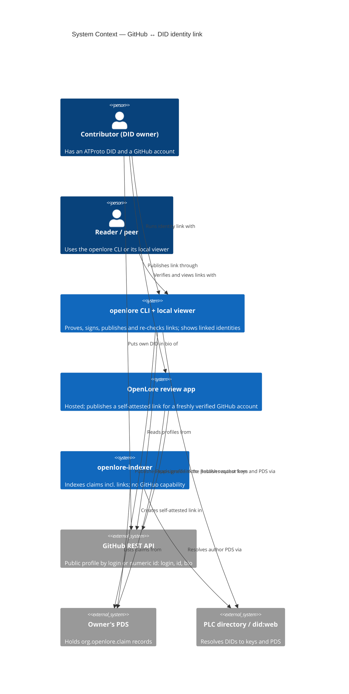

# Architecture Design: github-did-identity-link

DESIGN 2026-10-14 · Morgan · propose mode · ADR-084 + ADR-085 (Accepted 2026-10-14, user
approved as proposed). Decisions and options: `wave-decisions.md`. Paths are relative to
`/Users/jeffbailey/Projects/foss/leading/openlore/`.

Revised by ADR-086/087 (owner-only-signing): a verified link is also the proof of signing
authority over `github:` subjects; see the revision notes in the sections below.

## C4 — System Context (L1)

## C4 — Container (L2)

```mermaid
C4Container
  title Containers — identity link (EXTEND / NEW / UNCHANGED)
  Person(owner, "Contributor (DID owner)")
  Person(reader, "Reader / peer")
  System_Boundary(ws, "OpenLore Rust workspace") {
    Container(cli, "cli (root 1)", "Rust, clap", "EXTEND: identity link/verify/list/forget; person-view line")
    Container(hv, "adapter-http-viewer", "Rust, hyper", "UNCHANGED: /score calls scoring::score")
    Container(vd, "viewer-domain", "pure Rust", "UNCHANGED (linked-identity line = later slice)")
    Container(rapp, "openlore-review-app (root 3)", "Rust, hyper", "EXTEND: Publish/Retract this link")
    Container(idx, "openlore-indexer (root 2)", "Rust", "UNCHANGED: links are ordinary claims")
    Container(cd, "claim-domain", "pure Rust", "NEW module identity_link: matcher, check_link, codec, project, link_view")
    Container(rd, "review-domain", "pure Rust", "EXTEND: prove_ownership delegates; PlanKind::IdentityLink")
    Container(sd, "scraper-domain", "pure Rust", "EXTEND: person view consumes link_view")
    Container(sc, "scoring", "pure Rust", "EXTEND: score drops sameAs claims")
    Container(pt, "ports", "Rust traits", "NEW check Read/Write/Purge ports; EXTEND GithubPort::read_person_by_id")
    Container(gh, "adapter-github", "Rust, reqwest", "EXTEND: GET /user/{id}")
    Container(dk, "adapter-duckdb", "Rust, duckdb", "EXTEND: v7 identity_link_checks, check + purge adapters")
    Container(did, "adapter-atproto-did", "Rust", "UNCHANGED: DID resolution")
    Container(pdsA, "adapter-atproto-pds", "Rust", "UNCHANGED: single publish path")
    Container(oa, "adapter-atproto-oauth", "Rust, atrium-oauth", "UNCHANGED: create-only writes")
    ContainerDb(db, "openlore.duckdb", "DuckDB", "claims, peer_claims, contribution_links, identity_link_checks")
  }
  System_Ext(github, "GitHub REST API")
  System_Ext(pds, "Owner's PDS")
  System_Ext(plc, "PLC directory / did:web")
  Rel(owner, cli, "Runs identity link github <login> on")
  Rel(owner, rapp, "Presses Publish this link in")
  Rel(reader, cli, "Runs identity verify and list on")
  Rel(reader, hv, "Browses scores in")
  Rel(cli, cd, "Proves, encodes and projects links with")
  Rel(cli, sd, "Renders person view through")
  Rel(cli, sc, "Scores claims with")
  Rel(cli, hv, "Serves the local viewer through")
  Rel(hv, vd, "Renders pages with")
  Rel(hv, sc, "Scores claims with")
  Rel(cli, pt, "Holds narrowest port handles from")
  Rel(cli, gh, "Reads profiles through")
  Rel(cli, dk, "Reads, records and purges checks through")
  Rel(cli, did, "Resolves author keys through")
  Rel(cli, pdsA, "Publishes link through")
  Rel(rapp, rd, "Builds link plan with")
  Rel(rd, cd, "Delegates bio matching to")
  Rel(sd, cd, "Projects links with")
  Rel(rapp, gh, "Reads profile in the request through")
  Rel(rapp, oa, "Creates self-attested link through")
  Rel(gh, github, "GET /users/{u} and /user/{id} on")
  Rel(dk, db, "Inserts checks into")
  Rel(did, plc, "Resolves DID documents from")
  Rel(pdsA, pds, "createRecord on")
  Rel(oa, pds, "createRecord on")
  Rel(idx, pds, "Lists claims from")
```

L3 is not drawn: the new pure module has fewer than 5 components; its functions are listed below.

## Component boundaries

| Component | Path | Change | Responsibility | Contract shape (principle 12) |
|---|---|---|---|---|
| `identity_link` module | `crates/claim-domain/src/identity_link.rs` | NEW module | Hoisted DID-token matcher; `GithubObservation`; `check_link → ProofCheck` (algorithm ADR-085 §4); `ProvenLink` (only from a passing check on a fresh read); `LinkDraft → UnsignedClaim`; `project(&claim, &Provenance) → Option<IdentityLink>`; `link_view(links, lineages, checks) → Vec<LinkedIdentity>` with the association rule (ADR-085 §5) | Pure, return-only |
| Scorer | `crates/scoring/src/score.rs` | EXTEND | Drop every `sameAs` claim before grouping | **Unbounded preservation**: universe = every feed `F`; `score(F) == score(F \ sameAs rows)`; no other row altered. Asserted by a property test |
| Ownership proof | `crates/review-domain/src/ownership.rs` | EXTEND (delegate) | Keeps `prove_ownership`/`OwnershipRefusal`/`VerifiedOwnership`; matching delegates to `claim-domain` | Pure; existing proptests unchanged |
| Link publish plan | `crates/review-domain/src/plans.rs` | EXTEND | `PlanKind::IdentityLink` built from the request's own fresh proof; preview = exact record; executed once, read back, CID-verified | Plan-value |
| Check ports | `crates/ports` | NEW traits | `IdentityLinkCheckReadPort::latest_checks`; `IdentityLinkCheckWritePort::record_check` (insert only); `IdentityLinkCheckPurgePort::purge_subject` | Read: pure read. Write: bounded change = one insert into `identity_link_checks`. Purge: bounded change = rows of one `subject_did` |
| `GithubPort::read_person_by_id` | `crates/ports/src/lib.rs`, `crates/adapter-github` | EXTEND | One `GET /user/{id}`; same `PersonProfile`; 404 → `NotFound` | Read-only |
| Check adapters + `schema_v7` | `crates/adapter-duckdb` (`identity_link_checks.rs`, `identity_link_purge.rs`) | EXTEND | Forward-only idempotent migration; insert-only writes; latest via `max(checked_at)` read; DELETE only in the purge file; live probe | Bounded change |
| `identity` verbs | `crates/cli/src/verbs/identity.rs` + clap | NEW verb file | `link` (plan-returning preview; on confirm: one check row + sign + single publish path), `verify`, `list` (offline), `forget --did` | Imperative shell; per-verb handles in ADR-085 §7 |
| Person view / infer people | `crates/cli/src/render/people.rs`, `verbs/infer_people.rs`, `verbs/scrape_github.rs` | EXTEND | Linked-identity / assertion lines; `scrape github <user>` records a check only for already-published links of that login, from the profile it already reads | Shell + pure render |
| GitHub step | `crates/openlore-review-app/src/routes/github.rs`, `review-domain/src/views/github.rs` | EXTEND | "Publish this link" (opt-in; fresh read in the request) and "Retract this link"; a "proof gone — retract?" notice when re-verify fails | Shell + pure view |
| Reserved-predicate guard | shared compose path (`crates/cli/src/verbs/claim_add.rs` `build_unsigned_claim`, review-domain plans) calling `claim_domain::identity_link::is_reserved_predicate` | EXTEND | `claim add`, `claim counter`, `scrape --sign`, `infer people --sign`, review-app suggestion publish refuse predicate `sameAs` and point to `identity link` | Pure guard |
| `xtask check-arch` | `xtask/src/check_arch.rs` | EXTEND | `identity_link_checks_insert_only`, `identity_link_purge_only_in_forget_verb`, `identity_link_readers_hold_no_write_handle`, `identity_link_compose_only_via_proven_link` | — |
| `FakeGithub` + fixtures | `crates/test-support` (`fixtures/github/users_profile.json`, `user_by_id.json`) | EXTEND | Id lookup + lie catalogue (ADR-085 Earned Trust) | Test-only |

Revised by ADR-086/087 (owner-only-signing): `link_view` feeds the display association; a separate
pure `claim-domain::authority` module uses each DID's own `Verified` check (even when the id is
Contested) as the proof of signing authority over `github:<login>` and owned repos. The scorer
row's `sameAs` drop moves into `score_attested` via `authority::kind` (same outcome).

## Driving ports

- `openlore identity link github <login> [--yes]` — NEW. Fresh `GET /users/{login}`; refuses
  unless the bio names the user's own DID (exact token); without confirmation it only renders the
  plan (public record; retraction withdraws but does not erase; I-7 line via the shared preview)
  and writes nothing; on confirm records one check, signs and publishes through the single publish
  path, prints the CID and the retract command (I-8).
- `openlore identity verify [--did <did> | --github <login>]` — NEW. Re-checks Active links in the
  local store (own and peer) with ≤ 2 requests each; records checks; never signs.
- `openlore identity list [--did <did>]` — NEW. Offline render of `link_view`.
- `openlore identity forget --did <did>` — NEW. Deletes that DID's local check history only.
- `openlore claim retract <cid>` — REUSED unchanged for unlinking.
- `openlore infer people`, `openlore scrape github <user>` — EXTENDED render (+ check refresh on
  `scrape github <user>`).
- Review app `POST /github/link/publish`, `POST /github/link/retract` (names indicative) — behind
  the existing session, CSRF and per-DID publish budget (ADR-076).
- Revised by ADR-086/087 (owner-only-signing): `openlore authority verify` (owner-only-signing)
  re-checks links plus repo authority; `identity verify` is unchanged. Per-verb capabilities gain
  rows for the gated composers (ADR-085 §7).

## Driven ports

- `GithubPort::read_person` (REUSED) and `read_person_by_id` (NEW) → `adapter-github`.
- `IdentityLinkCheckReadPort` / `WritePort` / `PurgePort` (NEW) → `adapter-duckdb`.
- `StoragePort` claims by subject/contributor + `write_signed_claim` (REUSED) → `adapter-duckdb`.
- `IdentityPort::sign`, `ClockPort::now_utc`, single publish path (REUSED).
- Review app: `UserRepoWritePort` create-only, `GithubLinkPort` (REUSED).

## Data model (local, v7)

`identity_link_checks` — insert-only:
`subject_did VARCHAR NOT NULL`, `github_user_id UBIGINT NOT NULL`, `login_seen VARCHAR NOT NULL`,
`verdict VARCHAR NOT NULL CHECK (verdict IN ('verified','did_missing','different_did','no_bio','account_not_found'))`,
`checked_at TIMESTAMP NOT NULL`, `check_id BIGINT PRIMARY KEY` (DuckDB sequence), index on
(`subject_did`, `github_user_id`). Latest per (`subject_did`, `github_user_id`) = max
`checked_at`, then max `check_id` (read query).
Rate-limited / unavailable reads write no row. No `UPDATE`; `DELETE` only in
`identity_link_purge.rs` (whole `subject_did`). Labels use the ADR-076 spelling.

Revised by ADR-086/087 (owner-only-signing): owner-only-signing adds migration v8
(`repo_authority_checks`, `imported_candidates`); DELIVER may fold v7 and v8 into one migration if
they ship together.

## Reuse Analysis (HARD GATE)

| Existing component | File | Overlap | Decision | Contract shape / universe / assertion |
|---|---|---|---|---|
| `did_tokens`, `ownership_verdict`, `prove_ownership` | `crates/review-domain/src/ownership.rs` | The exact bio proof | **EXTEND (hoist matcher to `claim-domain`, delegate)** | Pure; universe = (bio, DID); existing proptests + new equivalence property |
| `GithubLinkPort::record_verified_link` / `github_links` | `crates/ports/src/review.rs`, `crates/adapter-review-store/src/github_links.rs` | Private verified link per DID | **REUSE unchanged** — UI state only; never the proof for publishing | Bounded change, owner-scoped |
| `GithubPort::read_person` / `PersonProfile.id` | `crates/ports/src/lib.rs`, `crates/ports/src/github.rs` | Profile + numeric id + bio | **REUSE unchanged** | Read-only |
| `GithubPort` id lookup | same | — | **EXTEND** (`read_person_by_id`) — *challenged*: login reads cannot tell a rename from a re-registration | Read-only |
| `PublishPlan` / `RetractPlan` | `crates/review-domain/src/plans.rs` | Self-attested create/retract | **EXTEND** (`PlanKind::IdentityLink`) | Plan-value |
| `is_self_retracted`, `is_superseded_by_author` | `crates/claim-domain/src/retraction.rs` | Link lifecycle | **REUSE unchanged** | Pure |
| ADR-071 provenance verdict | `crates/claim-domain/src/provenance.rs` | DID side of the proof | **REUSE unchanged** (input to `project`) | Pure |
| `possible_renames` / contribution links `github_user_id` | `crates/scraper-domain`, `crates/ports/src/contribution_link.rs` | Id-based rename display | **REUSE unchanged** | Pure / read-only |
| `scoring::score` | `crates/scoring/src/score.rs` | Aggregation | **EXTEND** (drop `sameAs`) | Unbounded preservation (above) |
| Shared sign batch / single publish path | `crates/cli/src/verbs/sign_batch.rs`, `claim_publish.rs` | Compose → preview → sign → publish | **REUSE** | Shell |
| `claim retract` | `crates/cli/src/verbs/claim_retract.rs` | Unlink | **REUSE unchanged** | Shell |
| `IndexPurgePort` pattern | ADR-082, `adapter-index-store/src/purge.rs` | Separate purge capability | **REUSE pattern** | — |
| Check ports | `crates/ports` | — | **CREATE NEW** — *challenged*: `ContributionLinkPort` is per (repo, person) snapshot; `GithubLinkPort` lives in another root's DB. No existing port stores per-(DID, id) observations. | See above |
| `identity.rs` verb file | `crates/cli/src/verbs/` | — | **CREATE NEW** — *challenged*: `claim add --predicate sameAs` cannot enforce proof-before-compose. One file per verb is the house pattern. | Shell |

**Verdict**: 0 new crates; CREATE NEW = check port traits + one verb file, both challenged; the
rest EXTEND/REUSE.

## Quality attributes (priority order)

1. **Security / privacy (consent)** — C-GDL-1/2/6/9; association only after your own check
   (GDL-D14); squatting cannot hijack or grief; local erasure via `identity forget`.
2. **Integrity** — CID path unchanged; one pure projection rule with provenance as input; checks
   never federated.
3. **Maintainability / testability** — one pure module, thin shells, three-layer enforcement.
4. **Reliability** — a GitHub outage or rate limit records nothing and changes no state; offline
   verbs work; probe failures follow the ADR-085 Earned Trust table.
5. **Performance / cost** — ≤ 2 GitHub requests per check (1 in the common case); 0 extra on
   `scrape github <user>`; review-app verify budget (20/hour/DID) unchanged.
6. **Observability** — CLI prints verdict labels; review app adds aggregate counters
   `github.link.publish.ok|refused` only (ADR-074), no DIDs or bios in logs.
