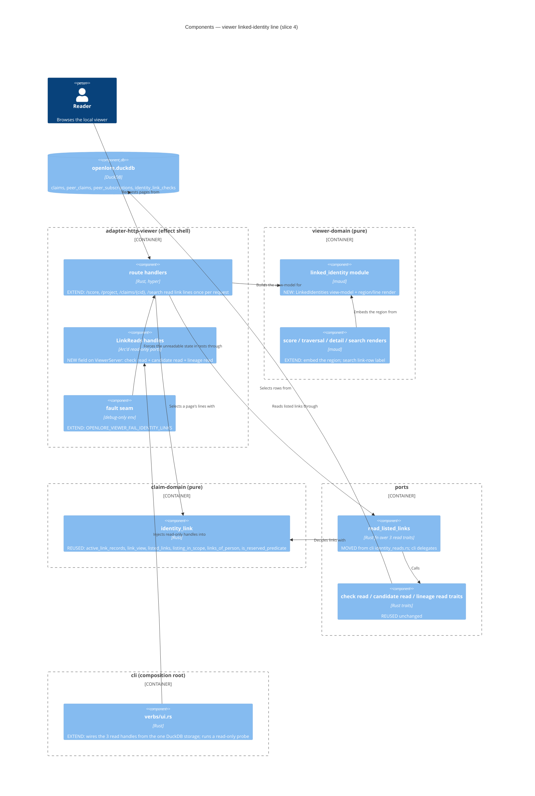

# Slice 4 Design Addendum: the viewer's linked-identity line

DESIGN 2026-10-19 · Morgan · propose mode · no new ADR (see D-VL-9). Decisions: `wave-decisions.md`
§ "Slice 4". Paths are relative to `/Users/jeffbailey/Projects/foss/leading/openlore/`.

## Prior-wave reading

| | Artifact | Used for |
|---|---|---|
| ✓ | `design/architecture-design.md`, `design/wave-decisions.md`, `design/upstream-changes.md` | Slice 4 was deferred ("viewer-domain UNCHANGED, line = later slice"); GDL-D8/D11/D14, C-GDL-1..10 |
| ✓ | `distill/test-scenarios.md`, `deliver/upstream-issues.md` | IR-1..IR-20b wording and states; U-6 (person match), U-7 (search label scope), U-8 (re-check hint), U-9/U-13 (record IDs), U-19/U-20/U-48 (removed peers), U-39 (retraction shape) |
| ✓ | ADR-085 §5-§8 | §7 table already gives "viewer" the check **read** handle only; §8 search label |
| ✓ | `docs/product/architecture/brief.md` (GDL entry, For Acceptance Designer, For Software Crafter) | Component inventory, viewer capability boundary |
| ⊘ | DISCUSS artifacts | None exist for this feature (no `discuss/` mentions "identity link" or "sameAs"). Minimal stories below (US-VL-1..3), recorded as UC-11 in `upstream-changes.md` |
| ✓ | `crates/claim-domain/src/identity_link.rs` | `project`, `active_link_records`, `link_view`, `listing_in_scope`, `PersonKey`, `links_of_person`, `suggests_recheck` |
| ✓ | `crates/cli/src/render/identity.rs`, `verbs/identity_reads.rs`, `verbs/identity_list.rs` | The line wording; `read_listed_links` (the one lineage read) |
| ✓ | `crates/ports/src/identity_link_check.rs` | `IdentityLinkCheckReadPort`, `LinkCandidateReadPort`, `LinkLineageReadPort` |
| ✓ | `crates/viewer-domain/src/{score,traversal,detail,search}.rs`, `crates/adapter-http-viewer/src/lib.rs`, `crates/cli/src/verbs/ui.rs` | Pages, routes, wiring, fault-seam pattern (ADR-053/054) |

## Stories (no DISCUSS wave; minimal, for DISTILL)

- **US-VL-1** — As a reader browsing a contributor (a DID) in my local viewer, I see the GitHub
  account(s) that DID linked, with how I last checked each link, so I know who the contributor is
  on GitHub without asking GitHub.
- **US-VL-2** — As a reader on a GitHub person's page (`github:<login>`), I see the DID(s) that
  linked that account, and whether I verified it, so I can find their signed claims.
- **US-VL-3** — As a reader of network search results, I see each author's linked identity as I
  last checked it, and every link row says "authority not checked here", so the index never looks
  like a proof.

Shared AC: same words as `openlore identity list`; no GitHub request; nothing written; only
self-authored, active, non-removed links; contested and failed proofs are stated, never hidden.

## Scope

In scope (four pages, all existing GET routes; no new route):

| Page | Who the page is about | Lines shown | Match rule |
|---|---|---|---|
| `/score?contributor=<did>` | one DID | every line whose DID is the bare contributor DID | `RecheckScope::Person` via `listing_in_scope` (same as `identity list --did`) |
| `/project?subject=github:<login>` | one GitHub person | every line whose account belongs to the person | `PersonKey::of_person` with no contribution ids → last-seen login, case-insensitive (U-6 fallback) |
| `/claims/{cid}` (claim detail) | the claim's author | the author's lines, under the "Author" row | as `/score` |
| `/search` results | each author group | the group author's lines, under the group heading; plus the label "authority not checked here" on every link row | as `/score`; label selected by `is_reserved_predicate` (U-7: link rows only) |

Out of scope: table rows of `/claims`, `/peer-claims`, `/peers`, traversal edge rows and
contributor lists, `/philosophy`. Each DID there already links to `/score`, which carries the line
(D-VL-2). No new route (an `/identities` page is an open question). Traversal of `sameAs` edges
stays as is (U-16 ruling).

## The line: state → text

The text is the `identity list` line, character for character (D-VL-5). `<did>` and
`github:<login>` render as links (DID → `/score?contributor=<did>`, account →
`/project?subject=github:<login>`). `<login>` is the last-seen login (rename shown).

| State (from `link_view`) | Text |
|---|---|
| Associated (sole Verified DID), check ≤ 30 days | `<did> is github:<login> — verified <age>` |
| Associated, check > 30 days (U-8) | `<did> is github:<login> — verified <age>; re-check with openlore identity verify` (command in `<code>`; the CLI's backticks become the `<code>` element) |
| NotChecked (this reader never checked) | `<did> claims github:<login> — not checked` |
| ProofGone (latest check failed) | `<did> claims github:<login> — proof gone (<verdict>), checked <age>`; `<verdict>` ∈ `did_missing`, `different_did`, `no_bio`, `account_not_found` |
| Contested (≥ 2 DIDs Verified for one account) | `github:<login> is contested — <did> claims it` (one line per DID) |
| Several records for one link (U-9) | the line above + ` (record <id>)` or ` (records <id>, <id>)`, ascending |
| Retracted or superseded by its author; retraction record (U-39) | no line |
| Author ≠ subject (third-party `sameAs`), flawed record | no line (not a link, C-GDL-1) |
| Link from a removed peer (U-19) | no line (hidden by the one candidate read) |
| Person has no link | no region at all (no empty heading) |
| Link reads failed or probe refused | the region shows only: `Linked identities could not be read from your local store.` |

`<age>` = `today`, `1 day ago`, `N days ago` (whole days, `check_age_days`).

Region layout: a heading "Linked identities", the lines as a list, and one legend line beneath:
`As you last checked them. The viewer never asks GitHub; re-check with openlore identity verify.`

## Data flow

```
GET page ─▶ adapter-http-viewer handler (effect shell)
   now = wall clock at the request edge (as the CLI's identity verbs)
   read  ─▶ ports::read_listed_links(check read, candidate read, lineage read, Everyone, now)
            = LinkCandidateReadPort::link_candidates(link_predicate())   [U-19 filter in SQL]
            + LinkLineageReadPort::referrers_of(cid) per candidate
            + IdentityLinkCheckReadPort::latest_checks(All, now)        [future checks ignored]
   pure  ─▶ claim_domain::identity_link: active_link_records (C-GDL-1, U-39, lifecycle)
            → link_view (association / contested / proof) → listed_links (record IDs)
            → listing_in_scope (DID) or links_of_person (GitHub person)
   map   ─▶ viewer-domain view-model LinkedIdentities { None | Lines(..) | Unreadable }
   render ─▶ viewer-domain pure maud fns (inside each page's results fragment)
```

Standings are decided over every active link before the page selects its lines, so a page never
changes a standing (the IR-18b rule). One read per request, only on the four pages.

## Component changes



| Component | Change | Responsibility | Contract shape |
|---|---|---|---|
| `ports::identity_link_check::read_listed_links` (+ the lineage fold it uses) | MOVE from `crates/cli/src/verbs/identity_reads.rs`; cli delegates, nothing copied. Returns a typed `LinkReadError` (NEW enum in `ports`, `thiserror`: `Checks(IdentityLinkCheckError)` / `Lineage(StorageError)`); `ports` gains no `anyhow`; cli converts with `?` into its `anyhow::Result` | The one read of active links, their records and this reader's checks | **Effect-read, bounded**: universe = 3 read-only traits (1 candidate query, 1 referrer query per candidate, 1 check query); no write handle; decisions stay in `claim-domain` |
| `viewer-domain` new module `linked_identity` | NEW module (no new crate) | `LinkedIdentities` ADT (`None` / `Lines` / `Unreadable`), the region and line renders, the fixed notice and legend constants | Pure, return-only |
| `viewer-domain` score, traversal, detail, search renders | EXTEND | Embed the region inside each results fragment (fragment = full-page parity); search adds the link-row label | Pure |
| `adapter-http-viewer` | EXTEND | Optional `LinkReads` (3 `Arc<dyn … + Send + Sync>` read handles) on `ViewerServer`; read once per request on the four pages; map read errors to `Unreadable`; debug-only fault seam | **Effect shell, read-only**: universe = the reads of `read_listed_links`; writes nothing; no network |
| `cli/src/verbs/ui.rs` | EXTEND | Build the 3 handles from the same `DuckDbStorageAdapter` (one connection); run the **read-only** startup probe (below); inject the handles only if it passes | Composition root |
| `xtask check-arch` | EXTEND | `identity_link_readers_hold_no_write_handle` also covers `crates/adapter-http-viewer/src/**`; the new seam token joins `VIEWER_FAIL_SEAM` guarded tokens | — |

## What stays unchanged

No new crate, no Lexicon change, no migration, no new port trait, no new route. `claim-domain`
rules, the U-19 candidate SQL, `scoring::score` (links still dropped, KPI-GDL-2), the indexer, the
review app, the CLI's output. The viewer still holds no signing key, no check write or purge
handle, and its `GithubPort` stays used by `POST /scrape` only. `viewer-domain` gains no new crate
edge (it already depends on `ports` and `claim-domain`); `chrono` (MIT/Apache-2.0, already in the
workspace and used by `claim-domain`) moves from its dev-dependencies to dependencies if the render
names `DateTime<Utc>`. The view-model takes `now` as a value; `viewer-domain` reads no clock.

## Degraded behaviour (Earned Trust)

| Dependency | What can lie or fail | Behaviour |
|---|---|---|
| Check table, candidate and lineage reads | Missing or unreadable (old store, file lock lost) | Startup: the viewer does **not** call `IdentityLinkCheckReadPort::probe()`, because that probe inserts two checks in a rolled-back transaction and the viewer writes nothing (NFR-VIEW-1). Instead `ui.rs` runs a **read-only probe**: one `read_listed_links(…, Everyone, now)` call, which exercises all three reads. Pass → inject the handles. Refuse → do **not** refuse the viewer (links are a secondary view, ADR-054 precedent); emit `viewer.identity_links.probe {refused: true}`; inject no handles. The insert-only write behaviour stays proven where writes happen (CLI verbs, ADR-085 Earned Trust) |
| No handles injected (probe refused) | — | On all four pages the region renders `Unreadable`, **whether or not the person has links** (the viewer cannot know). VL-12's "no region" applies only when reads succeed |
| Any of the 3 reads per request | Error | Whole region `Unreadable`. Never partial lines: a failed check read must not turn verified links into "not checked" |
| Clock | Checks dated in the future | Ignored by `latest_checks` and `link_view` (Q-RM-3) |
| GitHub | — | Never asked. The page renders the same with GitHub unreachable |
| Page reads (store) | The page's own data fails | Unchanged existing behaviour; the link region is independent |

Status 200 in every case; no error text, path or SQL reaches the page.

**Known limit (GitHub person pages, D-VL-6).** The page matches a link by its last-seen login.
If the linked account renamed and another account took the old login, the page for that login
still shows the first account's DID line until the reader re-checks (`identity verify` reads by
id and moves the line to the new login). The CLI person views share this limit (U-6 fallback).
The line states the account the reader last checked, under the login last seen on that check. It
says nothing about who uses that login now. VL-17 pins this.

**Cost per request.** 1 candidate query + 1 referrer query per `sameAs` candidate + 1 check
query, on the four pages only. Expected local stores hold tens of links; at that size the read
adds well under the existing page reads. If a store exceeds ~200 candidates, a batched referrer
read (one query) is the follow-up; no cache (a cache could show a stale standing).

## Accessibility

- The region is a `<section>` labelled by its "Linked identities" heading; lines are a `<ul>`.
- State is in words ("verified", "not checked", "proof gone", "contested"), never colour alone.
- DID and account are real links with their text as the accessible name.
- The age is text; a `<time datetime>` carries the check instant for assistive tools.
- No JavaScript needed; the region is inside the htmx results fragment, so a swap updates it.

## Acceptance scenarios for DISTILL

Driving port: the real `openlore ui` viewer over a real DuckDB store, seeded through the CLI verbs
and `given_a_check_recorded_seeing`; `FakeGithubAccounts` only to prove it is never asked.

| ID | Outcome title |
|---|---|
| VL-1 | Rachel's contributor page shows her GitHub account as verified (walking skeleton for slice 4) |
| VL-2 | Every link state reads in the viewer exactly as `identity list` prints it (rows: verified today, verified 31 days ago with re-check hint, not checked, proof gone × 4 verdicts, contested, two records) |
| VL-3 | A GitHub person's page shows the DID that linked the account, matched by login in any case, and under its new name after a rename |
| VL-4 | A contested account reads contested on each DID's page and on the GitHub person's page; no page says "is" |
| VL-5 | A stranger's `sameAs` about Rachel never shows as her linked identity on any page |
| VL-6 | A retracted or superseded link, and the retraction record itself, never show |
| VL-7 | A link from a peer Jeff removed does not show; it shows again once he follows the peer again |
| VL-8 | Showing linked identities asks GitHub nothing and records no check |
| VL-9 | When the link store cannot be read, the page still loads and says so, never "not checked" |
| VL-10 | A claim's detail page shows its author's linked identity |
| VL-11 | Search shows each author's linked identity from the local graph, and labels link rows "authority not checked here" |
| VL-12 | A contributor with no link shows no linked-identities region |
| VL-13 | The htmx results swap and the full page carry the same lines |
| VL-14 | When the startup link probe is refused, the viewer still serves and every one of the four pages says linked identities could not be read, even for a person with no link |
| VL-15 | A check dated in the future is ignored; the line reads from the latest real check |
| VL-16 | With GitHub unreachable the lines read exactly as with GitHub up |
| VL-17 | After a rename and reuse of the old login, the old login's page shows the first DID's line as last checked; after `identity verify` it moves to the new login's page |
| VL-18 | A contested account whose checks are over 30 days old reads contested with no re-check hint (U-8: verified lines only) |
| VL-19 | `/search` with no index configured shows its unavailable notice and no linked-identity region |

VL-9 rows: check read fails; candidate read fails; lineage read fails (one debug-only fault seam
per read, or one seam with a target value; the release-build guard covers it).

Parity property (D-VL-5): one property over generated `ListedLink`s asserts the viewer region's
text equals the CLI line (`render_linked_identities`) with backticks removed. Home: the `cli`
crate's tests, which can reach both renders (`cli` does not depend on `viewer-domain`; it reaches the viewer render through `adapter-http-viewer` or a `viewer-domain` dev-dependency, chosen in DELIVER, see distill D-VL-T11); owned by
the acceptance designer. Inside `viewer-domain`: `Unreadable` renders the notice and no line.

Viewer-only wording (not CLI parity; `viewer-domain` constants, open question 3 for the user):
the legend `As you last checked them. The viewer never asks GitHub; re-check with openlore identity
verify.`, the notice `Linked identities could not be read from your local store.`, and the heading
`Linked identities`.

## Handoff notes

- Development paradigm: functional (ADR-007), `@nw-functional-software-crafter`.
- External integrations: none new. The viewer adds no network call; no contract test needed.
- Enforcement: the extended `identity_link_readers_hold_no_write_handle` rule; the existing
  `viewer_holds_no_signing_surface` and `identity_link_compose_only_via_proven_link` rules (the
  viewer selects link rows only through `is_reserved_predicate`, never the literal).
