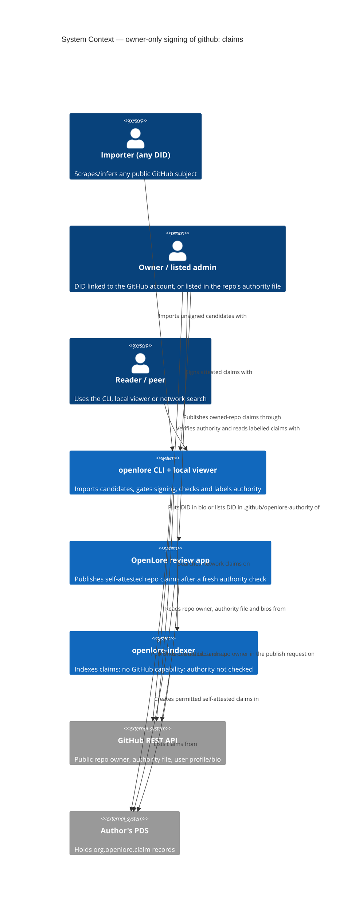
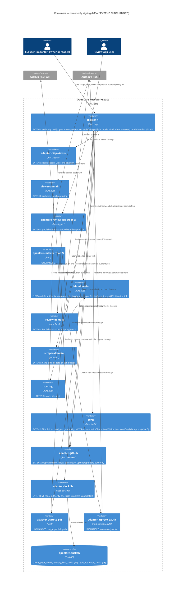

# Architecture Design: owner-only-signing

DESIGN 2026-10-14 · Morgan · propose mode · ADR-086 + ADR-087 (Accepted 2026-10-14, user
approved as proposed). Decisions and options: `wave-decisions.md`. Prior-wave changes: `upstream-changes.md`.
Builds on github-did-identity-link (GDL, ADR-084/085). Paths are relative to
`/Users/jeffbailey/Projects/foss/leading/openlore/`.

## C4 — System Context (L1)

## C4 — Container (L2)

L3 is not drawn: the new pure module has four public functions and two types (below).

## Authority model (pure, `claim-domain::authority`)

- `kind(claim) → Assertion | Retraction | Counter | IdentityLink` (non-weight kinds: the last
  three; ADR-086 §2). Non-weight kinds need no authority **and never count in scoring**, so a
  spoofed `counters` reference only turns a claim into a displayed dispute.
- `requirement(claim) → Exempt(NotGithubSubject | NonWeightKind) | Required(Person { login } |
  Repo { owner, name })`.
- `classify(claim, provenance, link_view, repo_observation) → Authority`:
  `Attested(Owner { github_id, checked_at } | RepoListed { checked_at })` (private fields; built
  only here),
  `Unattested(NoLink | LinkNotVerified | LoginNotCurrent | NotRepoOwner | OrgOwnedNotListed |
  NotListed | FileInvalid | RepoNotFound)`, `NotChecked`. Rules: ADR-087 §1-3.
- `may_sign(draft, signer_did, evidence, now, window) → Result<SigningPermit, SigningRefusal>`:
  permit iff `requirement` is `Exempt`, or `classify` is `Attested` with `checked_at ≥ now − window` (default 7 days),
  where `checked_at` is the **older** of the checks used (link check and, for repos, the repo
  observation); a check dated in the future counts as missing.
  `SigningRefusal` carries the reason, the check age, who can sign (owner login / "a DID listed in
  `.github/openlore-authority`") and the next command.
- Reader label set (one spelling everywhere): `owner`, `repo-listed`, `third-party`,
  `authority not checked` (+ `here` on index rows), each with the check age.

## Component boundaries

| Component | Path | Change | Responsibility | Contract shape (principle 12) |
|---|---|---|---|---|
| `authority` module | `crates/claim-domain/src/authority.rs` | NEW | Model above; `SigningPermit` private fields | Pure, return-only |
| `sign_permitted` helper | NEW in `crates/cli/src/verbs/` (e.g. `sign_permitted.rs`), called from `claim_add.rs`, `claim_counter.rs`, `claim_retract.rs`, `sign_batch.rs` | NEW (replaces the four inline `IdentityPort::sign` calls; `philosophy_add.rs` keeps its own, allowlisted) | Sign only a `SigningPermit`; refusals render the hand-off | Shell; bounded change = {one signed artifact file + one `claims` row} per permit |
| Single publish path | `crates/cli/src/verbs/claim_publish.rs` `publish_signed_claim` | EXTEND | Takes `&SigningPermit`; `claim publish <cid>` gets one from `may_sign` over the stored claim when `published_at IS NULL` (an already-published claim re-publishes idempotently with an exempt permit) | Shell; bounded change = {one PDS `createRecord` for that CID + `record_publication` on that row}; reads checks only |
| `authority verify` verb | `crates/cli/src/verbs/authority_verify.rs` | NEW | Re-check authority for local `github:` claims (own + peers), recording identity-link and repo checks; never signs | Bounded change: inserts into `identity_link_checks`, `repo_authority_checks` only |
| Scrape / infer views | `scrape_github.rs`, `scrape_person.rs`, `infer_people.rs`, `render/*` | EXTEND | Record one repo observation per scraped repo (scrape only); per-subject "can sign / can be signed by" line; gate `--sign` | Shell + pure render; bounded change (scrape) = existing contribution-link upserts + one insert into `repo_authority_checks` per scraped repo (+ GDL link-check refresh for `scrape github <user>`); `infer people` without `--sign` writes nothing |
| Review-app share draft | `crates/review-domain/src/share.rs` | EXTEND | Quote only the owner's `Attested` claims; list others as "not counted: authority not proven" | Pure |
| `graph query` / viewer | `graph_query.rs`, `adapter-http-viewer`, `viewer-domain` | EXTEND | Authority labels; `score_attested`; `--include-unattested` | Read-only (check read port only) |
| `search` render | `crates/cli/src/verbs/search.rs` | EXTEND | "authority not checked here" on `github:` assertion rows; local label when a local check exists | Read-only |
| Scorer + feed | `crates/scoring/src/score.rs`; `ports::AttributedClaim` + `adapter-duckdb/src/graph_query.rs` | EXTEND | `score_attested(feed, view)`; the feed gains each claim's reference types (from `claim_references` / `peer_claim_references`) so `kind` is computable | **Unbounded preservation**: ∀F, V: `score_attested(F, V) == score({c ∈ F │ kind(c) = Assertion ∧ (subject ∉ github: ∨ attested(c, V))})`; no row altered. Properties over `kind`/`classify` (not only this definition) |
| `GithubPort::read_repo_authority` | `crates/ports/src/lib.rs`, `crates/adapter-github` | EXTEND | Exactly 2 GETs (`/repos` + contents, always); NEW redirect policy: ≤ 1 redirect, same host only (today `build_client()` follows any) | Read-only |
| Repo authority ports | `crates/ports` | NEW | `RepoAuthorityCheckReadPort::latest(subjects)`, `RepoAuthorityCheckWritePort::record(observation)` (insert only) | Read: pure read. Write: bounded change = one insert |
| v8 adapters | `crates/adapter-duckdb/src/{schema_v8,repo_authority_checks}.rs` | EXTEND | Forward-only idempotent migration; insert-only; latest via read query; live probe | Bounded change |
| Review-app publish | `crates/openlore-review-app/src/routes/{publish,review}.rs` (extends `owner_can_publish`, which checks `link_verified` today), `executor.rs`, `review-domain/src/plans.rs` | EXTEND | Fresh bio read + `read_repo_authority` in the request; `PublishPlan` execution needs a permit; refusal page with hand-off. Org repos are not reachable here in v1 (scan = owned repos) | Plan-value; preview writes nothing |
| `xtask check-arch` | `xtask/src/check_arch.rs` | EXTEND | `sign_only_with_permit` (`IdentityPort::sign` only in `sign_permitted` + allowlisted `philosophy_add.rs`; `publish_signed_claim` / `PublishPlan` execution take a permit), `authority_evidence_only_from_adapters` (observation/evidence constructors only in `adapter-duckdb`, `adapter-github`, `test-support`), `repo_authority_checks_insert_only`, `authority_readers_hold_no_write_handle`, `scoring_callers_use_score_attested` | — |
| Imported candidates (slice 5) | `adapter-duckdb` `imported_candidates`, `crates/cli/src/verbs/candidates.rs` | NEW (optional) | Insert-only local record of imported candidates; offline list | Write: bounded change = inserts on import; never read by scoring/inference (structural rule `imported_candidates_not_in_scoring_or_inference`) |
| `FakeGithub` + fixtures | `crates/test-support` | EXTEND | Repo owner/redirect/contents fixtures + lie catalogue (ADR-087) | Test-only |

## Per-verb capabilities (composition root injects the narrowest handle)

| Verb / handler | Identity-link check read | Repo-authority read | Repo-authority write | Link-check write | Sign + publish | `GithubPort` |
|---|---|---|---|---|---|---|
| `graph query`, viewer, `search`, `infer people` (no `--sign`), `candidates list` | ✓ | ✓ | — | — | — | — |
| `claim add`, `infer people --sign`, `claim publish` | ✓ | ✓ | — | — | ✓ (with permit) | — |
| `claim counter`, `claim retract` | — | — | — | — | ✓ (exempt permit) | — |
| `scrape github <owner/repo>` / `scrape person` (no `--sign`) | ✓ | ✓ | ✓ | — | — | ✓ |
| `scrape github <owner/repo>` / `scrape person` `--sign` | ✓ | ✓ | ✓ | ✓ (the signer's own link only, refreshed before gating) | ✓ (with permit) | ✓ |
| `scrape github <user>` (person view) | ✓ | ✓ | — | ✓ (retained from ADR-085 §7: published links of that login) | — | ✓ |
| `authority verify` | ✓ | ✓ | ✓ | ✓ | — | ✓ |
| review-app publish | — (no CLI store) | — | — | — | create-only `UserRepoWritePort` with permit | ✓ |

## Flows

- **Non-owner imports and tries to sign** (`scrape github acme/tool --sign 1`): harvest + one
  `read_repo_authority` → observation recorded → `classify` = `Unattested(OrgOwnedNotListed)` →
  candidates listed, `--sign` refused per candidate: "github:acme/tool is owned by the organization
  acme; your DID is not in .github/openlore-authority. Can be signed by a DID listed there. To hand
  off: an admin adds the DID, or runs `openlore scrape github acme/tool --sign N`." Nothing signed.
- **Owner signs offline** (`claim add --subject github:me/tool …` with network disabled): latest
  checks show `Owner`, 2 days old → permit → sign, no network used. With a 9-day-old or missing
  check → refused: "re-check with `openlore authority verify --subject github:me/tool`" (the
  proposed I-9 exception, ADR-086 §5).
- **Spoofed dispute** (a foreign client writes a `github:acme/tool embodiesPhilosophy X` claim with
  a `counters` reference): `kind = Counter` → shown as a dispute, never weighted.
- **Observation order** (owner verifies, a listed DID verifies, owner verifies again): every
  observation reads the file, so the listed DID stays `repo-listed` throughout.
- **Person** (`infer people --person github:alice --sign 1` by Bob): `Unattested(NoLink)` → refused,
  candidates still shown; Alice (linked, verified) signs her own.
- **Reader** (`graph query --subject github:acme/tool --weighted`): attested claims counted;
  footer "3 claims not counted: 2 third-party, 1 authority not checked — `openlore authority
  verify --subject github:acme/tool`"; `--include-unattested` adds a per-author section.
- **Review app publish**: in the request, read bio (ADR-076 matcher) and `read_repo_authority`;
  owner id must equal the session's verified GitHub id or the DID must be listed; otherwise the
  refusal page; the plan is not executed and stays reviewable.

## Data model (local, v8)

`repo_authority_checks` — insert-only: `check_id BIGINT PRIMARY KEY` (sequence), `subject_key
VARCHAR NOT NULL` (case-folded `github:o/r` as asked), `outcome VARCHAR NOT NULL CHECK (outcome IN
('found','repo_not_found'))`, `repo_id UBIGINT`, `full_name_seen VARCHAR`, `owner_id UBIGINT`,
`owner_type VARCHAR CHECK (owner_type IN ('user','organization'))`, `authority_file VARCHAR CHECK (authority_file IN ('absent','present','invalid'))` for `outcome = 'found'` (always
read, so an observation is signer-independent) and `authority_file IS NULL` for `repo_not_found`
(no file read; a table CHECK ties the two), `authority_dids
VARCHAR[]` (exact tokens; empty unless present), `checked_at TIMESTAMP NOT NULL`; index on
`subject_key`. Latest = max `checked_at`, then max `check_id`. Rate-limited/unavailable reads write
nothing. No `UPDATE`, no `DELETE`.

`imported_candidates` (slice 5, optional) — insert-only: `import_id` sequence PK, `subject`,
`predicate`, `object`, `confidence_bp`, `evidence VARCHAR[]`, `signal`, `imported_at`. Never
federated; no signing column (signing still goes through the gate from a fresh derivation).

## Reuse Analysis (HARD GATE)

| Existing component | File | Overlap | Decision | Contract shape / universe / assertion |
|---|---|---|---|---|
| GDL `identity_link` (`check_link`, `project`, `link_view`, matcher) | `crates/claim-domain/src/identity_link.rs` (proposed) | Person and owner-tier proof | **REUSE** | Pure; property: person authority ⇒ a `verified` link to the subject's id |
| GDL `identity_link_checks` + read port | ADR-085 §7 | Link check state | **REUSE** | Read-only here; writes only via `authority verify` |
| `did_tokens` matcher | `review-domain/src/ownership.rs` → `claim-domain` (GDL) | Exact DID token in the authority file | **REUSE** | Pure; existing proptests |
| `GithubPort` `/repos` read inside `harvest_repo` | `crates/adapter-github/src/lib.rs` | Repo owner data | **EXTEND** (`read_repo_authority`) — *challenged*: `harvest_repo` returns signals only; widening it would couple the signal SSOT to authority | Read-only |
| `list_owned_repos` (`type=owner`) | `GithubPort` | Review app's scan scope | **REUSE unchanged** | — |
| Shared sign batch / single publish path | `sign_batch.rs`, `claim_publish.rs` | Compose → sign → publish | **EXTEND** (take a permit) | Shell |
| `PublishPlan` | `review-domain/src/plans.rs` | Self-attested publish | **EXTEND** (permit) | Plan-value |
| Retraction / counter rules | `claim-domain/src/retraction.rs`, `validate_counter_claim.rs` | Exemptions | **REUSE unchanged** | Pure |
| ADR-071 provenance verdict | `claim-domain/src/provenance.rs` | DID side | **REUSE** (input to `classify`) | Pure |
| `scoring::score` | `crates/scoring/src/score.rs` | Aggregation | **EXTEND** (`score_attested` wrapper) | Unbounded preservation |
| Insert-only check-store pattern | ADR-085 §7 | Observation storage | **REUSE pattern** | Bounded change |
| Repo-authority ports | `crates/ports` | — | **CREATE NEW** — *challenged*: GDL ports are keyed by (DID, GitHub user id); a repo observation is keyed by repo subject and carries owner + file data | See above |
| `authority verify` verb | `crates/cli/src/verbs/` | — | **CREATE NEW** — *challenged*: `identity verify` checks links only; folding repo checks into it would give an identity verb repo semantics | Shell |

**Verdict**: 0 new crates; CREATE NEW = two port traits + one verb (+ optional slice-5 table/verb),
all challenged; the rest REUSE/EXTEND.

## Quality attributes (priority order)

1. **Security / integrity** — C-OOS-1: one pure gate, type-enforced permit, structural rule, ATs
   over all composers; proofs public and re-checkable (C-OOS-3); squatting cannot create authority
   (person/owner tiers need a `verified` link; delegated tier needs push access).
2. **Honesty / transparency** — labels everywhere; skipped-claim footer; nothing hidden on the wire
   or deleted (C-OOS-5).
3. **Usability** — every refusal names who can sign and the next command; import never refused.
4. **Reliability** — GitHub outage/rate limit records nothing and changes no state; offline signing
   from fresh checks (I-9 with the accepted exception); signing gates fail closed on unknown state.
5. **Performance / cost** — 0 requests at offline sign. Scrape: harvest baseline ≈ 8 GETs per repo
   (`adapter-github/src/lib.rs` `harvest_repo`) + 2 for authority ≈ 10, so anonymous 60/hour ≈ 6
   repos/hour (≈ 7 before); `GITHUB_TOKEN` (5000/hour) recommended and surfaced in the refusal
   text. `authority verify`: 2 per repo subject + 1-2 per link check not yet done in the run
   (≈ 15-30 subjects/hour anonymous); `--sign` adds 1-2 for the signer's own link check per run.
   Review-app publish: +1 bio read per publish request + 2 per repo published (3 for one repo),
   inside the existing per-DID budget (ADR-076). Budget exhaustion mid-run: derived candidates still
   listed; unobserved repos refuse `--sign` with the reset time; nothing recorded for them.
6. **Maintainability / testability** — one pure module, thin shells, three-layer enforcement,
   recorded fixtures; existing ATs that sign `github:` subjects migrate to seeded-check fixtures
   (list in ADR-086 Consequences).
7. **Observability** — CLI prints reason labels and the rate budget through the existing
   `AuthReport` / `last_rate_budget` channel; local opt-in telemetry counter
   `claim.sign.refused.authority` (reason label only); review app aggregate counter
   `claim.publish.refused.authority` (no DIDs, no logins in logs, ADR-074).
