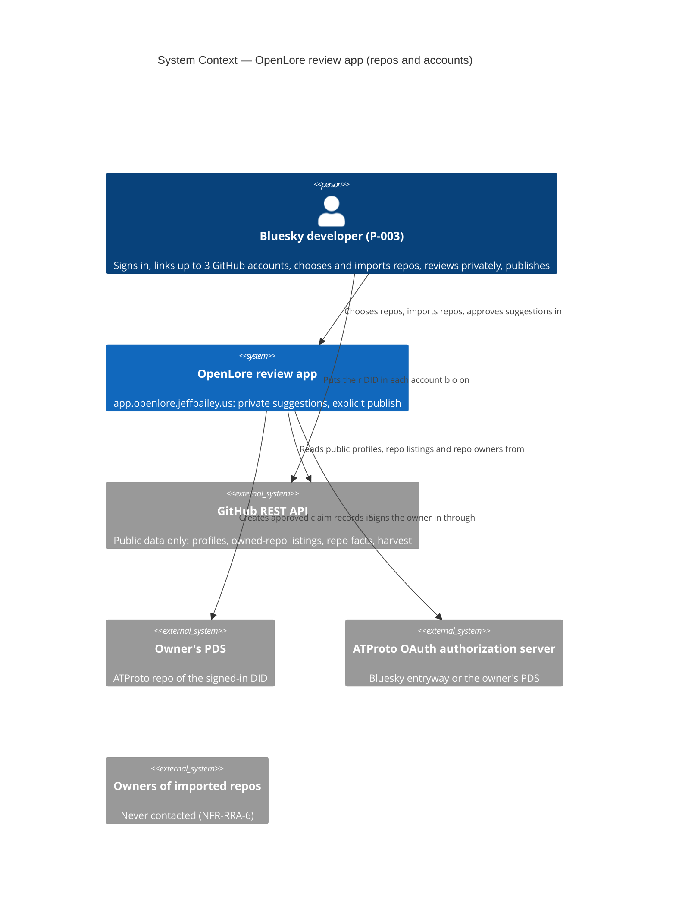
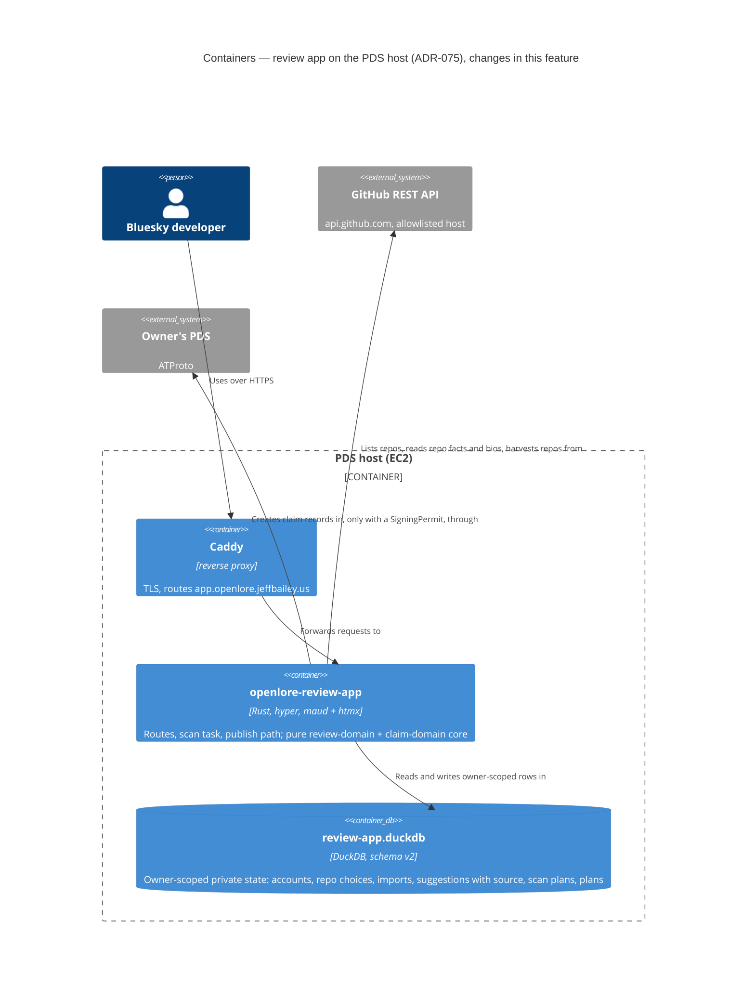
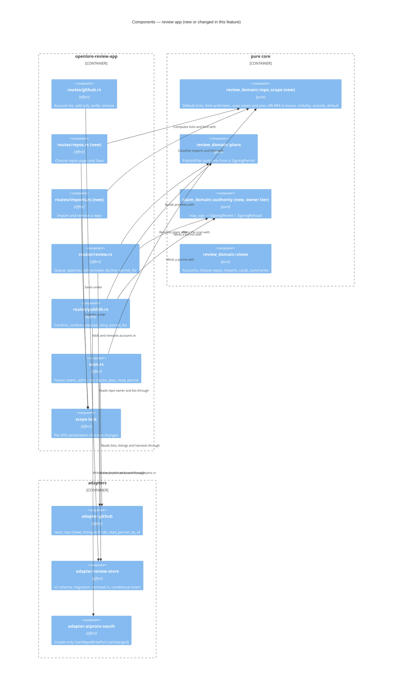

# Architecture Design: review-app-repos-and-accounts

- **Wave**: DESIGN, scope APPLICATION (component boundaries, store, ports). **Mode**: propose.
- **Architect**: Morgan (nw-solution-architect). **Date**: 2026-10-19. **Status**: proposed.
- **Inputs**: `../discuss/` (user-stories, wave-decisions D-RRA-1..17, outcome-kpis, journey),
  `docs/architecture/bluesky-claim-review-app/` (the shipped app's design),
  `docs/feature/owner-only-signing/design/` + ADR-086/087, github-did-identity-link A-4 /
  C-GDL-3 / C-GDL-10, and the code listed in `wave-decisions.md`.
- **ADRs**: ADR-088 (store v2, scan plan, removal), ADR-089 (publish permit, BR-RRA-1).

## 1. Summary

An in-place extension of the live review app. **Zero new crates, zero Lexicon change, no new
OAuth scope, no new external system.** One store migration (`review-app.duckdb` v1 → v2).

- The owner keeps up to 3 GitHub accounts, keyed by numeric GitHub id.
- Each account has a saved repo choice keyed by numeric repo id; without one, today's top 5 is
  ticked, limited by the room left under the one total limit of 10.
- The owner may import any public repo; its suggestions are private, carry "Not yours to
  publish", and offer Decline only.
- One scan (one admission) re-checks every account's bio, reads the frozen plan, and resumes
  that same plan after a GitHub pause.
- Every preview and confirm mints a `SigningPermit` from a fresh repo-owner read and a fresh bio
  read. A `PublishPlan` cannot be built without one. This is the BR-RRA-1 guarantee.

Style is unchanged: modular monolith, ports and adapters, functional core (ADR-007, ADR-009).
The team is one maintainer plus agents; one container; no reason to split anything.

## 2. C4 Level 1 — System Context

The imported repos' owners appear only to state that no arrow reaches them.

## 3. C4 Level 2 — Containers

## 4. C4 Level 3 — Components of `openlore-review-app` touched by this feature

## 5. Data model and migration (ADR-088)

### 5.1 `review-app.duckdb` v2 (new or changed only)

| Table | Key | Columns | Notes |
|---|---|---|---|
| `github_accounts` (new) | (`owner_did`, `github_user_id`) | `github_login_seen`, `status` (`verified`/`unverified`), `verified_at`, `last_checked_at`, `last_verdict`, `added_at`, `eligible_count_seen` (nullable) | ≤ 3 per DID; one `verified` DID per GitHub id; order by `added_at` |
| `repo_choices` (new) | (`owner_did`, `github_user_id`, `repo_id`) | `full_name_seen`, `ticked`, `saved_at` | Every repo shown at Save, ticked or not; no rows = no saved choice |
| `imported_repos` (new) | (`owner_did`, `repo_id`) | `full_name_seen`, `added_at` | Counts toward the limit |
| `suggestions` (changed) | unchanged | + `source_kind` (`account`/`imported`), `source_account_id`, `source_repo_id`, `outside_default` (`owned_choice`/`other_account`/`imported`, nullable) | No `hidden` column; visibility derived |
| `scan_runs` (changed) | unchanged | + `summary` (JSON: per-account outcome, skipped repos with reasons) | No bio, no DID in the JSON |
| `scan_run_repos` (new) | (`owner_did`, `run_id`, `position`) | `repo_id`, `full_name`, `source_kind`, `source_account_id`, `status` (`planned`/`read`/`skipped`), `skip_reason` | The frozen plan |
| `github_links` (kept) | unchanged | unchanged | Read by the migration; never written again except by purge, which deletes the DID's row; dropped by a later migration |

The bio is still never stored. All new tables are owner tables: their SQL must name `owner_did`
(check-arch `review_store_owner_scoped_sql`).

### 5.2 Migration v1 → v2

1. At startup, before serving, `schema_verdict(Some(1))` = `Migrate`. Open the file, run
   `CHECKPOINT` (folds the WAL into the file), close the connection, then copy the file to
   `review-app.v1.<unix-seconds>.bak` (never overwriting an earlier backup; a `.wal` left by a
   crash is copied beside it). Reopen.
2. In one transaction: create the new tables; copy each `github_links` row into
   `github_accounts` (`added_at` = `verified_at`, else `last_checked_at`); add the new
   `suggestions` and `scan_runs` columns; set `source_kind = 'account'` on every existing
   suggestion and `source_account_id` = the DID's `github_links.github_user_id`. A suggestion
   whose DID has no `github_links` row keeps `source_account_id` NULL: it matches no listed
   account, so it stays hidden, exactly as it was hidden in v1 (no verified link). Insert
   version 2.
3. Idempotent: a crash before commit leaves v1 and the migration simply runs again; a committed
   v2 is `Current`. Failure rolls back and the app refuses to start with a structured
   `health.startup.refused` event (wire, then probe, then use).
4. Rollback: a v1 binary refuses a v2 file (`TooNew`). Rolling back means restoring the backup,
   which **loses every change made since the deploy** (accounts added, choices, imports, new
   suggestions, declines and publish states recorded after it; claims already in PDSes are not
   affected). DEVOPS runbook states this; roll forward is preferred.
5. A run paused at deploy has no plan rows: its resume plans once from the current state.
6. Migration tests (CI): a real v1 file written by the v1 code, including a DID with
   suggestions and no `github_links` row; row counts, backfill and visibility before/after equal;
   second run is a no-op.

`repo_id` for existing suggestions stays NULL until the next scan of that repo fills it (the
publish gate reads the repo by `source_repo` name anyway, so nothing depends on it).

## 6. Scan admission, budget and the 10-repo limit

### 6.1 Constants (one source each)

- `SCAN_REPO_CAP = 10` (D-RRA-16, user decision), one named constant in `review_domain`, passed
  to every view so every surface prints the same number. Not configurable: another value is a
  user decision and a code change (NFR-BRA-4 budgets 10 repos).
- `MAX_GITHUB_ACCOUNTS = 3` (D-RRA-15). `DEFAULT_PERSON_REPO_COUNT = 5` (reused).
- Admission unchanged: `review_domain::budget` (6 scans per DID per day, 2 at once, floor 300).

### 6.2 Scan sequence (one admission, BR-RRA-4)

1. **Freeze intent (sync, before admission).** From the store: listed accounts in order, each
   with status and saved ticks or "default"; imported repos. Pure `scan_intent` refuses with
   `NothingToRead` (no verified account with a non-empty choice or a default, and no import,
   AC-002.5) or `OverLimit` (`S + I > cap`, `S` as defined once in §6.3, BR-RRA-3 scan
   start). Neither spends an admission.
2. **Admit** through the unchanged `ScanLimiter`. Record the run.
3. **Per account, in order:** read the profile by id (`read_person_by_id`, rename-safe) and run
   `prove_ownership`. Fails (bio read, DID absent) → mark unverified, outcome ✗, no repo of it
   read, its pending hidden (derived). Unfinished (rate limit, outage) → status kept, outcome
   "not reached", no repo of it read (AC-004.8). Passes → the listing (`list_owned_repos`, up to
   3 pages of 100, marked complete or truncated), then pure `plan_account`: saved ticks matched
   by `repo_id` (renamed repos follow; forks and archived chosen repos are skipped with reason
   and fix, AC-002.4). A chosen repo absent from a **complete** listing is skipped as "missing or
   transferred"; absent from a **truncated** listing it is checked with one `read_repo` before
   any reason is given (never reported missing on a guess). Or default
   ticks `min(5, eligible, room left)` in account order; `eligible_count_seen` refreshed; pure
   `moves` finds imported repos this account now owns (BR-RRA-5, executed in one transaction).
4. **Imports:** appended to the plan (no bio check).
5. **Write the plan** rows (`scan_run_repos`) before the first harvest.
6. **Read loop:** before each repo, `github_budget_allows` (pause → `rate_limited` with
   `resume_after`) and the source is still listed (a removed source is `skipped`, BR-RRA-4).
   Harvest → `derive_candidates` → `reconcile` → conditional insert (only if the source is still
   listed, same transaction) → mark `read`.
7. **Finish:** summary JSON (per-account ✓/✗/not reached, skipped repos), counts, tally.
   `OwnershipFailed` only when every account failed and there is no import.
8. **Resume** (automatic or pressed): a new run, admitted as today, re-checks the bios of the
   accounts in the carried rows, then reads the paused run's unread `planned` rows only. Per
   account on resume: passes → its rows are read; fails (bio read, DID absent) → marked
   unverified, its rows become `skipped` with reason "account unverified", outcome ✗; unfinished
   → its rows stay `planned` and are carried again, outcome "not reached". Rows of a source
   removed meanwhile are `skipped` ("removed"). Imports need no check. Property: the repos read
   across a run and its resumes ⊆ the first run's plan, each at most once.

GitHub cost per scan: per linked account one profile read and one listing (the listing exists
today), plus about 10 requests per planned repo (≤ 10 repos). Imports add no listing.

### 6.3 Limit arithmetic (pure `repo_scope`, BR-RRA-3)

- `S` = ticked rows of every listed account with a saved choice, verified or not (one
  definition in `repo_scope`, used by Save, import and scan start); `I` = imported repos.
  Property: any state reached by admitted Saves and imports passes the scan-start check.
- Default ticks, for verified accounts without a saved choice, in `added_at` order:
  `d_k = min(5, e_k, cap − S − I − Σ_{j<k} d_j)`, with `e_k` = live listing count when the request
  has it, else `eligible_count_seen`, else 5. So `S + I + Σd ≤ cap` whenever `S + I ≤ cap`.
- **Save** on account `a` with `t` ticks is admitted iff `t + (S − s_a) + I + D_others ≤ cap`,
  where `D_others` = the other accounts' current default ticks. Refusal names limit, total and
  how many to untick (AC-001.3).
- **Import** is admitted iff `S + I + D + 1 ≤ cap` (AC-005.3).
- **BR-RRA-5 move**: import −1, ticked +1 on the owning account (its current ticks become its
  saved choice if it had none). Total unchanged, always admitted.
- A stale `eligible_count_seen` can only make a Save/import refusal or admission off by the
  staleness; the scan always recomputes defaults from the live listing inside the room, so no
  scan reads more than the cap.

### 6.4 Choose-repos page (OQ-7)

Live listing on open (up to 3 pages, so an account with more than 300 owned repos shows the
first 300 and says so), one per verified account, run concurrently, each account rendered as its
own htmx fragment with a loading state (NFR-RRA-2). No cache (a cached listing would hide new and
transferred repos). A failed listing shows the cause and the next step and leaves the saved
choice alone (AC-001.5). Unverified accounts show the fix and a link, no listing (AC-001.7).

## 7. BR-RRA-1: how an unsigned suggestion cannot reach approve or publish (ADR-089)

1. **Type.** `claim_domain::authority::may_sign` is the only way to mint a `SigningPermit`
   (private fields, no serde). `publish_plan`, `publish_edited_plan` and `restore_plan` take
   `&SigningPermit`; the draft's subject must equal the permit's subject. `execute_publish`
   takes a `PublishPlan`. So no preview and no write can exist without a permit, on any route.
2. **Freshness.** The permit's inputs are `RepoFacts` and `GithubAccountProfile` values read in
   the request (`permit_for`, per-request memo, no cross-request cache). **Honest limit:** these
   are plain port values; Rust cannot restrict their construction to one other crate. So
   freshness is held by type (permit) + lint (`authority_evidence_only_from_adapters`, the
   allowlist shared with owner-only-signing) + property AT, not by type alone. Residual risk: a
   route that builds a `RepoFacts` literal from stored data in `#[cfg(test)]`-looking code the
   lint misses; mitigated by the behavioral property (stored status changed, GitHub answer
   unchanged → outcome follows GitHub) and code review.
3. **Rule.** Permit iff the repo's current `owner_id` is on the owner's account list, the
   owner is a user (not an org), and that account's bio, read now, holds the signed-in DID.
   Imported repos fail this unless one of her listed accounts truly owns them now.
4. **Structural.** check-arch `review_publish_plan_needs_permit`,
   `authority_evidence_only_from_adapters`, `signing_permit_not_serializable`, plus the existing
   create-only and capability-boundary rules.
5. **Behavioral.** The @property AT (US-RRA-006) over every request path; profile and share
   views read only published rows, which an imported suggestion can never become.
6. **Production audit.** Every claim write is preceded in the same request by the log event
   `ownership.publish_check.passed` (KPI-RRA-4, daily query = 0 mismatches).

The stored source tag and stored status only decide what the queue shows. They are never proof.

Visibility (OQ-5) is per source, not per repo: unticking a repo (D-RRA-7, AC-002.6) leaves its
account listed and verified, so its pending suggestions stay shown. Only an account that fails
its check (hidden) or a removal (deleted) changes what is shown.

Other PDS writes are out of this permit on purpose: retractions and share posts carry only
already-published claims; identity-link writes (`PlanKind::IdentityLink`) stay gated by a fresh
`ProvenLink` and the existing rules `identity_link_compose_only_via_proven_link` and
`link_preview_proves_from_a_fresh_read`.

## 8. Publish-time ownership re-read (US-RRA-010)

| Moment | Reads (same request) | Outcomes |
|---|---|---|
| Preview / approve / edit-preview / approve-selected | `read_repo` (1), then `read_person_by_id(owner_id)` (1) if listed | Permit → preview shown and plan kept. Refusal → no preview; message names repo, says "Nothing was published", gives next step |
| Confirm / confirm-selected / retry | Same two reads again | Permit → plan restored and written once. `BioNoLongerHolds` → account marked unverified (AC-010.2). `Unfinished` → nothing written, plan kept for retry, status kept (AC-006.4, AC-010.3) |

Batch (≤ 25): one read per distinct repo and per distinct account, per request.

## 9. Per-release component changes

### R1 — Choose owned repos (US-RRA-001, 002)

- `ports`: `OwnedRepo` + `repo_id`, `owner_id`; `RepoChoiceRead/Write`; `ScanRunPort` plan
  methods; `Suggestion` + `source`, `outside_default`.
- `adapter-github`: map `id` and `owner.id` in the listing.
- `adapter-review-store`: schema v2 and migration (all of ADR-088 lands here, so R2/R3 need no
  second migration); choices; scan plan rows; conditional insert.
- `review-domain`: `repo_scope` (default ticks, Save limit, new-since marks, scan intent and plan,
  `outside_default`); choose-repos view; summary with skipped repos; KPI events.
- `openlore-review-app`: `routes/repos.rs`, scope lock, `scan.rs` plan-based with resume of the
  frozen plan; constant `SCAN_REPO_CAP`.
- `xtask`: owner-table list extended.

### R2 — Several accounts + fresh publish check (US-RRA-003, 004, 008, 010)

- `ports`: `GithubAccountsRead/Write` (replaces `GithubLinkPort` use), `ScopeRemovalPort`;
  `GithubPort::read_repo` + `RepoFacts`.
- `adapter-github`: `read_repo` with one same-host redirect.
- `adapter-review-store`: accounts (≤ 3, one owner per id, in-tx), `removal.rs`.
- `claim-domain`: `authority` (owner tier), `SigningPermit`.
- `review-domain`: plans take a permit; per-account visibility; account list view; per-account
  scan summary.
- `openlore-review-app`: `routes/github.rs` multi-account add/remove with confirm; scan over
  every account; `permit_for` in review and publish routes; identity-link routes read the chosen
  account (unchanged behaviour per account).
- `xtask`: `review_publish_plan_needs_permit`, `authority_evidence_only_from_adapters`,
  `signing_permit_not_serializable`, removal `DELETE` rule.

### R3 — Imports, never publishable (US-RRA-005, 006, 009) — one shipping unit

- `ports`: `ImportedReposRead/Write`; removal of imports on `ScopeRemovalPort`.
- `adapter-review-store`: imports, BR-RRA-5 move transaction.
- `review-domain`: import classification (shape, missing/private, owned by a listed account,
  over limit), imported card (Decline only, "Not yours to publish", who can publish), moves.
- `openlore-review-app`: `routes/imports.rs`; scan appends imports and runs moves; imports-only
  scan says "No GitHub account to re-check".
- No change to the publish gate: R2's permit already refuses imported repos.

R4 (US-RRA-007) stays deferred; when a proof is chosen it adds a tier to `claim_domain::authority`.

## 10. Quality attributes

| Attribute | Strategy |
|---|---|
| Security / privacy | BR-RRA-1 by type + structure + property; GitHub host allowlist and `atproto_address_policy` SSRF guard unchanged; imports never contact owners (only public reads); no PII in counters or logs |
| Reliability | Unfinished check ≠ failed check (existing `disproves_ownership`); frozen plan survives pause and restart; race-free removal; migration in one transaction with backup |
| Performance | Listing ≤ 3 concurrent calls with per-account fragments (NFR-RRA-2); ≤ 10 repos per scan (NFR-RRA-3); 2 reads per publish (NFR-RRA-4) |
| Maintainability / testability | All rules pure in `repo_scope` and `authority`, property-testable; read/write/removal ports split |
| Accessibility | New controls keyboard reachable and labelled by repo or account (NFR-RRA-5); views own this |
| Observability | New counters (wave-decisions D-RRA-D11); audit log for KPI-RRA-4; scan-gate log per account for KPI-RRA-5 |

## 11. Earned Trust (probes and substrate lies)

| Dependency | Lie or fault | Design answer |
|---|---|---|
| GitHub `/repos/{o}/{r}` | Answers 301 for a renamed or transferred repo | One same-host redirect; facts from the final body; ids compared, not names |
| GitHub `/repos` | 404 for private and missing alike | One message for both (AC-005.1) |
| GitHub listing | `type=owner` returns forks and archived; paged at 100 | Filter in `select_person_repos`; follow up to 3 pages; a truncated listing never proves a repo missing |
| GitHub any | 403 with remaining 0, or timeout | `Unfinished`: nothing hidden, nothing published, scan pauses |
| GitHub profile | `bio` null, id 0, missing login | Existing `account_named_by` fail-closed rule |
| DuckDB | `ALTER TABLE ADD COLUMN` limits; PK immutable | Migration tested against a real v1 file in CI; new tables instead of PK changes |
| DuckDB | Concurrent writers | Single-writer transactions; conditional insert + removal in one transaction each |
| Store probe | Adapter claims a guarantee it lacks | Live probe: rolled-back conditional insert for an unlisted source inserts 0 rows; rolled-back removal deletes only `pending` |

## 12. External integrations — contract tests

- **GitHub REST API** (`/users/{id}`, `/users/{u}/repos`, `/repos/{o}/{r}` incl. 301, harvest
  endpoints): recorded-interaction contract tests (consumer-driven, Pact-style) for `read_repo`
  (200 user, 200 org, 301 rename, 301 transfer, 404, 403) and the paged listing are a
  **required CI acceptance-stage gate**, plus the existing `adapter-github` live probe. Handoff:
  "Contract tests required for the GitHub REST API (`read_repo`, owned-repo listing) — DEVOPS
  wires them into the acceptance stage."
- **ATProto PDS / OAuth**: unchanged by this feature.

## 13. Development paradigm

Functional (ADR-007). Pure: `claim_domain::authority`, `review_domain::repo_scope`, plans,
views. Effects only in routes, the scan task and adapters. Use @nw-functional-software-crafter.
