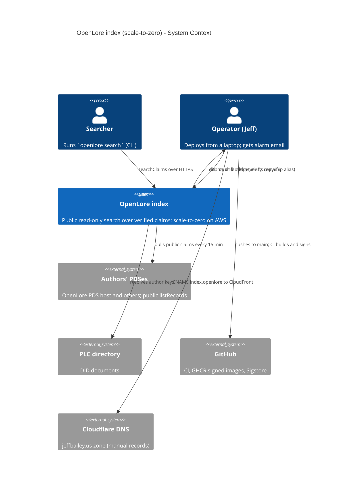
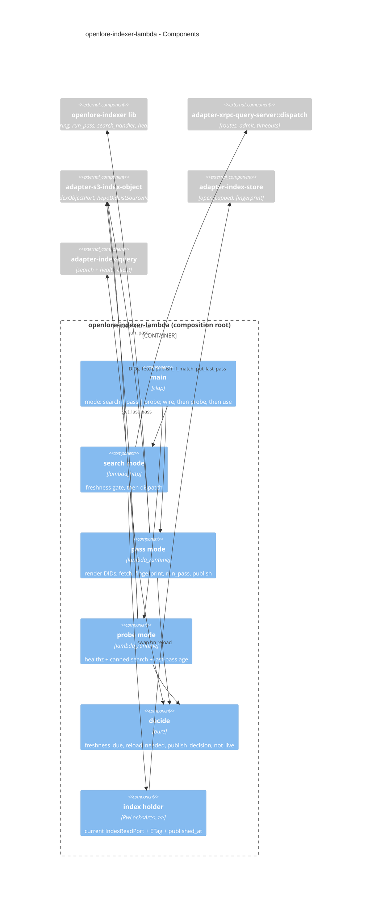

# Feature Delta: scale-to-zero-hosting

- **Wave**: DESIGN (2026-10-26). Mode: propose. Phase 1 offered options A, B and C; the user chose
  **Option B**, a native Lambda root.
- **Scope (user decision)**: the indexer only. Its search (`serve`) and its 15-minute pass move off
  the shared PDS host onto scale-to-zero AWS: Lambda, one S3 object holding the index, and
  CloudFront for `index.openlore.jeffbailey.us`. The review app and the OpenLore PDS stay on the
  t4g.micro host.
- **Requirements source**: there are **no DISCUSS artifacts** for this feature. The requirements
  are:
  - the SPIKE-6 pass criteria (`docs/feature/bluesky-claim-review-app/design/wave-decisions.md`,
    the SPIKE-6 rows);
  - the spike findings (`docs/feature/scale-to-zero-hosting/spike/findings.md`,
    `spike/wave-decisions.md`);
  - the existing indexer KPIs and NFRs, which "no loss of today's guarantees" carries forward
    (`docs/feature/indexer-deployment/discuss/outcome-kpis.md`: KPI-IXD-3, KPI-IXD-4, KPI-IXD-5,
    and NFR-IXD-6 "added cost ≤ $2/month").
- **ADRs**: **ADR-090** is new. It supersedes ADR-075 for the indexer, amends ADR-080 and ADR-083,
  and extends ADR-023.

## Wave: DESIGN / [REF] Requirements (derived, no DISCUSS)

| ID | Requirement | Source |
|---|---|---|
| R-STZ-1 | A search answers from a cold start in under 3 s, measured on the client end to end over HTTPS | SPIKE-6 pass criterion |
| R-STZ-2 | A warm search answers in under 200 ms when the index has not changed since the instance last checked | SPIKE-6 pass criterion |
| R-STZ-3 | The indexer costs well under $2/month at current traffic | SPIKE-6, NFR-IXD-6 |
| R-STZ-4 | Only CI-green commits deploy, the image is cosign-verified by digest, post-checks gate the deploy, and rollback is designed first and takes seconds | today's `deploy/indexer/deploy.sh` |
| R-STZ-5 | The last good pass is ≤ 30 min old in ≥ 98% of hourly checks | KPI-IXD-3 (pass every 15 min, user decision) |
| R-STZ-6 | A DID-list edit takes effect on the next pass with no deploy | KPI-IXD-4 |
| R-STZ-7 | Every exit-2 pass and two exit-3 passes in a row page; exit-0 passes do not; the index not being live pages | KPI-IXD-5, alarms A1-A3 |
| R-STZ-8 | Abuse is capped, both in damage and in spend | ADR-083 (as amended here) |
| R-STZ-9 | The self-hostable `openlore-indexer` binary behaves exactly as before and stays AWS-free | ADR-023, user decision |
| R-STZ-10 | Searches can lag a pass by at most the freshness TTL plus one reload | spike finding 7 |

## Wave: DESIGN / [REF] Design decisions (D-numbered)

| ID | Decision | Rationale |
|---|---|---|
| D-STZ-1 | **Option B.** A new composition root `openlore-indexer-lambda` (binary) runs search, pass and probe in-process. There is no Lambda Web Adapter. | Freshness checks run synchronously on the request path, so the R-STZ-10 bound holds; the decisions are pure and testable; the AWS SDK stays out of the self-host binary. |
| D-STZ-2 | `openlore-indexer` splits into a lib plus a bin. The bin's behaviour, CLI, env vars and events do not change. | The new root reuses the wiring, the pass and the search and health handlers without copying them. |
| D-STZ-3 | A new effect crate, `adapter-s3-index-object`, implements `IndexObjectPort` (S3) and `RepoDidListSourcePort` (SSM). It is the only crate, together with the Lambda root, that links `aws-*` crates. | ADR-023 boundary: the AWS SDK lives in one adapter. |
| D-STZ-4 | Region **us-east-1**. | The prod log group, alarms, SNS topic and DID parameter are already there, and CloudFront's ACM certificate must be in us-east-1. The spike timings are network-bound and carry over. |
| D-STZ-5 | The index is **one S3 object**, `s3://<bucket>/index/index.duckdb`, plus `index/last-pass.json`. The bucket is versioned and keeps at most 5 noncurrent versions for 1 day. SSE-S3 is on and public access is blocked. | The index is a rebuildable cache (ADR-023). S3 writes are atomic and reads are strongly consistent (spike finding 7). Versioning gives index rollback, and the lifecycle rule bounds storage cost. |
| D-STZ-6 | **One writer.** The pass function has reserved concurrency 1. Its publish is `PutObject` with `If-Match: <etag read at the start>`, or `If-None-Match: *` when no object exists. A 412 is `indexer.lambda.publish_conflict`, which is exit 2 and pages through A2. | ADR-080's "passes never overlap" holds at two independent layers, as the host timer did. |
| D-STZ-7 | The pass **publishes only when something changed**: the index fingerprint after the pass differs from the one before, and the store is still usable. Every pass with exit 0 also writes `last-pass.json` (`pass_id`, `exit_code`, `finished_at`, `published`). | It saves PUTs and avoids pointless warm reloads, while the probe still sees every good pass. |
| D-STZ-8 | **Fingerprint**: `(claim count, distinct author count, XOR of a 64-bit hash of every CID)`, read from the store before and after the pass. | It does not depend on upsert counters, and a re-upsert of the same claim, which is a no-op, does not count as a change. |
| D-STZ-9 | Publish also happens on exit 2 or 3 when the fingerprint changed and the store is usable. It never happens on an unusable store. (Confirmed by the user, 2026-10-27.) | This mirrors the host, which keeps committed upserts after an exit-2 pass (ADR-080). |
| D-STZ-10 | **Warm-instance freshness TTL 60 s.** Before answering, the search handler checks whether 60 s have passed since its last check. If so, it sends a `HEAD`. If the ETag changed, it downloads to a new `/tmp` file, opens it, swaps the handle and deletes the old file, then answers. | The bounded lag is TTL plus one reload. A `HEAD` costs about 15-30 ms, so warm calls stay under 200 ms. A reload costs about one cold fetch, inside the 3 s budget. |
| D-STZ-11 | A failed freshness check **never fails a search**. The instance answers from its current copy, logs `indexer.lambda.freshness_check_failed`, and retries after the next TTL. | Availability comes before freshness. A stale index is still a correct, verified index. |
| D-STZ-12 | `/healthz` `last_successful_pass_at` now means **"index published at"**. It is read from the object metadata `x-amz-meta-published-at` at fetch or reload, and it is `null` when no object exists yet. The JSON field name and shape do not change. | A search instance has no pass runner. The value is still public, still one timestamp, and still a freshness signal. |
| D-STZ-13 | When no index object exists (a fresh bucket, or after `reset-index`), search opens an empty local index: `/healthz` returns 200 with `null`, and searches return empty results until the next pass publishes. | Same as the host after `rollback --reset-index`. |
| D-STZ-14 | An S3 failure at **init** (not 404) emits `health.startup.refused` and init fails, so the Function URL answers 5xx. | The existing A2 filter already matches `health.startup.refused`. A broken store never looks healthy (ADR-083 §2). |
| D-STZ-15 | **Pass cadence every 15 min.** An EventBridge Scheduler entry `cron(0/15 * * * ? *)` targets the pass function's `live` alias, with no retries and no flexible window. | KPI-IXD-3 stays as written. Quarter-hour alignment keeps A1's 900 s periods correct. A missed slot is covered by the next one, as with the host timer. |
| D-STZ-16 | **DID list per pass.** The pass reads `/openlore/prod/indexer/repo-dids` (SSM) at the start of every run. It writes the list to `/tmp/config/repo-dids` with a rename and points the existing `OPENLORE_INDEXER_REPO_DIDS_FILE` at it. If SSM fails, a warm instance keeps its last good copy for up to 2 h. With no copy, the missing file makes the existing ADR-081 path refuse the pass with exit 2. | KPI-IXD-4 holds. The validation stays in the binary (ADR-081), and only the renderer moves. |
| D-STZ-17 | The pass deadline is `OPENLORE_INDEXER_PASS_DEADLINE_SECS=780`, and the function timeout is 840 s. | Lambda's hard limit is 900 s. Today a pass takes about 1 s. |
| D-STZ-18 | **Abuse guard (user decision)**: a global cap instead of per-client 429s. | Spike finding 5. WAF rate rules (about $6+/month) would break R-STZ-3. |
| D-STZ-18a | Search reserved concurrency is **3**. Calls above the cap are throttled by Lambda and get a 429 from the Function URL. | |
| D-STZ-18b | **Alarm A4** fires when search invocations exceed **3,000 per 5 min** (Sum). | |
| D-STZ-18c | **AWS Budgets** alert at **$2** and **$10** a month. They notify the operator's contact email, read from `/openlore/prod/acme-contact-email`. | |
| D-STZ-18d | **Kill switch**: `deploy.sh lambda stop` sets search reserved concurrency to **0**, and `lambda start` sets it back to 3. | |
| D-STZ-19 | The per-client rate limiter is **not wired** in the Lambda root. It stays in the self-host and host `serve` unchanged. | Each Lambda instance would start with an empty token bucket, so the limiter guards nothing there. |
| D-STZ-20 | The **edge is CloudFront without OAC** (user decision). The raw Function URL stays public, with auth `NONE`. Both paths share the same routes, bounds and reserved-concurrency cap, and the CLI does not change. | OAC would require POST clients to send `x-amz-content-sha256`, which would break `openlore search`. |
| D-STZ-21 | CloudFront has three behaviors: • `/xrpc/org.openlore.appview.searchClaims`: all methods, caching disabled, origin request policy "all viewer except Host"; • `/healthz`: GET/HEAD, caching disabled; • default `*`: a CloudFront Function answers 404 at viewer request. Price class 100. A response headers policy removes `x-amzn-*` headers. | This keeps ADR-083's two layers: edge allowlist plus binary allowlist. Body and value bounds stay in the binary (413/400), and the spike verified them without Caddy. |
| D-STZ-22 | Search requests go through the **same pure dispatch** as `serve`. `adapter-xrpc-query-server` gains a transport-free `dispatch(request, handlers) -> response` (routes, `admit`, the 5 s `REQUEST_TIMEOUT` → 503 `index_busy`, 413, 404, health). The hyper server and the Lambda root both call it. | The bounds are identical by construction, not by copying. |
| D-STZ-23 | **A3 detection by a 5-minute probe** (`openlore-indexer-probe`, reserved concurrency 1, EventBridge `rate(5 minutes)`). Each run: • `GET /healthz` and the canned search through CloudFront; • reads the age of `last-pass.json` (stale after 45 min); • emits one `indexer.host.health` line with `not_live` and the same causes as `health-timer.sh`. | The A3 filter and alarm are reused unchanged. Missing data still counts as breaching. The probe also keeps one search instance warm. The event name is kept for filter reuse and documented as legacy. |
| D-STZ-24 | **One signed image digest** carries both binaries (`openlore-indexer`, `openlore-indexer-lambda`) and `WORKDIR /`. The image `ENTRYPOINT` stays `openlore-indexer` for the host. Each Lambda function sets `image_config.entry_point = ["/usr/local/bin/openlore-indexer-lambda"]` and `command = ["search"\|"pass"\|"probe"]`. | One cosign verification covers every runtime. Spike finding 1 showed that `WORKDIR /` is needed; it is harmless for compose, which uses absolute paths. |
| D-STZ-25 | **ECR** repo `openlore-indexer` (us-east-1): immutable tags, lifecycle keeps the last 5 images. `deploy.sh` copies the verified GHCR digest with `crane copy` (the digest is preserved) and tags it `sha-<40 hex>`. | Lambda pulls only from same-account, same-region ECR. CI still pushes only to GHCR (ADR-075 §5 laptop discipline: no OIDC deploy role). |
| D-STZ-26 | **Versions and aliases.** Each function has a `live` alias. Search also has a `candidate` alias with its own Function URL for post-checks. A deploy runs: 1. CI green; 2. resolve the digest; 3. cosign verify; 4. crane copy; 5. `update-function-code` ×3; 6. `publish-version` ×3, with description `<sha> <digest>`; 7. move `candidate` and run the existing post-checks against its URL; 8. flip `live` on search, then pass, then probe. | Rollback is an alias flip back to the previous version, in seconds, with no image pull. Version descriptions replace the host's releases file. |
| D-STZ-27 | **Index rollback**: `deploy.sh lambda reset-index` deletes the current object, and the next pass rebuilds it. `restore-index <version-id>` copies a noncurrent version back. | The index is a rebuildable cache, and there is no schema change between releases (existing rule). |
| D-STZ-28 | **New tofu root `deploy/tofu/environments/prod-indexer/`**: provider us-east-1, state in `jeffbaileyterraformstate` under key `openlore/indexer/prod.tfstate`, laptop apply. It reads `backup_alarm_topic_arn` and `indexer_log_group` from the prod root through `terraform_remote_state`. | An indexer apply can never plan against the PDS module, which can replace the instance. |
| D-STZ-29 | Tofu owns the function configuration. `image_uri` and the alias `function_version` are `ignore_changes`, because `deploy.sh` owns code and versions. | Tofu does not fight deploys, and deploys do not drift infrastructure. |
| D-STZ-30 | **Function sizing**: arm64 throughout. • search: 512 MB, 10 s timeout, 512 MB `/tmp`, DuckDB 48 MB with 1 thread; • pass: 512 MB, 840 s; • probe: 128 MB, 30 s. | The spike's sweet spot (512 MB). 1024 MB was no faster. |
| D-STZ-31 | **Trial (user default)**: • the host keeps running its indexer in parallel; • Lambda functions log to a separate group, `/openlore/prod/indexer-lambda`, with trial copies of the four metric filters and alarms A1-A3 (actions enabled, named `openlore-indexer-lambda-*`); • **cut-over** is a manual Cloudflare exact CNAME `index.openlore` → the CloudFront domain, DNS-only, TTL 60; • rollback during the trial deletes the CNAME, so the wildcard sends traffic back to the Caddy host container; • **decommission the host indexer after 7 green days** after cut-over. | Two `pass_summary` producers in one log group would break A1's per-quarter-hour Minimum. The trial gives evidence before the host path is removed. |
| D-STZ-32 | At cut-over, the Lambda `logging_config` is repointed to `/openlore/prod/indexer`. The existing A1-A3 filters and alarms in the prod root then cover Lambda unchanged, and the trial filters, alarms and log group are removed. At decommission, the prod-root indexer resources move to the new root (`removed` and `import` blocks), and `bootstrap/indexer-iam.tf` and the host files are retired. | No alarm is redefined, and the KPI-IXD-5 history stays in one place. |
| D-STZ-33 | **Index-size alarm A5**: the pass logs `indexer.lambda.published {index_bytes, pass_id}`. A metric filter publishes `IndexBytes`, and A5 fires above 100 MB. | Spike: the cold start passes 3 s at about 140 MB. This gives warning before the ceiling. |
| D-STZ-34 | **Cloudflare DNS is done by hand**: the ACM DNS-validation CNAME and the exact `index` CNAME. | Cloudflare is not in tofu today (ADR-067, DNS section of the brief). |
| D-STZ-35 | **Only the two Lambda crates require Rust 1.94.1; the workspace MSRV stays 1.91** (user, 2026-10-27). | The current `aws-config`, `aws-sdk-s3`, `aws-sdk-ssm` and `aws-smithy-http-client` need 1.94.1, and CI builds on stable 1.99. A per-crate `rust-version` keeps the CLI's source install at 1.91. Pinning to the February 2026 SDK line (the last on 1.91) would lose 8 months of fixes. |
| D-STZ-36 | The AWS SDK HTTP client uses **rustls with ring** (`aws-smithy-http-client` feature `rustls-ring`, SDK `default-features = false`). | The workspace already uses `ring` and has no `aws-lc-rs`. ADR-004 prefers rustls, and `openssl` stays banned. |
| D-STZ-37 | The probe reuses `adapter-index-query` (the CLI's bounded XRPC client) for the canned search, which gains a `health()` call for `/healthz`. | It is the same client the CLI uses, so the probe tests what users see. No new HTTP client is added. |

## Wave: DESIGN / [REF] Component decomposition

| Path | Kind | Change | Notes |
|---|---|---|---|
| `crates/openlore-indexer` | driver (lib + bin) | **EXTEND** (lib split) | `src/lib.rs` exposes the wiring (`IndexerWiring::production` taking paths), the pass entry (`ingest_pass::run_pass -> PassExit`), `search_handler`, `health`, and `events`. `health_handler` takes a `last_published_at` reader closure instead of `StatusReader`; the self-host passes the runner's reader, so its behaviour is unchanged. `main.rs` is unchanged in behaviour. |
| `crates/openlore-indexer-lambda` | driver (binary) | **CREATE NEW** | The **fourth composition root**, in the indexer family. Modes `search` (lambda_http), `pass` (lambda_runtime, scheduler event) and `probe` (lambda_runtime). It holds the pure `decide` module. |
| `crates/openlore-indexer-lambda/src/decide.rs` | pure core (module) | **CREATE NEW** | `freshness_due(now, last_checked, ttl) -> bool`, `reload_needed(current: Option<Etag>, head: Option<Etag>) -> Reload`, `publish_decision(exit, before: Fingerprint, after: Fingerprint, store_usable) -> Publish`, `not_live(probe_facts) -> NotLive`, `dids_copy_usable(age, max) -> bool`. No I/O. |
| `crates/adapter-s3-index-object` | effect | **CREATE NEW** | `IndexObjectPort` over S3 (`head`, `fetch_to`, `publish_if_match`, `put_last_pass`, `get_last_pass`) and `RepoDidListSourcePort` over SSM (`current`). It is the only crate with `aws-*` dependencies besides the Lambda root, which builds the SDK config. |
| `crates/ports` | ports | **EXTEND** | New `index_object.rs` (`IndexObjectPort`, `ObjectVersion`, `PublishOutcome`, `LastPass`) and `repo_did_list.rs` (`RepoDidListSourcePort`). Async through `#[async_trait]`, as `IdentityResolvePort` already is. |
| `crates/adapter-index-store` | effect | **EXTEND** | `fingerprint() -> IndexFingerprint`: one read-only SQL query, with no aggregate across authors exposed to callers beyond counts (WD-103-safe: it returns no claim data). |
| `crates/adapter-xrpc-query-server` | effect | **EXTEND** | Extract transport-free `dispatch` (D-STZ-22). The hyper `serve` calls it after its rate limit and connection cap. Its behaviour is unchanged. |
| `crates/adapter-index-query` | effect | **EXTEND** | `health() -> Result<HealthBody, IndexQueryError>` with the same bounded timeouts (D-STZ-37). |
| `crates/openlore-indexer/Dockerfile` | image | **EXTEND** | `WORKDIR /`; copy both binaries. |
| `.github/workflows/ci.yml` (`indexer-build`, `indexer-image`) | CI | **EXTEND** | Build both binaries and produce an SBOM for each. Keep serve-smoke as is (it must stay green with `WORKDIR /`). Add a Lambda-posture smoke (see open questions). Trivy, push, sign, attest and SLSA are unchanged, on one digest. |
| `xtask/src/check_arch.rs` | tooling | **EXTEND** | See "xtask deltas" below. |
| `deploy/indexer/deploy.sh` | ops | **EXTEND** | New `lambda` verbs: `deploy <sha\|digest>`, `rollback`, `stop`, `start`, `status`, `trigger` (invoke the pass `live` alias once), `reset-index`, `restore-index <version-id>`. They reuse `ci_green`, `resolve_digest`, `image_revision`, `verify_signature`, `post_checks` and `kpi`. |
| `deploy/tofu/environments/prod-indexer/` | IaC | **CREATE NEW** | Resources listed below. |
| `deploy/tofu/environments/prod/indexer.tf`, `deploy/tofu/bootstrap/indexer-iam.tf`, `deploy/indexer/host/*` | IaC and ops | **KEEP** during the trial, **RETIRE or MOVE** at decommission | D-STZ-31 and D-STZ-32. |

**xtask deltas**:
- `indexer_lambda_holds_no_signing_or_local_store`: the same forbidden deps as the indexer root (`adapter-duckdb`, `adapter-atproto-pds`, `adapter-github`), applied to `openlore-indexer-lambda`.
- `aws_sdk_only_in_lambda_edge`: `aws-*` and `lambda_*` crates may be reachable only from `adapter-s3-index-object` and `openlore-indexer-lambda`. The `openlore-indexer` dependency graph contains none of them (R-STZ-9).
- `indexer_guarded_clients_only`: also scans `openlore-indexer-lambda/src`.
- `indexer_search_handler_read_only`: also scans the Lambda search module, which may hold `IndexReadPort` and `IndexObjectPort::head/fetch_to` but no `publish_*`.
- `cli` stays forbidden from linking the new crates (the I-3 second axis gains `adapter-s3-index-object` and `openlore-indexer-lambda`).

**Tofu resources in the new root**:
- ECR repo and lifecycle policy;
- S3 bucket, versioning, lifecycle, public access block, SSE;
- three IAM roles, each with least privilege:
  - search: `s3:GetObject` and `HeadObject` on `index/*`, logs;
  - pass: Get/Put on `index/*`, `ssm:GetParameter` on the DID parameter, logs;
  - probe: `s3:GetObject` on `index/last-pass.json`, logs;
- three `aws_lambda_function` (package type Image, reserved concurrency 3/1/1, `logging_config`);
- aliases `live` ×3 and `candidate` ×1;
- Function URLs on search `live` and `candidate` (auth NONE, with both resource-policy statements from spike finding 9);
- two `aws_scheduler_schedule` and their scheduler role;
- the trial log group, four filters, A1-A3 trial alarms, A4 and A5;
- ACM certificate (DNS validation, record done by hand);
- CloudFront distribution and CloudFront Function;
- two `aws_budgets_budget`.

## Wave: DESIGN / [REF] Driving ports

| Port | Transport | Contract |
|---|---|---|
| Search | `POST https://index.openlore.jeffbailey.us/xrpc/org.openlore.appview.searchClaims` (CloudFront) and the raw Function URL | Unchanged XRPC lexicon and bounds (ADR-027, ADR-083): 8 KiB body (413), 512 B value (400), ≤ 1000 rows, 5 s → 503 `index_busy`, store error → 500, other routes → 404. A throttle above reserved concurrency → 429. |
| Health | `GET /healthz` (same two hosts) | `200 {"status":"ok","last_successful_pass_at":<published-at>\|null}`; 503 `store_unusable`. Never 200 on a broken store. |
| Pass | EventBridge Scheduler event → pass function `live` alias (also `deploy.sh lambda trigger`) | One ADR-077/078 pass. It emits exactly one `indexer.ingest.pass_summary` with `exit_code` 0/2/3 and `pass_id`, then publishes or not (D-STZ-7). |
| Probe | EventBridge Scheduler event → probe function `live` alias | One `indexer.host.health` line with `not_live` 0 or 1. |
| Operator | `deploy.sh lambda …` (laptop, `AWS_PROFILE=jeff`) | Deploy, rollback, stop/start, status, trigger, reset-index and restore-index, all with the existing gates. |

## Wave: DESIGN / [REF] Driven ports and adapters

| Port | Adapter | Used by | Notes |
|---|---|---|---|
| `IndexReadPort` (existing) | `adapter-index-store` on the `/tmp` file | Lambda search | Behind a swappable holder (`RwLock<Arc<…>>`, std only). |
| `IndexStorePort`, `IndexPurgePort` (existing) | `adapter-index-store` | Lambda pass | Unchanged pass (ADR-080 §6 and §7 robustness carries over). |
| `IngestSourcePort`, `IdentityResolvePort` (existing) | `adapter-atproto-ingest`, `adapter-atproto-did` (guarded) | Lambda pass | Unchanged (ADR-077 SSRF guard). |
| **`IndexObjectPort`** (new) | `adapter-s3-index-object` (S3) | search (`head`, `fetch_to`), pass (all), probe (`get_last_pass`) | ETag is the object version. Conditional writes use `If-Match` and `If-None-Match`. |
| **`RepoDidListSourcePort`** (new) | `adapter-s3-index-object` (SSM `GetParameter`) | pass | Returns raw text. Validation stays in the existing ADR-081 loader. |
| `IndexQueryPort` (existing, extended with `health`) | `adapter-index-query` | probe | Public URL through CloudFront. |
| `ClockPort` (existing) | `adapter-system-clock` | all | Pure decisions take `now` as an argument. |

## Wave: DESIGN / [REF] Technology choices (pinned)

Versions are current on crates.io as of 2026-10-26. The lockfile is settled in DELIVER, and `cargo deny check` must pass.

| Crate | Version | MSRV | License | Why |
|---|---|---|---|---|
| `lambda_http` | 1.3.2 | 1.84 | Apache-2.0 | Function URL events as `http::Request` (http 1, hyper 1, the same stack as the query server). Not axum (banned). |
| `lambda_runtime` | 1.5.0 | 1.84 | Apache-2.0 | Scheduler events for pass and probe |
| `aws-config` | 1.13.0, `default-features = false`, features `rt-tokio`, `behavior-version-latest` | 1.94.1 | Apache-2.0 | Credentials from the Lambda environment |
| `aws-sdk-s3` | 1.155.0, `default-features = false`, `rt-tokio` | 1.94.1 | Apache-2.0 | `HeadObject`, `GetObject`, conditional `PutObject` |
| `aws-sdk-ssm` | 1.131.0, `default-features = false`, `rt-tokio` | 1.94.1 | Apache-2.0 | `GetParameter` for the DID list |
| `aws-smithy-http-client` | 1.5.1, feature `rustls-ring` | 1.94.1 | Apache-2.0 | rustls with ring; no aws-lc, no openssl (D-STZ-36) |
| existing `duckdb` (capped below 1.20000), `tokio` 1.54, `hyper` 1.12, `reqwest` 0.12 (rustls) | unchanged | | | |

- **Fallback if per-crate MSRV proves unworkable**: `aws-config` 1.8.14, `aws-sdk-s3` 1.124.0 and `aws-sdk-ssm` 1.106.0 (the last releases on 1.91).
- **AWS services**: Lambda (arm64, container image), S3, SSM Parameter Store (existing), ECR, EventBridge Scheduler, CloudFront with a CloudFront Function, ACM, CloudWatch Logs and alarms, SNS (the existing topic), AWS Budgets. Tofu: provider `hashicorp/aws ~> 6.0`, as in the prod root.

## Wave: DESIGN / [REF] Reuse Analysis (hard gate)

| Existing component | File | Overlap | Decision | Justification |
|---|---|---|---|---|
| Index store open (capped) | `crates/adapter-index-store/src/lib.rs` `open_capped` | Opens `/tmp/index.duckdb` | EXTEND (reuse plus `fingerprint`) | Verified on Lambda by the spike |
| Store reopen | none (`serve` opens once, ADR-080 §1) | Warm freshness | CREATE NEW in the Lambda root (a swappable holder over `IndexReadPort`, plus pure `decide`) | The existing `SharedIndexReads` seam takes it with no port change |
| One-shot pass | `crates/openlore-indexer/src/ingest_pass.rs` | The same pass, events, exit codes and purge | EXTEND (exposed through the lib) | Spike finding 8 |
| `trigger`, control socket, pass runner | `control.rs`, `pass_runner.rs` | Do not work across instances | KEEP for self-host and host; not used on Lambda | The single writer becomes reserved concurrency 1 plus `If-Match` (D-STZ-6) |
| Per-client rate limiter | `crates/adapter-xrpc-query-server/src/rate_limit.rs` | Ineffective on Lambda | KEEP in `serve`; not wired in Lambda | D-STZ-18 and D-STZ-19 |
| Route allowlist and bounds | `adapter-xrpc-query-server/src/lib.rs` (`public_route`, `admit`, `REQUEST_TIMEOUT`, `index_busy`) | Needed on Lambda | EXTEND (extract `dispatch`) | Identical bounds by construction (D-STZ-22) |
| Caddy site | `deploy/indexer/host/index.caddy` | Edge allowlist | REPLACE with CloudFront behaviors at cut-over | ADR-083 keeps two layers |
| Deploy gates | `deploy/indexer/deploy.sh` | CI green, cosign, post-checks | EXTEND (`lambda` verbs) | Same functions, new target |
| Rollback | `deploy.sh` releases file, `--reset-index` | Same intent | EXTEND (alias flip, `reset-index`, `restore-index`) | Faster than today |
| Events `pass_summary`, `health.startup.refused`, `indexer.store.unusable` | `events.rs`, `ingest_pass.rs` | Same stdout JSON | REUSE | `logging_config` targets the indexer log group, so the filters work unchanged |
| Host health timer and A3 | `deploy/indexer/host/health-timer.sh`, prod `indexer.tf` | Liveness | REPLACE the producer (probe function); REUSE the event name, filter and alarm | D-STZ-23 |
| DID list render | `deploy/indexer/host/render-dids.sh` | SSM to file | REPLACE the producer (pass renders to `/tmp`); REUSE ADR-081 validation | D-STZ-16 |
| CI image job | `.github/workflows/ci.yml` `indexer-image` | Build, smoke, scan, sign | EXTEND | One digest (D-STZ-24) |
| Prod tofu indexer resources | `deploy/tofu/environments/prod/indexer.tf` | Log group, alarms, SSM parameter | KEEP, then MOVE at decommission | D-STZ-32 |
| CLI index client | `crates/adapter-index-query` | XRPC client | EXTEND (`health`) and reuse for the probe | D-STZ-37 |
| SNS topic | module `backup_alarm_topic_arn` | Alarm notifications | REUSE through remote state | No module change (ADR-066) |

## Wave: DESIGN / [REF] C4: System Context (Level 1)

## Wave: DESIGN / [REF] C4: Container (Level 2)

## Wave: DESIGN / [REF] C4: Component (Level 3, `openlore-indexer-lambda`)

## Wave: DESIGN / [REF] Decisions table (summary)

| Area | Decision |
|---|---|
| Shape | Option B: native Lambda root, three functions from one signed image |
| Region | us-east-1 |
| Index | One S3 object, single writer (reserved concurrency 1 + `If-Match`), publish on change |
| Freshness | TTL 60 s `HEAD`, reload on ETag change; a failed check never fails a search |
| Health | `last_successful_pass_at` = index published at (object metadata) |
| Cadence | Every 15 min (KPI-IXD-3 unchanged) |
| DID list | SSM read each pass, rendered to `/tmp`; ADR-081 validation unchanged |
| Abuse | Reserved concurrency 3, A4 above 3,000 calls per 5 min, Budgets at $2 and $10, `lambda stop` kill switch |
| Edge | CloudFront without OAC; raw Function URL public with the same bounds; CLI unchanged |
| Monitoring | A1/A2 reused; A3 fed by the 5-minute probe; A4 invocations; A5 index size > 100 MB |
| Deploy | CI green, cosign verify, crane copy to ECR, versions, `candidate` post-checks, `live` flip; rollback is an alias flip |
| IaC | New root `deploy/tofu/environments/prod-indexer/` |
| Trial | Host in parallel, separate log group, manual CNAME cut-over, decommission after 7 green days |
| Toolchain | Lambda crates `rust-version` 1.94.1, workspace 1.91; SDK on rustls with ring |

## Wave: DESIGN / [REF] Cost (arithmetic, us-east-1 list prices, free tier ignored)

| Item | Arithmetic | $/month |
|---|---|---|
| Pass | 2,880 × 2 s × 0.5 GB = 2,880 GB-s × $0.0000133334 | 0.038 |
| Search (users) | 3,000 × 0.7 s × 0.5 GB = 1,050 GB-s | 0.014 |
| Probe and its two calls | 8,640 × 0.5 s × 0.125 GB + 17,280 × 0.1 s × 0.5 GB = 1,404 GB-s | 0.019 |
| Lambda requests | about 31,800 × $0.20/1M | 0.006 |
| S3 PUT | ≤ 2,880 index + 2,880 `last-pass.json` = 5,760 × $0.005/1k | 0.029 |
| S3 GET/HEAD | about 25k × $0.0004/1k | 0.010 |
| S3 storage | ≤ 6 versions × 3 MB | < 0.01 |
| CloudWatch Logs | about 30 MB | 0.015 |
| ECR | 5 × 45 MB | 0.02 |
| New alarms | A4, A5 × $0.10 | 0.20 |
| CloudFront, CF Function, ACM, Scheduler, Budgets | free tiers (10M requests, 2M functions, 14M invocations, 2 budgets) | 0 |
| **Total** | | **about $0.36** (about $0.30 with the Lambda free tier) |

The trial adds about $0.30/month for the duplicate A1-A3 alarms until cut-over. **Abuse ceiling**: at concurrency 3 and about 65 ms per call, saturation is about 46 req/s, which costs about $0.28 per hour of attack. A4 fires within 5 to 10 min, and the kill switch stops the spend.

## Wave: DESIGN / [REF] Contradictions and how each was resolved

| # | Contradiction | Resolution |
|---|---|---|
| 1 | The spike ran in us-west-2; prod is in us-east-1 | us-east-1 (D-STZ-4) |
| 2 | Moving the indexer does not lower the bill while the host stays | Accepted by the user. The value now is no shared fate, 128 MB freed on the t4g.micro, and the groundwork for the later SPIKE-6 halves. |
| 3 | The per-client rate limit does not hold on Lambda; abuse costs money | Global cap, A4, Budgets and the kill switch (D-STZ-18). ADR-083 amended. |
| 4 | An hourly pass would break KPI-IXD-3 | The pass stays at 15 min (D-STZ-15) |
| 5 | KPI-IXD-4 needs no-deploy DID edits | SSM is read each pass (D-STZ-16) |
| 6 | `/healthz` freshness came from an in-memory pass runner | Index published at, from object metadata (D-STZ-12) |
| 7 | Lambda cannot pull from GHCR; a Lambda variant image would be unsigned | One signed digest with both binaries; `crane copy` after cosign verify (D-STZ-24, D-STZ-25) |
| 8 | The AWS SDK must not enter the self-host binary | A new adapter crate and root, with xtask rules (D-STZ-3, xtask deltas) |
| 9 | OAC would break CLI POSTs | No OAC; the raw Function URL is public with the same bounds (D-STZ-20) |
| 10 | The latest AWS SDK needs Rust 1.94.1; the workspace MSRV is 1.91 | Per-crate `rust-version` 1.94.1 on the two Lambda crates only (D-STZ-35, user), with a pinned fallback |

## Changed Assumptions

**ADR-075** (co-locate on the PDS host). Its rejected alternative is now chosen for the indexer:

> "**Serverless (Lambda + function URL, or Cloudflare Workers as in the J-007 `atproto/` path)** |
> Rejected for v1. The pure cores are Rust with DuckDB, so this would need a new storage choice
> (DynamoDB/D1), a new deploy toolchain and a cold-start-tolerant scan design."

For the indexer, the spike showed that none of these is needed. DuckDB stays: the index is an S3 object fetched to `/tmp`. The deploy toolchain is the existing one plus `crane copy`. The cold start is 0.36-0.96 s up to 100k claims. The indexer leaves the host. **The review app keeps ADR-075 unchanged.**

**ADR-080** (`serve` owns the index and runs triggered passes):

> "1. **One process, one store handle.** The long-running `openlore-indexer serve` container is the
> only process that opens `index.duckdb` in production."
>
> "2. **The pass runs inside `serve`, on demand.** `serve` gains a **pass runner** and a **control
> channel** that starts the runner."

In production on Lambda, every search instance opens its own read copy, and the pass function is the only writer of the one S3 object. "Passes never overlap" holds through reserved concurrency 1 plus `If-Match`, instead of the in-process single-flight plus systemd. The runner, the control socket and `trigger` remain for self-hosting and for the host during the trial.

**ADR-083** (public surface, bounded):

> "**Caddy** (`index.caddy`, a stock directive set) proxies only `POST /xrpc/org.openlore.appview.searchClaims`
> and `GET /healthz`."
>
> "the limit is enforced in the indexer binary: a per-client token bucket, 10 req/s, burst 50 …"
>
> "5. **Responses carry no `Server` header** (Caddy `header -Server`)."

- CloudFront behaviors replace the Caddy layer.
- The per-client token bucket is replaced on Lambda by a global cap (reserved concurrency 3), alarm A4, Budgets and a kill switch.
- `last_successful_pass_at` now means index published at.
- CloudFront may send `Server: CloudFront`, which carries no version information; the `x-amzn-*` headers are removed.
- The in-binary bounds are unchanged and still independent of the edge.

**ADR-023** is extended, not changed. A Lambda composition root joins the indexer family, and the self-hostable single binary stays AWS-free and behaves as before.

## Wave: DESIGN / [REF] Open questions deferred to DISTILL/DELIVER

1. **Lambda-posture smoke in CI.** Options:
   - the Lambda Runtime Interface Emulator (pinned checksum) with a local S3-compatible store;
   - or a release-refused test seam `OPENLORE_INDEXER_LAMBDA_INDEX_SOURCE=file://…`, refused in release like `ALLOW_LOOPBACK_HTTP`.

   DISTILL decides. The second matches an existing pattern.
2. **Reload under the `/tmp` limit.** A reload holds two copies. With 512 MB `/tmp`, the index ceiling is about 240 MB, above the 140 MB cold ceiling, so this is fine. DELIVER confirms the old file is deleted after the swap.
3. **Write-ahead log.** The pass ends with `CHECKPOINT` (ADR-080 §6). DELIVER verifies that the WAL file is empty before upload, and closes the handle if it is not.
4. **SNS topic policy.** Confirm that alarms in a second root can publish to the module topic. CloudWatch alarm actions need no topic-policy change for same-account alarms; verify this with one test-fire.
5. **Function URL permissions in tofu.** `aws_lambda_permission` for `InvokeFunctionUrl` plus `InvokeFunction` with `invoked_via_function_url` (spike finding 9). Check that provider `~> 6.0` exposes the second condition. If not, use a `null_resource` or manual CLI step, documented.
6. **`deploy.sh` organisation.** Should the `lambda` verbs live in `deploy/indexer/deploy.sh` or in a new `deploy/indexer/lambda.sh` sourced by it? The file is already 847 lines. This is the crafter's call.
7. **Re-measure gate.** The spike measured the Web Adapter path. DELIVER re-measures cold and warm times for the native root in us-east-1 (5 cold, 20 warm) and records them before cut-over.
8. **Long-idle reactivation.** Spike finding 10 is unmeasured. The 5-minute probe keeps the function active, so this is moot while the probe runs.

## Wave: DESIGN / [REF] Quality validation

- Every R-STZ requirement maps to a decision: R-1/2 → D-10, D-30; R-3 → cost table; R-4 → D-24..27; R-5 → D-15; R-6 → D-16; R-7 → D-23, D-32; R-8 → D-18..21; R-9 → D-2, D-3 and xtask; R-10 → D-10.
- Rollback was designed first. The code rolls back by alias flip, the index by reset or restore, and traffic during the trial by deleting the CNAME.
- Simplest-first: rejected alternatives are recorded in ADR-090: option A, staying on the host, WAF, OAC, and a Caddy proxy.
- DORA: lead time is unchanged (laptop deploy). Time to restore improves: an alias flip takes seconds, against a container recreate.
