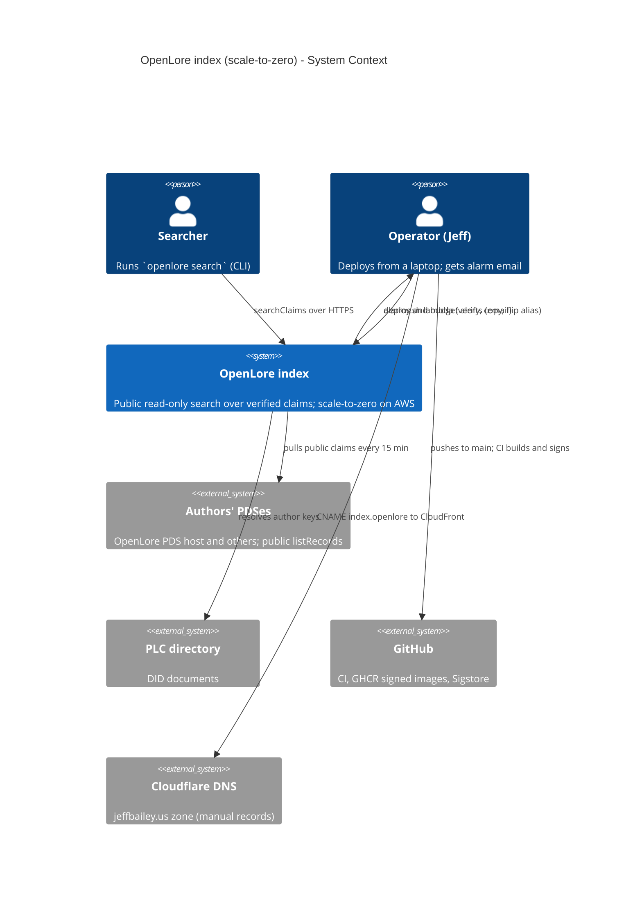
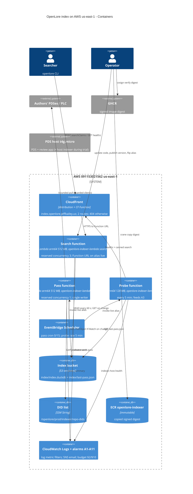
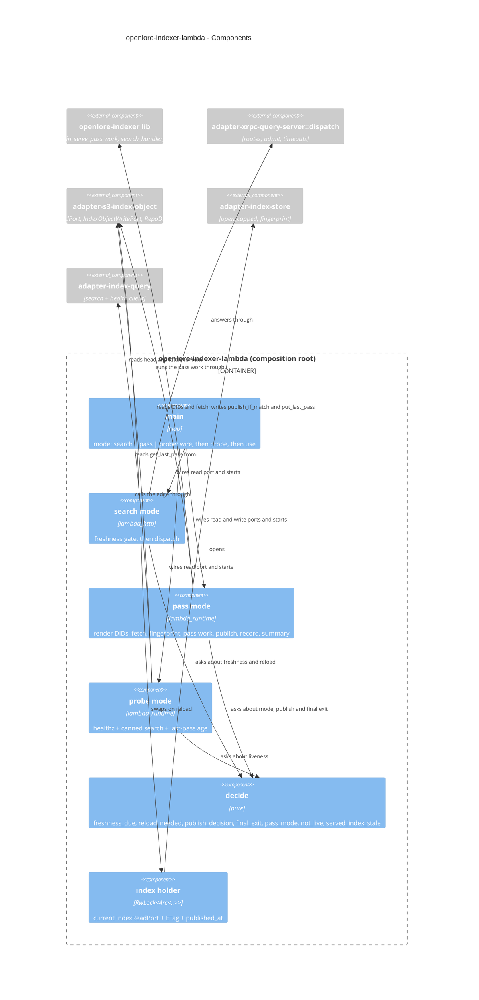

# Feature Delta: scale-to-zero-hosting

- **Wave**: DESIGN (2026-10-26). Mode: propose. Phase 1 offered options A, B and C; the user chose
  **Option B**, a native Lambda root.
- **Scope (user decision)**: the indexer only. Its search (`serve`) and its 15-minute pass move off
  the shared PDS host onto scale-to-zero AWS: Lambda, one S3 object holding the index, and
  CloudFront for `index.openlore.jeffbailey.us`. The review app and the OpenLore PDS stay on the
  t4g.micro host.
- **Requirements source**: there are **no DISCUSS artifacts** for this feature. The requirements
  are:
  - the SPIKE-6 pass criteria (`docs/feature/bluesky-claim-review-app/design/wave-decisions.md`,
    the SPIKE-6 rows);
  - the spike findings (`docs/feature/scale-to-zero-hosting/spike/findings.md`,
    `spike/wave-decisions.md`);
  - the existing indexer KPIs and NFRs, which "no loss of today's guarantees" carries forward
    (`docs/feature/indexer-deployment/discuss/outcome-kpis.md`: KPI-IXD-3, KPI-IXD-4, KPI-IXD-5,
    and NFR-IXD-6 "added cost ≤ $2/month").
- **ADRs**: **ADR-090** is new. It supersedes ADR-075 and NFR-IXD-8 for the indexer on Lambda, and
  amends ADR-023, ADR-080, ADR-081 and ADR-083.
- **Revised 2026-10-30** (revision cycles 1 and 2 after the final four-reviewer gate): the DESIGN
  rows below are corrected in place. What changed and why is in
  `## Changed Assumptions (Final review, 2026-10-30)`.

## Status at hand-off (2026-10-30)

| State | What |
|---|---|
| **Built** | This design, the acceptance tests, and scaffolds whose bodies panic. No Lambda behaviour exists yet. |
| **Proven** | None yet. The spike measured the Web Adapter path in us-west-2; the native root has never run. |
| **Deployed** | None. The host still serves `index.openlore.jeffbailey.us`. |
| **Deferred** | The trial, cut-over and decommission, and the other SPIKE-6 halves: bring-your-own PDS and the review app on Lambda. |

**As built (2026-10-31).** The table above is the DESIGN hand-off. DELIVER has since landed the
Lambda behaviour, and its tests pass locally. Deployed is still none, and nothing has run against
real AWS. See `## Wave: DELIVER / [REF] Implementation summary`.

## Wave: DESIGN / [REF] User-visible behaviour

What a searcher or an operator sees change after cut-over:

- **Concurrency.** At most 3 searches run at once, across all clients. A fourth concurrent search
  gets a 429, and the CLI reports the index as busy, as it does for the host's rate limit today.
  The cap is global, so one client's traffic can make other clients get 429.
- **Empty results.** After `reset-index`, or on a fresh bucket, searches return empty results and
  `/healthz` returns `null` until the next pass publishes, up to about 15 min.
- **During a store outage.** Searches keep answering from the last copy, with no time limit, and the
  results can be as old as that copy.
- **Errors.** A damaged index at cold start returns 5xx. A store error returns 500, never an empty
  result.
- **Freshness.** After a publish, consecutive searches can disagree for up to about 60 s plus one
  reload, because instances pick up the new index at different times. The search that triggers a
  reload is slower by about one cold fetch.
- **`/healthz`.** Public `last_successful_pass_at` now means index publish time, not the last good
  pass (D-STZ-12).
- **After a deploy.** The first search after a new image can take about 3.1 s while Lambda caches
  the image. That is over the 3 s budget; it happens once per image and is an exception to R-STZ-1
  (spike findings).
- **Geography.** CloudFront uses PriceClass_100, so its edges are in North America and Europe.
  Searchers elsewhere are served from the nearest of those, with higher latency and no loss of
  service.
- **Kill switch.** While `lambda stop` is in force, the public name stops answering and the raw
  Function URL answers 429.

## Wave: DESIGN / [REF] Requirements (derived, no DISCUSS)

| ID | Requirement | Source |
|---|---|---|
| R-STZ-1 | A search answers from a cold start in under 3 s, measured on the client end to end over HTTPS. **Exception:** the first search after a new image can take about 3.1 s while Lambda caches the image. | SPIKE-6 pass criterion; spike finding on the first call after a deploy |
| R-STZ-2 | A warm search answers in under 200 ms when the index has not changed since the instance last checked | SPIKE-6 pass criterion |
| R-STZ-3 | The indexer costs well under $2/month at current traffic | SPIKE-6, NFR-IXD-6 |
| R-STZ-4 | Only CI-green commits deploy, the image is cosign-verified by digest, post-checks gate the deploy, and rollback is designed first and takes seconds | today's `deploy/indexer/deploy.sh` |
| R-STZ-5 | The last good pass is ≤ 30 min old in ≥ 98% of hourly checks | KPI-IXD-3 (pass every 15 min, user decision) |
| R-STZ-6 | A DID-list edit takes effect on the next pass with no deploy | KPI-IXD-4 |
| R-STZ-7 | Every exit-2 pass and two exit-3 passes in a row page; exit-0 passes do not; the index not being live pages | KPI-IXD-5, alarms A1-A3 |
| R-STZ-8 | Abuse is **capped in rate and alerted in spend**. Concurrency caps what reaches search; spend has no cap, only alarms and a human kill switch. A run held just under the alarms for a month costs about $1.93 on the bill (see Cost). | ADR-083 (as amended here), user decision 2026-10-30 |
| R-STZ-9 | The self-hostable `openlore-indexer` binary behaves exactly as before and stays AWS-free | ADR-023, user decision |
| R-STZ-10 | Searches can lag a pass by at most the freshness TTL plus one reload | spike finding 7 |
| NFR-IXD-3 | **Carried over.** Search answers in ≤ 1 s p95. On Lambda there is no pass in the same process to contend with, so it is read from `UrlRequestLatency` p95 and the probe's `search_ms`. | `indexer-deployment/discuss/requirements.md`, DEVOPS § Monitoring contracts |
| NFR-IXD-7 | **Carried over, restated.** A burst of 100 searches in 10 s from one client cannot fail the PDS health check, because search no longer shares the host after cut-over. Each function has its own memory cap. Request and result bounds are unchanged (`dispatch`). During a cold start, or above 3 concurrent calls, part of a burst gets 429. | `indexer-deployment/discuss/requirements.md` |
| NFR-IXD-8 | **Superseded for the indexer on Lambda** (user decision 2026-10-30). "No AWS credentials" cannot hold, because the functions read S3 and SSM themselves. The replacement: short-lived role credentials only, no secret in the image, and the read-only functions hold read-only roles. Search reads the index object only: it calls `head` and `fetch_to`, an xtask token forbids `get_last_pass` in its module, and its IAM role grants `s3:GetObject` on the index object plus `s3:ListBucket` on the bucket ARN with a `StringLike` `s3:prefix` condition for `index/*`, so an empty start and a `reset-index` see 404, not 403. moto does not enforce IAM, so DELIVER verifies this with the policy simulator. The probe alone reads the pass record. The user approved a broader wording (search reads the index and the pass record); the design is narrower. The rest of NFR-IXD-8 (non-root, read-only root filesystem, no `/pds` mount, one writable path) holds on Lambda by platform. It stays in force on the host and for self-hosters. | `indexer-deployment/discuss/requirements.md`, ADR-090, ADR-081 |

## Wave: DESIGN / [REF] Design decisions (D-numbered)

| ID | Decision | Rationale |
|---|---|---|
| D-STZ-1 | **Option B.** A new composition root `openlore-indexer-lambda` (binary) runs search, pass and probe in-process. There is no Lambda Web Adapter. | Freshness checks run synchronously on the request path, so the R-STZ-10 bound holds; the decisions are pure and testable; the AWS SDK stays out of the self-host binary. |
| D-STZ-2 | `openlore-indexer` splits into a lib plus a bin. The bin's behaviour, CLI, env vars and events do not change. | The new root reuses the wiring, the pass and the search and health handlers without copying them. |
| D-STZ-3 | A new effect crate, `adapter-s3-index-object`, implements `IndexObjectReadPort` and `IndexObjectWritePort` (S3, D-STZ-38) and `RepoDidListSourcePort` (SSM). It is the only crate, together with the Lambda root, that links `aws-*` crates. | ADR-023 boundary: the AWS SDK lives in one adapter. |
| D-STZ-4 | Region **us-east-1**. | The prod log group, alarms, SNS topic and DID parameter are already there, and CloudFront's ACM certificate must be in us-east-1. The spike timings are network-bound and carry over. |
| D-STZ-5 | The index is **one S3 object**, `s3://<bucket>/index/index.duckdb`, plus `index/last-pass.json`. The bucket is versioned. Noncurrent versions are kept 7 days, and always at least the 5 newest (DEVOPS). SSE-S3 is on and public access is blocked. | The index is a rebuildable cache (ADR-023). S3 writes are atomic and reads are strongly consistent (spike finding 7). Versioning gives index rollback, and the lifecycle rule bounds storage cost. |
| D-STZ-6 | **One writer.** The pass function has reserved concurrency 1. Its publish is `PutObject` with `If-Match: <etag read at the start>`, or `If-None-Match: *` when no object exists. A 412 logs `indexer.lambda.publish_conflict` and makes the pass's one `pass_summary` exit 2 with cause `publish_conflict`, which pages through A2. The summary comes after the publish (D-STZ-40). | ADR-080's "passes never overlap" holds at two independent layers, as the host timer did. |
| D-STZ-7 | The pass **publishes only when something changed**: the index fingerprint after the pass differs from the one before, and the store is still usable. Every pass that writes a `pass_summary` (exit 0, 2 or 3) also writes `last-pass.json` (`pass_id`, `exit_code`, `finished_at`, `published`, `index_published_at`) (U-STZ-3, U-STZ-6). | It saves PUTs and avoids pointless warm reloads, while the probe still sees every pass. |
| D-STZ-8 | **Fingerprint**: `(claim count, distinct author count, XOR of a 64-bit hash of every CID)`, read from the store before and after the pass. | It does not depend on upsert counters, and a re-upsert of the same claim, which is a no-op, does not count as a change. |
| D-STZ-9 | Publish also happens on exit 2 or 3 when the fingerprint changed and the store is usable. It never happens on an unusable store. (Confirmed by the user, 2026-10-27.) | This mirrors the host, which keeps committed upserts after an exit-2 pass (ADR-080). |
| D-STZ-10 | **Warm-instance freshness TTL 60 s.** Before answering, the search handler checks whether 60 s have passed since its last check. If so, it sends a `HEAD`. If the ETag changed, it downloads to a new `/tmp` file, opens it, swaps the handle and deletes the old file, then answers. **A stall never fails a search (F4):** the `HEAD` has a 1 s operation timeout, which maps to `HeadSeen::Failed`, so the instance keeps its copy and reports. The reload, download and open together, has a 3 s timeout. When it fires, the download is dropped, the partial file is deleted, no swap happens, and the search answers from the current copy and logs `freshness_check_failed`. The gate takes at most 4 s. **On Lambda `REQUEST_TIMEOUT` (5 s) covers the gate and the query together**, so the query gets whatever the gate left: 5 s when no check is due, about 4.9 s after a `HEAD`, and at least 1 s after a full 4 s gate. A query that runs past that is the usual 503 `index_busy`. The 1 s floor is unmeasured, **to measure at the 140 MB ceiling**; warm queries take 63-75 ms today. All of this stays inside the 10 s function timeout. The reload runs inline on the request and Lambda gives an instance one request at a time, so no download is ever in flight when another search arrives. An open past the bound cannot be stopped, because it runs on a blocking thread: the search moves on, the open finishes alone and its file is removed when it ends. Until then it holds its memory and its partial file, and a frozen instance can carry it into the next TTL, so each attempt gets its own file (04-06). To measure at the 140 MB ceiling. | The bounded lag is TTL plus one reload. A `HEAD` costs about 15-30 ms, so warm calls stay under 200 ms. A reload costs about one cold fetch, inside the 3 s budget today. An index too big to reload in 3 s keeps a warm instance on its old copy until it is recycled; A10 reports that. To measure at the 140 MB ceiling. |
| D-STZ-11 | A failed freshness check **never fails a search**. The instance answers from its current copy, logs `indexer.lambda.freshness_check_failed`, and retries after the next TTL. | Availability comes before freshness. A stale index is still a correct, verified index. |
| D-STZ-12 | `/healthz` `last_successful_pass_at` now means **"index published at"**. It is read from the object metadata `x-amz-meta-published-at` at fetch or reload, and it is `null` when no object exists yet. The JSON field name and shape do not change. **Explicit decision (2026-10-30):** on the host and self-hosted, the field moves only on exit-0 passes. On Lambda it reports the index publish time, so it also moves when an exit-2 or exit-3 pass publishes (D-STZ-9, PA-5). It does not say a pass was good, and KPI-IXD-3 is never read from it. | A search instance has no pass runner. The value is still public, still one timestamp, and still a freshness signal. |
| D-STZ-13 | When no index object exists (a fresh bucket, or after `reset-index`), search opens an empty local index: `/healthz` returns 200 with `null`, and searches return empty results until the next pass publishes. | Same as the host after `rollback --reset-index`. |
| D-STZ-14 | An S3 failure at **init** (not 404), or an object that downloads but is damaged or unusable, emits `health.startup.refused` and init fails, so the Function URL answers 5xx. On a warm reload, a newer index that cannot be used leaves the current copy in place and the search answers from it. | The existing A2 filter already matches `health.startup.refused`. A broken store never looks healthy (ADR-083 §2). A working copy is not given up for a broken newer one (D-STZ-11). |
| D-STZ-15 | **Pass cadence every 15 min.** An EventBridge Scheduler entry `cron(0/15 * * * ? *)` targets the pass function's `live` alias, with no retries and no flexible window. Lambda's own async retry is off too (D-STZ-43, U-STZ-5). | KPI-IXD-3 stays as written. Quarter-hour alignment keeps A1's 900 s periods correct. A missed slot is covered by the next one, as with the host timer. |
| D-STZ-16 | **DID list per pass.** The pass reads `/openlore/prod/indexer/repo-dids` (SSM) at the start of every run. It writes the list to `/tmp/config/repo-dids` with a rename and points the existing `OPENLORE_INDEXER_REPO_DIDS_FILE` at it. If SSM fails, a warm instance keeps its last good copy for up to 2 h. With no copy, the missing file makes the existing ADR-081 path refuse the pass with exit 2. | KPI-IXD-4 holds. The validation stays in the binary (ADR-081), and only the renderer moves. |
| D-STZ-17 | The pass deadline is `OPENLORE_INDEXER_PASS_DEADLINE_SECS=780`, and the function timeout is 840 s. | Lambda's hard limit is 900 s. Today a pass takes about 1 s. |
| D-STZ-18 | **Abuse guard (user decision)**: a global cap instead of per-client 429s. | Spike finding 5. WAF rate rules (about $6+/month) would break R-STZ-3. |
| D-STZ-18a | Search reserved concurrency is **3**. Calls above the cap are throttled by Lambda and get a 429 from the Function URL. | |
| D-STZ-18b | **Alarm A4** fires when search invocations exceed **3,000 per 5 min** (Sum). | |
| D-STZ-18c | **One tag-filtered AWS budget** alerts at **$2** and **$10** a month (DEVOPS). It notifies the operator's contact email, read from `/openlore/prod/acme-contact-email`. Budgets data lags hours, so it is a backstop. | |
| D-STZ-18d | **Kill switch**: `deploy.sh lambda stop` sets search reserved concurrency to **0** and disables the CloudFront distribution. `lambda start` restores both. Tofu ignores the distribution's `enabled` value, as it does search concurrency, so an apply never undoes a stop. It stays human-in-the-loop: no alarm stops anything by itself. | Concurrency 0 takes seconds and stops Lambda spend, but requests answered at the edge are billed regardless, so the edge has to stop too. The distribution takes minutes to disable (user decision 2026-10-30). |
| D-STZ-18e | **Alarm A8** fires when search invocations exceed **1,900 per hour** (Sum over 3,600 s, 1 of 1). | Room to the target is $2.00 - $0.72 = $1.28. At $0.89 per million warm calls and list Lambda rates, 1,900 × 720 h = 1.37M calls cost $1.22, which fits. A4 alone lets about 36,000 calls an hour through, about $23/month (see Cost). |
| D-STZ-18f | **Alarm A9** fires when CloudFront requests exceed **13,000 per hour** (`AWS/CloudFront` `Requests`, Sum over 3,600 s, 1 of 1). | Reserved concurrency does not bound edge requests: 404s and 429s are billed too. The free 10M requests over the longest month, 744 h, is 13,440 an hour, so no request is paid for below that. Rounded down to 13,000, the month under A8 and A9 together stays under $2, including in a 31-day month (see Cost). |
| D-STZ-19 | The per-client rate limiter is **not wired** in the Lambda root. It stays in the self-host and host `serve` unchanged. | Each Lambda instance would start with an empty token bucket, so the limiter guards nothing there. |
| D-STZ-20 | The **edge is CloudFront without OAC** (user decision). The raw Function URL stays public, with auth `NONE`. Both paths share the same routes, bounds and reserved-concurrency cap, and the CLI does not change. | OAC would require POST clients to send `x-amz-content-sha256`, which would break `openlore search`. |
| D-STZ-21 | CloudFront has three behaviors, `/xrpc/org.openlore.appview.searchClaims`, `/healthz` and default `*`. **All three allow all methods** (U-STZ-4), with caching disabled and origin request policy "all viewer except Host". One viewer-request CloudFront Function on all three passes `POST /xrpc/org.openlore.appview.searchClaims` and `GET`/`HEAD /healthz`, and answers 404 to everything else.<br>Price class 100. A response headers policy removes `x-amzn-*` headers. | This keeps ADR-083's two layers: edge allowlist plus binary allowlist. A behavior limited to GET/HEAD would answer 403 before any function ran. Body and value bounds stay in the binary (413/400), and the spike verified them without Caddy. |
| D-STZ-22 | Search requests go through the **same pure dispatch** as `serve`. `adapter-xrpc-query-server` gains a transport-free `dispatch(request, handlers) -> response` (routes, `admit`, the 5 s `REQUEST_TIMEOUT` → 503 `index_busy`, 413, 404, health). The hyper server and the Lambda root both call it. | The bounds are identical by construction, not by copying. |
| D-STZ-23 | **A3 detection by a 5-minute probe** (`openlore-indexer-probe`, reserved concurrency 1, EventBridge `cron(2/5 * * * ? *)`, one line per A3 period). Each run:<br>• the canned search, then `GET /healthz`, through CloudFront, in that order (U-STZ-6);<br>• reads the age of `last-pass.json` (stale after 45 min, which now means no pass ran, U-STZ-3; a missing or unreadable record also counts, UI-12);<br>• emits one `indexer.host.health` line with `not_live` and the same causes as `health-timer.sh`. | The A3 filter and alarm are reused unchanged. Missing data still counts as breaching. The probe also keeps one search instance warm. The event name is kept for filter reuse and documented as legacy. The probe's handler refuses an event that is not a JSON object: a function error, no health line, no calls (U-STZ-7). That gives `lambda test-alarm errors` a real, harmless `Errors` datapoint. The pass is stricter still (D-STZ-44), but a test-fire keeps using the probe, so a slip in the test-fire cannot touch the single writer. |
| D-STZ-24 | **One signed image digest** carries both binaries (`openlore-indexer`, `openlore-indexer-lambda`) and `WORKDIR /`. The image `ENTRYPOINT` stays `openlore-indexer` for the host. Each Lambda function sets `image_config.entry_point = ["/usr/local/bin/openlore-indexer-lambda"]` and `command = ["search"\|"pass"\|"probe"]`. | One cosign verification covers every runtime. Spike finding 1 showed that `WORKDIR /` is needed; it is harmless for compose, which uses absolute paths. |
| D-STZ-25 | **ECR** repo `openlore-indexer` (us-east-1): immutable tags, lifecycle keeps the last 10 images, with an eviction guard at deploy step 6 (U-STZ-9). `deploy.sh` copies the verified GHCR digest with `crane copy` (the digest is preserved) and tags it `sha-<40 hex>`. | Lambda pulls only from same-account, same-region ECR. CI still pushes only to GHCR (ADR-075 §5 laptop discipline: no OIDC deploy role). |
| D-STZ-26 | **Versions and aliases.** Each function has a `live` alias. Search also has a `candidate` alias with its own Function URL for post-checks. The exact gate order is the DEVOPS one (steps 0-16 in § Deployment strategy), with this change: the pre-flip pass gate is **no-publish** (D-STZ-44). So the first real publish from a new version comes from the first scheduled pass after the flip. No scheduled pass or probe runs before the first deploy's gates have passed and `live` has flipped, because until then `live` points at unchecked `$LATEST` code. | Rollback is an alias flip back to the previous version, in seconds, with no image pull. Version descriptions replace the host's releases file. |
| D-STZ-27 | **Index rollback**: `deploy.sh lambda reset-index` deletes the current object, and the next pass rebuilds it. `restore-index <version-id>` copies a noncurrent version back. | The index is a rebuildable cache, and there is no schema change between releases (existing rule). |
| D-STZ-28 | **New tofu root `deploy/tofu/environments/prod-indexer/`**: provider us-east-1, state in `jeffbaileyterraformstate` under key `openlore/indexer/prod.tfstate`, laptop apply. It reads `backup_alarm_topic_arn` and `indexer_log_group` from the prod root through `terraform_remote_state`. | An indexer apply can never plan against the PDS module, which can replace the instance. |
| D-STZ-29 | Tofu owns the function configuration. `image_uri` and the alias `function_version` are `ignore_changes`, because `deploy.sh` owns code and versions. **Drift rule (U-STZ-2):** a published version snapshots its environment, logging config, memory and timeout, so a tofu change to any of these reaches `live` only through `deploy.sh lambda republish`. `lambda status` reports `$LATEST` drift against `live`. | Tofu does not fight deploys, and deploys do not drift infrastructure, as long as every such apply is followed by a republish. |
| D-STZ-30 | **Function sizing**: arm64 throughout.<br>• search: 512 MB, 10 s timeout, 512 MB `/tmp`, DuckDB 48 MB with 1 thread;<br>• pass: 512 MB, 840 s;<br>• probe: 128 MB, 30 s. | The spike's sweet spot (512 MB). 1024 MB was no faster. |
| D-STZ-31 | **Trial, then soak (U-STZ-1)**:<br>• during the trial the host keeps running its indexer and serves the public name; Lambda functions log to a separate group, `/openlore/prod/indexer-lambda`, with trial copies of the four metric filters and alarms A1-A3 (actions enabled, named `openlore-indexer-lambda-*`);<br>• **cut-over** is a manual Cloudflare exact CNAME `index.openlore` → the CloudFront domain, DNS-only, TTL 60;<br>• at cut-over the host indexer goes to **standby**: pass timer, health timer and container stopped; files, units, Caddy site and releases kept. New host verbs `deploy.sh standby` and `resume`;<br>• rollback during the soak takes about 10 min: Lambda pass and probe off, host `resume` and `trigger`, delete the CNAME, repoint Lambda logs to the trial group;<br>• **decommission the host indexer after 7 green soak days**. | Two `pass_summary` producers in one log group would break A1's per-quarter-hour Minimum, and the host health timer would keep feeding A3 regardless of DNS. The trial gives evidence before the host path is removed. |
| D-STZ-32 | At cut-over, the Lambda `logging_config` is repointed to `/openlore/prod/indexer`, followed by `lambda republish` (D-STZ-29). The existing A1-A3 filters and alarms in the prod root then cover Lambda unchanged, and the trial filters and alarms are removed. The trial log group ages out and is removed later. At decommission, the prod-root indexer resources move to the new root (`removed` and `import` blocks), and `bootstrap/indexer-iam.tf` and the host files are retired. | No alarm is redefined, and the KPI-IXD-5 history stays in one place. |
| D-STZ-33 | **Index-size alarm A5**: the pass logs `indexer.lambda.published {index_bytes, pass_id}`. A metric filter publishes `IndexBytes`, and A5 fires above 100 MB. | Spike: the cold start passes 3 s at about 140 MB. This gives warning before the ceiling. |
| D-STZ-34 | **Cloudflare DNS is done by hand**: the ACM DNS-validation CNAME and the exact `index` CNAME. | Cloudflare is not in tofu today (ADR-067, DNS section of the brief). |
| D-STZ-35 | **Only the two Lambda crates require Rust 1.94.1; the workspace MSRV stays 1.91** (user, 2026-10-27). | The current `aws-config`, `aws-sdk-s3`, `aws-sdk-ssm` and `aws-smithy-http-client` need 1.94.1, and CI builds on stable 1.99. A per-crate `rust-version` keeps the CLI's source install at 1.91. Pinning to the February 2026 SDK line (the last on 1.91) would lose 8 months of fixes. |
| D-STZ-36 | The AWS SDK HTTP client uses **rustls with ring** (`aws-smithy-http-client` feature `rustls-ring`, SDK `default-features = false`). | The workspace already uses `ring` and has no `aws-lc-rs`. ADR-004 prefers rustls, and `openssl` stays banned. |
| D-STZ-37 | The probe reuses `adapter-index-query` (the CLI's bounded XRPC client) for the canned search, which gains a `health()` call for `/healthz`. | It is the same client the CLI uses, so the probe tests what users see. No new HTTP client is added. |
| D-STZ-38 | **Read and write are separate ports.** `IndexObjectPort` splits into `IndexObjectReadPort` (`head`, `fetch_to`, `get_last_pass`) and `IndexObjectWritePort` (`publish_if_match`, `put_last_pass`). Search and probe get the read port only; pass gets both. `Driven` becomes per-function (`SearchDriven`, `PassDriven`, `ProbeDriven`), so a mode's constructor cannot be handed a port it must not hold. Search calls `head` and `fetch_to` only. **Scope of the split (F9):** it covers the object store and the DID list. The pass's store, ingest and DID-resolve clients, and the probe's HTTP client, are composed internally from the environment by the lib wiring and sit outside `Driven` and outside this split. They are bounded by the existing capability rules instead. The scaffolds already have this shape. | A read-only mode with write methods on its port is a bug class that can be written. With the split it cannot be: search has no way to name a publish. |
| D-STZ-39 | **Each object port has its own probe.** The read probe proves a `HEAD` through the role. The write probe runs at pass init, on a key of its own, `index/.write-probe`, a compile-time constant (`WRITE_PROBE_KEY`) in `ports/src/probe.rs` with the pure write-probe rules, re-exported by the adapter (roadmap review, UF-3), and not an `S3Location` field: a zero-byte `PutObject` with `If-None-Match: *`.<br>• **Config refusal (UI-21):** the constant stops the probe key being configured, but `index_key` and `last_pass_key` are still configured. So in every Lambda mode, `connect` refuses a location where either equals `WRITE_PROBE_KEY`, with `health.startup.refused`. The check is a pure function of the two keys, so it can be tested without building an adapter.<br>• **412:** the condition is honoured. This is the usual case, one PUT.<br>• **2xx:** a first run, or a store that ignores conditions. The probe repeats the same PUT, and the repeat must get 412 (UI-20). So a first run costs two PUTs and leaves one object.<br>• **Two 2xx:** the store ignored the condition, on a first run or any later one. The pass refuses to start with `health.startup.refused`. **This is the only refusal from the write probe outcome** (UI-17); the config refusal above happens at connect, before any PUT.<br>• **Anything else on either PUT** (unreachable, access denied, timeout): the probe says nothing about conditions, so it is not a refusal. That pass runs and reports through D-STZ-41. Pass init does not gate on the read probe either; search and probe init do.<br>**What it proves:** `If-None-Match` only. `If-Match` is not probed; it rests on reserved concurrency 1 plus the RIO suite.<br>Each PUT has a 2 s **operation timeout** with `max_attempts = 1`, so an outage cannot use up Lambda's 10 s init limit (see § Timeouts). The outcome is built so that "accepted, with no repeat" cannot be expressed: `write_probe_outcome` takes one value, honoured (412), unknown (anything else) or repeated with the second answer. **The object-port probes stay sync**, like every port probe (ADR-009), and init calls them through `spawn_blocking`, because blocking on the runtime from async init panics. **No IAM change**: the pass role needs only its existing `s3:PutObject` on the key. | Earned Trust: the first-object publish rests on the store honouring `If-None-Match`, so the probe exercises that lie on a key of its own, and it can never touch the index, including on a no-publish run. Repeating the PUT needs no state and no read of the key, unlike a `GetObject` (an IAM change) or a listing (a second request on every init). Refusing at init in an outage would lose the summary and the record that D-STZ-41 promises, and a pass whose writes are denied still pages every run, through `publish_failed` or `pass_record_failed`. |
| D-STZ-40 | **Lambda pass order (UI-14).** (1) the pass work ends with a pass exit, including the deadline check; (2) publish if the fingerprint changed and the store is usable; (3) write `last-pass.json`; (4) emit the single `pass_summary` with the final exit. The pure `decide::final_exit(pass_exit, publish_outcome, record_outcome)` computes the final exit. A pass that already failed keeps its cause (first failure wins, as today); then a publish failure; then a record failure; then the pass exit. The record carries the exit decided before its own write. A failed record write changes only the summary. | A 412 is known only at the publish, but must be exit 2 inside the one summary, because A2 counts exit-2 summaries. |
| D-STZ-40a | **Time.** The deadline clock starts at handler entry, so the SSM read and the fetch count against `PASS_DEADLINE_SECS=780`. Everything after the deadline check must fit the **60 s margin** before the 840 s function timeout:<br>• local post-pass steps (fingerprint read, WAL check, handle close, staging the file): 15 s, **unmeasured, to measure at the 140 MB ceiling**. They have no timer, so a measured overrun moves the deadline earlier;<br>• publish: 35 s **operation timeout** with `max_attempts = 1`, or the time left minus 10 s if that is less;<br>• record: 5 s operation timeout with `max_attempts = 1`;<br>• summary and flush: 5 s.<br>The `CHECKPOINT` runs inside the pass work, before the deadline check. A timed-out publish is `publish_failed` (D-STZ-41). It may still have landed. That is accepted, with no re-`HEAD`: the record says not published, the page is real work for the operator to read, and the next pass fetches whatever is current. | A publish that overran would hit the hard timeout with no summary. The shrinking publish timeout keeps the record and the summary alive if local steps run long. Retries would multiply each timeout, so there are none: a failed publish is retried by the next pass, 15 min later. |
| D-STZ-41 | **Failure rulings (UI-15, UI-2).** New `appview_domain::PassFailure` tokens:<br>• `starting_index_unusable`: no usable starting index (store unavailable or refusing, object damaged, no room). Exit 2, nothing published, `last-pass.json` written, no crash;<br>• `publish_conflict`: a 412. Exit 2, nothing published;<br>• `publish_failed`: any other store error on publish. Exit 2, nothing published;<br>• `pass_record_failed`: `last-pass.json` could not be written. Exit 2, and the index stays published if the publish worked.<br>**Full store outage**: cause `starting_index_unusable`, exit 2, nothing published, the old record stays, no crash, on a warm or a cold instance: an outage never refuses a pass at init (D-STZ-39, UI-17). A2 pages at once. A3 also pages: within about 10 min when the probe's read fails too (UI-12), and at about 50-55 min at the latest when only writes fail (the 45-minute stale rule plus A3's 2 of 2 periods). | Each failed pass names its cause (ADR-078). Exit 2 pages through A2, so a lost record cannot go unnoticed until A3. |
| D-STZ-42 | **Reused pass entry (UI-16).** The entry is `in_serve_pass(wiring, pass: PassLabel, purge: Option<RunnerPurge>) -> i32`, or an equivalent extracted from it. `run_pass` is **not** the entry: it is private, returns `i32`, and lacks the list reload, the purge, the panic catch and the test faults. Because D-STZ-40 needs the summary after the publish, the lib splits `in_serve_pass` into the caught work and the summary write; `serve` calls both in order, so its behaviour does not change. `PassLabel` and the purge contract (`RunnerPurge`, `PurgeStep`, `PurgedAuthor`, `purge_unlisted_authors`) move out of `pass_runner` into a neutral lib module (proposed name `runner_contract`), so the Lambda root does not depend on `pass_runner`. The `index_purge_only_in_pass_runner` rule moves with them: its allowed file becomes that module, and it also scans the Lambda root. | The Lambda pass must behave like the in-`serve` pass (PA-4, PA-8, PA-9, PA-E3, PA-E4, PA-E6). The purge contract and the label cannot be built outside `pass_runner` today. |
| D-STZ-43 | **Invocation contract (U-STZ-5, UI-3).** `aws_lambda_function_event_invoke_config` sets retries 0, max event age 600 s (pass) and 240 s (probe). The pass returns success with `{pass_id, exit_code, published, index_bytes}` on exits 0, 2 and 3, and fails only on a crash, a timeout or a refused event (D-STZ-44). So `Errors` (A6) means a fault: an uncaught abort, a timeout or a malformed invocation, never an ordinary failed pass. A **panic** inside the pass is a failed pass: exit 2 `pass_panicked`, the invocation succeeds, nothing is published (a panic counts as store not usable), A2 pages. | Lambda's own async retry (default 2) would rerun a crashed pass. |
| D-STZ-44 | **No-publish mode (user decision 2026-10-30).** The pre-flip pass gate does a full run and skips the publish.<br>• **Request (strict):** a synchronous invoke of the new version with payload `{"mode":"no-publish"}`. Pure `decide::pass_mode(event) -> Result<PassMode, EventRefused>` accepts exactly two events: `{}` (both schedules and `lambda trigger`) is a normal pass, and an object whose only key is `mode` with a known value (today only `no-publish`) is no-publish.<br>• **Everything else is refused:** a non-object, `null`, an absent payload, a bare string, a misspelled key, an extra key or an unknown mode is a function error, before any work and any call, as the probe does. **This changes the earlier rule**: an unknown mode used to run no-publish, and now it refuses. Init has already run by then, so a refused event on a cold instance can still have run the write probe.<br>• **Can never publish:** the pass work returns a plan value. The no-publish arm lives in its own module, `crates/openlore-indexer-lambda/src/no_publish.rs`, as `run_no_publish(read: &dyn IndexObjectReadPort, …) -> NoPublishReport`, which takes the read port only. It has no path to `publish_if_match` or `put_last_pass`, and xtask `lambda_no_publish_is_read_only` refuses `IndexObjectWritePort`, `publish_if_match`, `put_last_pass` and `PassDriven` in that module. A no-publish run writes nothing to the bucket, including `last-pass.json`, except the one-time write-check marker on a bucket's first run, which init writes (D-STZ-39, U-STZ-8).<br>• **Reply:** the usual payload with `published: false`, plus `mode` and `would_publish`. `deploy.sh` stops the deploy if `mode` does not come back. The `pass_summary` carries `no_publish: true`. | A gate that publishes writes the shared index from an unflipped version. Now a failed gate needs no index restore. The cost: the publish path is first exercised by the first scheduled pass after the flip, and a failure there pages through A2 and rolls back by alias flip. A strict event means a mistyped gate invoke stops at once, instead of running a real pass or a surprise rehearsal. |
| D-STZ-45 | **`cli` drops its dev-dependency on `openlore-indexer` (UI-7)**, in the lib-split step, and its suites use the build-before-run pattern the other `cli` suites document (`cargo build --bin openlore --bin openlore-indexer`, which `ci.yml` already runs before nextest). Dev edges are **not** excluded from the rule. An xtask test asserts that `cli`'s graph, dev edges included, does not reach `openlore-indexer`. | After the split that dev-dependency would pull `adapter-xrpc-query-server`, `adapter-index-store` and `adapter-atproto-ingest` into `cli`'s graph and fail `CLI_FORBIDDEN_INDEXER_DEPS`. Excluding dev edges would weaken I-3 for every crate. |
| D-STZ-46 | **Fingerprint SQL (UI-9): one SQL literal.** Neither an allowlist entry nor counting in Rust. `classify_index_store_sql_literal` passes an aggregate over `indexed_claims` that names `author_did`, so one literal projecting `count(*)`, `count(DISTINCT author_did)` and the CID hash XOR needs no scanner change. It must stay one literal: a separate `count(*)` would be flagged, correctly. | Computing in Rust would load every CID to return the same three numbers. The result carries no claim data, so WD-103 holds. |
| D-STZ-47 | **Real-I/O home (UI-6).** RIO-1..9 run in a dedicated CI job, `rio-object-store`, on every push, with a moto service at the same pinned version as `ci-image-lambda`. They do not run in `ci-image-lambda`. | That job runs the release image and has no cargo toolchain, and it runs on main pushes only. DEVOPS confirmed the job name. |
| D-STZ-48 | **Served index against the record (U-STZ-6).** `last-pass.json` gains `index_published_at`: the `published-at` of this pass's publish, otherwise of the object seen at the start of the pass, otherwise `null`. An object is seen when `fetch_to` returned its version, so a damaged object that downloaded is named, and a failed download is `null` (UI-19). The probe compares it with the `/healthz` value through the pure `decide::served_index_stale(served, recorded, record_age, margin)`, with a margin of 120 s. The answer is stale when the served value is older, or `null` against a recorded value, and the record is older than the margin. Then the probe emits `indexer.lambda.served_index_stale {served, recorded, lag_s}`, with `lag_s` `null` when `served` is. A `null` recorded value, a failed `/healthz` or an unreadable record means no comparison and no line. `not_live` does not change. **Limits:** the probe samples only the instance that answers it, so a stuck instance it does not reach is not seen, and with 3 instances A10 is evidence, not proof, that all are current. After `reset-index` the served `null` against the old record can fire A10 once before the next pass; that one firing is expected. | Nothing else sees a search stuck on an old copy: `/healthz` answers 200 and the probe calls it live. A stale copy is still a correct index (D-STZ-11), so this alarms through A10 and does not make the index not live. A `null` for a damaged object would hide exactly the case A10 exists for. A failed download already pages through A2. |
| D-STZ-50 | **The signing claim (UI-18).** "Cannot sign" is not claimed. `adapter-atproto-did`, which the pass needs to verify claims, also holds the keychain path and `ed25519-dalek`, and `claim-domain` holds the pure `sign`, so that code is linked into both indexer binaries. The claim is: **the indexer family holds no signing capability and no path to publish a signature.**<br>• **Composition:** the roots build `AtProtoDidAdapter` only through `resolve_only()` and hold it only behind the verify-only port (`Box<dyn IdentityResolvePort>`). The value's type does implement `IdentityPort`, but no root names it.<br>• **No key:** `resolve_only()` holds an all-zero placeholder key, not a real one, behind that verify-only port. No key is in the image or the environment, and the `keyring` crate is built with its macOS backend only, so it has no real store on Linux.<br>• **No path out:** neither root reaches `adapter-atproto-pds`, `adapter-atproto-oauth`, `adapter-github` or `adapter-duckdb`.<br>**Checks:** `indexer_holds_no_signing_or_local_store` and `indexer_lambda_holds_no_signing_or_local_store` keep their names, and each gains `adapter-atproto-oauth` in its forbidden graph. Together they run a source scan over the production code of `crates/openlore-indexer/src`, lib and bin, and `crates/openlore-indexer-lambda/src`. The scan refuses `IdentityPort`, `for_did`, `new_with_did_document`, `ensure_keychain_key`, `claim_domain::sign`, `SigningKey` and `keyring`, and requires a `resolve_only` site, so it cannot pass vacuously. | A graph rule cannot show "no signing" while the verifier and the signer share a crate. The honest claim is about what is composed and where a signature could go. Splitting the crate would make the graph rule true, but it is a refactor of a shared adapter that this feature does not need. |
| D-STZ-49 | **Alarms A10 and A11 (DEVOPS).** A10 counts `indexer.lambda.freshness_check_failed` and `indexer.lambda.served_index_stale`. A11 counts sustained search 5xx. Thresholds are in the DEVOPS alarm table. | Before them, a failed freshness check only logged, and 5xx had no alarm of its own. |

## Wave: DESIGN / [REF] Timeouts (S3 and SSM clients)

Every AWS call below sets an **operation timeout** (the SDK's whole-operation timeout) and `max_attempts = 1`, so each figure is the real worst case and there is no retry budget to add. **To confirm in DELIVER**: the SDK's default retry mode and attempt count, and its stalled-stream protection, must be read from the pinned SDK and overridden in one place. All figures are design budgets; none has been measured at the 140 MB ceiling.

**Confirmed in 01-07 from the pinned SDK source** (`aws-sdk-s3` 1.157.0, `aws-smithy-runtime` 1.16.2, `BehaviorVersion` `v2026_01_12`): the default is standard retry with 3 attempts, no operation timeout, a 3.1 s connect timeout, and stalled-stream protection on with a 5 s grace. `client_settings(call)` sets `max_attempts = 1` and the table figure per call, and caps the stall grace at `min(5 s, budget)`.

**The operation timeout does not cover a `GetObject` body.** The SDK deserializes that operation as a stream, so `send()` returns once headers arrive, and the body is read afterwards. Stalled-stream protection stops a stall, but a body trickling at 1 byte/s or more passes it. So `fetch_to` wraps the send and the whole body read in its own `tokio::time::timeout` from the same budget. That applies to the `GetObject` rows below; `HeadObject`, `PutObject` and `GetParameter` are bounded by the operation timeout alone.

| Call | Where | Timeout | When it fires |
|---|---|---|---|
| Write probe, each `PutObject` | pass init | 2 s | Not a refusal; the pass runs (D-STZ-39) |
| Read probe `HEAD` | search and probe init | 2 s | `health.startup.refused` |
| `GetObject` at init | search init | 8 s | `health.startup.refused` (D-STZ-14) |
| Freshness `HEAD` | search path | 1 s | `HeadSeen::Failed`: keep the copy and report (D-STZ-10, D-STZ-11) |
| Reload, `GetObject` and open | search path | 3 s in all | Drop, delete the partial file, no swap, answer from the current copy (D-STZ-10) |
| `GetParameter` | pass | 5 s | The warm copy, or the ADR-081 refusal (D-STZ-16) |
| `GetObject` | pass | 60 s | `starting_index_unusable` |
| `publish_if_match` | pass | 35 s, or the time left minus 10 s | `publish_failed` (D-STZ-40a) |
| `put_last_pass` | pass | 5 s | `pass_record_failed` |
| `get_last_pass` | probe | 3 s | Unreadable record, no recent pass (UI-12) |

## Wave: DESIGN / [REF] Component decomposition

| Path | Kind | Change | Contract shape | Notes |
|---|---|---|---|---|
| `crates/openlore-indexer` | driver (lib + bin) | **EXTEND** (lib split) | unbounded-preservation of self-host behaviour; the pass is bounded-change on its local store | `src/lib.rs` exposes the wiring (`IndexerWiring::production` taking paths), the pass entry (`in_serve_pass` or its extracted equivalent, D-STZ-42), `search_handler`, `health`, and `events`. `health_handler` takes a `last_published_at` reader closure instead of `StatusReader`; the self-host passes the runner's reader, so its behaviour is unchanged. `main.rs` is unchanged in behaviour. |
| `crates/openlore-indexer/src/pass_runner.rs` | effect (module) | **EXTEND** | unbounded-preservation of runner behaviour | `PassLabel` and the purge contract move to the neutral lib module (D-STZ-42). Single-flight and `PassStatus` stay. |
| `crates/openlore-indexer-lambda` | driver (binary) | **CREATE NEW** | per mode: search and probe preserve the bucket (unbounded-preservation); pass is bounded-change (table below) | The **fourth composition root**, in the indexer family. Modes `search` (lambda_http), `pass` (lambda_runtime, scheduler event) and `probe` (lambda_runtime), in modules `search.rs`, `pass.rs`, `no_publish.rs` and `probe.rs`, plus the index holder. It holds the pure `decide` module. `Driven` is per-function (D-STZ-38). |
| `crates/openlore-indexer-lambda/src/decide.rs` | pure core (module) | **CREATE NEW** | **pure-function** | `freshness_due`, `reload_needed`, `publish_decision`, `not_live`, `dids_copy_usable`, plus `final_exit` (D-STZ-40), `pass_mode` (D-STZ-44) and `served_index_stale` (D-STZ-48). `final_exit` works on the domain `PassExit`, because it carries a cause. No I/O: `now` and every outcome are arguments. |
| `crates/adapter-s3-index-object` | effect | **CREATE NEW** | read port preserves the bucket; write port bounded-change (table below) | `IndexObjectReadPort` and `IndexObjectWritePort` over S3 and `RepoDidListSourcePort` over SSM (`current`). It is the only crate with `aws-*` dependencies besides the Lambda root, which builds the SDK config. |
| `crates/ports/src/index_object.rs` | ports | **CREATE NEW** | declarations; the read port exposes no write method | `IndexObjectReadPort`, `IndexObjectWritePort`, `ObjectVersion`, `PublishOutcome`, `LastPass`. Async through `#[async_trait]`, as `IdentityResolvePort` already is. |
| `crates/ports/src/repo_did_list.rs` | ports | **CREATE NEW** | declarations (read only) | `RepoDidListSourcePort`. |
| `crates/ports/src/lib.rs` | ports | **EXTEND** | n/a | Declares the two new modules and re-exports their types. |
| `crates/appview-domain` | pure core | **EXTEND** | pure-function | Four new `PassFailure` tokens (D-STZ-41). Self-host never produces them. |
| `crates/adapter-index-store` | effect | **EXTEND** | unbounded-preservation (a read-only query) | `fingerprint() -> IndexFingerprint`: one read-only SQL literal (D-STZ-46), with no aggregate across authors exposed to callers beyond counts (WD-103-safe: it returns no claim data). |
| `crates/adapter-xrpc-query-server` | effect | **EXTEND** | pure-function over injected handlers | Extract transport-free `dispatch` (D-STZ-22). The hyper `serve` calls it after its rate limit and connection cap. Its behaviour is unchanged. |
| `crates/adapter-index-query` | effect | **EXTEND** | unbounded-preservation (a read-only client) | `health() -> Result<HealthBody, IndexQueryError>` with the same bounded timeouts (D-STZ-37). |
| `crates/cli/Cargo.toml` | manifest | **EXTEND** | n/a | Drop the `openlore-indexer` dev-dependency (D-STZ-45). |
| `crates/openlore-indexer/Dockerfile` | image | **EXTEND** | n/a | `WORKDIR /`; copy both binaries. |
| `.github/workflows/ci.yml` (`indexer-build`, `indexer-image`) | CI | **EXTEND** | n/a | Build both binaries and produce an SBOM for each. Keep serve-smoke as is (it must stay green with `WORKDIR /`). Add the `lambda-smoke` and `rio-object-store` jobs (DEVOPS, D-STZ-47). Trivy, push, sign, attest and SLSA are unchanged, on one digest. |
| `xtask/src/check_arch.rs` | tooling | **EXTEND** | pure-function (classifiers) | See "xtask deltas" below. |
| `deploy/indexer/deploy.sh` | ops | **EXTEND** | bounded-change for `reset-index` and `restore-index` (table below); others read or flip aliases | New `lambda` verbs: `deploy <sha\|digest>`, `rollback`, `stop`, `start`, `status`, `trigger` (invoke the pass `live` alias once, a real pass), `reset-index`, `restore-index <version-id>`. They reuse `ci_green`, `resolve_digest`, `image_revision`, `verify_signature`, `post_checks` and `kpi`. New host verbs `standby` and `resume`. The full verb list is in the DEVOPS section. |
| `deploy/tofu/environments/prod-indexer/` | IaC | **CREATE NEW** | n/a | Resources listed below. |
| `deploy/tofu/environments/prod/indexer.tf`, `deploy/tofu/bootstrap/indexer-iam.tf`, `deploy/indexer/host/*` | IaC and ops | **KEEP** during the trial, **RETIRE or MOVE** at decommission | n/a | D-STZ-31 and D-STZ-32. |

**Contract shapes of the writes** (Principle 6). Everything outside a row's universe must not change.

| Write | Shape | Universe | Declared delta | Assertion |
|---|---|---|---|---|
| `publish_if_match` | bounded-change | `index/index.duckdb`, S3 version history | On `Published`: one new current version with `published-at` and `pass-id`; the old one becomes noncurrent. On `Conflict` or an error: none. | `assert_state_delta` over `LambdaWorld::pass_universe()`; RIO suite on moto |
| `put_last_pass` | bounded-change | `index/last-pass.json`, S3 version history | The record, including `index_published_at`, is replaced; its old copy becomes noncurrent. The index is untouched. | `assert_state_delta`; RIO suite |
| purge | bounded-change | the working copy of `index/index.duckdb` in `/tmp` | Rows of authors no longer listed are removed; all others are unchanged; an empty list removes nothing (ADR-082). It reaches S3 only through a publish. | `assert_state_delta` (PA-8, PA-9) |
| `reset-index` | bounded-change | `index/index.duckdb`, S3 version history | A delete marker becomes current; every version stays; `last-pass.json` is untouched. | Stubbed `lambda` verb tests |
| `restore-index` | bounded-change | `index/index.duckdb`, S3 version history | One new current version with the chosen bytes; the source version stays. | Stubbed `lambda` verb tests |
| DID-list render | bounded-change | `/tmp/config/repo-dids` | The file is replaced by rename. On SSM failure it is unchanged. | `assert_state_delta` (PA-4 and the DID rows) |
| write probe (function init, whatever the event) | bounded-change | `index/.write-probe` | One zero-byte object, once in a bucket's life. On a store that ignores conditions, two new versions per init, and the pass refuses. | RIO suite; the fake for the store that ignores conditions |
| no-publish arm | unbounded-preservation | every key under `index/` except `index/.write-probe`, which belongs to init; S3 version history | None. The run as a whole writes nothing except the one-time write-check marker on a bucket's first run. | Empty delta, with a write port that fails the test on any call; seed the probe key, or leave it out of the universe, on a first run |
| search, probe | unbounded-preservation | every key under `index/`, S3 version history | None on the bucket. A reload adds one file to `/tmp` and removes the old one. | No write port is composed (D-STZ-38); xtask read-only rule |

**xtask deltas**:
- `indexer_lambda_holds_no_signing_or_local_store`: the same forbidden deps as the indexer root (`adapter-duckdb`, `adapter-atproto-pds`, `adapter-atproto-oauth`, `adapter-github`), applied to `openlore-indexer-lambda`, plus the source scan of D-STZ-50. The indexer root's rule gains the same two.
- `aws_sdk_only_in_lambda_edge`: `aws-*` and `lambda_*` crates may be reachable only from `adapter-s3-index-object` and `openlore-indexer-lambda`. The `openlore-indexer` dependency graph contains none of them (R-STZ-9).
- `indexer_guarded_clients_only`: also scans `openlore-indexer-lambda/src`.
- `indexer_search_handler_read_only`: `SEARCH_HANDLER_WRITE_TOKENS` gains `publish_if_match`, `put_last_pass`, `IndexObjectPort` (the old name must not come back) and `IndexObjectWritePort` (the new write port, which the old token does not match). The rule also scans the Lambda search module, which may hold `IndexReadPort` and `IndexObjectReadPort`. The Lambda probe module gets the same token list without the `IndexReadPort` requirement, because it holds no store. The Lambda search module also refuses `get_last_pass` (requirements F1).
- `lambda_no_publish_is_read_only` (new): `crates/openlore-indexer-lambda/src/no_publish.rs` refuses `IndexObjectWritePort`, `publish_if_match`, `put_last_pass` and `PassDriven`, and must name `IndexObjectReadPort`, so it cannot pass vacuously (D-STZ-44).
- `index_purge_only_in_pass_runner`: the allowed file becomes the neutral module, the "never vacuous" check points at it, and the rule also scans `openlore-indexer-lambda/src`, with that root's `main.rs` as a composition root (D-STZ-42).
- `cli` stays forbidden from linking the new crates (the I-3 second axis gains `adapter-s3-index-object` and `openlore-indexer-lambda`), and from reaching `openlore-indexer`, dev edges included (D-STZ-45).

**Tofu resources in the new root**: the DEVOPS section is the authoritative list. In summary:
- ECR repo and lifecycle policy;
- S3 bucket, versioning, lifecycle, public access block, SSE;
- three IAM roles, each with least privilege:
  - search: `s3:GetObject` on `index/index.duckdb`, `s3:ListBucket` on the bucket ARN with a `StringLike` `s3:prefix` condition for `index/*`, logs. `ListBucket` is a bucket-level action, so an object-ARN resource would grant nothing, and a missing object would be 403, not 404, which breaks the empty-start and `reset-index` paths. moto does not enforce IAM, so DELIVER verifies this with the policy simulator. (`HeadObject` is not an IAM action; a HEAD needs `s3:GetObject`.);
  - pass: `s3:GetObject` on `index/index.duckdb`, conditional `s3:PutObject` on it, `s3:PutObject` on `index/last-pass.json` and `index/.write-probe`, the same `s3:ListBucket` statement, `ssm:GetParameter` on the DID parameter, logs;
  - probe: `s3:GetObject` on `index/last-pass.json`, the same `s3:ListBucket` statement, logs;
- three `aws_lambda_function` (package type Image, reserved concurrency 3/1/1, `logging_config`) and two `aws_lambda_function_event_invoke_config` (D-STZ-43);
- aliases `live` ×3 and `candidate` ×1;
- Function URLs on search `live` and `candidate` (auth NONE, with both resource-policy statements from spike finding 9);
- two `aws_scheduler_schedule` and their scheduler role;
- the trial log group, four filters, A1-A3 trial alarms, and A4-A11;
- ACM certificate (DNS validation, record done by hand);
- CloudFront distribution and CloudFront Function;
- one tag-filtered `aws_budgets_budget`.

## Wave: DESIGN / [REF] Driving ports

| Port | Transport | Contract |
|---|---|---|
| Search | `POST https://index.openlore.jeffbailey.us/xrpc/org.openlore.appview.searchClaims` (CloudFront) and the raw Function URL | Unchanged XRPC lexicon and bounds (ADR-027, ADR-083): 8 KiB body (413), 512 B value (400), ≤ 1000 rows, 5 s → 503 `index_busy`, store error → 500, other routes → 404. A throttle above reserved concurrency → 429. Read only. |
| Health | `GET /healthz` (same two hosts) | `200 {"status":"ok","last_successful_pass_at":<published-at>\|null}`; 503 `store_unusable`. Never 200 on a broken store. Read only. |
| Pass | EventBridge Scheduler event → pass function `live` alias (also `deploy.sh lambda trigger`) | One ADR-077/078 pass, in the D-STZ-40 order: pass work and its exit, publish or not (D-STZ-7), `last-pass.json`, then exactly one `indexer.ingest.pass_summary` with the final `exit_code` 0/2/3 and `pass_id`. Returns `{pass_id, exit_code, published, index_bytes}` (D-STZ-43). |
| Pass, no-publish | Synchronous invoke of a pass version with `{"mode":"no-publish"}` (`deploy.sh` pre-flip gate) | The same run and the same one summary, with `no_publish: true`. It writes nothing to the bucket except the one-time write-check marker on a bucket's first run. Any other event is refused as a function error (D-STZ-44). |
| Probe | EventBridge Scheduler event → probe function `live` alias | One `indexer.host.health` line with `not_live` 0 or 1, and `indexer.lambda.served_index_stale` when the served index lags the record (D-STZ-48). An event that is not a JSON object is a function error, with no line and no calls (U-STZ-7). Read only. |
| Operator | `deploy.sh lambda …` (laptop, `AWS_PROFILE=jeff`) | Deploy, rollback, stop/start, status, trigger, reset-index and restore-index, all with the existing gates. |

## Wave: DESIGN / [REF] Driven ports and adapters

| Port | Adapter | Used by | Notes |
|---|---|---|---|
| `IndexReadPort` (existing) | `adapter-index-store` on the `/tmp` file | Lambda search | Behind a swappable holder (`RwLock<Arc<…>>`, std only). |
| `IndexStorePort`, `IndexPurgePort` (existing) | `adapter-index-store` | Lambda pass | The pass is unchanged, apart from its order (ADR-080 §6 and §7 robustness carries over). |
| `IngestSourcePort`, `IdentityResolvePort` (existing) | `adapter-atproto-ingest`, `adapter-atproto-did` (guarded) | Lambda pass | Unchanged (ADR-077 SSRF guard). |
| **`IndexObjectReadPort`** (new) | `adapter-s3-index-object` (S3) | search (`head`, `fetch_to`), pass (`fetch_to`, which also returns the ETag the publish needs, so the pass makes no `head` call), probe (`get_last_pass`) | ETag is the object version. No write method. Its probe proves a `HEAD`. |
| **`IndexObjectWritePort`** (new) | `adapter-s3-index-object` (S3) | pass only, and never its no-publish arm | Conditional writes use `If-Match` and `If-None-Match`. Its probe proves `If-None-Match` only (D-STZ-39). |
| **`RepoDidListSourcePort`** (new) | `adapter-s3-index-object` (SSM `GetParameter`) | pass | Returns raw text. Validation stays in the existing ADR-081 loader. |
| `IndexQueryPort` (existing, extended with `health`) | `adapter-index-query` | probe | Public URL through CloudFront. |
| `ClockPort` (existing) | `adapter-system-clock` | all | Pure decisions take `now` as an argument. |

## Wave: DESIGN / [REF] Technology choices (pinned)

Versions are current on crates.io as of 2026-10-26. The lockfile is settled in DELIVER, and `cargo deny check` must pass.

| Crate | Version | MSRV | License | Why |
|---|---|---|---|---|
| `lambda_http` | 1.3.2 | 1.84 | Apache-2.0 | Function URL events as `http::Request` (http 1, hyper 1, the same stack as the query server). Not axum (banned). |
| `lambda_runtime` | 1.5.0 | 1.84 | Apache-2.0 | Scheduler events for pass and probe |
| `aws-config` | 1.13.0, `default-features = false`, features `rt-tokio`, `behavior-version-latest` | 1.94.1 | Apache-2.0 | Credentials from the Lambda environment |
| `aws-sdk-s3` | 1.155.0, `default-features = false`, `rt-tokio` | 1.94.1 | Apache-2.0 | `HeadObject`, `GetObject`, conditional `PutObject` |
| `aws-sdk-ssm` | 1.131.0, `default-features = false`, `rt-tokio` | 1.94.1 | Apache-2.0 | `GetParameter` for the DID list |
| `aws-smithy-http-client` | 1.5.1, feature `rustls-ring` | 1.94.1 | Apache-2.0 | rustls with ring; no aws-lc, no openssl (D-STZ-36) |
| existing `duckdb` (capped below 1.20000), `tokio` 1.54, `hyper` 1.12, `reqwest` 0.12 (rustls) | unchanged | | | |

- **Fallback if per-crate MSRV proves unworkable**: `aws-config` 1.8.14, `aws-sdk-s3` 1.124.0 and `aws-sdk-ssm` 1.106.0 (the last releases on 1.91).
- **AWS services**: Lambda (arm64, container image), S3, SSM Parameter Store (existing), ECR, EventBridge Scheduler, CloudFront with a CloudFront Function, ACM, CloudWatch Logs and alarms, SNS (the existing topic), AWS Budgets. Tofu: provider `hashicorp/aws ~> 6.0`, as in the prod root.

## Wave: DESIGN / [REF] Reuse Analysis (hard gate)

The assertion mechanism for every bounded-change row is `assert_state_delta` over a named universe (`tests/common/state_delta.rs`); the universes and deltas are in the "Contract shapes of the writes" table.

| Existing component | File | Overlap | Decision | Contract shape | Justification |
|---|---|---|---|---|---|
| Index store open (capped) | `crates/adapter-index-store/src/lib.rs` `open_capped` | Opens `/tmp/index.duckdb` | EXTEND (reuse plus `fingerprint`) | unbounded-preservation (`fingerprint` is a read) | Verified on Lambda by the spike |
| Store reopen | none (`serve` opens once, ADR-080 §1) | Warm freshness | CREATE NEW in the Lambda root (a swappable holder over `IndexReadPort`, plus pure `decide`) | unbounded-preservation of the bucket | The existing `SharedIndexReads` seam takes it with no port change |
| In-`serve` pass | `crates/openlore-indexer/src/ingest_pass.rs` `in_serve_pass` | The same pass: list reload, purge, panic catch, test faults, events, exit codes | EXTEND (exposed through the lib, with the summary split out, D-STZ-42). `run_pass` is not the entry. | bounded-change (the local store) | Spike finding 8; UI-16 |
| `trigger`, control socket | `control.rs` | Do not work across instances | KEEP for self-host and host; not used on Lambda | n/a | The single writer becomes reserved concurrency 1 plus `If-Match` (D-STZ-6) |
| Pass runner | `pass_runner.rs` | Single-flight does not work across instances; its label and purge contract are needed | KEEP single-flight for self-host and host. MOVE `PassLabel` and the purge contract to a neutral lib module, which Lambda reuses (D-STZ-42). | bounded-change (purge) | The Lambda root must not depend on `pass_runner` |
| Per-client rate limiter | `crates/adapter-xrpc-query-server/src/rate_limit.rs` | Ineffective on Lambda | KEEP in `serve`; not wired in Lambda | n/a | D-STZ-18 and D-STZ-19 |
| Route allowlist and bounds | `adapter-xrpc-query-server/src/lib.rs` (`public_route`, `admit`, `REQUEST_TIMEOUT`, `index_busy`) | Needed on Lambda | EXTEND (extract `dispatch`) | pure-function over injected handlers | Identical bounds by construction (D-STZ-22) |
| Caddy site | `deploy/indexer/host/index.caddy` | Edge allowlist | REPLACE with CloudFront behaviors at cut-over | n/a | ADR-083 keeps two layers |
| Deploy gates | `deploy/indexer/deploy.sh` | CI green, cosign, post-checks | EXTEND (`lambda` verbs) | unbounded-preservation (gates only read) | Same functions, new target |
| Rollback | `deploy.sh` releases file, `--reset-index` | Same intent | EXTEND (alias flip, `reset-index`, `restore-index`) | bounded-change (S3 key and version history) | Faster than today |
| Events `pass_summary`, `health.startup.refused`, `indexer.store.unusable` | `events.rs`, `ingest_pass.rs` | Same stdout JSON | REUSE, with four new `cause` tokens | pure-function (event shape) | `logging_config` targets the indexer log group, so the filters work unchanged |
| Host health timer and A3 | `deploy/indexer/host/health-timer.sh`, prod `indexer.tf` | Liveness | REPLACE the producer (probe function); REUSE the event name, filter and alarm | unbounded-preservation (reads only) | D-STZ-23 |
| DID list render | `deploy/indexer/host/render-dids.sh` | SSM to file | REPLACE the producer (pass renders to `/tmp`); REUSE ADR-081 validation | bounded-change (`/tmp/config/repo-dids`) | D-STZ-16 |
| CI image job | `.github/workflows/ci.yml` `indexer-image` | Build, smoke, scan, sign | EXTEND | n/a | One digest (D-STZ-24) |
| Prod tofu indexer resources | `deploy/tofu/environments/prod/indexer.tf` | Log group, alarms, SSM parameter | KEEP, then MOVE at decommission | n/a | D-STZ-32 |
| CLI index client | `crates/adapter-index-query` | XRPC client | EXTEND (`health`) and reuse for the probe | unbounded-preservation (a read-only client) | D-STZ-37 |
| SNS topic | module `backup_alarm_topic_arn` | Alarm notifications | REUSE through remote state | n/a | No module change (ADR-066) |

**CREATE NEW justifications** (hard gate): each row names the candidate checked and why it does not fit.

| New component | Candidate checked | Why it does not fit | Contract shape |
|---|---|---|---|
| `crates/openlore-indexer-lambda` | A `lambda` mode of `openlore-indexer` | It would link `lambda_*` and `aws-*` into the self-host binary, which breaks ADR-023's AWS-free rule and R-STZ-9. | per mode (component table) |
| `crates/openlore-indexer-lambda/src/decide.rs` | `appview_domain::ingest_pass` and `appview_domain::pass_runner`, which hold the pure pass decisions | Those stay reused. Freshness, ETag and publish decisions exist only on Lambda: in the domain they would be dead code for self-hosters and bring object-store terms into the domain. | pure-function |
| `crates/adapter-s3-index-object` | Every `crates/adapter-*` | No object-store or parameter-store adapter exists. The nearest are `adapter-index-store` (a local DuckDB file) and the host's `render-dids.sh` (a shell script). A new crate also confines the AWS SDK (D-STZ-3). | read preserves; write bounded-change |
| `crates/ports/src/index_object.rs` | `IndexStorePort`, `IndexReadPort` | Both are operations on an open local store. Neither has versions, conditional writes or a remote fetch. | declarations |
| `crates/ports/src/repo_did_list.rs` | `appview_domain::did_list::read_did_list` | It reads a local file. No port fetches the list from a remote source. It stays the validator (ADR-081). | declarations |
| `deploy/tofu/environments/prod-indexer/` | The prod root `deploy/tofu/environments/prod/` | An indexer apply there plans against the PDS module, which can replace the instance (D-STZ-28). | n/a |
| Index holder, Lambda root (`RwLock<Arc<…>>`) | `SharedIndexReads` in the self-host indexer | `SharedIndexReads` shares one store handle that never changes. The holder swaps it on a reload, over the same seam. | unbounded-preservation of the bucket |
| `no_publish.rs`, Lambda root | `pass.rs` | Its own file is what lets an xtask token rule check it (D-STZ-44). | unbounded-preservation |
| `search.rs`, `pass.rs`, `probe.rs`, Lambda root | The `serve` path and `ingest_pass.rs` | They hold the Lambda event handling only, and call the reused handlers and pass. | per mode |
| `runner_contract` module, `crates/openlore-indexer` | `pass_runner.rs` | The Lambda root must not depend on `pass_runner`, and single-flight stays there (D-STZ-42). | bounded-change (purge) |

## Wave: DESIGN / [REF] C4: System Context (Level 1)



## Wave: DESIGN / [REF] C4: Container (Level 2)



## Wave: DESIGN / [REF] C4: Component (Level 3, `openlore-indexer-lambda`)



## Wave: DESIGN / [REF] Decisions table (summary)

| Area | Decision |
|---|---|
| Shape | Option B: native Lambda root, three functions from one signed image |
| Region | us-east-1 |
| Index | One S3 object, single writer (reserved concurrency 1 + `If-Match`), publish on change |
| Freshness | TTL 60 s `HEAD`, reload on ETag change; a failed check never fails a search |
| Health | `last_successful_pass_at` = index published at (object metadata) |
| Cadence | Every 15 min (KPI-IXD-3 unchanged) |
| DID list | SSM read each pass, rendered to `/tmp`; ADR-081 validation unchanged |
| Abuse | Capped in rate, alerted in spend: reserved concurrency 3, A4 above 3,000 calls per 5 min, A8 above 1,900 calls per hour, A9 above 13,000 CloudFront requests per hour, one budget at $2 and $10, human `lambda stop` (search and the distribution) |
| Edge | CloudFront without OAC; three all-method behaviors; one CloudFront Function allowlist; raw Function URL public with the same bounds; CLI unchanged |
| Monitoring | A1/A2 reused; A3 fed by the 5-minute probe; A4, A8 invocations; A5 index size > 100 MB; A6 errors; A7 throttles; A9 edge requests; A10 failed freshness checks and stale served index; A11 search 5xx |
| Pass order | Pass exit, publish, `last-pass.json`, one summary with the final exit; `decide::final_exit` |
| Deploy | The DEVOPS gate order: CI green, cosign verify, crane copy to ECR, versions, `candidate` post-checks, no-publish pass gate, `live` flip; rollback is an alias flip; `republish` after versioned config changes |
| IaC | New root `deploy/tofu/environments/prod-indexer/` |
| Trial | Host in parallel, separate log group, manual CNAME cut-over, host on standby in the soak, decommission after 7 green soak days |
| Toolchain | Lambda crates `rust-version` 1.94.1, workspace 1.91; SDK on rustls with ring |

## Wave: DESIGN / [REF] Cost (arithmetic, us-east-1 list prices, free tier ignored)

The usage rows are DESIGN's 2026-10-26 estimate, which DEVOPS confirmed, plus the write probe's PUTs. The alarm, metric, budget and total rows carry DEVOPS's final figures (revision 2026-10-30). Prices are from the AWS Price List API (CloudFront offer published 2026-10-19).

| Item | Arithmetic | $/month |
|---|---|---|
| Pass | 2,880 × 2 s × 0.5 GB = 2,880 GB-s × $0.0000133334 | 0.038 |
| Search (users) | 3,000 × 0.7 s × 0.5 GB = 1,050 GB-s | 0.014 |
| Probe and its two calls | 8,640 × 0.5 s × 0.125 GB + 17,280 × 0.1 s × 0.5 GB = 1,404 GB-s | 0.019 |
| Lambda requests | about 31,800 × $0.20/1M | 0.006 |
| S3 PUT | ≤ 2,880 index + 2,880 `last-pass.json` + ≤ 2,880 write probes (a refused PUT is treated as billed) = 8,640 × $0.005/1k | 0.043 |
| S3 GET/HEAD | about 25k × $0.0004/1k | 0.010 |
| S3 storage | ≤ 6 versions × 3 MB | < 0.01 |
| CloudWatch Logs | about 30 MB | 0.015 |
| ECR | ≤ 10 images × 45 MB = 0.45 GB × $0.10 (an upper bound: layers shared between images are billed once; DEVOPS keeps 10) | 0.045 |
| New alarms | A4-A11 × $0.10 | 0.80 |
| New custom metrics | `IndexBytes`, `IndexerFreshnessFailed` × $0.30 (log metric filters count as custom metrics; the earlier totals left these out) | 0.60 |
| CloudFront, CF Function, ACM, Scheduler, budget | free tiers (10M requests, 2M functions, 14M invocations; the one budget keeps the account at two) | 0 |
| **Total** | | **about $1.60 at list**. **About $0.72 on the bill** with the free tiers: Lambda to $0, 2 of the 8 new alarms in the free 10, both metrics in the free 10 |

$0.72 is the figure to compare with the $2 target. The trial's extra cost is in the DEVOPS section, along with data transfer, which the table above covers only at normal traffic.

**Net cost.** This is a recurring add of about $0.72/month on the bill. The host bill is unchanged after decommission, because no downsizing is decided. The offset is 128 MB of host memory, not money.

**Spend guard** (user decision 2026-10-30). Spend is alerted, not capped, and a human stops it.

- **Cost per warm call**: from DEVOPS's saturation figures, about $0.147/hour ÷ 166k calls/hour = about **$0.89 per million calls** (compute at about 65 ms, the request, and its log lines).
- **Month length.** A month is 720 hours (30 days) everywhere here, as in every usage row above. Where a limit is checked against the longest month, 744 hours is named.
- **A8, 1,900 calls/hour**: room to the target is $2.00 - $0.72 = $1.28, and $1.28 ÷ $0.89/M = 1.44M calls, or about 2,000 an hour. Rounded down to 1,900: 1.37M calls/month × $0.89/M = $1.22 at list. Normal traffic is about 30 calls an hour, including the probe.
- **A9, 13,000 requests/hour**: the free 10M requests over 744 hours is 13,440 an hour, and 13,000 is that rounded down. At 720 hours it is 9.36M requests/month, all free, and 9.36M - 2M free = 7.36M function runs × $0.10/M = $0.74. CloudFront request prices do not enter, so US and Europe cost the same below A9.
- **Ceiling.** It has three terms, and only the first is fully bounded:

  | Term | Bound | Cost |
  |---|---|---|
  | Lambda compute, requests and log lines | Capped by concurrency 3 | About $0.15/hour at saturation |
  | CloudFront requests and function runs | **Not capped.** Edge 404s and throttled 429s are billed too | $0 until the free tier is gone (10M requests, 2M function runs a month), then $1.10 per million from the US, $1.30 from Europe |
  | Data transfer out | Bounded by concurrency for replies from Lambda; not bounded for small edge answers | $0.085/GB through CloudFront after the free 1 TB; $0.09/GB from the raw URL after the free 100 GB |

  At the saturation rate of 166k requests/hour with 1 KB replies, once the free tiers are used, the total is about **$0.34/hour** (US) to **$0.38/hour** (Europe). A flood of 1,000 requests/s costs about $3.96 to $4.68/hour in requests, plus about $0.31/hour in transfer, and uses up the free 10M in about 2.8 hours. Heavy replies are the worst transfer case: at about 2 MB each (1,000 rows; an estimate, not measured) and 6 calls/s, about $3.67/hour through the edge after the free 1 TB, or $3.89/hour from the raw URL after the free 100 GB, which lasts about 2.3 hours. Today's index is about 3 MB, so a reply cannot yet be that large. The DEVOPS section has the working.
- **Sub-threshold exposure.** A run held just under A8 and A9 all month pages nobody and costs about $0.72 + $0.47 + $0.74 = **about $1.93 on the bill**, under the $2 target. The $0.47 is the A8 run after the Lambda free tier: $0.08 of requests, $0.34 of logs and $0.05 of S3 HEADs. In a 31-day month the same run is about $1.97. This assumes warm calls. Slower calls cost more each, up to the concurrency cap on compute, about $0.072/hour.
- **Response time.** A4 fires within 5 to 10 min, A8 and A9 within about an hour, and the budget lags hours. `lambda stop` then takes seconds for Lambda and minutes for the edge.
- **NFR-IXD-6.** The earlier statement that it holds "short of an attack left running for more than about 6 hours" is true only at saturation. A slower rate can pass $2 over a longer run, whatever the hours: just under A4, about 36,000 calls/hour, is about $23/month. A8 now alarms on that rate, but alarming does not stop it. At saturation, the $1.28 of room lasts about 9 hours on Lambda alone and about 3.5 hours with the edge, once the edge free tiers are used.

## Wave: DESIGN / [REF] Contradictions and how each was resolved

| # | Contradiction | Resolution |
|---|---|---|
| 1 | The spike ran in us-west-2; prod is in us-east-1 | us-east-1 (D-STZ-4) |
| 2 | Moving the indexer does not lower the bill, because no host downsizing is decided | Accepted by the user. The value now is no shared fate, 128 MB freed on the t4g.micro, and the groundwork for the later SPIKE-6 halves. |
| 3 | The per-client rate limit does not hold on Lambda; abuse costs money | Global cap, A4, A8, A9, a budget and the kill switch (D-STZ-18). Capped in rate, alerted in spend. ADR-083 amended. |
| 4 | An hourly pass would break KPI-IXD-3 | The pass stays at 15 min (D-STZ-15) |
| 5 | KPI-IXD-4 needs no-deploy DID edits | SSM is read each pass (D-STZ-16) |
| 6 | `/healthz` freshness came from an in-memory pass runner | Index published at, from object metadata (D-STZ-12) |
| 7 | Lambda cannot pull from GHCR; a Lambda variant image would be unsigned | One signed digest with both binaries; `crane copy` after cosign verify (D-STZ-24, D-STZ-25) |
| 8 | The AWS SDK must not enter the self-host binary | A new adapter crate and root, with xtask rules (D-STZ-3, xtask deltas) |
| 9 | OAC would break CLI POSTs | No OAC; the raw Function URL is public with the same bounds (D-STZ-20) |
| 10 | The latest AWS SDK needs Rust 1.94.1; the workspace MSRV is 1.91 | Per-crate `rust-version` 1.94.1 on the two Lambda crates only (D-STZ-35, user), with a pinned fallback |
| 11 | NFR-IXD-8 forbids AWS credentials; the functions read S3 and SSM | NFR-IXD-8 superseded for the indexer on Lambda (user, 2026-10-30), with short-lived role credentials and no secret in the image |
| 12 | `/healthz` moves only on exit-0 passes today; D-STZ-9 publishes on exit 2 | On Lambda it reports the index publish time (D-STZ-12) |
| 13 | One summary must carry a 412's exit 2, but the reused pass writes its summary last | The summary moves after the publish and the record (D-STZ-40) |

## Changed Assumptions

**ADR-075** (co-locate on the PDS host). Its rejected alternative is now chosen for the indexer:

> "**Serverless (Lambda + function URL, or Cloudflare Workers as in the J-007 `atproto/` path)** |
> Rejected for v1. The pure cores are Rust with DuckDB, so this would need a new storage choice
> (DynamoDB/D1), a new deploy toolchain and a cold-start-tolerant scan design."

For the indexer, the spike showed that none of these is needed. DuckDB stays: the index is an S3 object fetched to `/tmp`. The deploy toolchain is the existing one plus `crane copy`. The cold start is 0.36-0.96 s up to 100k claims. The indexer leaves the host. **The review app keeps ADR-075 unchanged.**

**ADR-080** (`serve` owns the index and runs triggered passes):

> "1. **One process, one store handle.** The long-running `openlore-indexer serve` container is the
> only process that opens `index.duckdb` in production."
>
> "2. **The pass runs inside `serve`, on demand.** `serve` gains a **pass runner** and a **control
> channel** that starts the runner."

In production on Lambda, every search instance opens its own read copy, and the pass function is the only writer of the one S3 object. "Passes never overlap" holds through reserved concurrency 1 plus `If-Match`, instead of the in-process single-flight plus systemd. The runner, the control socket and `trigger` remain for self-hosting and for the host during the trial.

**ADR-083** (public surface, bounded):

> "**Caddy** (`index.caddy`, a stock directive set) proxies only `POST /xrpc/org.openlore.appview.searchClaims`
> and `GET /healthz`."
>
> "the limit is enforced in the indexer binary: a per-client token bucket, 10 req/s, burst 50 …"
>
> "5. **Responses carry no `Server` header** (Caddy `header -Server`)."

- CloudFront behaviors replace the Caddy layer.
- The per-client token bucket is replaced on Lambda by a global cap (reserved concurrency 3), alarms A4, A8 and A9, a budget and a kill switch.
- `last_successful_pass_at` now means index published at.
- CloudFront may send `Server: CloudFront`, which carries no version information; the `x-amzn-*` headers are removed.
- The in-binary bounds are unchanged and still independent of the edge.

**ADR-023** is amended (2026-10-30, see below). A Lambda composition root joins the indexer family, and the self-hostable single binary stays AWS-free and behaves as before.

## Changed Assumptions (Final review, 2026-10-30)

The DESIGN rows above already carry these changes. Each entry gives the old text, the new text and the reason.

**Rows that had no entry until now**

- **D-STZ-7** said: "Every pass with exit 0 also writes `last-pass.json`." Now: every pass that writes a `pass_summary` writes it (U-STZ-3). Reason: otherwise one failure pages through both A2 and A3.
- **IAM actions** said: "search: `s3:GetObject` and `HeadObject` on `index/*`." Now: `s3:GetObject` on `index/index.duckdb` plus `s3:ListBucket`. Reason: `HeadObject` is not an IAM action, and without `ListBucket` a missing object is 403, so D-STZ-13's empty start would refuse. The pass and probe roles change the same way, and the pass role gains `index/.write-probe`.
- **Cost** said: "about $0.36 (about $0.30 with the Lambda free tier)", and "about $0.28 per hour of attack". Now: about $1.60 at list and about $0.72 on the bill (DEVOPS, 2026-10-30), and a ceiling with three terms. Reason: A6-A9 were added, and the edge term is not bounded by concurrency.

**User decisions**

- **NFR-IXD-8** said: "Indexer containers get no AWS credentials." Now: superseded for the indexer on Lambda, because of short-lived role credentials, no secret in the image, and read-only roles on the read-only functions. ADR-081 amended. **The decision's wording** says search reads the index and the pass record. The design is narrower: search reads the index object only, and the probe alone reads the record. `get_last_pass` is on the read port type that both hold, so an xtask token and IAM keep it out of search.
- **Spend guard** said: "capped, both in damage and in spend". Now: capped in rate, alerted in spend. A8 and A9 are added, and `lambda stop` also disables the distribution. It stays human-in-the-loop.
- **NFR-IXD-6 "short of about 6 hours"** was true only at saturation. See Cost. That sentence is in the DEVOPS section, which the DEVOPS revision corrects.
- **Pre-flip pass gate** said: "This is a real pass by the single writer." Now: a no-publish run (D-STZ-44). The first real publish comes from the scheduled run after the flip. It also skips `last-pass.json`: it writes nothing to the bucket except the one-time write-check marker on a bucket's first run, so "can never publish" is a fact about its signature, not its flags.
- **One signed image** stays. ADR-023's self-host artifact is the `openlore-indexer` binary, and the image also carries the Lambda binary.
- **No usable starting index** is a failed pass (D-STZ-41, UI-2).

**Corrections from the reviewers**

- **`IndexObjectPort`** said: one port for read and write. Now: two ports, and `Driven` per-function (D-STZ-38). Each port has its own probe (D-STZ-39). The scaffolds and tests already have this shape.
- **D-STZ-6 and the driving-ports Pass row** said: summary, then publish. Now: publish, record, summary (D-STZ-40).
- **The component table** said: "`ingest_pass::run_pass -> PassExit`". That function is private, returns `i32`, and lacks the list reload, the purge, the panic catch and the test faults. Now: `in_serve_pass` or its extracted equivalent (D-STZ-42).
- **The Reuse row** said: "`trigger`, control socket, pass runner … not used on Lambda". Now: single-flight is not used, and `PassLabel` and the purge contract are reused from a neutral module.
- **`crates/ports`** said: EXTEND. The two port files are CREATE NEW.
- **UI-7** is decided: drop the dev-dependency and keep dev edges in the rule (D-STZ-45).
- **UI-9** was framed as allowlist or Rust. The scanner already passes a single literal that names `author_did`, so neither is needed (D-STZ-46).
- **D-STZ-14** gained the damaged-index case (UI-4).

**Upstream changes from the DEVOPS revision** (accepted by the architect, 2026-10-30):

- **U-STZ-6**: D-STZ-7 said the record had four fields, and D-STZ-23 read only its age. Now it has `index_published_at`, and the probe compares it with the served value (D-STZ-48). Reason: a search stuck on an old copy was invisible.
- **U-STZ-7**: D-STZ-23 said the probe reads no event. Now its handler refuses a non-object event as a function error. Reason: `lambda test-alarm errors` needs a real, harmless error. **Condition:** every caller that expects a normal probe run must send a JSON object, so both schedules set `input = "{}"`, and `lambda probe` and the deploy's probe gate send `{}`. No document records what an event looks like with no `input` set, and if it were not an object, every scheduled probe would fail.
- **U-STZ-8**: D-STZ-44 said "writes nothing to the bucket". Now that applies to the no-publish arm, and init's write probe can create its own key once.

**Rulings on the DISTILL issues** (2026-10-30):

- **UI-17**: D-STZ-39 said only that "a later 2xx" refuses. Now: two 2xx is the only refusal from the write probe outcome, so an outage never refuses a pass at init, cold or warm. UI-21 adds a separate config refusal at connect. The tests' assumption is confirmed.
- **UI-18**: the capability rules and XS-5 said "no signing" as if the graph showed it. Now: holds no signing capability and no path to publish a signature, checked by the graph plus a source scan (D-STZ-50).
- **UI-19**: "the object seen" now means `fetch_to` returned its version. The tests' assumption is confirmed.
- **UI-20**: one conditional PUT cannot tell a first run from a store that ignores conditions. Now: a 2xx is followed by the same PUT, which must get 412. No IAM change.

**Revision cycle 2** (re-review, 2026-10-30):

- **The pass event** said: no `mode` key is a normal pass, and any `mode` value is no-publish. Now: only `{}` and `{"mode":"no-publish"}` are accepted, and anything else is a function error. An unknown mode refuses instead of running no-publish. Reason: a mistyped invoke must do nothing at all (D-STZ-44).
- **Timeouts** said: "client timeouts". Now: operation timeouts with `max_attempts = 1` on every AWS call, in one table, and a 60 s budget that counts the local post-pass steps (D-STZ-40a, § Timeouts). Reason: an SDK default retry would have multiplied each figure.
- **The search path** said: a failed check never fails a search, with no bound on a stall. Now: a 1 s `HEAD` and a 3 s reload (D-STZ-10).
- **A9** said: 14,000 requests/hour. Now: 13,000. **The sub-threshold month** said: $2.22. Now: about $1.93. **Month length** was mixed. Now: 720 hours.
- **The write probe** said it proves "conditional writes". Now: it proves `If-None-Match` only (D-STZ-39). Its key is a constant, and its outcome type cannot express an accepted write with no repeat.
- **The no-publish arm** gained a declared signature, its own module and an xtask rule (D-STZ-44).
- **A timed-out publish** may have landed. That is accepted (D-STZ-40a).
- **Bootstrap**: no schedule runs before the first deploy's gates (D-STZ-26).
- **User-visible behaviour** gained the empty-result, outage, error and global-cap statements, R-STZ-1 gained its exception, and NFR-IXD-3 is carried in the requirements table.

**Earlier upstream changes folded in**: U-STZ-1 (D-STZ-31, D-STZ-32), U-STZ-2 (D-STZ-29), U-STZ-3 (D-STZ-7, D-STZ-23), U-STZ-4 (D-STZ-21), U-STZ-5 (D-STZ-15, D-STZ-43). Also D-STZ-5 (retention), D-STZ-18c (one budget), D-STZ-23 (schedule) and D-STZ-26 (gate order), from the DEVOPS list.

## Wave: DESIGN / [REF] Open questions deferred to DISTILL/DELIVER

1. **Lambda-posture smoke in CI.** Settled by DEVOPS: the Lambda Runtime Interface Emulator plus moto. No `file://` seam.
2. **Reload under the `/tmp` limit.** A reload holds two copies. With 512 MB `/tmp`, the index ceiling is about 240 MB, above the 140 MB cold ceiling, so this is fine. DELIVER confirms the old file is deleted after the swap.
3. **Write-ahead log.** The pass ends with `CHECKPOINT` (ADR-080 §6). DELIVER verifies that the WAL file is empty before upload, and closes the handle if it is not.
4. **SNS topic policy.** Confirm that alarms in a second root can publish to the module topic. CloudWatch alarm actions need no topic-policy change for same-account alarms; verify this with one test-fire.
5. **Function URL permissions in tofu.** `aws_lambda_permission` for `InvokeFunctionUrl` plus `InvokeFunction` with `invoked_via_function_url` (spike finding 9). Check that provider `~> 6.0` exposes the second condition. If not, use a `null_resource` or manual CLI step, documented.
6. **`deploy.sh` organisation.** Should the `lambda` verbs live in `deploy/indexer/deploy.sh` or in a new `deploy/indexer/lambda.sh` sourced by it? The file is already 847 lines. This is the crafter's call.
7. **Re-measure gate.** The spike measured the Web Adapter path. DELIVER re-measures cold and warm times for the native root in us-east-1 (5 cold, 20 warm) and records them before cut-over.
8. **Long-idle reactivation.** Spike finding 10 is unmeasured. The 5-minute probe keeps the function active, so this is moot while the probe runs.

## Wave: DESIGN / [REF] Quality validation

- Every R-STZ requirement maps to a decision: R-1/2 → D-10, D-30; R-3 → cost table; R-4 → D-24..27; R-5 → D-15; R-6 → D-16; R-7 → D-23, D-32, D-40, D-41; R-8 → D-18..21, D-18e, D-18f; R-9 → D-2, D-3, D-42, D-45 and xtask; R-10 → D-10, D-48, D-49.
- Rollback was designed first. The code rolls back by alias flip, the index by reset or restore, and traffic by deleting the CNAME: at once during the trial, or with host `resume` in about 10 min during the soak.
- Effect isolation: `decide` is pure, read-only modes hold no write port, the no-publish arm has no path to one, and every write has a declared universe and delta.
- Simplest-first: rejected alternatives are recorded in ADR-090: option A, staying on the host, WAF, OAC, and a Caddy proxy.
- DORA: lead time is unchanged (laptop deploy). Time to restore improves: an alias flip takes seconds, against a container recreate.

---

# Wave: DEVOPS (2026-10-27)

- **Revised 2026-10-30** (revision cycles 1 and 2 after the final four-reviewer gate). The sections
  below are corrected in place. What changed and why is in `## Changed Assumptions (DEVOPS revision,
  2026-10-30)`.
- **Architect**: Apex (nw-platform-architect), autonomous. Design only: no code, tofu, workflow or
  script was changed, nothing was applied, deployed or committed. AWS was read with
  `AWS_PROFILE=jeff`, read-only.
- **Configuration (given)**: AWS us-east-1; Lambda container image, arm64; GitHub Actions, extending
  `ci.yml`; existing infra and CI (prod tofu root, `deploy/indexer/deploy.sh`, `deploy/ops.sh`,
  `indexer-build`/`indexer-image`, A1-A3 on SNS); CloudWatch; blue-green by Lambda alias; no
  continuous learning; trunk-based; per-feature mutation testing (already in CLAUDE.md).
- **Facts checked in the account (read-only, 2026-10-27)**: Lambda account limit 1,000 and 0
  functions in us-east-1; 8 CloudWatch alarms and 7 custom metrics today; one existing budget
  ("Monthly Budget", $15, unfiltered); the SNS topic `openlore-pds-prod-backup-alarm` has the
  default same-account policy and no KMS key, with 1 confirmed subscription;
  `/openlore/prod/acme-contact-email` is a SecureString; `jeffbailey.us` is served by Cloudflare;
  the locked AWS provider (6.67.0) has the Function URL `invoked_via_function_url` attribute; the
  pinned `rust:1-bookworm` build image is Rust 1.99.0; the distroless base sets
  `WorkingDir=/home/nonroot`; there is **no MSRV job** in any workflow.
- **Facts checked (read-only, 2026-10-30)**: 8 CloudWatch alarms, 7 CloudFront distributions, one
  budget, and 0 Lambda functions in us-east-1, as above. CloudFront metrics carry dimensions
  `Region=Global` and `DistributionId`. The spike's function URL shows `UrlRequestLatency` under
  `FunctionName` and `FunctionName`+`Resource`, so A11 uses that pair; AWS's docs list `Url5xxCount`
  in the same family, and the account has no data point for it yet. Prices come from the AWS Price
  List API (CloudFront offer 2026-10-19). moto 5.2.5 was run locally against conditional writes
  (see `rio-object-store`).

## Wave: DEVOPS / [REF] Environment matrix

| Environment | Platform | What runs | Preconditions |
|---|---|---|---|
| **local** | macOS or Linux laptop, Rust stable (`rust-toolchain.toml`) | `cargo nextest`: the pure `decide` module, the handlers through in-memory fakes of `IndexObjectReadPort`, `IndexObjectWritePort` and `RepoDidListSourcePort`, the extracted `dispatch`, `fingerprint`. No AWS credentials, no network. | None beyond today's dev setup. Clippy and nextest stay CI-authoritative (slow host). |
| **ci-commit** | GitHub Actions `ubuntu-latest` | fmt, clippy, deny (AWS tree), check-arch (new xtask rules), check-probes, **new `msrv` job** (1.91.0 without the two Lambda crates; 1.94.1 for the two Lambda crates), then `test` (nextest workspace). | Every push to `main`. |
| **ci-rio-object-store** | GitHub Actions `ubuntu-latest`, service container moto 5.2.5 | The real `adapter-s3-index-object` against moto: RIO-1..9 (D-STZ-47). A skip fails the job. | Every push. |
| **ci-image-lambda** | GitHub Actions `ubuntu-24.04-arm`, Docker | The single image under the **Lambda Runtime Interface Emulator** (pinned release, checksum-verified, mounted at run time and never in the image) with **moto** 5.2.5 (the same pin as `rio-object-store`) standing in for S3 and SSM through `AWS_ENDPOINT_URL`, reached through a small race shim for the publish assertions. The container runs as an arbitrary uid with a read-only root and a 512 MB `/tmp` tmpfs, which is how Lambda runs it. | Main pushes only. This settles DESIGN open question 1 (see CI/CD outline). |
| **ci-image-self-host** | same job | The existing `serve-smoke`, unchanged, on the same image (now `WORKDIR /`). | Must stay green: the self-host contract. |
| **prod-trial** | AWS us-east-1: Lambda arm64 ×3, S3, ECR, Scheduler, CloudFront (default `d….cloudfront.net` domain), ACM | Search, pass (every 15 min, real ingest, real publish) and probe (every 5 min, against the CloudFront default domain). Logs to `/openlore/prod/indexer-lambda` with trial alarms. **The host indexer still serves `index.openlore.jeffbailey.us`** and keeps A1-A3. Both read the same SSM DID list. | The prod-indexer root applied; first `deploy.sh lambda deploy` done, then schedules enabled; bootstrap gate passed (pre-requisites P-1..P-18). |
| **prod-cutover (soak)** | same, plus the Cloudflare exact CNAME `index.openlore` → CloudFront | Lambda serves the public name. Lambda logs to `/openlore/prod/indexer`, so A1-A3 cover it. Trial alarms removed. **Host indexer on standby**: pass timer, health timer and container stopped, files and Caddy site kept for rollback. The probe stays on the CloudFront domain. | 7 green trial days, `lambda measure` passed for the digest being cut over, rollback drill passed, Caddy's `index.` certificate valid for ≥ 14 more days. |
| **prod (after decommission)** | same | Lambda only. The prod-root indexer resources live in the prod-indexer root. The host runs the PDS and the review app only. | 7 green soak days. |
| **self-host** | Linux (image `linux/arm64`, or a source build on Linux/macOS with Rust 1.91) | `openlore-indexer` (`serve`, `ingest`, `trigger`) exactly as before; AWS-free. | None new. |
| **cli-client** | Anywhere the CLI runs | `openlore search` with `OPENLORE_INDEXER_URL` set to the public name, the CloudFront domain or the raw Function URL. Unchanged. | None. |

## Wave: DEVOPS / [REF] CI/CD pipeline outline

Trunk-based: every push to `main` runs `ci.yml`; image jobs run on main pushes only; CI never
deploys and never gets AWS credentials (ADR-075 §5 laptop discipline holds).

```text
push to main
  ci.yml
   ├─ commit stage (parallel): fmt │ clippy │ deny │ check-arch │ check-probes │ msrv (NEW, matrix ×2)
   ├─ test (needs commit stage incl. msrv) ── builds the binaries ATs spawn (+ openlore-indexer-lambda if DISTILL's ATs spawn it)
   ├─ rio-object-store (NEW, blocking, every push; needs commit stage) ── RIO-1..9 against moto 5.2.5
   ├─ release-guard (unchanged)
   └─ indexer-build (CHANGED; needs test, rio-object-store) → indexer-image (CHANGED)
        build both binaries (two cargo invocations) → SBOM ×2 → artifact
        docker build (both binaries, WORKDIR /) → --version ×2 → serve-smoke (unchanged)
        → lambda-smoke (NEW, blocking) → trivy → push GHCR → cosign sign → attest SBOM ×3 → SLSA
  deploy-pds-check.yml (paths + deploy/tofu/environments/prod-indexer/**): fmt/validate (+ new root),
        trivy config on the new root (advisory), shellcheck + stubbed tests of the `lambda` verbs
laptop: deploy/ops.sh indexer lambda deploy <sha>    (operator, by hand)
```

| Change | Design |
|---|---|
| **`indexer-build`** | Build `openlore-indexer` and `openlore-indexer-lambda` in **two separate `cargo build --release -p …` invocations**, so Cargo's feature unification cannot change the self-host binary's feature set (for example a rustls crypto provider feature pulled in by the SDK). Strip both. `cargo cyclonedx` for both manifests. One artifact holding both binaries and both cargo SBOMs. **Artifact check (blocking)**: the self-host binary contains no `aws-sdk-`, `aws-smithy-`, `aws-lc` or `lambda_runtime` strings, a cheap second layer behind the xtask rule. |
| **Dockerfile** | Runtime-only, as today. `COPY` both binaries to `/usr/local/bin/`, `WORKDIR /`, add label `org.openlore.indexer.lambda-root="1"`. `USER`, `ENTRYPOINT ["/usr/local/bin/openlore-indexer"]` and `CMD ["serve"]` unchanged (D-STZ-24). |
| **`indexer-image` smoke** | `--version` for both binaries; the **unchanged serve-smoke**, which must pass with `WORKDIR /`; then the new **lambda-smoke** (below). Both block the push, so every pushed digest passed both. |
| **`rio-object-store`** (NEW; name confirmed, D-STZ-47, B-1) | Blocking job on every push, on `ubuntu-latest`, `needs` the commit stage, and `indexer-build` `needs` it, so no digest is signed without it. Service container `motoserver/moto:5.2.5@sha256:59a1965d845249b04def37a0e2565f9cc6c44543cb89b68e90f28f344b3b0d1a` (multi-arch: amd64 and arm64), port 5055 to 5000. It sets `OPENLORE_TEST_MOTO_ENDPOINT=http://127.0.0.1:5055` and runs `cargo nextest run -p adapter-s3-index-object --run-ignored only --no-fail-fast --success-output immediate`, with `pipefail` and the output teed to a log. **A skip is a failure**, and each layer is checked. The variable must be non-empty, and without it every test but RIO-9 panics. `grep 'not run: set'` on the log must find nothing. All 10 named tests (RIO-1..9 and the seed check) must report PASS, by name, not by count: `the_index_object_round_trips_through_a_real_object_store_and_a_lost_update_is_refused`, `the_pass_record_round_trips_through_a_real_object_store`, `a_bucket_that_does_not_exist_is_a_store_failure_never_no_index_yet`, `the_did_list_is_read_verbatim_from_a_real_parameter_store`, `the_start_up_probes_tell_a_reachable_store_from_a_missing_one`, `the_write_check_creates_one_empty_marker_and_never_touches_the_index`, `a_write_the_store_cannot_take_is_a_failure_never_a_lost_update`, `a_pass_record_nobody_can_read_is_an_error_never_no_pass_yet`, `a_store_that_accepts_the_connection_and_never_answers_does_not_stop_a_pass_starting`, `the_seeds_really_reach_the_moto_store`. `ci-image-lambda` uses the same pin. A pin bump reruns the proof below. |
| **Proof that moto honours conditional PutObject** | **Proven for 5.2.5.** The changelog adds conditional `put_object` at 5.0.15, and `moto/s3/responses.py` checks both headers on PutObject. Run on 2026-10-30 twice with the same script: against pip `moto==5.2.5`, and against the pinned image digest itself (the arm64 variant that `ci-image-lambda` runs; the amd64 variant that `rio-object-store` runs is confirmed by RIO-1 in CI, and the image reports its version as `5.2.5.dev`). Both used AWS CLI 2.39.2, which sends flexible checksums on PUT, on a versioned bucket. `If-None-Match: *` creates a new key; on an existing key it gets 412 `PreconditionFailed`. `If-Match` with the current ETag succeeds and adds a version; a stale ETag gets 412, and the current bytes do not change. After a delete marker, `If-Match` gets 404 `NoSuchKey` and `If-None-Match: *` succeeds, which is the behaviour S3's documentation states, so `reset-index` then a pass works. A zero-byte write probe creates once and gets 412 after. `published-at` and `pass-id` metadata round-trip. **Fallback if a later pin loses this**: stay on 5.2.5. The real-store proof remains the write probe (D-STZ-39), which runs on real S3 at pass init. |
| **lambda-smoke** (settles DESIGN open question 1) | Runs the release image the way Lambda does: `--user 993:990` (not the image's uid; this is the regression test for spike finding 1), `--read-only`, `--tmpfs /tmp:size=512m`, `--memory 512m`, entrypoint `/aws-lambda-rie /usr/local/bin/openlore-indexer-lambda <mode>`, the production Lambda env from the same JSON file tofu reads (see the root), `AWS_ENDPOINT_URL` at a small race shim in front of moto (Python stdlib, in the job, never in the image; it forwards every call, logs conditional headers, and on request replaces the object just before forwarding a publish, so a stale ETag is deterministic in a release image, which has no test faults). A seed `index.duckdb` holding one claim is built in `indexer-build` by a small helper (DELIVER), so a changed DID list can change the fingerprint without network access. **Events are exact**: every normal pass invoke sends `{}`, the probe sends `{}`, and the no-publish invoke sends exactly `{"mode":"no-publish"}`, never a richer event, because anything else is refused (D-STZ-44). Assertions: (1) `docker inspect` WorkingDir is `/`; (2) **search** on an empty bucket: a Function URL v2 event for `GET /healthz` returns 200 with `last_successful_pass_at: null`, POST search 200 empty, `GET /xrpc/x` 404, 8 KB not 413, 9 KB 413; (3) **search with S3 unreachable** at init: `health.startup.refused` and an init error (D-STZ-14); (4) **pass** with one unresolvable DID (`did:web:smoke.invalid` in the moto SSM parameter): the invocation succeeds, its payload says exit 3, the log has exactly one `pass_summary` with a `pass_id`, `last-pass.json` is written with the same `exit_code` as the summary (D-STZ-40), no index object is published; (5) **probe** against an unreachable base URL: one `indexer.host.health` line with `not_live: 1`, no function error; (6) **release seam**: pass and search started with `OPENLORE_INDEXER_ALLOW_LOOPBACK_HTTP=1` refuse with `health.startup.refused` naming it. **Seed step, between (6) and (7)**: the harness writes the one-claim seed object to moto directly, not through the shim, with `published-at` and `pass-id` metadata, and sets the SSM list to `did:web:smoke.invalid` alone, so the seeded author is unlisted. Call the seed fingerprint F1 = (1 claim, 1 author, its CID hash) and the empty one F0 = (0, 0, 0). (7) **no-publish**: `{"mode":"no-publish"}`. Expected change: start F1, the purge gives F0, so the fingerprint changed. The reply has `mode`, `published: false` and `would_publish: true`; the summary has `no_publish: true`; every object version under `index/` is unchanged; (8) **a pass publishes with If-Match**: `{}`. Expected change: F1 to F0, again changed, and the pass exits 3. The shim's log shows `If-Match` equal to the seed's ETag, a new current version carries `published-at` and `pass-id`, and in the log `indexer.lambda.published` comes before the one `pass_summary`. **Re-seed before (9)**, by the same step: (8) left F0 as the current object, and a pass that starts from F0 changes nothing and never reaches a publish; (9) **stale ETag**: `{}`, with the shim armed. Expected change: F1 to F0, changed, so the pass tries to publish. The shim lets the pass's GET through, and when the publish PUT arrives it first writes a different object straight to moto, between that GET and PUT, then forwards the PUT, which gets 412. The write probe's PUT does not trip it, because it arms only on `index/index.duckdb`. The payload says exit 2, the one summary has cause `publish_conflict` after an `indexer.lambda.publish_conflict` line, `last-pass.json` has exit 2, and the current object is the shim's; (10) **misspelled key**: `{"mdoe":"no-publish"}`: a function error, no `pass_summary`, no read or write of `index/index.duckdb` or `index/last-pass.json` in the shim's log, every version unchanged, and no publish. An init-time write-probe PUT may appear, and it gets 412. The release-refused `file://` index-source seam proposed in DESIGN is **not needed**: a release image refuses it, so it could not smoke the shipped artifact. |
| **Secret check (NFR-IXD-8)** | Blocking, on the image and the file that becomes the Lambda environment. trivy runs with `scanners: vuln,secret` on the image. `docker inspect` must show no `AWS_*` credential variable in `Config.Env`. An xtask test reads `lambda-env.json`: no key name contains `SECRET`, `TOKEN`, `PASSWORD` or `PRIVATE`, and no value matches a static AWS key (`AKIA` or `ASIA` plus 16 characters), a 40-character secret-shaped string or a PEM header. |
| **Single digest** | trivy (CRITICAL/HIGH, ignore-unfixed, blocking) scans the whole image, so both binaries. One push, one `cosign sign` (keyless), `cosign attest --type cyclonedx` for three SBOMs (two cargo, one syft image), one SLSA provenance. The job summary adds `lambda-smoke: passed` and the `deploy.sh lambda deploy <sha>` command. |
| **xtask** | DESIGN's rules (`aws_sdk_only_in_lambda_edge`, `indexer_lambda_holds_no_signing_or_local_store`, `lambda_no_publish_is_read_only`, the two scan extensions, with `get_last_pass` among the search module's refused tokens, and the CLI I-3 axis). `COMPOSITION_ROOTS` gains `openlore-indexer-lambda`. The rule walks `cargo metadata`'s full resolve graph (already how `load_workspace` works), so it sees transitive `aws-*` and `lambda_*` crates, dev-deps included. |
| **MSRV (new `msrv` job)** | No MSRV job exists today, so 1.91 is claimed but never proven. New commit-stage matrix job, `needs` nothing, and `test` needs it: (a) toolchain **1.91.0**: `cargo check --workspace --exclude openlore-indexer-lambda --exclude adapter-s3-index-object --lib --bins`; (b) toolchain **1.94.1**: `cargo check -p openlore-indexer-lambda -p adapter-s3-index-object --lib --bins`. Both set `CARGO_RESOLVER_INCOMPATIBLE_RUST_VERSIONS=fallback`, because `Cargo.lock` is gitignored and an upstream MSRV bump would otherwise turn `main` red for no code reason. A small xtask check asserts that only those two crates set `rust-version = "1.94.1"` and every other member inherits the workspace's 1.91. Stable (1.99) builds everything in `clippy`/`test`, and the image build image is Rust 1.99.0. |
| **cargo-deny** | Same job, same policy. `deny.toml` bans `aws-lc-rs`, `aws-lc-sys` and `aws-lc-fips-sys` (D-STZ-36: rustls with ring only; `openssl` stays banned). DELIVER runs `cargo deny check` when the crates land; the expected licenses (Apache-2.0, MIT, ISC, Unicode-3.0, BSD-3-Clause) are already allowed. Advisories keep the existing ignore discipline (a dated recheck per entry). |
| **deploy-pds-check.yml** | Path trigger adds `deploy/tofu/environments/prod-indexer/**`. `tofu fmt -check` and `tofu validate` (with `init -backend=false`) on the new root; `trivy config` on it (advisory). shellcheck plus stubbed tests (no credentials, stub `aws`/`crane`/`cosign`/`gh`, the pattern `xtask/tests/indexer_deployment_platform.rs` already uses for `curl`) for the `lambda` verbs: ref validation, gate order, refusal of a non-Lambda-capable digest, the exit-3 rule, rollback target selection, the exact event each verb sends, and the **host-path assertion**: no `lambda` verb calls `aws ssm send-command` or a host verb, so none can touch the PDS host. |
| **`cli` graph (UI-7, D-STZ-45)** | The lib split drops `cli`'s `openlore-indexer` dev-dependency in the same step. `test` keeps its `cargo build --bin openlore --bin openlore-indexer --bin openlore-review-app` step, and that step's comment ("bin-only, so cli's dev-dependency on it is ignored") is rewritten. Dev edges stay in check-arch, and the new xtask test covers them. |
| **Local gates** | Unchanged: `.githooks/pre-commit` (check-probes); the optional pre-push adds `tofu fmt -check` for the new root and shellcheck when `deploy/indexer/**` changed. |

DORA: lead time stays CI (about 25-30 min, plus 3-5 min for the AWS SDK compile) plus a
5-minute laptop deploy. Time to restore drops to under a minute (alias flip). Change failure rate is
read from the `live` alias history (`prev=` in its description) and `lambda rollback` runs.

## Wave: DEVOPS / [REF] Infrastructure: tofu root `deploy/tofu/environments/prod-indexer/`

Laptop apply against a saved plan gated by `deploy/check-plan.sh` (it already refuses any delete
of an `aws_s3_bucket`). Files: `versions.tf`, `main.tf` (provider, remote state, locals),
`variables.tf`, `ecr.tf`, `s3.tf`, `iam.tf`, `lambda.tf`, `edge.tf`, `schedule.tf`,
`monitoring.tf`, `budget.tf`, `outputs.tf`, `lambda-env.json` (the Lambda environment, read by
tofu with `jsondecode` and by the CI lambda-smoke, so the smoke tests the real posture).

**Backend, providers, inputs**

| Item | Setting |
|---|---|
| Backend | `s3`: bucket `jeffbaileyterraformstate`, key `openlore/indexer/prod.tfstate`, region `us-west-2`, `encrypt = true`, `use_lockfile = true` |
| Versions | `required_version >= 1.10.0` (local is OpenTofu 1.13.2); `hashicorp/aws >= 6.67, < 7.0` (6.67 has `invoked_via_function_url`); `.terraform.lock.hcl` committed |
| Provider | One `aws` provider, `us-east-1` (from `deploy/environments/prod.json`), `profile = var.aws_profile`; `default_tags`: `Project=openlore`, `Environment=prod`, `ManagedBy=opentofu`, `Component=openlore-indexer-lambda` |
| From the prod root | `data "terraform_remote_state" "prod"` (same bucket, key `openlore/pds/prod.tfstate`): `backup_alarm_topic_arn` (alarm and OK actions), `indexer_log_group` (the cut-over log target), `indexer_repo_dids_parameter` (the SSM name in the pass policy). The prod root already exports all three; no prod-root change. The prod root's own convention avoids remote state for the bootstrap's deterministic names; here the values are owned by the prod root and will move, so remote state is the honest reference until decommission. |
| Budget email | `data "aws_ssm_parameter" "contact"` on `/openlore/prod/acme-contact-email` (SecureString, decrypted, marked sensitive; it lands in the encrypted state, as the PDS root's values do) |
| Variables | `aws_profile`; `phase` = `"trial"` or `"cutover"` (selects the Lambda log group, the trial alarms and the prod log-group grant); `schedules_enabled` (default `false` until after the first flip); `lambda_alarms_enabled` (default `false` until the bootstrap gate); `bootstrap_image_uri` (create-time only; see ordering) |

**Resources**

| Resource | Key settings |
|---|---|
| `aws_ecr_repository.indexer` `openlore-indexer` | `image_tag_mutability = IMMUTABLE`, AES256, basic `scan_on_push = true` (free, advisory), `force_delete = false` |
| `aws_ecr_lifecycle_policy` | Rule 1: untagged images expire after 1 day. Rule 2: tag prefix `sha-`, keep the newest **10** (`imageCountMoreThan 10`). The lifecycle counts pushes and knows nothing about aliases, so a run of failed deploys could otherwise push out a digest that `live`, `candidate`, `$LATEST` or a `prev=` record still needs. Deleting such an image can stop new instances of that version starting. Ten leaves room over the 5 versions the prune keeps, and step 6 refuses a copy that would evict a referenced digest. `lambda rollback` still refuses a target whose digest is no longer in ECR. |
| `aws_ecr_repository_policy` | Allows `lambda.amazonaws.com` `ecr:BatchGetImage` and `ecr:GetDownloadUrlForLayer`, condition `aws:SourceArn` = `arn:aws:lambda:us-east-1:091153021562:function:openlore-indexer-*`. Tofu owns this policy so Lambda does not write its own and drift it. |
| `aws_s3_bucket.index` `openlore-indexer-index-091153021562` | `lifecycle { prevent_destroy = true }` |
| `…_versioning` | `Enabled` |
| `…_lifecycle_configuration` | Noncurrent versions expire after **7 days**, keeping the **5** newest noncurrent regardless of age (`noncurrent_days = 7`, `newer_noncurrent_versions = 5`); expired delete markers removed; incomplete multipart uploads aborted after 1 day. (DESIGN said 1 day; the 7 days come from the DEVOPS brief. See Changed Assumptions.) |
| `…_server_side_encryption_configuration` | SSE-S3 (`AES256`) |
| `…_public_access_block` | All four `true` |
| `…_ownership_controls` | `BucketOwnerEnforced` |
| `aws_s3_bucket_policy` | Deny any request with `aws:SecureTransport = false` |
| `aws_lambda_function` ×3 (`openlore-indexer-search`, `-pass`, `-probe`) | `package_type = Image`, `architectures = ["arm64"]`, `image_uri = var.bootstrap_image_uri` at create, `image_config { entry_point = ["/usr/local/bin/openlore-indexer-lambda"], command = ["search"\|"pass"\|"probe"], working_directory = "/" }` (belt to the Dockerfile `WORKDIR /`), `publish = false`, no VPC (the pass needs internet egress; no NAT), X-Ray off, `logging_config { log_format = "JSON", log_group = local.lambda_log_group, system_log_level = "INFO" }` (JSON `platform.report` records give init durations and max memory to Logs Insights; the binary's own JSON stdout lines pass through as they are, so the metric filters match unchanged), env from `lambda-env.json` plus bucket and key names, `HOME=/tmp` (the image's `/home/nonroot` is unreadable under Lambda's uid). `lifecycle { ignore_changes = [image_uri] }` (D-STZ-29). |
| search | 512 MB, timeout 10 s, `ephemeral_storage` 512 MB, `reserved_concurrent_executions = 3` with `ignore_changes` on it (the kill switch sets 0 by CLI; an apply must not undo it). Env: index bucket and key, `INDEX_PATH=/tmp/index.duckdb`, DuckDB 48 MB / 1 thread, freshness TTL 60 s. |
| pass | 512 MB, timeout **840 s**, 512 MB `/tmp`, reserved concurrency **1** (tofu-enforced). Env: bucket, key, `last-pass.json` key, the DID parameter name, `REPO_DIDS_FILE=/tmp/config/repo-dids`, `PURGE_UNLISTED=1`, `PASS_DEADLINE_SECS=780`, `MAX_CONCURRENT_FETCHES=4`, `PER_DID_TIMEOUT_SECS=30`, DuckDB 48 MB / 1 thread (the host's values, so the pass behaves the same). |
| probe | 128 MB, timeout 30 s, reserved concurrency **1**. Env: `PROBE_BASE_URL` = `https://<distribution>.cloudfront.net` **in both phases**, so the probe never reaches the host during the DNS drain, bucket, `last-pass.json` key, stale threshold 2,700 s. |
| `aws_lambda_function_event_invoke_config` ×2 | pass: `maximum_retry_attempts = 0`, `maximum_event_age_in_seconds = 600`; probe: 0 and 240. Scheduler invokes asynchronously, and Lambda's own async retry (default 2) would otherwise rerun a crashed pass. |
| `aws_lambda_alias` | `live` on all three; `candidate` on search. Created at `$LATEST`; `lifecycle { ignore_changes = [function_version, description] }` (D-STZ-29: `deploy.sh` owns versions). |
| `aws_lambda_function_url` ×2 | search `live` and search `candidate`: `authorization_type = NONE`, `invoke_mode = BUFFERED`, no CORS |
| `aws_lambda_permission` ×4 (two per URL) | (1) `lambda:InvokeFunctionUrl`, principal `*`, `function_url_auth_type = NONE`, `qualifier`; (2) `lambda:InvokeFunction`, principal `*`, `invoked_via_function_url = true`, `qualifier` (spike finding 9; DESIGN open question 5 is answered by provider 6.67) |
| `aws_scheduler_schedule_group` `openlore-indexer` and two `aws_scheduler_schedule` | Both: `state = var.schedules_enabled ? "ENABLED" : "DISABLED"`, created **DISABLED**, because until the first flip `live` is unchecked `$LATEST` code and a pass could publish from it (D-STZ-26). pass: `cron(0/15 * * * ? *)`, UTC, flexible window `OFF`, target the pass `live` alias ARN, `input = "{}"`, `retry_policy { maximum_retry_attempts = 0 }`. probe: `cron(2/5 * * * ? *)`, UTC, window `OFF`, target the probe `live` alias ARN, `input = "{}"`, retries 0 (the probe refuses a non-object event, U-STZ-7). The probe is pinned to minute 2 of each 5-minute block, so each of A3's 300 s periods gets exactly one line (a `rate` schedule drifts against the period boundaries). |
| `aws_acm_certificate` `index.openlore.jeffbailey.us` | `validation_method = DNS`; `aws_acm_certificate_validation` applied in a second step after the operator adds the validation CNAME in Cloudflare by hand |
| `aws_cloudfront_function` `openlore-index-edge` (viewer request, `cloudfront-js-2.0`) | Passes `POST /xrpc/org.openlore.appview.searchClaims` and `GET`/`HEAD /healthz`; everything else gets a 404 with a short body. Attached to **all three** behaviors (see Changed Assumptions: CloudFront's method sets would otherwise answer 403 to `POST /healthz`). |
| `aws_cloudfront_response_headers_policy` `openlore-index-strip` | `remove_headers_config` for `x-amzn-requestid`, `x-amzn-trace-id`, `x-amzn-remapped-content-length`, `x-amzn-remapped-connection`, `x-amzn-remapped-date`, `x-amzn-remapped-x-amzn-requestid` (no wildcard support, so the edge check in `deploy.sh` asserts that no `x-amzn-` header survives) |
| `aws_cloudfront_distribution` | `lifecycle { ignore_changes = [enabled] }`: `lambda stop` owns that value, so an apply never undoes a stop (D-STZ-18d). Alias `index.openlore.jeffbailey.us`, ACM cert, `sni-only`, `TLSv1.2_2021`, price class 100, HTTP/2 and 3, IPv6, standard logging **off** (no client IPs, no cost). Origin: the search `live` Function URL host, `https-only`, TLSv1.2, read timeout 10 s. Behaviors: `/xrpc/org.openlore.appview.searchClaims` and `/healthz`, all 7 methods, `Managed-CachingDisabled`, `Managed-AllViewerExceptHostHeader`, `redirect-to-https`, the edge function, the strip policy; default `*` the same with the edge function always answering 404. No WAF. |
| `aws_iam_role` + inline policy, **search** `openlore-indexer-search` | `s3:GetObject` on `arn:aws:s3:::openlore-indexer-index-091153021562/index/index.duckdb` (HEAD needs `s3:GetObject`; there is no `HeadObject` action); `s3:ListBucket` on the bucket ARN with `StringLike: {"s3:prefix": "index/*"}` (without `ListBucket` a missing object is 403, not 404, and D-STZ-13's empty start would refuse instead; see P-17 for whether this condition also holds on that implicit check); `logs:CreateLogStream`, `logs:PutLogEvents` on the trial group `…:log-group:/openlore/prod/indexer-lambda:*`, plus `…:log-group:/openlore/prod/indexer:*` only when `phase = "cutover"`, so during the trial no function can write into the group that A1-A3 read |
| **pass** `openlore-indexer-pass` | `s3:GetObject` on `index/index.duckdb`; `s3:PutObject` on `index/index.duckdb` in two statements, one with condition `Null: {"s3:if-match": "false"}` and one with `Null: {"s3:if-none-match": "false"}`, so an unconditional overwrite is denied by IAM too (`aws iam simulate-custom-policy` on 2026-10-30, design statements: each key allowed when present, `implicitDeny` when absent; DELIVER repeats it on the applied policy, P-15); `s3:PutObject` on `index/last-pass.json` (unconditional); `s3:PutObject` on `index/.write-probe` with condition `Null: {"s3:if-none-match": "false"}` and no `s3:GetObject` on that key (S3's documentation asks only for `s3:PutObject` with `If-None-Match`; `If-Match` also needs `s3:GetObject`, which the index key has); `s3:ListBucket` as search; `ssm:GetParameter` on `arn:aws:ssm:us-east-1:091153021562:parameter/openlore/prod/indexer/repo-dids` (Standard String, no KMS); logs as search |
| **probe** `openlore-indexer-probe` | `s3:GetObject` on `index/last-pass.json`; `s3:ListBucket` as search; logs as search. Its HTTP calls go to the public edge and need no IAM. |
| **scheduler** `openlore-indexer-scheduler` | Trust `scheduler.amazonaws.com` with `aws:SourceAccount = 091153021562`; `lambda:InvokeFunction` on `…:function:openlore-indexer-pass:live` and `…:function:openlore-indexer-probe:live` only |
| Lambda trust | `lambda.amazonaws.com` with `aws:SourceAccount = 091153021562`. No managed policy (`AWSLambdaBasicExecutionRole` grants `CreateLogGroup` on `*`). |
| `aws_cloudwatch_log_group` `/openlore/prod/indexer-lambda` | 30 days. Kept after cut-over until its history ages out, then removed. |
| Trial filters ×4 (`count = phase == "trial"`) | Copies of the prod filters (`pass-outage` 1, `pass-not-outage` 0, `failure`, `not-live` = `$.not_live`) on the trial group, namespace **`OpenLore/IndexerLambdaTrial`**, so the host's metrics never mix with Lambda's. No `default_value` (the A1 rule). |
| `IndexBytes` filter | On `local.lambda_log_group` (trial group, then the prod group), pattern `{ $.event = "indexer.lambda.published" }`, value `$.index_bytes`, namespace `OpenLore/Indexer` |
| `IndexerFreshnessFailed` filter | On `local.lambda_log_group`, pattern `{ $.event = "indexer.lambda.freshness_check_failed" \|\| $.event = "indexer.lambda.served_index_stale" }`, value 1, namespace `OpenLore/Indexer`, no `default_value` |
| Alarms | See Monitoring contracts. Trial A1-T..A3-T with `count = phase == "trial"`; A4-A11 permanent. A9 reads `aws_cloudfront_distribution.…id`. All on the remote-state SNS topic with `ok_actions`, `actions_enabled = var.lambda_alarms_enabled`. |
| Saved queries (free) | `indexer-lambda/cold-starts` (`platform.report` init durations), `indexer-lambda/memory` (max memory used per function), `indexer-lambda/publishes`, `indexer-lambda/freshness-failures`, `indexer-lambda/probe` |
| `aws_budgets_budget` `openlore-indexer-lambda` (**one** budget) | `COST`, `MONTHLY`, limit **$10**, `cost_filter` `TagKeyValue = user:Component$openlore-indexer-lambda`; notifications `ACTUAL > 20 %` (= **$2**) and `ACTUAL > 100 %` (= **$10**), `subscriber_email_addresses` from the contact parameter |
| `aws_ce_cost_allocation_tag` `Component` | `status = Active`. Applied once the tag has appeared in billing data (up to 24 h after the first tagged resource exists); until then the budget reads $0. |

**Apply order (bootstrap)**: (1) apply with `-target` for ECR, S3, IAM, the trial log group and
the ACM certificate; the operator adds the ACM validation CNAME in Cloudflare; (2)
`deploy.sh lambda seed <sha>` runs the verification gates and the ECR copy only and prints the
`bootstrap_image_uri`; (3) full apply with `schedules_enabled = false` (functions at `$LATEST`,
aliases, URLs, permissions, schedules DISABLED, edge, alarms with actions off, budget); (4)
`deploy.sh lambda deploy <sha>` publishes version 1, runs the gates and flips the aliases; (5) only
then `schedules_enabled = true` and apply, so nothing scheduled ever runs on unchecked code; (6) a
day later, apply again to activate the cost-allocation tag.

**CI and deploy IAM delta in bootstrap**: **none**. CI keeps no AWS access and still pushes only to
GHCR. Deploys and applies stay on the operator's laptop as `websites` (group Administrators) under
profile `jeff`. The Lambda execution and scheduler roles live in the new root, not in bootstrap. At
decommission, `deploy/tofu/bootstrap/indexer-iam.tf` is deleted (one `aws_iam_role_policy`
delete, applied with `OPENLORE_ALLOW_DELETE=1` after reading the plan).

**By hand (Cloudflare is not in tofu, D-STZ-34)**: the ACM validation CNAME; at cut-over the exact
CNAME `index.openlore` → `<distribution>.cloudfront.net`, DNS-only, TTL 60; its deletion on rollback.

## Wave: DEVOPS / [REF] Deployment strategy and rollback (`deploy.sh lambda`)

Blue-green by alias: a new version is published next to the running one, the search `candidate`
alias and a direct invoke of the new pass and probe versions are checked, then `live` flips. Every
step is one laptop command, run by the operator, through `deploy/ops.sh indexer lambda …` (ops.sh
already passes arguments through and gives crane a throwaway `DOCKER_CONFIG`, into which the
ECR login goes). The verbs may live in a sourced `deploy/indexer/lambda.sh` (DESIGN open
question 6, the crafter's call).

**Rollback first**

| What fails | Rollback | Time | Who |
|---|---|---|---|
| Code, any function | `lambda rollback`: `live` back to the `prev=` version recorded in each alias's description; `candidate` follows. `--to <sha>` is deferred and refused: to reach an arbitrary earlier version, run `lambda deploy <older-sha>`, which requires CI success and a signature. Refuses a target whose image digest has left ECR. Prints the `idx=` pre-publish index version id. | < 30 s | operator |
| Abuse or runaway spend | `lambda stop`: search reserved concurrency 0 (the raw URL answers 429) and the distribution disabled. `lambda start` restores both. | seconds for Lambda, minutes for the edge | operator |
| A bad index, or a bad first publish after a flip | `lambda rollback` first if the new code wrote it, then `lambda reset-index [--trigger]` or `lambda restore-index <version-id>` (below; the deploy summary and the pass alias record the id) | ≤ 60 s to empty, ≤ 15 min (or immediate with `--trigger`) to rebuilt | operator |
| Traffic after cut-over | Host `resume`, `lambda pass-off` and `probe-off`, delete the CNAME (cut-over runbook) | ≤ 10 min | operator |
| Infrastructure | Revert commit, saved plan, `check-plan.sh`, apply; then `lambda republish` if function config changed | minutes | operator |

**`lambda deploy <sha|digest>`: exact gate order**

0. Preflight: tools (`aws`, `gh`, `cosign`, `crane`, `jq`, `curl`); caller account 091153021562;
   region us-east-1.
1. Ref check: a 40-hex sha or `sha256:<64 hex>`; tags, branches and short shas are refused before
   any tool runs (existing rule).
2. `ci_green <sha>`: `ci.yml` on `main` concluded `success`. (For a digest: `verify_signature`,
   then `image_revision`, then `ci_green` on that revision, as today.)
3. `resolve_digest`: the digest CI pushed as `ghcr.io/jeffabailey/openlore-indexer:sha-<sha>`.
4. `verify_signature`: `cosign verify` by digest, identity `ci.yml@refs/heads/main`, GitHub OIDC
   issuer.
5. `lambda_capable`: the signed image config has `WorkingDir` `/` and the
   `org.openlore.indexer.lambda-root` label. Older digests are refused (they have no Lambda root).
6. `ecr_copy`: skip if `aws ecr describe-images --image-ids imageDigest=<digest>` finds it. Else run
   the **eviction guard**: list the `sha-*` images by push time, work out which would fall past the
   newest 10 after this copy, and refuse the deploy if any of those digests is referenced by `live`,
   `candidate`, `$LATEST` or any `prev=` record. Then `crane copy ghcr.io/…@<digest>
   <account>.dkr.ecr.us-east-1.amazonaws.com/openlore-indexer:sha-<sha>` and assert the ECR digest
   equals `<digest>` (the copy preserves it; immutable tags make a second copy fail, hence the skip).
   If a step fails after this copy and before step 9 publishes, the verb deletes the copied digest
   with `batch-delete-image`, provided this run copied it and nothing in that same set, `$LATEST`
   included, references it, so a failed deploy does not use up a retention slot. A failure after
   step 8 leaves `$LATEST` on the new digest, so that copy stays.
7. Record rollback targets: the current `live` version of each function, and the `VersionId` of the
   current `index/index.duckdb` (none on an empty bucket). This is the pre-publish id: step 15 writes
   it to the pass alias as `idx=<id>`, and step 16 prints it.
8. `update-function-code --image-uri <ecr>@<digest>` on all three `$LATEST`s; `aws lambda wait
   function-updated-v2` on each; assert each `$LATEST` `CodeSha256` matches the digest. Nothing
   invokes `$LATEST`, so this is invisible to traffic.
9. `publish-version` ×3 with `--code-sha256` and `--revision-id` (no race with a concurrent change)
   and description `<sha> <digest>`; wait until each version is `Active`.
10. Move search `candidate` to the new version.
11. `post_checks <candidate URL>`: the existing checks with the base URL as an argument
    (`/healthz` ok, minimal search 200 JSON, `createRecord` 404, `POST /healthz` 404, 8 KB not 413,
    9 KB 413), plus: `/healthz`'s `last_successful_pass_at` equals the S3 object's
    `published-at` metadata, which proves the new code fetched the real index. The first call's
    time is printed (it includes the one-off image cache, about 3 s per spike), not gated.
12. **Pass gate, no-publish (D-STZ-44)**: synchronous invoke of `openlore-indexer-pass:<new
    version>` with payload `{"mode":"no-publish"}`, with `--cli-read-timeout 0` and
    `AWS_MAX_ATTEMPTS=1`, so a slow gate is never re-invoked by the client. Pass has one slot, so a
    running pass makes the invoke throttle (`TooManyRequestsException`). The verb waits for that pass
    to finish: it retries every 30 s for up to 870 s (the 840 s timeout plus 30 s), then stops with
    nothing flipped. There is no minute blackout: reserved concurrency alone keeps the gate and a
    pass apart. A scheduled pass that arrives during the gate is throttled and stays in Lambda's
    async queue for up to its 600 s event age; if the gate runs longer, that slot is missed and the
    next one covers it.

    The reply must carry `mode: "no-publish"` and `published: false`. If either is missing, the deploy
    stops, whatever the exit, because that version ignored the request and may have written: it
    prints the step 7 id. Then, by `exit_code`: 0 continues; 2 stops the deploy, nothing is flipped,
    and no restore is needed because the gate wrote nothing; 3 stops unless `LAMBDA_ACCEPT_EXIT_3=1`
    (all DIDs skipped is usually the network, not the code); a function error stops. **The acceptance
    changes only the exit-3 row.** It never accepts exit 2, a function error or a missing `mode`.
    `would_publish` is printed. The gate writes nothing to the bucket, so it cannot be a bad publish.

    A gate's `pass_summary` lands in the current log group, so a gate exit 2 pages through A2. That
    is expected, and `freshness_ratio` skips `no_publish: true` lines. A1's two filters and A2's stay
    unchanged (D-STZ-32), so a gate line in a quarter hour can count toward A1's Minimum for that
    quarter only.

    The candidate post-checks are **not** re-run after the gate. They would prove nothing new: the
    gate changed no object, so what step 11 read is what `live` will read.
13. **Probe gate**: synchronous invoke of the new probe version with payload `{}`, with the same throttle wait (probe
    has one slot too): no function error and exactly one health line. This proves the new probe code
    and the current index. It does **not** prove the candidate's search: the probe calls the public
    edge, which still reaches the old `live` search. Steps 11 and 14 prove search. `not_live = 1` **stops the
    deploy** unless `LAMBDA_ACCEPT_NOT_LIVE=1`. The first deploy on an empty bucket needs the
    acceptance, because there is no `last-pass.json` yet (UI-12), and so does a redeploy during a
    known outage. It changes only this check. Causes are printed.

    **Worst case and aborts.** Steps 12 and 13 share this bound: the pass gate can wait 870 s and then
    run for 840 s, about **1,710 s** (28.5 min), before the deploy continues or stops. Any stop before
    step 14 leaves **nothing flipped**: every `live` alias is untouched, the verb moves `candidate`
    back to the live version, the new versions stay until the next prune, and `$LATEST` keeps the
    unflipped image, which `lambda status` flags and `republish` never publishes.
14. Start the **flip poller**: once a second, `GET /healthz` and the canned search `POST` through the
    public edge, from 5 s before the flip until the edge checks end. Flip search `live`, with description
    `prev=<old> <sha> <digest> <utc>`, then run the **edge checks** through the public edge (trial: the
    CloudFront domain; after cut-over: the public name): `/healthz` 200, search 200, `GET /` 404 from
    the edge function, `POST /healthz` 404, no `x-amzn-` response header. Any failure, or a poller
    gap above 30 s, flips search `live` and `candidate` back and exits 1. The **gap** is the longest
    run in which either call fails to answer 200, so it measures search downtime, not only health. It
    is timed from the last 200 before it to the first 200 after it.
15. Flip pass `live`, then probe `live`, with the same `prev=<old> <sha> <digest> <utc>` description
    (L-13); the pass alias appends `idx=<pre-publish version id>`. All three fit the 256-character
    description limit.
16. Summary (versions, digest, flip-to-first-200 ms and the gap in ms through the edge, `would_publish`,
    the pre-publish index version id, the exact rollback and restore commands), then prune: delete
    versions beyond the newest 5 per function unless an alias or a `prev=` references them.

**After the flip: the first real publish.** The gate proves everything except the publish path. A
new version first publishes on the next scheduled pass that changes the fingerprint, which can be
minutes or days later. Exit 0 with `would_publish: false` means nothing is waiting. The pre-publish
version stays current until that publish, then is kept 7 days, so the recorded id cannot expire
first.

| What goes wrong | Caught by | Within |
|---|---|---|
| The publish fails (412, store error, timeout) | A2 (exit 2, `publish_*` cause). Nothing was published. | ≤ 5 min of the pass |
| The new pass crashes or times out | A6; A3 as well if it stays broken | ≤ 5 min; A3 by 45 min |
| The object is published but unusable. Cold instances refuse at init; warm ones keep the old copy (D-STZ-14). | A2 on the first cold start (`health.startup.refused`); A11 on the resulting 5xx; A3 once the probe's call fails; A10 through `served_index_stale`, even with only warm instances | A2 ≤ 5 min of that cold start, A3 about 10 min, A11 about 10 min, A10 ≤ 30 min |
| The object is usable but wrong (rows lost) | **No alarm.** The canned search matches nothing by design. `lambda parity` catches it in the trial; in the soak and after, `lambda status` shows `index_bytes` and the operator compares. Accepted (see Accepted risks). | Not bounded |

Recovery: `lambda rollback` first, or the next scheduled pass publishes again. Then
`lambda restore-index <pre-publish version id>`, taken from the deploy summary, the pass alias's
`idx=`, or the `lambda rollback` output. `lambda reset-index --trigger` is the alternative when a
rebuild is quicker. A2 and A3 clear as their periods pass.

**Other verbs**

| Verb | What it does |
|---|---|
| `lambda seed <sha>` | Steps 0-6 only, then prints `bootstrap_image_uri` (first apply) |
| `lambda republish` | Republishes the image that is **already live**, so `$LATEST` can never carry an unflipped or rolled-back image into `live`. For each function: read the digest from the `live` version's `Code.ImageUri`. If that cannot be read, **refuse**: a `prev=` record names the version before this one, so it is never a fallback. Refuse a digest no longer in ECR; `update-function-code --image-uri <ecr>@<digest>` on `$LATEST`, and wait; assert `CodeSha256` equals the digest; `publish-version --code-sha256 <that digest> --revision-id …`. Step 7 runs first, and steps 10-16 follow. Needed after any tofu change to function configuration: environment, logging config, memory and timeout are part of a published version, so `live` keeps the old values until a new version is published (see Changed Assumptions). |
| `lambda rollback` | Above. No CI or cosign gate: targets were verified when first deployed. `--to <sha>` is deferred; see `lambda deploy <older-sha>`. |
| `lambda status` | Per function: `live`/`candidate` versions and descriptions; **drift**: `$LATEST` configuration against `live`, and **`$LATEST` image digest against `live` image digest** ("run republish"); reserved concurrency against its required value (search 3, pass 1, probe 1), flagged when different, with search `0` shown as stopped and pass or probe `0` as off; schedules' state; the last 8 `pass_summary` lines and the last probe line (Logs Insights on the current log group); the index object (ETag, size, `published-at`), `last-pass.json`, noncurrent versions with ids; alarm states for the current phase; the budget's month-to-date actual; the distribution's status, domain and `enabled` value, with a partial stop flagged; the **metric check** (`list-metrics`): `AWS/Lambda` `Invocations` with `FunctionName`, `AWS/CloudFront` `Requests` with `Region` and `DistributionId`, and `AWS/Lambda` `Url5xxCount` with `FunctionName` and `Resource`, each marked seen or not seen. Answers in ≤ 10 s. |
| `lambda stop` | The kill switch. (1) `put-function-concurrency` 0 on search: effect in seconds, and the raw URL answers 429. (2) `update-distribution` with `Enabled=false`, under the `If-Match` of the current config: the call returns at once and the edge stops in minutes (AWS gives no figure; time it in the trial drill, plan for up to about 15 min). Prints both states and `lambda status` as the way to watch the edge; `--wait` blocks until the distribution is `Deployed`. Pass and probe keep running, so the index stays fresh. Tofu ignores both values, so an apply never undoes a stop. **Expected pages**: A3 within about 10 min, staying in ALARM while stopped (`/healthz` is 429, then refused at the edge). A7 only if at least 10 calls are throttled in 5 min. The probe alone makes 2, and only until the edge is disabled: after that its calls stop at the disabled edge and never reach Lambda, so they add no throttles. A4, A8 and A9, if they fired, stay until their periods pass. A10 and A11 stay quiet: 429 is not 5xx, and no check runs on an unreachable search. |
| `lambda start` | Restores what `stop` changed, and nothing else: search reserved concurrency to a **fixed 3** at once (not a saved value), then `Enabled=true` (minutes). Prints both states. The raw URL answers at once; the public name answers when the distribution is `Deployed`. A3 clears after 2 good periods. Safe to run twice. A `lambda deploy` during a stop fails at its post-checks (429), so a deploy cannot undo a stop. |
| `lambda pass-off` / `pass-on`, `probe-off` / `probe-on` | Reserved concurrency 0 / 1 for maintenance (test-fire A1, cut-over rollback). An apply in between restores 1, the safe default. |
| `lambda trigger` | Synchronous invoke of pass `live` with payload `{}`, a real pass; prints `pass_id` and exit code and exits with it |
| `lambda probe` | Synchronous invoke of probe `live` with payload `{}`; prints the health line and its causes |
| `lambda reset-index [--trigger]` | Asks for a typed `reset`. Deletes `index/index.duckdb` (a delete marker; versions stay) and prints the now-noncurrent version id. Within 60 s every warm search instance sees 404 and serves an empty index (D-STZ-13); the next pass publishes with `If-None-Match: *`. `--trigger` runs that pass now with payload `{}` (about 1-2 s today). Without `--trigger`, A10 can fire once before the next pass (served `null` against the old record); printed. |
| `lambda restore-index <version-id>` | Shows the version's size and `published-at`, refuses in the quarter-hour edge minutes, then `copy-object` from that version onto the key (a new current version). A colliding pass would get 412, exit 2 and page through A2: harmless, the next pass works on the restored object. The next pass re-applies ingestion on top, so restore is a starting point, not a pin. Today `reset-index` is the better tool (rebuild in seconds); restore matters once the index is large. History: 7 days, at least 5 versions. Until the next pass rewrites `last-pass.json`, the served value differs from the record, so A10 can fire once; printed. |
| `lambda measure` | **The R-STZ-1 and R-STZ-2 gate, not a report** (DESIGN open question 7, P-5). Stage 1 (trial), after the digest to be cut over is `live`; it must have passed for that digest before Stage 2, so a new digest re-runs it. First it checks reserved concurrency (search 3, pass 1) and exits 1 if either differs. Then: 5 cold calls (each against a fresh `candidate` version with a nonce environment value, from the digest already live, as in `republish`; pruned after, and `$LATEST` restored) and 20 warm calls, client side over HTTPS, against the us-east-1 functions, through the CloudFront domain and the raw URL. **Pass: all 5 cold calls < 3 s and all 20 warm calls < 200 ms, on both paths.** **As built:** cold calls use the raw `candidate` URL, because the distribution's only origin is `live`, so cold latency through CloudFront is not measured; warm calls use both paths. It runs from the operator's laptop, the client R-STZ-1 and R-STZ-2 mean here, and prints the round trip to an edge 404 for information only. Any other vantage point needs a **recorded user waiver**. **Failure action**: exit 1, which blocks Stage 2. Fix, redeploy, re-run. Each pass prints a result line with the digest, kept in the DELIVER evidence and read at Stage 2 step 0. Also prints min/median/max and the `platform.report` init durations for DELIVER evidence. |
| `lambda kpi [days]` | The existing `freshness_ratio` and `unalerted_failures` over the current log group and alarm names, with its own query text that skips `no_publish: true` lines and `TEST` ids; plus A4-A11 transitions, cold-start p95, warm p95, max memory, and the budget actual. The prod root's saved query `indexer/kpi-freshness` does not filter these lines, so read the verb, not the saved query, until decommission moves it. |
| `lambda parity` | Trial only: the same three canned searches against the host and the CloudFront domain at minute 7 of an hour; sorted `(author_did, cid)` lists must match (rerun once 15 min later if a pass was in flight) |
| `lambda test-alarm a1\|a2\|a3\|a4\|a5\|a8\|a9\|a10\|a11\|errors\|throttles` | A1-A3, A5 and A10 by synthetic lines in a `test-fire` stream of the current Lambda log group (`pass_id` prefix `TEST`, so KPI queries skip them; A1 with `pass-off`; A10 with three lines). Synthetic lines keep a trial A2 test from touching the shared SSM list, which the live host also reads. A4, A8, A9 and A11 by `set-alarm-state`: **notification path only**. The metric path of A8, A9 and A11 rests on the metric check in `lambda status`. **`errors` is a real failing invoke**: a synchronous invoke of probe `live` with the JSON event `[]`, which is not an object, so the handler returns a function error and does nothing else (U-STZ-7). The probe is used because it holds no write port and a stray pass could not happen. Probe has one slot, so a 429 means a scheduled probe holds it: the drill retries with the pass gate's wait and prints that it did. The verb then waits for A6 to reach ALARM and back to OK, and exits 1 if either does not arrive within 15 min. `throttles`: `set-alarm-state`, then end to end: search concurrency 0, 10 raw-URL calls, concurrency 3. It does not touch the distribution. **`a11 --metric`** (Stage 0 only, alarm actions still off): a real 5xx, so `Url5xxCount` exists: publish a version of the live digest whose environment names a missing bucket, move `candidate` to it, call the candidate URL 5 times (init refuses), move `candidate` back and delete the version. The metric then shows under `Resource=openlore-indexer-search:candidate`, which proves the name and the dimension shape; the `:live` value is the same shape. |
| `lambda cutover-watch` | Stage 2 only. Polls the public name once a second over steps 3-5, with `GET /healthz` and the canned search `POST`. Records the last host 200, the first edge 200 (a CloudFront `via` header marks the edge) and the longest run in which either call fails, and reuses `start_pds_poller` for the PDS `_health`. Exits 1 if the gap is above 30 s. |

**Operator-only steps**: every verb above, every `tofu apply`, both Cloudflare records, the SNS
subscription (already confirmed), the cost-allocation tag check, and the judgement calls (exit-3
acceptance, not-live acceptance, rollback, reset or restore). Nothing in CI or AWS deploys by itself; the only automatic
actors are the two schedules, the alarms and the budget.

## Wave: DEVOPS / [REF] Monitoring contracts

KPI to instrument (KPI-IXD-* from `docs/feature/indexer-deployment/discuss/outcome-kpis.md`, plus
the guards this feature adds). "Current log group" means `/openlore/prod/indexer-lambda` in the
trial and `/openlore/prod/indexer` after cut-over.

| KPI / guard | Registered KPI | Target | Instrument on Lambda | Read by | Cadence |
|---|---|---|---|---|---|
| KPI-IXD-1 network reach | KPI-IXD-1 | ≥ 2 distinct PDS hosts in results; 100% of rows attributed | **Manual**: a fixed broad search through the public edge; each author DID resolved to its PDS endpoint | Operator, recorded in DELIVER and at close. The nightly `index-smoke` of DV-IXD-15 was never built and is not built here; if built, it must not use `/healthz` freshness (below). | Cut-over day, then weekly |
| KPI-IXD-2 publish to search | KPI-IXD-2 | ≤ 30 min, 5 of 5 | **Manual**: timed samples against the CloudFront domain (trial) or the public name. Bound: ≤ 15 min to the next pass + ≤ 60 s TTL + one reload. | Recorded in DELIVER | 5 samples in the trial |
| KPI-IXD-3 freshness | KPI-IXD-3 | Last exit-0 pass ≤ 30 min old in ≥ 98% of hourly checks over 30 days | `indexer.ingest.pass_summary` `exit_code = 0` in the current log group, without `no_publish: true` lines. **Not** `/healthz`: on Lambda its timestamp is "index published at" and moves only when the index changes. | `lambda kpi` (`freshness_ratio`) | Daily in trial and soak, then weekly |
| KPI-IXD-4 DID edits without deploy | KPI-IXD-4 | 100% applied on the next pass, 0 deploys | SSM parameter history against `indexer.config.loaded` `repo_did_count` and `repo_dids_age_secs`; the `live` alias history shows no flip in between | Saved query + `aws ssm get-parameter-history` | Per edit |
| KPI-IXD-5 alert precision | KPI-IXD-5 | 100% of exit-2 passes and 2× exit-3 alerted; 0 on exit-0; ≤ 2 alert emails a week | Alarm history of A1-A3 (trial names in the trial) and A4-A11 | `lambda kpi` (`unalerted_failures`, transition counts) | Weekly |
| KPI-IXD-6 safe ship and rollback | KPI-IXD-6 | 0 PDS impact; rollback ≤ 2 min; search gap ≤ 30 s per deploy | **Alias flip**: the flip poller's gap (step 14), on both `/healthz` and a search `POST`, which stops a deploy above 30 s. **Cut-over**: `lambda cutover-watch`, last host 200 to first edge 200, fails above 30 s. **Rollback**: timed `lambda rollback` drill. **PDS `_health`**: the existing `start_pds_poller` runs through the host steps (`standby`, `resume`) and `cutover-watch`, which touch the shared host. It is **not measured** for `lambda deploy` or `rollback`. The attribution check is the host-path assertion: no `lambda` verb calls a host path, so those verbs cannot affect the PDS. | Deploy and cut-over summaries | Per deploy; drill once in the trial |
| NFR-IXD-6 added cost | KPI-IXD-G1 | ≤ $2/month | Tag-filtered budget, $2 and $10 alerts | Email; `lambda status` | Continuous (Budgets data lags about 8-24 h) |
| NFR-IXD-3 search p95 | (none) | ≤ 1 s | `AWS/Lambda` `UrlRequestLatency` p95 (search, `live`); the probe's `search_ms` | `lambda kpi` | Weekly |
| R-STZ-1 cold start | KPI-STZ-G1 | < 3 s client side | `lambda measure` (gate); `platform.report` `initDurationMs` p95 < 2,000 ms as a server-side proxy | Saved query | Once before cut-over; daily in trial |
| R-STZ-2 warm | KPI-STZ-G2 | < 200 ms client side | `lambda measure` (gate); probe `search_ms` p95 < 200 ms (in-region) | `lambda kpi` | Same |
| R-STZ-8 abuse and spend | KPI-STZ-G3 | Capped in rate, alerted in spend | A4, A7, A8, A9, budget, `lambda stop`. The 429 at cap 3 is **unverified until the trial** (P-18). | Email | Continuous |
| R-STZ-10 freshness lag | (none) | ≤ 60 s + one reload | The 60 s bound is verified **in-process only** (SE-3, CORE-1). In production, A10 detects persistent staleness above 120 s, best effort, not the 60 s bound: 3 failed checks or stale probe readings in 15 min. Also the `indexer.lambda.freshness_check_failed` count. | Email; saved query | Continuous; weekly |
| Search availability | (none) | No sustained 5xx | A11 | Email | Continuous |
| Index ceiling | KPI-STZ-G4 | < 100 MB (cold fails near 140 MB) | A5 on `IndexBytes` | Email | Per publish |
| Lambda faults | KPI-STZ-G5 | 0 crashes or timeouts | A6 (`Errors`) | Email | Continuous |
| Memory headroom (replaces NFR-IXD-4 on Lambda) | KPI-STZ-G5 | Max memory used ≤ 400 MB (search, pass), ≤ 100 MB (probe) | `platform.report` `maxMemoryUsedMB` | `lambda kpi` | Weekly |
| R-STZ-9 self-host AWS-free | KPI-STZ-G6 | 0 AWS or Lambda crates in `openlore-indexer` | xtask rule + artifact string check | CI (blocking) | Every push |

**Requirement to check matrix.** Every requirement has a check; the KPI is the registered id in
`docs/product/kpi-contracts.yaml`, where there is one.

| Requirement | KPI | Check |
|---|---|---|
| R-STZ-1, R-STZ-2 | KPI-STZ-G1, KPI-STZ-G2 | `lambda measure` gate before Stage 2; green-day rule 5 |
| R-STZ-3 | KPI-IXD-G1 | Budget; green-day rule 6; 30-day baseline at close |
| R-STZ-4 | KPI-IXD-6 | Gates 0-16, OP-1, OP-2, OP-E1..E6, rollback drill |
| R-STZ-5 | KPI-IXD-3 | `lambda kpi`; green-day rule 1; A1, A3 |
| R-STZ-6 | KPI-IXD-4 | PA-4, RIO-4; per-edit check |
| R-STZ-7 | KPI-IXD-5 | A1-A3, test-fires, PA and PR scenarios |
| R-STZ-8 | KPI-STZ-G3 | A4, A7, A8, A9, budget, `lambda stop` drill, OP-3, P-18 |
| R-STZ-9 | KPI-STZ-G6 | xtask, artifact check, serve-smoke, XS-1, XS-2 |
| R-STZ-10 | none | SE-3, CORE-1 and SE-E3 in-process for the 60 s bound; A10 in production for staleness above 120 s |
| NFR-IXD-6 | KPI-IXD-G1 | Budget; DEVOPS § Cost |
| NFR-IXD-7 | none | SE-6, per-function memory caps, no shared host after cut-over |
| NFR-IXD-8 (Lambda form) | none | The secret check on the image and `lambda-env.json`, and no static AWS key in either; the IAM role table; xtask read-only rules |

**Alarms**

| ID | Name | Metric and source | Statistic / period | Condition | Missing data | Actions | In the trial |
|---|---|---|---|---|---|---|---|
| A1 | `openlore-indexer-total-outage` (prod root) | `OpenLore/Indexer` `IndexerPassOutage` | Minimum / 900 s | ≥ 1, 2 of 2 | notBreaching | SNS alarm + OK | Watches the **host**; watches Lambda from cut-over |
| A2 | `openlore-indexer-pass-failed` (prod root) | `IndexerFailure` (exit 2, `health.startup.refused`, `indexer.store.unusable`; a 412 is exit 2) | Sum / 300 s | ≥ 1, 1 of 1 | notBreaching | same | Host, then Lambda |
| A3 | `openlore-indexer-not-live` (prod root) | `IndexerNotLive` = `$.not_live` (host health line, then the probe line) | Maximum / 300 s | ≥ 1, 2 of 2 | **breaching** | same | Host, then Lambda |
| A1-T, A2-T, A3-T | `openlore-indexer-lambda-total-outage`, `-pass-failed`, `-not-live` | Same definitions on the trial group, namespace `OpenLore/IndexerLambdaTrial` | as A1-A3 | as A1-A3 | as A1-A3 | same | **Enabled** after the bootstrap gate; destroyed at cut-over |
| A4 | `openlore-indexer-search-invocations` | `AWS/Lambda` `Invocations`, `FunctionName=openlore-indexer-search` | Sum / 300 s | > 3,000, 1 of 1 | notBreaching | same | Enabled |
| A5 | `openlore-indexer-index-size` | `OpenLore/Indexer` `IndexBytes` (filter on `indexer.lambda.published`) | Maximum / 900 s | > 104,857,600, 1 of 1 | **ignore** (publishes are rare; the alarm keeps its state until a smaller publish) | same | Enabled |
| A6 | `openlore-indexer-lambda-errors` | `AWS/Lambda` `Errors`: a crash, a timeout, or a refused event, including a refused pass event (D-STZ-44). Account level (no dimension; valid while these are the only functions in us-east-1, 0 today) | Sum / 300 s | ≥ 1, 1 of 1 | notBreaching | same | Enabled |
| A7 | `openlore-indexer-lambda-throttles` | `AWS/Lambda` `Throttles`, account level | Sum / 300 s | ≥ 10, 1 of 1 | notBreaching | same | Enabled |
| A8 | `openlore-indexer-search-hourly` | `AWS/Lambda` `Invocations`, `FunctionName=openlore-indexer-search` | Sum / 3,600 s | > 1,900, 1 of 1 | notBreaching | same | Enabled |
| A9 | `openlore-indexer-edge-requests` | `AWS/CloudFront` `Requests`, `Region=Global`, `DistributionId=<id>` | Sum / 3,600 s | > 13,000, 1 of 1 | notBreaching | same | Enabled |
| A10 | `openlore-indexer-freshness-failed` | `OpenLore/Indexer` `IndexerFreshnessFailed` (filter on `indexer.lambda.freshness_check_failed` and `indexer.lambda.served_index_stale`) | Sum / 900 s | ≥ 3, 1 of 1 | notBreaching | same | Enabled |
| A11 | `openlore-indexer-search-5xx` | `AWS/Lambda` `Url5xxCount`, `FunctionName=openlore-indexer-search`, `Resource=openlore-indexer-search:live` | Sum / 300 s | ≥ 1, 2 of 2 | notBreaching | same | Enabled |
| Budget | `openlore-indexer-lambda` | Cost, tag `Component=openlore-indexer-lambda` | Monthly | actual > $2; actual > $10 | n/a | Email (contact parameter) | Enabled once the tag is active |

**Why these thresholds.** A8 and A9 are D-STZ-18e and D-STZ-18f. A10: at idle only the probe drives
checks, 3 per 900 s period (minutes 2, 7 and 12), so 3 means every probe-driven check in a quarter
failed or read stale. Under real traffic it fires sooner. **The stale reading is best effort**
(D-STZ-48): `/healthz` runs no due-check of its own, the canned search just before it may reach
another instance, and the probe samples only what answers it. So one reading proves little, which is
why A10 needs 3 in a quarter and not 1. It is evidence, not proof, that every instance is current. A11: at idle the probe makes 2 calls per 5 min, so any threshold above
1 could not fire when it matters, and 2 of 2 periods absorbs a single blip. `Url5xxCount` covers both
the edge and the raw URL and counts function errors and timeouts, so it also sees a failed init.
CloudFront's `5xxErrorRate` is not used: it is a percentage of low traffic and misses the raw URL.
Metric names: `Url5xxCount` is from AWS's Lambda docs, and the dimension pair was seen on the spike's
`UrlRequestLatency` metric, not on `Url5xxCount` itself.

**Metric check for A8, A9 and A11.** `set-alarm-state` proves only the notification path, so a wrong
metric name or dimension would leave an alarm that can never fire. `lambda status` asserts each
alarm's metric and dimensions with `list-metrics`. A metric is listed only after it has data, so the
check cannot run before Stage 0: it closes Stage 0. `Url5xxCount` publishes nothing without a 5xx
(the spike's URL shows `UrlRequestLatency` and no `Url5xxCount`), so `lambda test-alarm a11 --metric`
produces one on `candidate`. **A healthy live search never has a 5xx, so A11's seen-check uses the
candidate series**, `Resource=openlore-indexer-search:candidate`. The alarm's own `:live` dimension
is checked for shape only: the same metric name and the same `Resource` form, with only the alias
differing. **A11 blocks Stage 1 until the candidate series has been seen**, and A8 and A9 block it
until their own metrics have been seen. After Stage 1, `not seen` on `Url5xxCount` is normal, because
`list-metrics` covers about two weeks.

**Disabled during the trial**: only before the bootstrap gate (`lambda_alarms_enabled = false`
until the first exit-0 pass, a green probe and the test-fires, like I-6 for the host). After that,
nothing is disabled: the trial alarms page alongside the host's. Expected pages: `lambda stop`
as listed in its verb row; `pass-off` longer than 45 min fires A3; a failed pass gate fires A2;
`reset-index` and `restore-index` can fire A10 once.

**Event contracts this design relies on** (DELIVER implements, DISTILL tests): the pass accepts
exactly two events, `{}` (both schedules, `lambda trigger`, `reset-index --trigger`) and
`{"mode":"no-publish"}` (the gate). Anything else is a function error before any work (D-STZ-44). It
runs in the D-STZ-40 order, so `indexer.lambda.published`, then the `last-pass.json` write, then the
one `pass_summary` carrying the final exit from `decide::final_exit`; `last-pass.json` holds the exit
decided before its own write. The pass invocation returns success with a payload
`{pass_id, exit_code, published, index_bytes}` for exit 0, 2 and 3, and a function error only for a
crash, a timeout or a refused event. So `Errors` (A6) means a fault or a wrong caller, and Lambda
never retries an ordinary failed pass. A no-publish reply adds `mode` and `would_publish`, and its
summary has `no_publish: true`.
`indexer.lambda.published {pass_id, index_bytes}` on every publish; the probe's line is
`indexer.host.health` with `source: "lambda-probe"`, `healthz_ok`, `search_ok`, `search_ms`,
`search_status`, `last_pass_age_s`, `last_pass_exit_code`, `not_live`; `last-pass.json` is written on
**every** pass that writes a `pass_summary` (see upstream changes), and carries `index_published_at`
(U-STZ-6).

**Served index against the record (U-STZ-6, D-STZ-48).** The rule is in D-STZ-48. The probe runs the
canned search, then reads `/healthz`, and emits `indexer.lambda.served_index_stale {served, recorded,
lag_s}` under that rule, which A10 counts. `not_live` does not change: a stale copy is still a correct
index (D-STZ-11). So a search stuck on an old copy, for any reason including a newer index it cannot
use (D-STZ-14), **usually** pages within 30 min. That holds only for an instance the probe reaches,
and it is best effort, as above.

## Wave: DEVOPS / [REF] Observability stack

| Signal | Tool | Notes |
|---|---|---|
| Logs | CloudWatch Logs, 30 days; the binary's JSON stdout events plus Lambda `platform.*` JSON records | One group per phase. No claim content or search values: `dispatch` never logs a value, Lambda logs no bodies, CloudFront logging is off. |
| Metrics | Log metric filters (A1-A3, A5, A10) + `AWS/Lambda` (Invocations, Errors, Throttles, Duration, `UrlRequestLatency`, `Url4xxCount`, `Url5xxCount`) + `AWS/CloudFront` default metrics (`Requests`, A9) | No `PutMetricData` anywhere |
| Traces | None (X-Ray off) | Correlation by `pass_id` and the Lambda request id |
| Alerting | CloudWatch alarms → existing SNS topic (email, with OK); Budgets → email | No new topic or subscription |
| Dashboards | None | Saved queries plus `lambda status` and `lambda kpi`, as for the host |

## Wave: DEVOPS / [REF] Branching strategy

Trunk-based, unchanged: commit to `main`, no pull requests, every push runs `ci.yml`, every green
main sha has one signed image digest that can run on the host or on Lambda. Deploys are by hand
from the laptop. Incomplete work hides behind the phase variable and the CNAME, not branches: the
Lambda stack can exist and run its trial while the public name still points at the host.

## Wave: DEVOPS / [REF] Mutation testing strategy

Per-feature, kill rate ≥ 80% on modified files (already in CLAUDE.md; not edited). Scope for this
feature: `openlore-indexer-lambda/src/decide.rs` (all seven decisions: `freshness_due`,
`reload_needed`, `publish_decision`, `not_live`, `dids_copy_usable`, `final_exit`, `pass_mode`),
the `pass_mode` contract (the two accepted events and every refusal), the
probe's served-index comparison (`served_index_stale`, U-STZ-6), the § Timeouts config (each
operation timeout and `max_attempts = 1`), `adapter-index-store` `fingerprint`, the extracted `dispatch`, the Lambda config parser, and the S3 error mapping in
`adapter-s3-index-object` (404 vs other failures) where it can run against a fake. Pure SDK call
sites with no logic are excluded, with the reason recorded in the mutation report.

## Wave: DEVOPS / [REF] Coexistence matrix

| Must keep working | Shared with this feature | Guard |
|---|---|---|
| OpenLore PDS on the t4g.micro (same account and region) | SNS topic (read via remote state); nothing else | No resource in the new root touches the host or the module. The new root can never plan the PDS module (D-STZ-28). |
| Review app on the same host | Host Caddy (the `index.` site is removed only at decommission) | Host standby stops only indexer units; the review app's units, IAM and alarms are untouched |
| Prod tofu root | Outputs `backup_alarm_topic_arn`, `indexer_log_group`, `indexer_repo_dids_parameter` | No prod-root change until decommission, then `removed` blocks (forget, not delete; `check-plan.sh` passes) |
| Bootstrap root | None until decommission | Then one inline-policy delete |
| Self-host `openlore-indexer` binary and image | Same image digest | serve-smoke unchanged and blocking; xtask rule + artifact check keep AWS out; `ENTRYPOINT`/`CMD` unchanged. `WORKDIR /` changes only relative paths (the default index path is `$HOME`-based, so unaffected); release note. |
| `openlore search` (CLI) | The public name | Same lexicon, bounds and status codes; a throttle is a 429, which the client already handles from the host's rate limiter |
| Host indexer during the trial | SSM DID list (read-only for both) | Separate log groups and namespaces; trial test-fires use synthetic lines, never the shared list |
| Other AWS workloads in the account (7 CloudFront distributions, other ACM certs, a CDK ECR repo, "Monthly Budget") | Account | New names are unique; the budget is tag-filtered; A6/A7 are account-level and must move to per-function dimensions if any other Lambda function is added in us-east-1; A9 has the distribution's own dimension |
| `deploy/ops.sh`, `release.yml`, `nightly.yml`, `publish-contract.yml`, Homebrew formula | None | No change needed; `ops.sh indexer lambda …` passes through |

## Wave: DEVOPS / [REF] Pre-requisites (from DESIGN, checked)

| # | Pre-requisite | Status |
|---|---|---|
| P-1 | Lib split and `dispatch` extraction leave `serve` unchanged | DELIVER; serve-smoke proves it |
| P-2 | xtask rules land with the first `aws-*` dependency, in the same commit | DELIVER |
| P-3 | `cargo deny check` passes with the AWS tree; `aws-lc-*` banned | DELIVER |
| P-4 | Image with both binaries and a green lambda-smoke on `main` | DELIVER |
| P-5 | Re-measure in us-east-1 before cut-over (5 cold < 3 s, 20 warm < 200 ms, client side) | Trial, `lambda measure`, a blocking gate for Stage 2 |
| P-6 | Index < 100 MB | About 3 MB today; A5 |
| P-7 | WAL empty before upload | DELIVER (DESIGN open question 3) |
| P-8 | Alarms in a second root can publish to the module topic | **Confirmed**: default same-account policy, no KMS. Test-fire proves it. |
| P-9 | Provider exposes `invoked_via_function_url` | **Confirmed** in the locked 6.67.0; pin `>= 6.67` |
| P-10 | Account concurrency allows 3 + 1 + 1 reserved | **Confirmed**: limit 1,000, unreserved 1,000 (995 left ≥ the 100 minimum) |
| P-11 | Cloudflare access for the validation record and the CNAME | Operator |
| P-12 | Caddy's `index.` certificate valid ≥ 14 days at cut-over (Caddy cannot renew it by HTTP-01 while the name points at CloudFront) | Check at cut-over |
| P-13 | Budget contact parameter exists | **Confirmed** (SecureString) |
| P-14 | Build image Rust ≥ 1.94.1 | **Confirmed**: pinned `rust:1-bookworm` is 1.99.0 |
| P-15 | The two `s3:if-match` and `s3:if-none-match` conditions behave as designed | **Design statements simulated** 2026-10-30. Before the first production pass, DELIVER runs `aws iam simulate-custom-policy` on the applied pass policy for both keys, present and absent, and records the output. The simulator evaluates the policy only; it does not prove S3 sends the keys. **IAM conditions are not exercised in CI**: moto does not evaluate them, and lambda-smoke and `rio-object-store` run with test credentials. So the first production publish and write probe finish the proof, and a condition that is wrong shows as `publish_failed` there, after the flip. |
| P-16 | moto honours conditional PutObject | **Confirmed** for 5.2.5, on the pip package and on the pinned image digest (arm64) (see `rio-object-store`) |
| P-17 | `s3:ListBucket` with the `s3:prefix` condition still turns a missing key into 404 | **Unverified.** S3 makes an implicit list check on a missing key, and it is not documented whether `s3:prefix` is present on that check. moto does not enforce IAM, so CI cannot show this: DELIVER runs the policy simulator on the applied statement (the bucket ARN, with the `StringLike` condition; an object-ARN resource would grant nothing). Check at Stage 0: the first deploy's post-checks on the empty bucket must show `/healthz` 200 and `null`. If init refuses with 403, change the condition to `StringLikeIfExists` and re-apply. **That fallback is wider**: a list call with no prefix then passes too, so the role can list the whole bucket. The bucket holds only `index/*`, so the extra exposure is key names only, and it is recorded if used. |
| P-18 | A fourth concurrent search gets a 429 at cap 3 (D-STZ-18a) | **Unverified until the trial.** The spike ran with no reserved concurrency, so it says nothing about a cap, and the in-process suites cannot show it. Stage 1: 20 concurrent raw-URL calls against `live`, repeated up to 5 times, must show at least one 429 and nothing but 200 and 429. The release image has no slow fixture, so this relies on real overlap. If none overlaps, it stays unverified and is recorded. |

## Wave: DEVOPS / [HOW] Cut-over runbook outline

**Stage 0: bootstrap (one evening).** Apply order above, with schedules DISABLED. `lambda deploy`
needs `LAMBDA_ACCEPT_NOT_LIVE=1` (no pass record yet). Post-checks and edge checks green. Then
`schedules_enabled = true`: nothing scheduled runs before this. First scheduled pass exit 0 and
`published: true`; `lambda probe` not_live 0; test-fire A1-T, A2-T, A3-T, A4, A5, A8, A9, A10, A11,
errors, throttles, and `test-alarm a11 --metric`; `lambda status` shows the A8 and A9 metrics seen,
A11's on its candidate series, with the `:live` dimension checked for shape only; then
`lambda_alarms_enabled = true`. P-15 and P-17 are recorded here. **Stage 1 does not start
until the metric check is complete.**

**Stage 1: trial, 7 consecutive green days** (host serves the public name). A **green day** is a UTC
day where all of these hold, read from `lambda kpi 1` and `lambda parity`:

1. Freshness ≥ 23 of 24 hourly checks, and ≥ 165 of 168 over the 7 days (≥ 98%).
2. 0 exit-2 passes, 0 `publish_conflict`, 0 A1-T/A2-T/A3-T alarms, 0 A6 errors, 0 A10 and 0 A11.
3. Probe `not_live = 0` in ≥ 285 of 288 lines, never 2 in a row.
4. Parity: the three canned searches match the host's.
5. Init p95 < 2,000 ms; probe `search_ms` p95 < 200 ms; max memory ≤ 400 MB (search, pass).
6. No A4, A7, A8, A9 or budget alert.

A **red day resets the count to zero**: the 7 days are consecutive, and the 7-day freshness figure
restarts with them. Test-fires (`TEST` ids, and the `errors` invoke at a time the verb records) do not
make a day red. Also in the trial: `lambda measure` passes for the digest to be cut over (P-5), a
rollback drill N → N-1 is timed (≤ 2 min), a `lambda stop` and `start` drill times the edge in both
directions, P-18 is tried, and 5 KPI-IXD-2 samples are taken.

**Stage 2: cut-over (one quarter hour, start at minute 1 after a quarter-hour pass).**

0. Check that `lambda measure` passed for the digest being cut over: its recorded result line names
   the same digest as `live` in `lambda status`. If not, stop and run it.
1. `deploy.sh standby --timers` (**new host verb**, with explicit flags): stop the pass timer **and**
   the health timer, keep the container serving. The existing `host-timer stop` stops only the pass
   timer, which would leave the health timer writing beside the probe from step 2 on. So the two
   producers never overlap in the prod group, and the constraint in `environments.yaml` holds.
2. Tofu `phase = "cutover"`: Lambda log group → `/openlore/prod/indexer`, prod log-group write added
   to the roles, trial filters and alarms destroyed (`OPENLORE_ALLOW_DELETE=1` for those only); then
   `lambda republish`, so `live` carries the new log target. `PROBE_BASE_URL` does not change. A3
   treats missing data as breaching over 2 of 2 periods, so the first probe line must reach the prod
   group by minute 12. Stop and run the abort below if this step will overrun.
3. Start `lambda cutover-watch`. Cloudflare: create the exact CNAME `index.openlore` →
   `<distribution>.cloudfront.net`, DNS-only, TTL 60.
4. Check through the public name: `/healthz` and search 200, a `via`/`x-cache` header from
   CloudFront, edge 404s.
5. Wait ≥ 10 min for the wildcard A record to drain from resolvers. Stop the watch and read its
   summary. A gap above 30 s fails KPI-IXD-6 for the cut-over: investigate before step 6, while the
   host can still serve.
6. `deploy.sh standby --container`: stop the container; keep files, units, the Caddy site and
   the releases file. From step 1 only Lambda writes `pass_summary` and `indexer.host.health` into
   `/openlore/prod/indexer`.
7. Watch the next quarter-hour pass and two probe periods; A1-A3 OK; `lambda kpi 1`.

**Abort before step 6**: `deploy.sh resume` restarts both timers; delete the CNAME if it exists; tofu
`phase = "trial"`; `lambda republish`.

**Stage 3: soak, 7 green days** (same definition, on the prod group and A1-A3; parity no longer
applies).

**Rollback to the host (soak only):** (1) `lambda pass-off` and `probe-off` (no Lambda lines in the
prod group); (2) `deploy.sh resume` (**new host verb**: reinstall units, start the container and
both timers); (3) `deploy.sh trigger` (a fresh host pass); (4) delete the Cloudflare CNAME (the
wildcard sends the name back to the host in ≤ 60 s); (5) tofu `phase = "trial"`, which
turns pass and probe back on, then `lambda republish`, which can't run with them off. Target ≤ 10 min. After decommission there
is no host rollback; a return to the host is a reinstall from git history.

**Stage 4: decommission checklist.**

- [ ] Host (over SSM): stop and remove the `openlore-indexer` container; disable and remove the
      pass and health timers and services; remove `/pds/caddy/sites/index.caddy`, validate, reload
      Caddy; remove `/pds/indexer/{bin,config,state,data}` (the index is a rebuildable cache).
- [ ] Prod root: replace `indexer.tf` with `removed { … lifecycle { destroy = false } }` for the 13
      resources (SSM parameter, log group, 4 filters, 3 alarms, 4 queries); drop the three indexer
      outputs and `indexer_alarms_enabled`; plan shows only forgets; `check-plan.sh`; apply.
- [ ] Prod-indexer root: add the same 13 resources with `import { to = …, id = … }` (parameter
      name, log group name, `<group>:<filter>` for filters, alarm names, query definition ids);
      replace the remote-state log group and parameter reads with local references; keep the
      remote state for the SNS topic; plan shows 13 imports and at most in-place description
      updates; apply; delete the `import` blocks in a follow-up commit.
- [ ] Bootstrap: delete `indexer-iam.tf`; plan shows one policy delete; `OPENLORE_ALLOW_DELETE=1`.
- [ ] Repo: remove `deploy/indexer/host/*`, the host verbs in `deploy.sh` (install, redeploy,
      host-status, measure, host-timer, standby, resume, the SSM `remote` path), the `indexer-host`
      job in `deploy-pds-check.yml` and its bats tests. Keep `serve-smoke` (the self-host contract).
- [ ] Docs: rewrite `deploy/indexer/README.md` as the Lambda runbook; update the go-live section of
      `deploy/README.md`; mark ADR-075's indexer amendment as done; update the brief.
- [ ] Remove the trial log group once its 30 days have passed.
- [ ] Record the 30-day KPI baseline in `docs/evolution/` at close.

## Wave: DEVOPS / [WHY] Cost

us-east-1 list prices, free tier ignored (as in DESIGN), from the AWS Price List API on 2026-10-30:
Lambda arm64 $0.0000133334/GB-s and $0.20/M requests; Logs ingest $0.50/GB; standard alarm
$0.10/month; custom metric $0.30/month; CloudFront HTTPS requests $1.00/M (US) and $1.20/M (Europe);
CloudFront Functions $0.10/M after the free 2M; CloudFront data out $0.085/GB (US and Europe, first
10 TB). S3 PUT $0.005/1k, GET/HEAD $0.0004/1k, $0.023/GB-month, and ECR $0.10/GB-month are as first
listed in this section. The free 10M CloudFront requests, 1 TB out, and 100 GB out from other
services are as stated in DESIGN and were not re-read from a price source.

| Item | Arithmetic | $/month |
|---|---|---|
| Pass | 96/day × 30 = 2,880 runs × 2 s × 0.5 GB = 2,880 GB-s | 0.038 |
| Search (users) | 3,000 × 0.7 s × 0.5 GB = 1,050 GB-s | 0.014 |
| Probe and its calls | 8,640 × 0.5 s × 0.125 GB = 540 GB-s; 17,280 search calls × 0.1 s × 0.5 GB = 864 GB-s; 1,404 GB-s | 0.019 |
| Lambda requests | 2,880 + 8,640 + 17,280 + 3,000 = 31,800 × $0.20/M | 0.006 |
| S3 PUT | ≤ 2,880 index (only on change) + 2,880 `last-pass.json` + ≤ 2,880 write probes = 8,640 × $0.005/1k. AWS's request pricing is not clear on refused PUTs, so they are counted. | 0.043 |
| S3 GET/HEAD | 8,640 probe-driven HEADs + 3,000 user HEADs + 2,880 pass GETs + 8,640 `last-pass.json` GETs + about 1,000 cold GETs ≈ 24,200 × $0.0004/1k | 0.010 |
| S3 storage | 3 MB current + ≥ 5 noncurrent × 3 MB + 672 tiny `last-pass.json` versions ≈ 0.02 GB | < 0.001 |
| CloudWatch Logs | about 30 MB × $0.50/GB | 0.015 |
| ECR | ≤ 10 images × about 45 MB compressed = 0.45 GB (an upper bound: layers shared between images are billed once; 45 MB is DESIGN's estimate, as the Lambda image does not exist yet) | 0.045 |
| Data out (probe to the edge, raw-URL responses) | under 0.1 GB × $0.09 | < 0.01 |
| CloudFront, CloudFront Function, ACM, Scheduler | about 20k requests and function runs (free: 10M and 2M); 11,520 schedule runs (free: 14M); public cert free | 0 |
| Budget | one budget; the account then has two (assuming the first two are free, $0.02/day each beyond) | 0 |
| **Usage subtotal** | | **about $0.20** |
| Alarms A4-A11 | 8 × $0.10 | 0.80 |
| Custom metrics `IndexBytes`, `IndexerFreshnessFailed` | 2 × $0.30. Log metric filters are custom metrics; the earlier list totals left them out. | 0.60 |
| **Total at list** | | **about $1.60** |

**On the bill** the steady state is about **$0.72/month**, and this is the figure to hold against the
$2 target. The free tiers are Lambda's 400k GB-s and 1M requests, and 10 alarms and 10 custom metrics
per account. The $0.08 of Lambda lines goes to $0, leaving $0.12 of usage. 2 of the 8 new alarms are
free (the account has 8 of 10 today), leaving 6 × $0.10 = $0.60. Both new metrics are free (7 of 10
used at the last count), leaving $0. So $0.12 + $0.60 = $0.72.

**Month length.** A month is 720 hours (30 days) throughout, and 744 hours is named only where a limit
is checked against the longest month.

**Trial extras**: 3 trial alarms ($0.30/month) and 3 trial custom metrics (the account reaches 12, so
2 over the free 10, $0.60/month), prorated over about 2 weeks: about $0.45 in total.

**Which figures are current.** Current: $1.60 at list, $0.72 on the bill, $1.93 sub-threshold ($1.97
in a 31-day month), $0.34-0.38/hour at saturation. A9 is 13,000 requests/hour. Historical, kept only as history: DESIGN's first $0.36/$0.30; the
2026-10-27 DEVOPS $0.56/$0.28; the $0.76/$0.48 placeholders; the $3.03 and $2.22 sub-threshold
figures; the $0.70 and $1.58 of the 5-image ECR policy; the $0.29/hour edge figure; and the spike's $0.25/$0.03 (ADR-090 Context, SPIKE-6 rows in
`docs/feature/bluesky-claim-review-app/design/wave-decisions.md`).

**Abuse ceiling.** Spend is alerted, not capped.

| Term | Working | Cost |
|---|---|---|
| Lambda at saturation | Concurrency 3 × 3,600 s × 0.5 GB = 5,400 GB-s ($0.072) + about 166k requests ($0.033) + their platform log lines (about 83 MB, $0.042) | about $0.15/hour, capped by concurrency |
| Edge requests and function runs | 166k × $1.10/M (US) or × $1.30/M (Europe), once the free tiers are used | $0.18-0.22/hour, **not capped** |
| Data out, 1 KB replies | 166k × 1 KB = 0.17 GB × $0.085 | $0.01/hour |
| **Saturation, all terms** | Replaces the old $0.29/hour. It understated the edge term; $1.10/M, DESIGN's figure from memory, is confirmed for US traffic. | **about $0.34-0.38/hour** |
| Flood, 1,000 requests/s | 3.6M × $1.10-1.30/M, plus 3.6 GB out × $0.085. The free 10M lasts about 2.8 hours; the free 1 TB about 280 hours. | about $4.27-4.99/hour |
| Heavy replies | About 2 MB each (1,000 rows at about 2 KB: an **estimate, not measured**) at 6 calls/s (0.5 s each, concurrency 3) = 43 GB/hour. No cache, so every reply comes from Lambda, and concurrency bounds this term. | $3.67/hour through the edge after the free 1 TB (about 23 hours); $3.89/hour from the raw URL after the free 100 GB (about 2.3 hours) |

Today's index is about 3 MB, so a reply cannot be anywhere near 2 MB yet; that row is the ceiling as
the index grows.

**A sub-threshold month** (just under A8 and A9) costs about $0.72 + $0.47 + $0.74 = **$1.93 on the
bill**, under the target, or about **$1.97 in a 31-day month**.

| Component | Working | $/month |
|---|---|---|
| Steady state | As above | 0.72 |
| A8 run | 1,900 × 720 h = 1.37M calls, $1.22 at list. The Lambda free tier absorbs the compute and most of the requests, leaving $0.08 of requests, $0.34 of logs and $0.05 of S3 HEADs. | 0.47 |
| A9 run | 13,000 × 720 h = 9.36M requests, all inside the free 10M (9.67M at 744 h, still inside), so request prices do not enter. 9.36M - 2M free = 7.36M function runs × $0.10/M. | 0.74 |

**Response**: A4 fires within 5-10 min, A8 and A9 within about an hour, and the budget lags hours. So
A4, A8 and A9 plus `lambda stop` are the real guard, and the budget is the backstop. `lambda stop`
then takes seconds for Lambda and minutes for the edge.

**NFR-IXD-6** (≤ $2/month) holds at the expected traffic. It is not a guarantee under abuse: any rate
held long enough passes $2. At saturation, the $1.28 of room lasts about **9 hours on Lambda
alone** and about **3.5 hours with the edge**, once the edge free tiers are used. A run just under A4
reaches $23/month if nobody acts. A8 now alarms on that rate, but
alarming does not stop it.

## Wave: DEVOPS / [REF] Contradictions with DESIGN and their resolution

| # | Found | Resolution | Where |
|---|---|---|---|
| C-1 | D-STZ-31 keeps the host indexer running for 7 days after cut-over, while D-STZ-32 repoints Lambda's logs into the host's group at cut-over: two `pass_summary` producers in one group, the exact problem D-STZ-31 avoids, and the host health timer (which probes its own Caddy over loopback) would keep feeding A3 | Host **standby** at cut-over (pass timer, health timer and container stopped, files kept); new host verbs `standby` and `resume`; rollback-to-host gains steps | upstream-changes.md U-STZ-1 |
| C-2 | D-STZ-29/32 assume a tofu change to function configuration takes effect; Lambda versions snapshot environment, logging config, memory and timeout, so `live` keeps the old values | `deploy.sh lambda republish` after any such apply; `lambda status` reports the drift | upstream-changes.md U-STZ-2 |
| C-3 | D-STZ-7 writes `last-pass.json` on exit 0 only (yet gives it an `exit_code` field); the probe then calls a run of exit-2 passes "not live" after 45 min, so one failure pages through A2 **and** A3, unlike the host (any `pass_summary` counts) and against KPI-IXD-5's email budget | Write `last-pass.json` on every pass that writes a `pass_summary` | upstream-changes.md U-STZ-3 |
| C-4 | D-STZ-21: `/healthz` GET/HEAD only. CloudFront then answers 403 to `POST /healthz` (and the default behavior 403 to non-GET), but the post-checks and ADR-083 require 404 | All behaviors allow all methods; one CloudFront Function enforces the exact (method, path) allowlist with 404 | upstream-changes.md U-STZ-4 |
| C-5 | Scheduler invokes Lambda asynchronously, and Lambda's default async retry (2) would rerun a crashed pass; DESIGN set retries 0 on the schedule only | Event-invoke config with 0 retries; the pass returns success for exit 0/2/3 and fails only on a crash or timeout | upstream-changes.md U-STZ-5 |
| C-6 | DESIGN's IAM lists `HeadObject`, which is not an IAM action, and omits `s3:ListBucket`, without which a missing object is 403 and D-STZ-13's empty start would refuse (D-STZ-14) | `s3:GetObject` + `s3:ListBucket` | This file (IAM) |
| C-7 | Two budgets at $2 and $10 (D-STZ-18c): the account already has one budget, and an unfiltered $2 budget would fire on the PDS host's spend | One tag-filtered budget with two thresholds; activate the `Component` cost-allocation tag | Changed Assumptions |
| C-8 | D-STZ-5 / ADR-090: 5 noncurrent versions for 1 day; the DEVOPS brief says 7 days | 7 days, keeping at least the 5 newest | Changed Assumptions |
| C-9 | DESIGN open question 1 proposed a release-refused `file://` seam as one option for the Lambda image smoke; a release image refuses it, so it cannot smoke the shipped artifact | RIE + moto in CI; no new seam | CI/CD outline |
| C-10 | The probe schedule `rate(5 minutes)` drifts against A3's 300 s periods | `cron(2/5 * * * ? *)` | Infrastructure |

| C-11 | D-STZ-23 reads only the record's age, so a search stuck on an old copy looks live; D-STZ-11 and D-STZ-14 only log it | `last-pass.json` gains `index_published_at`; the probe compares; A10 counts it | upstream-changes.md U-STZ-6 |
| C-12 | L-1 needs a real function error, and a test-fire must never be able to touch the single writer. D-STZ-44 has since made the pass event strict too. | The test-fire uses the probe, whose handler refuses a non-object event | upstream-changes.md U-STZ-7 |
| C-14 | D-STZ-25 keeps 5 images, and ECR's lifecycle counts pushes, so failed deploys can evict a digest that `live` or a `prev=` still needs | Keep 10, an eviction guard at step 6, and delete a failed copy | upstream-changes.md U-STZ-9 |
| C-13 | D-STZ-44 says a no-publish run writes nothing to the bucket, but pass init runs the write probe (D-STZ-39), which creates `index/.write-probe` on the very first run | Holds for the no-publish **arm**. The first-ever init writes the probe key once, whatever the event. Tests seed the key, or leave it out of the universe, on a first run. | upstream-changes.md U-STZ-8 |

None of these changes the shape of the architecture (three functions, one object, one writer, one
digest, alias blue-green). C-1 to C-5 and C-11 to C-14 change contracts or the rollout story, so they are
written up for the architect.

## Changed Assumptions (DEVOPS, 2026-10-27)

- **D-STZ-5** said: "The bucket is versioned and keeps at most 5 noncurrent versions for 1 day."
  Now: noncurrent versions expire after 7 days, keeping the 5 newest regardless of age. Reason: the
  DEVOPS brief asks for 7 days, which also covers a bad index noticed after a weekend. Worst case
  (an index change on every pass for 7 days) is about 2 GB, $0.05/month; the realistic figure is
  under 20 MB.
- **D-STZ-18c** said: "AWS Budgets alert at $2 and $10 a month", listed as "two
  `aws_budgets_budget`". Now: one budget, $10 limit, alerts at 20% ($2) and 100% ($10), filtered on
  the tag `Component=openlore-indexer-lambda`. Reason: the account already has an unfiltered $15
  budget and the PDS host's spend would trip an unfiltered $2 budget at once; one budget keeps the
  account at two. Budgets data lags hours, so it is a backstop behind A4.
- **D-STZ-21** said: "`/healthz`: GET/HEAD, caching disabled". Now: all methods reach the behavior
  and a CloudFront Function answers 404 to anything but `GET`/`HEAD /healthz` and
  `POST /xrpc/org.openlore.appview.searchClaims`. Reason: CloudFront answers 403 to methods a
  behavior does not allow, before any function runs.
- **D-STZ-23** said: "EventBridge `rate(5 minutes)`". Now: `cron(2/5 * * * ? *)`, one line per A3
  period.
- **D-STZ-26** listed the deploy as steps 1-8. Now it adds `lambda_capable` (refuse pre-feature
  digests), a synchronous invoke of the new pass and probe versions before any `live` flip, and edge
  checks after the search flip with automatic flip-back.
- **D-STZ-29** said: "Tofu does not fight deploys, and deploys do not drift infrastructure." It
  holds, with one addition: a tofu change to versioned function configuration reaches `live` only
  through `deploy.sh lambda republish` (U-STZ-2). Search reserved concurrency is also
  `ignore_changes`, so an apply never undoes the kill switch.
- **D-STZ-31/32**: cut-over puts the host indexer on standby instead of leaving it running
  (U-STZ-1).
- **Open question 1** (Lambda image smoke): settled as RIE + moto; the `file://` seam is not added.
- **Open question 4** (SNS from a second root): settled; default policy, no KMS.
- **Open question 5** (Function URL permission in tofu): settled; provider 6.67 has
  `invoked_via_function_url`.
- **KPI-IXD-3 measurement** (indexer-deployment `kpi-instrumentation.md` and DV-IXD-15's planned
  `index-smoke` spot check) used `/healthz` `last_successful_pass_at` as a freshness spot check. On
  Lambda that field is "index published at" (D-STZ-12) and moves only when the index changes, so
  KPI-IXD-3 is read from `pass_summary` logs only.
- **NFR-IXD-4** (host `MemAvailable` > 128 MB during passes) stops applying to the indexer once the
  host indexer is retired; Lambda max memory used replaces it.

## Changed Assumptions (DEVOPS revision, 2026-10-30)

Old text, new text and reason, from the final four-reviewer gate. Findings that only needed a line
are listed once.

- **Alarms** said: A1-A7. Now: A8 and A9 (D-STZ-18e, D-STZ-18f), A10 and A11. Reason: spend guard;
  stale serving and search 5xx had no alarm.
- **Cost** said: "about $0.56 ... about $0.28 with free tiers" and "about $0.29 per hour once
  CloudFront's free 10M requests are used up". Now: about $1.58 at list, about $0.70 on the bill,
  about $0.34-0.38/hour at saturation. Reason: 8 alarms, 2 custom metrics that the list total had
  omitted, the write probe's PUTs, and real CloudFront prices. Data transfer is now costed.
- **The sub-threshold figure** said: about $3.03. Now: about $2.22 on the bill. Reason: $3.03 added
  list Lambda and alarm costs to a CloudFront figure that assumed free tiers, which is no bill.
- **NFR-IXD-6** said: "holds in every case short of an attack left running for more than about 6
  hours". Now: it holds at expected traffic and is no guarantee under abuse.
- **Step 12** said: real pass, refused in minutes 13, 14, 0, 1 and 2, three retries 30 s apart. Now:
  no-publish, with a `mode` echo check, and a wait for a running pass of up to 870 s. Reason:
  D-STZ-44, H-2, L-3. UD-3 is superseded (user, 2026-10-30).
- **Exit-3 handling** is now stated: `LAMBDA_ACCEPT_EXIT_3` changes only that row. DISTILL's C5b gap
  is **re-rated HIGH here**: a loose acceptance would let a failed pass reach `live`. It stays a
  scenario for the test agent.
- **Step 13** said: `not_live` is printed. Now: `not_live = 1` stops the deploy unless
  `LAMBDA_ACCEPT_NOT_LIVE=1`. Reason: L-4.
- **Steps 14-15** said: `prev=` on search only. Now: on all three aliases, with `idx=` on pass, and a
  poller that measures the flip gap. Reason: rollback reads each alias; L-13, H-2, KPI-IXD-6.
- **`lambda republish`** said: "Steps 7-16 with the image already on `live`". That publishes whatever
  `$LATEST` holds, which after a stopped deploy or a rollback is not the live image. Now: it sets
  `$LATEST` to the live digest first and publishes with `--code-sha256`. `lambda status` flags the
  image drift. Reason: H-3.
- **`lambda stop`** said: search only. Now: search and the distribution, with `enabled` ignored by
  tofu (D-STZ-18d). "A3 and A7 fire while stopped" was too strong for A7.
- **`lambda measure`** said: prints figures for the operator to record. Now: a gate that blocks
  Stage 2, with a reserved-concurrency check first.
- **`lambda test-alarm errors`** said: `set-alarm-state`. Now: a real failing invoke of the probe,
  waiting for A6 to reach ALARM and OK. Reason: L-1, and it closes UI-13's notification half.
- **`freshness_ratio`** now skips `no_publish: true` lines, or a gate would count as a good pass.
- **Cut-over step 1** said: `host-timer stop`. That verb stops only the pass timer, so the host health
  timer and the probe both wrote to the prod group from step 2 to step 6, against the constraint.
  Now: `standby --timers` stops both in step 1. Reason: L-2.
- **IAM**: `index/.write-probe` statement added to the pass role; `s3:ListBucket` gains the
  `s3:prefix` condition (L-6, P-17); the prod log-group write moves from "up front" to the cut-over
  apply, so a trial function cannot write into the group A1-A3 read.
- **Green days**: a red day resets the count (L-8); A8-A11 join the rules.
- **KPI-IXD-1 and KPI-IXD-2** are manual. The planned `lambda kpi` reach line is dropped (L-9).
- **KPI-IXD-6** gains a defined gap for alias flips and for the cut-over, and the PDS `_health` part
  is named for host steps and marked not measured for `lambda deploy`.
- **Mutation scope** said: "all five decisions". Now: seven, plus the served-index comparison.
- **Environment matrix** said: `IndexObjectPort`. Now: the split ports (D-STZ-38).

**Revision cycle 2** (re-review, 2026-10-30):

- **Cost** said: $1.58, $0.70, $1.91. Now: $1.60 at list, $0.72 on the bill, $1.93 sub-threshold,
  $1.97 in a 31-day month. Reason: keeping 10 images at one size figure, 45 MB, adds $0.025. The
  DESIGN cost rows carry the same figures. A8 and A9 thresholds do not change.
- **lambda-smoke (7)-(9)** said: "on the seeded bucket", with no seed step, and (9) ran "the same
  again" on an object (8) had already purged, so it could never publish or reach `publish_conflict`.
  Now: an explicit seed step, a re-seed before (9), a stated fingerprint change for each, and a shim
  swap between GET and PUT. (10) is new.
- **Schedules** said: created by the full apply. Now: DISABLED until after the first flip (D-STZ-26).
- **Events** said: unstated for `lambda trigger`, `reset-index --trigger` and the smoke. Now: `{}`,
  and exactly `{"mode":"no-publish"}` for the gate.
- **ECR** said: keep 5, and rollback refuses a missing image. Now: keep 10, an eviction guard, and a
  failed copy is deleted. The constraint that the lifecycle and the prune "stay in step" was wrong.
- **`lambda republish`** said: fall back to `prev=`. Now: it refuses. `prev=` names the version before
  this one, so that fallback would publish the wrong image.
- **`PROBE_BASE_URL`** said: the public name after cut-over. Now: the CloudFront domain in both
  phases, so the probe cannot read the host during the drain. The Cloudflare record itself is
  no longer probed (see Accepted risks).
- **`standby`** is one verb with explicit flags: `--timers` and `--container`.
- **`lambda measure`** said: re-run from CloudShell if the laptop fails. Removed. Another vantage
  point needs a recorded user waiver. Stage 2 gains step 0.
- **A10** is stated as best effort, and R-STZ-10 in production means staleness above 120 s.
- **`set-alarm-state`** coverage is "notification path only", and a metric check closes Stage 0.
- **The flip gap** now covers a search `POST`, not only `/healthz`.
- **NFR-IXD-8's check** was P-15, which tests IAM conditions. Now: a secret check on the image and
  `lambda-env.json`.
- **A6** now includes a refused event (D-STZ-44).
- **Mutation scope** gains the `pass_mode` contract and the § Timeouts config.

## Wave: DEVOPS / [WHY] Accepted risks

| Risk | Why accepted | Who revisits |
|---|---|---|
| The deploy identity `websites` is an administrator (L-7). A stolen laptop session could change anything in the account. | One operator, one laptop, as for the PDS and the host indexer since ADR-075. CI still has no AWS access. A scoped deploy role would add its own bootstrap. | Revisit if a second operator or CI deploys appear |
| A usable but wrong publish raises no alarm | The index is a rebuildable cache (ADR-023), and the canned search is built to match nothing. `lambda parity` covers the trial. | Revisit if a claim-count guard is wanted |
| The first publish of a new version is unproven until after the flip | User decision (D-STZ-44). See "After the flip" for what catches it and how to recover. | None |
| A sub-threshold run costs about $1.93, close to the target, and pages nobody | User decision (capped in rate, alerted in spend). Only the budget email reports it. | Review after 30 days of traffic |
| The probe uses the CloudFront domain, so a wrong or deleted Cloudflare record is not seen by A3 | The probe must not reach the host in the drain. The public name is checked at cut-over and in every deploy's edge checks. | Revisit after decommission, when the host is gone |
| The raw Function URL is public, so CloudFront stopping does not stop it | D-STZ-20. `lambda stop` also sets concurrency 0. | None |

---

# Wave: DISTILL (2026-10-30)

- **Designer**: Quinn (nw-acceptance-designer), autonomous. Tests and documents only; no behaviour
  was implemented, no AWS SDK was added, nothing was committed. **Revised 2026-10-30** (revision
  cycle 1 after the final four-reviewer gate).
- `[lang-mode] rust` · `[policy-mode] inherit` · `[port-mode] inherit` (`tests/common/state_delta.rs`).
- **Reconciliation passed — 0 contradictions**, reconciled against DEVOPS changes C-1..C-10 and
  U-STZ-1..9, and again against the DESIGN and DEVOPS revision of cycle 2 (strict pass events,
  § Timeouts, A9 13,000, ECR keep 10, schedules disabled). The DEVOPS table runs to C-14; C-11..C-14
  are the same changes as U-STZ-6..9. There are
  no DISCUSS artifacts, so requirements come from DESIGN (waiver DWD-STZ-13). The architect's rulings
  on UI-17..20 (D-STZ-39, D-STZ-41, D-STZ-48, D-STZ-50) are applied.
- **Open issues**: `distill/upstream-issues.md`. RED evidence: `distill/red-classification.md`.
  Decisions: `distill/wave-decisions.md`.

## Wave: DISTILL / [REF] Scenario list with tags

The Rust suites are the scenario SSOT: the Gherkin is the doc comment on each test (project
convention, DWD-IXD-1). There are no `.feature` files. Every scenario carries `@contract-shape:`
(132 of 132, by script); the table leaves it out for width, and the `@D-STZ-n` and `@U-STZ-n` tags
with it. `@real-io` means the real driving entry and the real internal adapters, with the external
ports faked; `@adapter-integration` is the real adapter against moto. The KPI column is the registered
id in `docs/product/kpi-contracts.yaml`.

| ID | Scenario | Tags | KPI |
|---|---|---|---|
| WS-1 | Maria finds Priya's claim after the scheduled pass published the index | @walking_skeleton @driving_port @real-io @kpi | KPI-IXD-2 |
| WS-2 | The operator adds an author and, with no deploy, Maria finds their claim | @walking_skeleton @driving_port @real-io @kpi | KPI-IXD-4 |
| SE-1 | A fresh deployment answers before any index was published | @driving_port @real-io @edge |  |
| SE-2 | The index reports when the copy it serves was published, not when it last looked | @driving_port @real-io |  |
| SE-3 | A warm instance picks up a newly published claim within a minute | @driving_port @real-io @kpi | KPI-IXD-2 |
| SE-4 | When nothing was published, a warm instance only checks and keeps its copy | @driving_port @real-io |  |
| SE-5 | After the operator resets the index, warm instances answer empty until the next pass | @driving_port @real-io |  |
| SE-6 | Serial searches from one client are all answered | @driving_port @real-io |  |
| SE-7 | A warm instance on a fresh deployment picks up the first published index | @driving_port @real-io |  |
| SE-8 | Two warm instances disagree for at most about a minute after a publish | @driving_port @real-io |  |
| SE-B1 | The search entry turns away what the self-hosted index turns away (14 rows) | @driving_port @real-io @error @adversarial |  |
| SE-E1 | A search the index cannot answer within 5 seconds is told to retry shortly | @driving_port @real-io @error |  |
| SE-E2 | A search the index cannot read fails loudly, never as an empty result | @driving_port @real-io @error |  |
| SE-E6 | An index whose store breaks while it runs says so instead of looking healthy | @driving_port @real-io @error |  |
| SE-E3 | When the freshness check fails, Maria still gets an answer from the current copy | @driving_port @real-io @error |  |
| SE-E4 | A newer index the instance cannot use leaves Maria on the current copy (2 rows) | @driving_port @real-io @error |  |
| SE-E7 | A freshness check that stalls still leaves Maria an answer from the current copy | @driving_port @real-io @error |  |
| SE-E8 | A reload that stalls is abandoned, and Maria stays on the current copy | @driving_port @real-io @error |  |
| SE-E9 | After a slow freshness check, a search has only what is left of its 5 seconds | @driving_port @real-io @error |  |
| SE-E5 | A search instance that cannot get a usable index never starts answering (4 rows) | @driving_port @real-io @error |  |
| PA-1 | The first pass creates the index and records itself | @driving_port @real-io @kpi | KPI-STZ-G4 |
| PA-2 | A pass that changes nothing publishes nothing but still records itself | @driving_port @real-io |  |
| PA-3 | A pass that indexes a new claim replaces exactly the version it started from | @driving_port @real-io @kpi | KPI-IXD-2 |
| PA-4 | An edit to the DID list takes effect on the next pass with no redeploy | @driving_port @real-io @kpi | KPI-IXD-4 |
| PA-5 | A pass that fails part way still publishes the claims it committed | @driving_port @real-io @error @kpi | KPI-IXD-5 |
| PA-6 | A pass that reaches nobody publishes nothing and still records itself | @driving_port @real-io @error @kpi | KPI-IXD-5 |
| PA-7 | A warm pass rides out a parameter store outage on its last good list | @driving_port @real-io |  |
| PA-8 | An author removed from the DID list leaves search on the next pass | @driving_port @real-io @kpi | KPI-IXD-4 |
| PA-9 | An emptied DID list purges nobody and publishes nothing | @driving_port @real-io |  |
| PA-10 | A pass on an empty bucket with nothing to publish records that no index exists (2 rows) | @driving_port @real-io |  |
| PA-11 | A pass reports itself last, after publishing and recording (3 rows) | @driving_port @real-io @kpi | KPI-IXD-5 |
| PA-12 | A no-publish run does the whole pass and writes nothing to the bucket (2 rows) | @driving_port @real-io |  |
| PA-13 | On a bucket's very first run, a no-publish run leaves only the write-check marker | @driving_port @real-io |  |
| PA-14 | The write check leaves one marker in a bucket's life, however often passes start | @driving_port @real-io |  |
| PA-E1 | A pass never overwrites an index somebody else published while it ran | @driving_port @real-io @error @kpi | KPI-IXD-5 |
| PA-E2 | A pass whose store became unusable never publishes it | @driving_port @real-io @error |  |
| PA-E3 | A pass with no usable DID list refuses, publishes nothing, and pages (2 rows) | @driving_port @real-io @error @kpi | KPI-IXD-5 |
| PA-E4 | A pass refuses a DID list with a typo and keeps the index as it was | @driving_port @real-io @error |  |
| PA-E5 | A pass that cannot get a usable starting index is a failed pass (4 rows) | @driving_port @real-io @error @kpi | KPI-IXD-5 |
| PA-E6 | A pass that panics part way is reported as a failed pass and publishes nothing | @driving_port @real-io @error @kpi | KPI-IXD-5 |
| PA-E7 | A pass during a full store outage still reports a failed pass | @driving_port @real-io @error @kpi | KPI-IXD-5 |
| PA-E8 | A pass that cannot publish its changes fails and keeps the index as it was | @driving_port @real-io @error @kpi | KPI-IXD-5 |
| PA-E9 | A pass whose record cannot be written reports exit 2 and its index stays published | @driving_port @real-io @error @kpi | KPI-IXD-5 |
| PA-E10 | A store that ignores the write condition is refused before a pass can trust it (2 rows) | @driving_port @real-io @error @kpi | KPI-IXD-5 |
| PA-E11 | A pass refuses any event but an empty one or a no-publish request (9 rows) | @driving_port @real-io @error @kpi | KPI-STZ-G5 |
| PA-E12 | A function configured to keep its data under the write check's marker never starts (4 rows) | @driving_port @real-io @error @kpi | KPI-IXD-5 |
| PR-1 | The probe reports a live index | @driving_port @real-io @kpi | KPI-IXD-5 |
| PR-2 | A failed pass that just ran does not also make the index look dead | @driving_port @real-io @kpi | KPI-IXD-5 |
| PR-3 | The probe reports a search stuck on an old copy, without calling the index dead (2 rows) | @driving_port @real-io @error |  |
| PR-4 | The probe writes no stale-index line when it has nothing to compare or nothing lags (7 rows) | @driving_port @real-io @edge |  |
| PR-B1 | A pass exactly 45 minutes old still counts as recent | @driving_port @real-io @edge |  |
| PR-E1 | The probe says the index is not live, and why, for each failure (7 rows) | @driving_port @real-io @error @kpi | KPI-IXD-3 |
| PR-E2 | A public index that hangs is not live, and the probe still reports it in time | @driving_port @real-io @error @kpi | KPI-IXD-5 |
| PR-E3 | The probe refuses an event that is not an object and does nothing else (3 rows) | @driving_port @real-io @error @kpi | KPI-STZ-G5 |
| PR-E4 | A health answer the probe cannot read counts as a failed health check | @driving_port @real-io @error |  |
| CORE-1 | A warm instance checks the index at most once per TTL, and always before its first answer | @property |  |
| CORE-2 | A warm instance downloads only a different index, empties only when the index is gone, and never fails on a failed check | @property |  |
| CORE-3 | A pass publishes exactly when it changed the index and the index is still usable | @property |  |
| CORE-4 | The probe calls the index live only when every fact is good, and names each bad one | @property |  |
| CORE-5 | A warm pass reuses its last good DID list for at most 2 hours | @property |  |
| CORE-6 | The summary carries the first failure, and a pass that did not fail keeps its exit | @property |  |
| CORE-7 | A pass accepts exactly two events and refuses every other | @property |  |
| CORE-8 | A served index is stale only when it lags a record old enough to trust | @property |  |
| RIO-1 | The index object round-trips through a real object store, and a lost update is refused | @real-io @adapter-integration @requires_external |  |
| RIO-2 | The pass record round-trips through a real object store | @real-io @adapter-integration @requires_external |  |
| RIO-3 | A bucket that does not exist is a store failure, never "no index yet" | @real-io @adapter-integration @requires_external @error |  |
| RIO-4 | The DID list is read verbatim from a real parameter store, and a missing list is a failure | @real-io @adapter-integration @requires_external @kpi | KPI-IXD-4 |
| RIO-5 | The start-up probes tell a reachable store from a missing one | @real-io @adapter-integration @requires_external @error |  |
| RIO-6 | The write check creates one empty marker and never touches the index | @real-io @adapter-integration @requires_external |  |
| RIO-7 | A write the store cannot take is a failure, never a lost update | @real-io @adapter-integration @requires_external @error |  |
| RIO-8 | A pass record nobody can read is an error, never "no pass yet" | @real-io @adapter-integration @requires_external @error |  |
| RIO-9 | A store that accepts the connection and never answers does not stop a pass starting | @real-io @adapter-integration @error |  |
| FP-1 | An empty index has the zero fingerprint, and counts claims and authors | @real-io |  |
| FP-2 | Indexing the same claim again does not change the fingerprint | @real-io |  |
| FP-3 | The fingerprint does not depend on the order claims were indexed in | @real-io |  |
| FP-4 | Adding a claim changes the fingerprint, and purging its author restores it | @real-io |  |
| FP-5 | Two indexes with the same counts but different claims have different fingerprints | @real-io |  |
| WP-1 | Only two accepted writes mean a store ignores the condition (5 rows) |  |  |
| WP-2 | The write check's marker can never be the index (3 rows) | @error |  |
| TO-1 | Every store call has one attempt and its own time limit |  |  |
| XS-1 | check-arch knows the Lambda root and its rules | @kpi | KPI-STZ-G6 |
| XS-2 | The self-hosted indexer stays free of AWS and Lambda code | @guard @kpi | KPI-STZ-G6 |
| XS-2b | The self-hosted indexer has no path to write to a PDS | @guard |  |
| XS-3 | Only the Lambda root and its adapter may reach AWS | @guard |  |
| XS-4 | The CLI links neither the Lambda root nor its adapter | @guard |  |
| XS-5 | The Lambda root holds no claim store, no PDS write path and no GitHub client | @guard |  |
| XS-6 | Only the pass can publish the index | @guard |  |
| XS-7 | The CLI's graph does not reach the self-hosted indexer, dev edges included | @guard |  |
| XS-8 | The CLI no longer names the self-hosted indexer as a dependency |  |  |
| XS-9 | check-arch refuses a write capability in a read-only Lambda mode (9 rows) | @error |  |
| XS-10 | check-arch refuses a signing capability in either indexer root (8 rows) | @error |  |
| XS-11 | check-arch refuses a write capability in the no-publish module (6 rows) | @error |  |
| XS-12 | The Lambda environment holds no secret and no static AWS key |  |  |
| OP-1 | A deploy passes every gate in order and flips live last | @driving_adapter @real-io @kpi | KPI-IXD-6 |
| OP-2 | A rollback returns every function to the version it replaced | @driving_adapter @real-io @kpi | KPI-IXD-6 |
| OP-3 | The kill switch stops search and the edge, and leaves the pass and the probe alone | @driving_adapter @real-io @kpi | KPI-STZ-G3 |
| OP-4 | The edge is one allowlist, in front of every path | @infrastructure |  |
| OP-5 | A crashed pass is not retried, one pass runs at a time, and the index keeps a week of history | @infrastructure |  |
| OP-6 | At most three searches run at once, and a stop survives an apply | @infrastructure @kpi | KPI-STZ-G3 |
| OP-7 | A republish carries the image already live, whatever the next version would have held | @driving_adapter @real-io |  |
| OP-8 | Restoring the index copies the chosen version back once | @driving_adapter @real-io |  |
| OP-9 | Maintenance switches change one function and nothing else (4 rows) | @driving_adapter @real-io |  |
| OP-10 | Both schedules send an empty event, which the pass and the probe accept | @infrastructure |  |
| OP-E1 | A deploy names one exact build or it is refused before any tool runs (5 rows) | @driving_adapter @real-io @error @adversarial |  |
| OP-E2 | An image that cannot run the pass is refused before the registry sees it | @driving_adapter @real-io @error |  |
| OP-E3 | A pass gate that fails stops the deploy with nothing flipped | @driving_adapter @real-io @error |  |
| OP-E4 | A pass gate that reached nobody stops the deploy unless the operator accepts it (2 rows) | @driving_adapter @real-io @error |  |
| OP-E5 | A rollback to a version whose image was removed is refused | @driving_adapter @real-io @error |  |
| OP-E6 | Resetting the index needs the exact typed word (4 rows) | @driving_adapter @real-io @error |  |
| OP-E7 | A pass gate that does not say it ran as no-publish stops the deploy (2 rows) | @driving_adapter @real-io @error |  |
| OP-E8 | Accepting a gate that reached nobody accepts nothing else (2 rows) | @driving_adapter @real-io @error |  |
| OP-E9 | A probe gate that finds the index not live stops the deploy unless accepted (3 rows) | @driving_adapter @real-io @error |  |
| OP-E10 | A rollback with no recorded version is refused | @driving_adapter @real-io @error |  |
| OP-E11 | A republish that does not hold the image already live is refused | @driving_adapter @real-io @error |  |
| OP-E12 | Restoring the index is refused when a pass is due or running (3 rows) | @driving_adapter @real-io @error |  |
| OP-E13 | A gate waits for a running pass or probe, and gives up with nothing flipped (4 rows) | @driving_adapter @real-io @error |  |
| OP-E14 | A republish of an image that left the registry is refused | @driving_adapter @real-io @error |  |
| OP-E15 | A search that fails at the public edge after its flip goes straight back | @driving_adapter @real-io @error @kpi | KPI-IXD-6 |
| OP-E16 | A candidate that fails its checks stops the deploy before any gate (3 rows) | @driving_adapter @real-io @error |  |
| OP-11 | Each operator action sends exactly its own event (8 rows) | @driving_adapter @real-io |  |
| OP-12 | No Lambda operation reaches the shared host (15 rows) | @driving_adapter @real-io @kpi | KPI-IXD-6 |
| OP-13 | Standby stops what it names and leaves the rest (2 rows) | @driving_adapter @real-io |  |
| OP-14 | Nothing runs on a schedule until the operator turns it on | @infrastructure |  |
| OP-15 | The registry keeps the newest 10 builds | @infrastructure |  |
| OP-16 | The probe watches the same address before and after the cut-over | @infrastructure |  |
| OP-17 | The status report looks for the search error metric where a test put it (2 rows) | @driving_adapter @real-io @kpi | KPI-STZ-G3 |
| OP-E17 | A republish that cannot read the live image is refused, whatever the record says | @driving_adapter @real-io @error |  |
| OP-E18 | A copy that would push out an image in use is refused (2 rows) | @driving_adapter @real-io @error |  |
| OP-E19 | A failed deploy removes the copy it made, and only that (3 rows) | @driving_adapter @real-io @error |  |
| OP-E20 | A deploy stopped before the flip puts its candidate back (2 rows) | @driving_adapter @real-io @error |  |
| OP-E21 | The error alarm drill waits out a busy probe | @driving_adapter @real-io @error @kpi | KPI-STZ-G5 |
| OP-E22 | Standby needs to be told what to stop (2 rows) | @driving_adapter @real-io @error |  |

| Count | Scenarios | Share |
|---|---|---|
| Walking skeleton | 2 | |
| Happy path, edge and guard (includes 5 FP contracts, WP-1, TO-1 and 10 XS structural checks) | 62 | |
| Error | 60 | **45.5%** of 132 (47.9% without the 13 XS checks) |
| Property | 8 | |
| **Total** | **132** | |

Counting outline rows as cases gives 148 error cases of 260 (56.9%).

**Language exemption (user decision, 2026-10-30).** Guards and operator checks (XS, OP) may use technical
terms, because their readers are operators, and so may the RIO tests, which exist to prove the real
store adapter. Timed freshness scenarios may chain steps (SE-3, SE-4, SE-8, SE-E3, WS-2), because the
sequence is the behaviour under test, and so may OP-3 and OP-E6, stop-then-start and
declined-then-confirmed. See `distill/wave-decisions.md`.

## Wave: DISTILL / [REF] Requirement coverage

Where no scenario can assert a requirement, the row says so, and no scenario carries its tag.

| Requirement | Covered by |
|---|---|
| R-STZ-1, R-STZ-2 | **`lambda measure`, a gate and not a report**: it exits 1 and blocks Stage 2 unless all 5 cold calls are under 3 s and all 20 warm calls are under 200 ms, on both paths. No cargo scenario: in-process times prove nothing about either. |
| R-STZ-3 | Budget at $2 and $10, 30-day baseline. Recorded cost: about $0.72/month on the bill, about $1.60 at list, about $1.93 for a run held just under the alarms ($1.97 in a 31-day month). No cargo scenario. |
| R-STZ-4 | OP-1, OP-2, OP-7, OP-E1..E5, OP-E7..E11, OP-E13..E16 |
| R-STZ-5 | `lambda kpi` (`freshness_ratio`), A1, A3. No cargo scenario. |
| R-STZ-6 | WS-2, PA-4, RIO-4 |
| R-STZ-7 | PA-5, PA-6, PA-11, PA-E1..E10, PR-1, PR-2, PR-E1..E3 |
| R-STZ-8 | OP-3, OP-4, OP-6. The alarms by test-fire: notification path only. The 429 at cap 3 is unverified until the trial (P-18) |
| R-STZ-9 | XS-1, XS-2, XS-3 |
| D-STZ-50, the signing claim | XS-2b, XS-5 (graph), XS-10 (source scan) |
| NFR-IXD-8 (Lambda form) | XS-6, XS-11, XS-12 |
| R-STZ-10 | SE-3, SE-8, SE-E7..E9, PR-3 |
| NFR-IXD-7 | SE-6 (no per-client limit), OP-6 (the global cap) |

## Wave: DISTILL / [REF] WS strategy

Walking-skeleton Strategy A/B/C/D is retired; the Architecture of Reference and the project policy
decide the treatment. WS-1 (a searcher's journey) and WS-2 (the operator's DID-list edit) run the REAL
Lambda composition root, pass and DuckDB in-process, with the AWS ports, the clock and the PDS network
faked. They are `#[ignore]`d at hand-off, following DWD-IXD; DELIVER's first step un-ignores them. The
Lambda runtime itself is the CI `lambda-smoke`.

**Waiver (F5).** Walking skeletons are environment-agnostic and in-process, so they carry no
environment Givens. `local` and `ci-commit` run them as they are. Each infrastructure environment
escalates to its platform check: `ci-rio-object-store` to RIO-1..9, `ci-image-lambda` to `lambda-smoke`,
`ci-image-self-host` to serve-smoke, `prod-trial` to the trial stages.

## Wave: DISTILL / [REF] Tier B

Declined (DWD-STZ-10). Of Mandate 10's two conditions, the journey of 3 or more chained scenarios is
met and the domain-rich input space is not: what varies is a closed set of store behaviours, and the
rich decisions are pure and generated at layer 1 (CORE-1..8).

## Wave: DISTILL / [REF] Test placement

| Suite | Registered in | Why |
|---|---|---|
| `tests/acceptance/scale_to_zero_{walking_skeleton,search,pass,probe,core,harness}.rs`, `support/indexer_lambda.rs` | `crates/openlore-indexer-lambda` `[[test]]` | `cli` may not link the new crates (check-arch I-3) |
| `tests/acceptance/scale_to_zero_object_store_real_io.rs` | `crates/adapter-s3-index-object` `[[test]]` | The real adapter |
| `crates/adapter-s3-index-object/tests/scale_to_zero_write_probe.rs` | that crate | WP-1, WP-2, TO-1: moto cannot play a store that lies, and no SDK client exists yet, so these pure rules are tested with no store |
| `crates/adapter-index-store/tests/fingerprint_contract.rs` | that crate | `cli` may not link the index store (precedent: CORE-11) |
| `xtask/tests/scale_to_zero_architecture.rs`, `scale_to_zero_platform.rs` | `xtask` | The workspace graph and `deploy.sh` under stubs (precedent: `indexer_deployment_platform.rs`) |

## Wave: DISTILL / [REF] Adapter coverage table

| Driven adapter | `@real-io` scenario | Covered by |
|---|---|---|
| `adapter-s3-index-object` S3 (`IndexObjectReadPort`, `IndexObjectWritePort`) | YES, needs moto | RIO-1, RIO-2, RIO-3, RIO-5..9. The lying-store row cannot run on moto: WP-1 |
| `adapter-s3-index-object` SSM (`RepoDidListSourcePort`) | YES, needs moto | RIO-4, RIO-5 |
| `adapter-index-store` on the `/tmp` file | YES | FP-1..5 (real DuckDB); every pass and search suite through the root |
| `adapter-atproto-ingest`, `adapter-atproto-did` (guarded) | YES | Every PA scenario, loopback HTTP to `FakeAtprotoNetwork` |
| `adapter-index-query` + `health` | YES | PR-1..4, PR-E1, PR-E2, PR-E4, loopback HTTP to `CannedEdge` |
| `adapter-xrpc-query-server` `dispatch` | YES | SE-B1, SE-E1, SE-E2, SE-E6; the existing `serve` suites for the hyper path |
| `adapter-system-clock` | Existing | Unchanged; `FakeClock` in the suites |

Nothing has run against real S3 or SSM yet. RIO-1..9 and the seed check, 10 tests, were run with pip
`moto==5.2.5` on the laptop. The seed check passed, so every seed reached the store, and the 9 RIO
scenarios stop at the adapter scaffold. Without moto, RIO-1..8 and the seed check panic, naming the
variable, so they report "not run" and never pass. RIO-9 needs no moto: its store is a silent socket. The write probe's real proof is pass init
on real S3 (D-STZ-39).

## Wave: DISTILL / [REF] Driving Adapter coverage

| Entry | Scenario | Protocol |
|---|---|---|
| Search, `POST …searchClaims` | WS-1, WS-2, SE-1..8, SE-B1, SE-E1..E9 | Function URL payload 2.0 through the real entry point, in-process |
| Health, `GET /healthz` | WS-1, SE-1, SE-2, SE-5, SE-7, SE-E6, SE-E8 | Same |
| Pass, scheduler event `{}` | WS-1, WS-2, PA-1..11, PA-14, PA-E1..E10 | The schedule's event, in-process |
| Pass, no-publish | PA-12, PA-13 | `{"mode":"no-publish"}`, in-process |
| Pass, any other event | PA-E11 | Refused: a function error, in-process (D-STZ-44) |
| Init of all three, misconfigured | PA-E12 | `health.startup.refused`, in-process (D-STZ-39) |
| Probe, scheduler event `{}` | PR-1..4, PR-B1, PR-E1, PR-E2, PR-E4 | The schedule's event, in-process |
| Probe, a non-object event | PR-E3 | `[]`, a string, `null`, in-process |
| Operator, `deploy.sh lambda` deploy, rollback, stop, start, reset-index, restore-index, republish, pass-off/on, probe-off/on, trigger, probe, `test-alarm errors` | OP-1..3, OP-7..9, OP-11, OP-12, OP-17, OP-E1..E21 | Real `bash` with stub tools |
| Host, `deploy.sh standby --timers` and `--container` | OP-13, OP-E22 | Real `bash`, laptop side and `host` side, with stub tools |
| `openlore-indexer-lambda <search\|pass\|probe>` binary | **No cargo scenario** (waiver, DWD-STZ-3) | CI `lambda-smoke` |
| CloudFront edge | OP-4 and OP-6 read the tofu root | Live edge checks in `deploy.sh`, step 14 |
| `lambda measure` | **No cargo scenario. It is a gate, not a report**: exit 1 blocks Stage 2 | DEVOPS, requirement matrix; R-STZ-1, R-STZ-2. Owner: DELIVER, with the first digest in the trial |
| `lambda status`'s report beyond OP-17, `kpi`, `parity`, `seed`'s output, `cutover-watch`, the other `test-alarm` targets; host `resume` | **None** | Runbook: they report, or need a real host. `status` and `seed` are in OP-12 only for what they may not reach |

## Wave: DISTILL / [REF] Scaffolds

| File | Marker | Note |
|---|---|---|
| `crates/openlore-indexer-lambda/src/{lib,decide,pass,no_publish,search,probe,main}.rs` | `SCAFFOLD: true` | Every body panics. `Driven` is per-function (D-STZ-38). `decide` gains `final_exit`, a strict `pass_mode` and `served_index_stale`. `no_publish::run_no_publish` takes the read port only. The probe calls an event check first (U-STZ-7). |
| `crates/adapter-s3-index-object/src/lib.rs` | `SCAFFOLD: true` | Every body panics, with the pure `write_probe_outcome`, `location_names_write_probe_key` and `call_budget`. `WRITE_PROBE_KEY` is a constant, not an `S3Location` field. No AWS dependency yet |
| `xtask/src/check_arch.rs` `scan_indexer_family_holds_no_signing`, `scan_lambda_no_publish_is_read_only` | `SCAFFOLD: true` on each | Panic; not wired into `check-arch` yet (XS-10, XS-11). `adapter-atproto-oauth` is in `INDEXER_FORBIDDEN_DEPS` now, live |
| `crates/ports/src/index_object.rs`, `repo_did_list.rs` | `SCAFFOLD: true` | `IndexObjectReadPort`, `IndexObjectWritePort`; `LastPass.index_published_at` |
| `crates/ports/src/index_query.rs` | none | `IndexQueryPort::health`, `HealthBody` (a trait surface) |
| `crates/adapter-index-query/src/lib.rs` `health` | `SCAFFOLD: true` on the method | Panics. The file-level `SCAFFOLD: false` is gone |
| `crates/adapter-index-store/src/lib.rs` `fingerprint` | `SCAFFOLD: true` on the method | Panics. The file-level `SCAFFOLD: false` is gone: no tool read it |
| `crates/appview-domain/src/ingest_pass.rs` | none | Four `PassFailure` tokens (D-STZ-41); nothing produces them yet |
| `crates/ports/src/probe.rs` | none | `IndexObjectWriteConditionIgnored` |
| `xtask/src/check_probes.rs` | allowlist | `S3IndexObjectAdapter`, `SsmRepoDidListAdapter`; DELIVER removes both |
| `Cargo.toml`, the two Lambda crates | members, `rust-version = "1.94.1"` | D-STZ-35 |

## Wave: DISTILL / [REF] Pre-requisites

| # | Pre-requisite | Status |
|---|---|---|
| 1 | Drop `cli`'s dev-dependency on `openlore-indexer` in the lib-split step (D-STZ-45, XS-8) | DELIVER, first |
| 2 | Lib split and `dispatch` extraction leave `serve` unchanged (P-1); expose the `in_serve_pass` path (D-STZ-42) | DELIVER |
| 3 | Event lines go through a writer the root provides (UI-8); the pass and the sync probes run off the async runtime (UI-11) | DELIVER |
| 4 | Add the fault tokens `search_store_slow` and `store_poisoned_after_first_search` (UI-5) | DELIVER |
| 5 | xtask rules land with the first `aws-*` dependency (P-2): XS-1, XS-9, XS-10, XS-11 go green then | DELIVER |
| 6 | The write probe follows D-STZ-39: repeat a 2xx, read the result through `write_probe_outcome` (WP-1). Every client is built from `call_budget` (TO-1) | DELIVER |
| 7 | `deploy.sh lambda` and `standby` meet the suite's testability contract (inline payload, `sleep 30`, attempts counted, the word `refusing` on a refusal) | DELIVER |
| 8 | The tofu root meets the reader's contract: literal `function_name`, no `for_each` or `dynamic` on the resources OP-4..6, OP-10 and OP-14..16 read | DELIVER |
| 9 | Environments: `local` and `ci-commit` for every cargo suite; `rio-object-store` for RIO; `ci-image-lambda` for the runtime | DEVOPS, defined |

## Wave: DISTILL / [REF] AT completeness

**15 of 15: COMPLETE.** Item-by-item evidence is in `distill/wave-decisions.md`. The two earlier gaps are
closed: C4b by OP-E10, and C5b, which DEVOPS re-rated HIGH, by OP-E8 and OP-E9. The caveat stands: most
Lambda scenarios stop at the first scaffold panic, so their later assertions have not run.

## Wave: DISTILL / [REF] Step-reuse ratio (informational)

About **8.7×**: 723 calls of 83 shared steps across the suites, measured by script. Rust has no step
decorators, so a step here is a method of `LambdaWorld` and its run types, or a suite-local `given_`,
`when_`, `assert_` or delta helper. This is not a gate.

## Wave: DISTILL / [REF] Handoff to DELIVER

Take these in order; **UI-7 comes first** because it blocks the lib split.

| Action | What DELIVER must do |
|---|---|
| **UI-7** | **HIGH.** Drop `cli`'s dev-dependency in the lib-split step (D-STZ-45). XS-8 goes green, and XS-7 must stay green. |
| UI-5 | Add the fault tokens `search_store_slow` and `store_poisoned_after_first_search`, acting on reads after init. |
| UI-8 | Pass and handlers write event lines through a writer from the composition root. |
| UI-11 | The pass's `block_on` panics inside Tokio, and both object probes are sync; run them through `spawn_blocking`. |
| UI-13 | No test covers a real crash or timeout of the pass (A6). LOW. |
| UI-22 | Build every S3 and SSM client from `call_budget`. TO-1 holds the table, and RIO-9 holds only the write probe's client to a bound. |
| D-STZ-10 | Pass `dispatch` the deadline left after the gate, so the 5 s covers both (SE-E9). |
| Smoke assertion 9 | Arm the race shim before the invoke, so the stale ETag is deterministic. |
| Measurements | Measure the post-pass steps (D-STZ-40a) and the query at the 140 MB ceiling (D-STZ-10). |
| RIO | Run RIO-1..9 on the pinned moto image: they have run on the pip package only. |
| Evidence | Record P-15, P-17 and P-18. The 429 at cap 3 stays unverified until P-18. |
| D-STZ-39 | The write probe repeats a 2xx. WP-1 pins the reading, PA-E10 the refusal, PA-E12 and WP-2 the config refusal, RIO-9 the bound against a silent store. |
| § Timeouts | One table, `call_budget`, with `max_attempts = 1` on every call (TO-1). The reload's 3 s bound is the root's (SE-E8). |
| D-STZ-50 | Implement and wire the source scan, in both capability rules, and give the Lambda root its `resolve_only` site (XS-10). |

Implementation sequence: UI-7 → WS-1 → CORE-1..8, WP-1, WP-2, TO-1 and FP-1..5 → SE-1, SE-2, PA-1 → WS-2 → the story lines of the
pass and search suites → no-publish and the write probe → error paths → PR → RIO → OP. Un-ignore one
scenario at a time.

# Wave: DELIVER (2026-10-31)

- **Nothing is deployed, nothing has run against real AWS, and CI has not seen this work.** The
  commits are on local `main`, ahead of `origin/main`.
- Evolution doc: `docs/evolution/scale-to-zero-hosting-evolution.md`. Operator evidence:
  `docs/evolution/scale-to-zero-hosting-evidence.md`.

## Wave: DELIVER / [REF] Implementation summary

All 49 roadmap steps are committed (`deliver/roadmap.json`, `deliver/execution-log.json`).

- **Lambda root.** `openlore-indexer-lambda` runs `search`, `pass` and `probe` from one signed
  image. The rules are pure, in `decide`.
- **AWS adapter.** `adapter-s3-index-object` provides the read and write ports over S3, the DID
  list over SSM, and one table of call budgets, with one attempt per call.
- **Reuse.** `openlore-indexer` is lib and bin. `dispatch` is transport-free and serves hyper and
  Lambda. The self-hosted binary stays free of AWS.
- **Index store.** It gained a fingerprint and `read_through`. The design did not have
  `read_through`; review added it to fetch.
- **Infrastructure.** Tofu root `deploy/tofu/environments/prod-indexer/`, one image with both
  binaries, the MSRV legs, `rio-object-store` and lambda-smoke in CI.
- **Operator.** `deploy.sh lambda` verbs in `deploy/indexer/lambda.sh`, host standby and resume,
  and the runbook in `deploy/indexer/README.md`.

Phase 4 rejected the first result. One revision pass followed, and the changes are in the
evolution doc.

## Wave: DELIVER / [REF] Files modified

`c108420..HEAD`: 129 commits, 111 files, +34,618, -765.

| Group | Files |
|---|---|
| `crates/openlore-indexer-lambda/` (new) | 12 |
| `crates/openlore-indexer/` (lib split, pass entry, event writer) | 12 |
| `crates/adapter-s3-index-object/` (new) | 7 |
| `crates/ports/` | 5 |
| `crates/adapter-index-store/` | 4 |
| `crates/adapter-xrpc-query-server/`, `crates/appview-domain/` | 2 each |
| `crates/adapter-index-query/`, `crates/cli/` | 1 each |
| `deploy/tofu/environments/prod-indexer/` (new) | 15 |
| `deploy/indexer/` | 5 |
| `.github/workflows/` | 3 |
| `xtask/src/`, `xtask/tests/` | 2, 6 |
| `tests/acceptance/` | 8 |
| `docs/adrs/`, `docs/product/`, this feature directory | 7, 2, 10 |
| The rest: `Cargo.toml`, `deny.toml`, agent and architecture docs | Few |

## Wave: DELIVER / [REF] Scenarios green

- **DISTILL's 132 scenarios** all exist in the test files, by a script over the IDs above. 123 run
  in the default suite and pass. RIO-1..9 keep `#[ignore]` by design.
- **8 scenario IDs added in DELIVER:** SE-3b, PA-E1b, OP-18, OP-19, OP-E23, OP-E24, OP-E25 and
  OP-E26. They pass. That makes 140 IDs, 131 of them in the default suite.
- **Test cases.** `cargo nextest list` shows 269 cases in this feature's 15 test binaries: 259 run
  by default and 10 are ignored, which are RIO-1..9 and the seed check.
- **Full workspace at 5300ebb:** 3307 run, 3307 passed, 21 skipped.
- **RIO** passed 10 of 10 against moto at step 06-03. The default run skips them, the crate has
  changed since, and the CI job has never run.

## Wave: DELIVER / [REF] Definition of Done

- [x] All 49 roadmap steps committed; DES traces complete.
- [x] Acceptance scenarios green in the default suite (131 of 140 IDs, above).
- [x] Full workspace nextest passes locally at 5300ebb.
- [x] Mutation at or above the gate on the feature diff (292 of 292 after the new tests).
- [x] `check-arch`, `check-probes`, clippy and fmt OK locally.
- [x] Both feature adapters de-allowlisted; no SCAFFOLD markers in this feature's code.
- [ ] Reviewer approval. Phase 4 REJECTED, one revision pass followed, and no re-review ran.
- [ ] CI green. CI has not seen this work.
- [ ] Any run against real AWS. Every lambda verb has run only against stubs.
- [ ] ADR-090 accepted. Its status is still Proposed.

## Wave: DELIVER / [REF] Demo Evidence

No Elevator Pitches exist, because this feature had no DISCUSS wave, so that gate has nothing to
run. No DELIVER demo touched AWS. The closest thing to a demo is WS-1 and WS-2 against fakes,
plus lambda-smoke run locally, and neither is evidence about AWS.

## Wave: DELIVER / [REF] Quality gates

| Gate | Result |
|---|---|
| Phase 3.5 full run | 3274 of 3275, one OP-13 call-log flake, fixed in 33b57f2 (450 of 450 runs after) |
| Phase 4 review | REJECTED, one revision pass (batches A, B, C, D). **No re-review ran**; the skill allows one revision, then proceed |
| Phase 5 mutation | 100% after new tests, 93.8% first pass. Gate >= 80% |
| Full workspace nextest at 5300ebb | 3307 of 3307, 21 skipped, 1629 s, `-j 4` |
| `cargo xtask check-probes` | OK, 20 sites, 1 pre-existing allowlisted stub, not this feature's |
| Clippy `-D warnings`, fmt, check-arch | OK at the mutation gate |
| `des-verify-integrity` | "All 49 steps have complete DES traces" |
| CI | **Not run** |

## Wave: DELIVER / [REF] Pre-requisites

From `## Wave: DEVOPS / [REF] Pre-requisites` and DISTILL's list. Rows not named here were
confirmed earlier or are DELIVER work the gates above cover.

| # | Status at DELIVER close |
|---|---|
| P-1 | Local suites green. serve-smoke in CI has not run |
| P-2, P-3 | Landed. `cargo deny` in CI has not run on this work |
| P-4 | The image and lambda-smoke exist. A green lambda-smoke on `main` is owed: smoke ran locally only, with a faster release profile |
| P-5 | Owed: `lambda measure`, a blocking gate for Stage 2 |
| P-11, P-12 | Operator, at cut-over |
| P-15 | Owed: simulator on the applied pass policy, then the first production publish |
| P-17 | Owed: still unverified |
| P-18 | Owed: the 429 at cap 3 is unverified until the trial |

Also owed: the 140 MB measurements, metric checks, connect time against the 10 s init, and
read_through timing on Lambda. The operator needs `ecr:BatchDeleteImage`.

## Wave: DELIVER / [WHY] Upstream Issues

- **`lambda rollback --to`** is deferred and refused, though the design said it existed. Use
  `lambda deploy <older-sha>`.
- **`lambda measure`** cold calls use the raw candidate URL, so cold through CloudFront is
  unmeasured. R-STZ-1's text is unchanged. Open for the user (08-08).
- **Partial config change.** A deploy refuses if any function came out unchanged (B1), so a
  partial config change needs a new build, and `status` DRIFT persists until one lands.
- **H1 undo.** An update-alias that errored after AWS applied it is treated as not flipped.
- **`read_through`** was added to fetch. The design did not have it.
- **05-01.** Any failed probe search, including 429 and 503, sets `not_live`, where the host's
  timer does so only on 500. Open for the user.
- **DES.** `.nwave/des-config.json` `tdd_phases` lists 5 phases, and `des-log-phase` rejects those
  names, so logging used 3 phases. 08-09 is logged twice (rework), and 08-02 logs GREEN FAIL, then
  PASS.

## Wave: DELIVER / [HOW] Mutation testing report

Per-feature, gate >= 80%, on git-archive exports of 7da2669. **292 caught, 0 missed, 100%** after
the new tests in 5300ebb. First pass 274 of 292, 93.8%. Excluded: 2 equivalent, 1 timeout (counted
neither way), 123 unviable. 153 by cargo mutants, 139 by hand. No production bug found and no
production code changed. The full cargo mutants set was not rerun after the tests; each survivor
was.

| File | Total caught | First-pass rate |
|---|---|---|
| `decide.rs` | 45 | 100% |
| `config.rs` | 32 | 93.8% |
| `index_holder.rs` | 21 | 90.5% |
| `pass.rs` | 58 | 100% |
| `s3.rs` | 67 | 91.0% |
| adapter `lib.rs` `call_budget` | 13 | 100% |
| `client_settings.rs` | 3 | 100% |
| `ssm.rs` | 6 | 100% |
| `dispatch.rs` | 25 | 100% |
| `adapter-index-store` `lib.rs` (feature diff only) | 21 | 61.9%, below the gate on first pass |
| `ports` `index_object.rs` constant | 1 | 100% |

The 18 real gaps, all killed by new tests: 8 read_through columns; record key and content type;
head, record and fetch budgets; the 4xx boundary; DuckDB caps; config trim; config prefix.

Not in scope: `main.rs`, `search.rs`, `probe.rs` and `no_publish.rs` of the Lambda crate, and
index-store code outside the diff.
