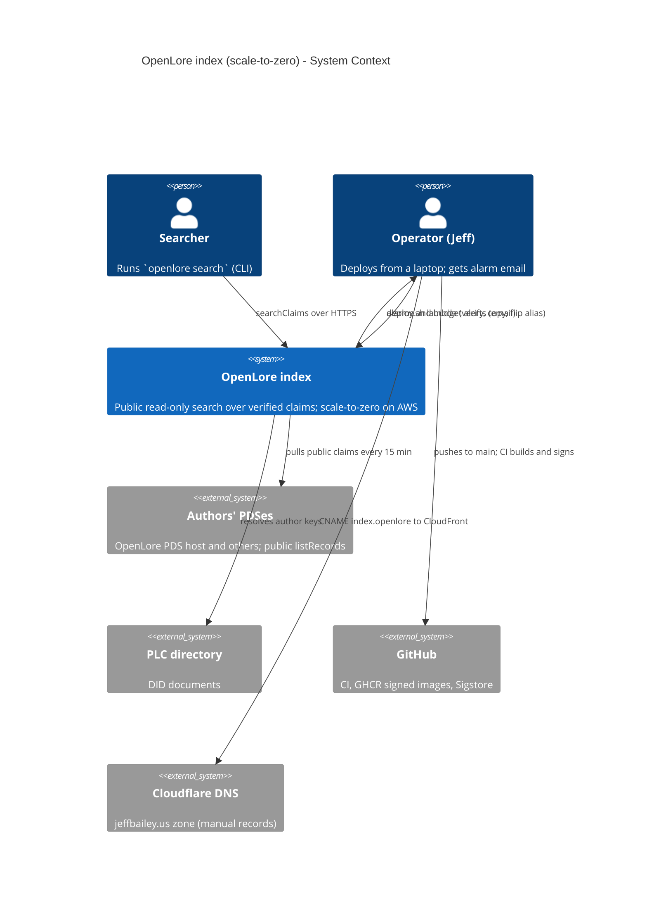
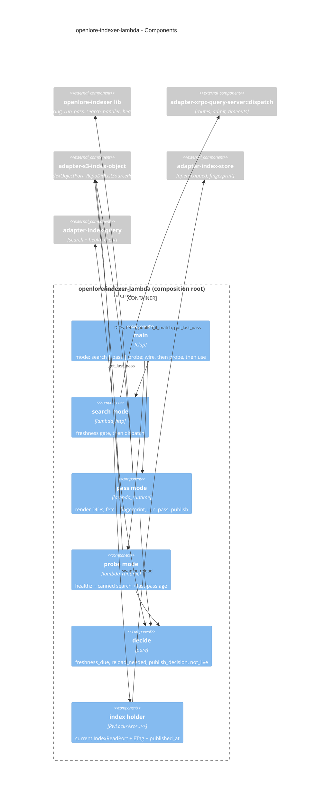

# Feature Delta: scale-to-zero-hosting

- **Wave**: DESIGN (2026-10-26). Mode: propose. Phase 1 offered options A, B and C; the user chose
  **Option B**, a native Lambda root.
- **Scope (user decision)**: the indexer only. Its search (`serve`) and its 15-minute pass move off
  the shared PDS host onto scale-to-zero AWS: Lambda, one S3 object holding the index, and
  CloudFront for `index.openlore.jeffbailey.us`. The review app and the OpenLore PDS stay on the
  t4g.micro host.
- **Requirements source**: there are **no DISCUSS artifacts** for this feature. The requirements
  are:
  - the SPIKE-6 pass criteria (`docs/feature/bluesky-claim-review-app/design/wave-decisions.md`,
    the SPIKE-6 rows);
  - the spike findings (`docs/feature/scale-to-zero-hosting/spike/findings.md`,
    `spike/wave-decisions.md`);
  - the existing indexer KPIs and NFRs, which "no loss of today's guarantees" carries forward
    (`docs/feature/indexer-deployment/discuss/outcome-kpis.md`: KPI-IXD-3, KPI-IXD-4, KPI-IXD-5,
    and NFR-IXD-6 "added cost ≤ $2/month").
- **ADRs**: **ADR-090** is new. It supersedes ADR-075 for the indexer, amends ADR-080 and ADR-083,
  and extends ADR-023.

## Wave: DESIGN / [REF] Requirements (derived, no DISCUSS)

| ID | Requirement | Source |
|---|---|---|
| R-STZ-1 | A search answers from a cold start in under 3 s, measured on the client end to end over HTTPS | SPIKE-6 pass criterion |
| R-STZ-2 | A warm search answers in under 200 ms when the index has not changed since the instance last checked | SPIKE-6 pass criterion |
| R-STZ-3 | The indexer costs well under $2/month at current traffic | SPIKE-6, NFR-IXD-6 |
| R-STZ-4 | Only CI-green commits deploy, the image is cosign-verified by digest, post-checks gate the deploy, and rollback is designed first and takes seconds | today's `deploy/indexer/deploy.sh` |
| R-STZ-5 | The last good pass is ≤ 30 min old in ≥ 98% of hourly checks | KPI-IXD-3 (pass every 15 min, user decision) |
| R-STZ-6 | A DID-list edit takes effect on the next pass with no deploy | KPI-IXD-4 |
| R-STZ-7 | Every exit-2 pass and two exit-3 passes in a row page; exit-0 passes do not; the index not being live pages | KPI-IXD-5, alarms A1-A3 |
| R-STZ-8 | Abuse is capped, both in damage and in spend | ADR-083 (as amended here) |
| R-STZ-9 | The self-hostable `openlore-indexer` binary behaves exactly as before and stays AWS-free | ADR-023, user decision |
| R-STZ-10 | Searches can lag a pass by at most the freshness TTL plus one reload | spike finding 7 |

## Wave: DESIGN / [REF] Design decisions (D-numbered)

| ID | Decision | Rationale |
|---|---|---|
| D-STZ-1 | **Option B.** A new composition root `openlore-indexer-lambda` (binary) runs search, pass and probe in-process. There is no Lambda Web Adapter. | Freshness checks run synchronously on the request path, so the R-STZ-10 bound holds; the decisions are pure and testable; the AWS SDK stays out of the self-host binary. |
| D-STZ-2 | `openlore-indexer` splits into a lib plus a bin. The bin's behaviour, CLI, env vars and events do not change. | The new root reuses the wiring, the pass and the search and health handlers without copying them. |
| D-STZ-3 | A new effect crate, `adapter-s3-index-object`, implements `IndexObjectPort` (S3) and `RepoDidListSourcePort` (SSM). It is the only crate, together with the Lambda root, that links `aws-*` crates. | ADR-023 boundary: the AWS SDK lives in one adapter. |
| D-STZ-4 | Region **us-east-1**. | The prod log group, alarms, SNS topic and DID parameter are already there, and CloudFront's ACM certificate must be in us-east-1. The spike timings are network-bound and carry over. |
| D-STZ-5 | The index is **one S3 object**, `s3://<bucket>/index/index.duckdb`, plus `index/last-pass.json`. The bucket is versioned and keeps at most 5 noncurrent versions for 1 day. SSE-S3 is on and public access is blocked. | The index is a rebuildable cache (ADR-023). S3 writes are atomic and reads are strongly consistent (spike finding 7). Versioning gives index rollback, and the lifecycle rule bounds storage cost. |
| D-STZ-6 | **One writer.** The pass function has reserved concurrency 1. Its publish is `PutObject` with `If-Match: <etag read at the start>`, or `If-None-Match: *` when no object exists. A 412 is `indexer.lambda.publish_conflict`, which is exit 2 and pages through A2. | ADR-080's "passes never overlap" holds at two independent layers, as the host timer did. |
| D-STZ-7 | The pass **publishes only when something changed**: the index fingerprint after the pass differs from the one before, and the store is still usable. Every pass with exit 0 also writes `last-pass.json` (`pass_id`, `exit_code`, `finished_at`, `published`). | It saves PUTs and avoids pointless warm reloads, while the probe still sees every good pass. |
| D-STZ-8 | **Fingerprint**: `(claim count, distinct author count, XOR of a 64-bit hash of every CID)`, read from the store before and after the pass. | It does not depend on upsert counters, and a re-upsert of the same claim, which is a no-op, does not count as a change. |
| D-STZ-9 | Publish also happens on exit 2 or 3 when the fingerprint changed and the store is usable. It never happens on an unusable store. (Confirmed by the user, 2026-10-27.) | This mirrors the host, which keeps committed upserts after an exit-2 pass (ADR-080). |
| D-STZ-10 | **Warm-instance freshness TTL 60 s.** Before answering, the search handler checks whether 60 s have passed since its last check. If so, it sends a `HEAD`. If the ETag changed, it downloads to a new `/tmp` file, opens it, swaps the handle and deletes the old file, then answers. | The bounded lag is TTL plus one reload. A `HEAD` costs about 15-30 ms, so warm calls stay under 200 ms. A reload costs about one cold fetch, inside the 3 s budget. |
| D-STZ-11 | A failed freshness check **never fails a search**. The instance answers from its current copy, logs `indexer.lambda.freshness_check_failed`, and retries after the next TTL. | Availability comes before freshness. A stale index is still a correct, verified index. |
| D-STZ-12 | `/healthz` `last_successful_pass_at` now means **"index published at"**. It is read from the object metadata `x-amz-meta-published-at` at fetch or reload, and it is `null` when no object exists yet. The JSON field name and shape do not change. | A search instance has no pass runner. The value is still public, still one timestamp, and still a freshness signal. |
| D-STZ-13 | When no index object exists (a fresh bucket, or after `reset-index`), search opens an empty local index: `/healthz` returns 200 with `null`, and searches return empty results until the next pass publishes. | Same as the host after `rollback --reset-index`. |
| D-STZ-14 | An S3 failure at **init** (not 404) emits `health.startup.refused` and init fails, so the Function URL answers 5xx. | The existing A2 filter already matches `health.startup.refused`. A broken store never looks healthy (ADR-083 §2). |
| D-STZ-15 | **Pass cadence every 15 min.** An EventBridge Scheduler entry `cron(0/15 * * * ? *)` targets the pass function's `live` alias, with no retries and no flexible window. | KPI-IXD-3 stays as written. Quarter-hour alignment keeps A1's 900 s periods correct. A missed slot is covered by the next one, as with the host timer. |
| D-STZ-16 | **DID list per pass.** The pass reads `/openlore/prod/indexer/repo-dids` (SSM) at the start of every run. It writes the list to `/tmp/config/repo-dids` with a rename and points the existing `OPENLORE_INDEXER_REPO_DIDS_FILE` at it. If SSM fails, a warm instance keeps its last good copy for up to 2 h. With no copy, the missing file makes the existing ADR-081 path refuse the pass with exit 2. | KPI-IXD-4 holds. The validation stays in the binary (ADR-081), and only the renderer moves. |
| D-STZ-17 | The pass deadline is `OPENLORE_INDEXER_PASS_DEADLINE_SECS=780`, and the function timeout is 840 s. | Lambda's hard limit is 900 s. Today a pass takes about 1 s. |
| D-STZ-18 | **Abuse guard (user decision)**: a global cap instead of per-client 429s. | Spike finding 5. WAF rate rules (about $6+/month) would break R-STZ-3. |
| D-STZ-18a | Search reserved concurrency is **3**. Calls above the cap are throttled by Lambda and get a 429 from the Function URL. | |
| D-STZ-18b | **Alarm A4** fires when search invocations exceed **3,000 per 5 min** (Sum). | |
| D-STZ-18c | **AWS Budgets** alert at **$2** and **$10** a month. They notify the operator's contact email, read from `/openlore/prod/acme-contact-email`. | |
| D-STZ-18d | **Kill switch**: `deploy.sh lambda stop` sets search reserved concurrency to **0**, and `lambda start` sets it back to 3. | |
| D-STZ-19 | The per-client rate limiter is **not wired** in the Lambda root. It stays in the self-host and host `serve` unchanged. | Each Lambda instance would start with an empty token bucket, so the limiter guards nothing there. |
| D-STZ-20 | The **edge is CloudFront without OAC** (user decision). The raw Function URL stays public, with auth `NONE`. Both paths share the same routes, bounds and reserved-concurrency cap, and the CLI does not change. | OAC would require POST clients to send `x-amz-content-sha256`, which would break `openlore search`. |
| D-STZ-21 | CloudFront has three behaviors:<br>• `/xrpc/org.openlore.appview.searchClaims`: all methods, caching disabled, origin request policy "all viewer except Host";<br>• `/healthz`: GET/HEAD, caching disabled;<br>• default `*`: a CloudFront Function answers 404 at viewer request.<br>Price class 100. A response headers policy removes `x-amzn-*` headers. | This keeps ADR-083's two layers: edge allowlist plus binary allowlist. Body and value bounds stay in the binary (413/400), and the spike verified them without Caddy. |
| D-STZ-22 | Search requests go through the **same pure dispatch** as `serve`. `adapter-xrpc-query-server` gains a transport-free `dispatch(request, handlers) -> response` (routes, `admit`, the 5 s `REQUEST_TIMEOUT` → 503 `index_busy`, 413, 404, health). The hyper server and the Lambda root both call it. | The bounds are identical by construction, not by copying. |
| D-STZ-23 | **A3 detection by a 5-minute probe** (`openlore-indexer-probe`, reserved concurrency 1, EventBridge `rate(5 minutes)`). Each run:<br>• `GET /healthz` and the canned search through CloudFront;<br>• reads the age of `last-pass.json` (stale after 45 min);<br>• emits one `indexer.host.health` line with `not_live` and the same causes as `health-timer.sh`. | The A3 filter and alarm are reused unchanged. Missing data still counts as breaching. The probe also keeps one search instance warm. The event name is kept for filter reuse and documented as legacy. |
| D-STZ-24 | **One signed image digest** carries both binaries (`openlore-indexer`, `openlore-indexer-lambda`) and `WORKDIR /`. The image `ENTRYPOINT` stays `openlore-indexer` for the host. Each Lambda function sets `image_config.entry_point = ["/usr/local/bin/openlore-indexer-lambda"]` and `command = ["search"\|"pass"\|"probe"]`. | One cosign verification covers every runtime. Spike finding 1 showed that `WORKDIR /` is needed; it is harmless for compose, which uses absolute paths. |
| D-STZ-25 | **ECR** repo `openlore-indexer` (us-east-1): immutable tags, lifecycle keeps the last 5 images. `deploy.sh` copies the verified GHCR digest with `crane copy` (the digest is preserved) and tags it `sha-<40 hex>`. | Lambda pulls only from same-account, same-region ECR. CI still pushes only to GHCR (ADR-075 §5 laptop discipline: no OIDC deploy role). |
| D-STZ-26 | **Versions and aliases.** Each function has a `live` alias. Search also has a `candidate` alias with its own Function URL for post-checks. A deploy runs:<br>1. CI green;<br>2. resolve the digest;<br>3. cosign verify;<br>4. crane copy;<br>5. `update-function-code` ×3;<br>6. `publish-version` ×3, with description `<sha> <digest>`;<br>7. move `candidate` and run the existing post-checks against its URL;<br>8. flip `live` on search, then pass, then probe. | Rollback is an alias flip back to the previous version, in seconds, with no image pull. Version descriptions replace the host's releases file. |
| D-STZ-27 | **Index rollback**: `deploy.sh lambda reset-index` deletes the current object, and the next pass rebuilds it. `restore-index <version-id>` copies a noncurrent version back. | The index is a rebuildable cache, and there is no schema change between releases (existing rule). |
| D-STZ-28 | **New tofu root `deploy/tofu/environments/prod-indexer/`**: provider us-east-1, state in `jeffbaileyterraformstate` under key `openlore/indexer/prod.tfstate`, laptop apply. It reads `backup_alarm_topic_arn` and `indexer_log_group` from the prod root through `terraform_remote_state`. | An indexer apply can never plan against the PDS module, which can replace the instance. |
| D-STZ-29 | Tofu owns the function configuration. `image_uri` and the alias `function_version` are `ignore_changes`, because `deploy.sh` owns code and versions. | Tofu does not fight deploys, and deploys do not drift infrastructure. |
| D-STZ-30 | **Function sizing**: arm64 throughout.<br>• search: 512 MB, 10 s timeout, 512 MB `/tmp`, DuckDB 48 MB with 1 thread;<br>• pass: 512 MB, 840 s;<br>• probe: 128 MB, 30 s. | The spike's sweet spot (512 MB). 1024 MB was no faster. |
| D-STZ-31 | **Trial (user default)**:<br>• the host keeps running its indexer in parallel;<br>• Lambda functions log to a separate group, `/openlore/prod/indexer-lambda`, with trial copies of the four metric filters and alarms A1-A3 (actions enabled, named `openlore-indexer-lambda-*`);<br>• **cut-over** is a manual Cloudflare exact CNAME `index.openlore` → the CloudFront domain, DNS-only, TTL 60;<br>• rollback during the trial deletes the CNAME, so the wildcard sends traffic back to the Caddy host container;<br>• **decommission the host indexer after 7 green days** after cut-over. | Two `pass_summary` producers in one log group would break A1's per-quarter-hour Minimum. The trial gives evidence before the host path is removed. |
| D-STZ-32 | At cut-over, the Lambda `logging_config` is repointed to `/openlore/prod/indexer`. The existing A1-A3 filters and alarms in the prod root then cover Lambda unchanged, and the trial filters, alarms and log group are removed. At decommission, the prod-root indexer resources move to the new root (`removed` and `import` blocks), and `bootstrap/indexer-iam.tf` and the host files are retired. | No alarm is redefined, and the KPI-IXD-5 history stays in one place. |
| D-STZ-33 | **Index-size alarm A5**: the pass logs `indexer.lambda.published {index_bytes, pass_id}`. A metric filter publishes `IndexBytes`, and A5 fires above 100 MB. | Spike: the cold start passes 3 s at about 140 MB. This gives warning before the ceiling. |
| D-STZ-34 | **Cloudflare DNS is done by hand**: the ACM DNS-validation CNAME and the exact `index` CNAME. | Cloudflare is not in tofu today (ADR-067, DNS section of the brief). |
| D-STZ-35 | **Only the two Lambda crates require Rust 1.94.1; the workspace MSRV stays 1.91** (user, 2026-10-27). | The current `aws-config`, `aws-sdk-s3`, `aws-sdk-ssm` and `aws-smithy-http-client` need 1.94.1, and CI builds on stable 1.99. A per-crate `rust-version` keeps the CLI's source install at 1.91. Pinning to the February 2026 SDK line (the last on 1.91) would lose 8 months of fixes. |
| D-STZ-36 | The AWS SDK HTTP client uses **rustls with ring** (`aws-smithy-http-client` feature `rustls-ring`, SDK `default-features = false`). | The workspace already uses `ring` and has no `aws-lc-rs`. ADR-004 prefers rustls, and `openssl` stays banned. |
| D-STZ-37 | The probe reuses `adapter-index-query` (the CLI's bounded XRPC client) for the canned search, which gains a `health()` call for `/healthz`. | It is the same client the CLI uses, so the probe tests what users see. No new HTTP client is added. |

## Wave: DESIGN / [REF] Component decomposition

| Path | Kind | Change | Notes |
|---|---|---|---|
| `crates/openlore-indexer` | driver (lib + bin) | **EXTEND** (lib split) | `src/lib.rs` exposes the wiring (`IndexerWiring::production` taking paths), the pass entry (`ingest_pass::run_pass -> PassExit`), `search_handler`, `health`, and `events`. `health_handler` takes a `last_published_at` reader closure instead of `StatusReader`; the self-host passes the runner's reader, so its behaviour is unchanged. `main.rs` is unchanged in behaviour. |
| `crates/openlore-indexer-lambda` | driver (binary) | **CREATE NEW** | The **fourth composition root**, in the indexer family. Modes `search` (lambda_http), `pass` (lambda_runtime, scheduler event) and `probe` (lambda_runtime). It holds the pure `decide` module. |
| `crates/openlore-indexer-lambda/src/decide.rs` | pure core (module) | **CREATE NEW** | `freshness_due(now, last_checked, ttl) -> bool`, `reload_needed(current: Option<Etag>, head: Option<Etag>) -> Reload`, `publish_decision(exit, before: Fingerprint, after: Fingerprint, store_usable) -> Publish`, `not_live(probe_facts) -> NotLive`, `dids_copy_usable(age, max) -> bool`. No I/O. |
| `crates/adapter-s3-index-object` | effect | **CREATE NEW** | `IndexObjectPort` over S3 (`head`, `fetch_to`, `publish_if_match`, `put_last_pass`, `get_last_pass`) and `RepoDidListSourcePort` over SSM (`current`). It is the only crate with `aws-*` dependencies besides the Lambda root, which builds the SDK config. |
| `crates/ports` | ports | **EXTEND** | New `index_object.rs` (`IndexObjectPort`, `ObjectVersion`, `PublishOutcome`, `LastPass`) and `repo_did_list.rs` (`RepoDidListSourcePort`). Async through `#[async_trait]`, as `IdentityResolvePort` already is. |
| `crates/adapter-index-store` | effect | **EXTEND** | `fingerprint() -> IndexFingerprint`: one read-only SQL query, with no aggregate across authors exposed to callers beyond counts (WD-103-safe: it returns no claim data). |
| `crates/adapter-xrpc-query-server` | effect | **EXTEND** | Extract transport-free `dispatch` (D-STZ-22). The hyper `serve` calls it after its rate limit and connection cap. Its behaviour is unchanged. |
| `crates/adapter-index-query` | effect | **EXTEND** | `health() -> Result<HealthBody, IndexQueryError>` with the same bounded timeouts (D-STZ-37). |
| `crates/openlore-indexer/Dockerfile` | image | **EXTEND** | `WORKDIR /`; copy both binaries. |
| `.github/workflows/ci.yml` (`indexer-build`, `indexer-image`) | CI | **EXTEND** | Build both binaries and produce an SBOM for each. Keep serve-smoke as is (it must stay green with `WORKDIR /`). Add a Lambda-posture smoke (see open questions). Trivy, push, sign, attest and SLSA are unchanged, on one digest. |
| `xtask/src/check_arch.rs` | tooling | **EXTEND** | See "xtask deltas" below. |
| `deploy/indexer/deploy.sh` | ops | **EXTEND** | New `lambda` verbs: `deploy <sha\|digest>`, `rollback`, `stop`, `start`, `status`, `trigger` (invoke the pass `live` alias once), `reset-index`, `restore-index <version-id>`. They reuse `ci_green`, `resolve_digest`, `image_revision`, `verify_signature`, `post_checks` and `kpi`. |
| `deploy/tofu/environments/prod-indexer/` | IaC | **CREATE NEW** | Resources listed below. |
| `deploy/tofu/environments/prod/indexer.tf`, `deploy/tofu/bootstrap/indexer-iam.tf`, `deploy/indexer/host/*` | IaC and ops | **KEEP** during the trial, **RETIRE or MOVE** at decommission | D-STZ-31 and D-STZ-32. |

**xtask deltas**:
- `indexer_lambda_holds_no_signing_or_local_store`: the same forbidden deps as the indexer root (`adapter-duckdb`, `adapter-atproto-pds`, `adapter-github`), applied to `openlore-indexer-lambda`.
- `aws_sdk_only_in_lambda_edge`: `aws-*` and `lambda_*` crates may be reachable only from `adapter-s3-index-object` and `openlore-indexer-lambda`. The `openlore-indexer` dependency graph contains none of them (R-STZ-9).
- `indexer_guarded_clients_only`: also scans `openlore-indexer-lambda/src`.
- `indexer_search_handler_read_only`: also scans the Lambda search module, which may hold `IndexReadPort` and `IndexObjectPort::head/fetch_to` but no `publish_*`.
- `cli` stays forbidden from linking the new crates (the I-3 second axis gains `adapter-s3-index-object` and `openlore-indexer-lambda`).

**Tofu resources in the new root**:
- ECR repo and lifecycle policy;
- S3 bucket, versioning, lifecycle, public access block, SSE;
- three IAM roles, each with least privilege:
  - search: `s3:GetObject` and `HeadObject` on `index/*`, logs;
  - pass: Get/Put on `index/*`, `ssm:GetParameter` on the DID parameter, logs;
  - probe: `s3:GetObject` on `index/last-pass.json`, logs;
- three `aws_lambda_function` (package type Image, reserved concurrency 3/1/1, `logging_config`);
- aliases `live` ×3 and `candidate` ×1;
- Function URLs on search `live` and `candidate` (auth NONE, with both resource-policy statements from spike finding 9);
- two `aws_scheduler_schedule` and their scheduler role;
- the trial log group, four filters, A1-A3 trial alarms, A4 and A5;
- ACM certificate (DNS validation, record done by hand);
- CloudFront distribution and CloudFront Function;
- two `aws_budgets_budget`.

## Wave: DESIGN / [REF] Driving ports

| Port | Transport | Contract |
|---|---|---|
| Search | `POST https://index.openlore.jeffbailey.us/xrpc/org.openlore.appview.searchClaims` (CloudFront) and the raw Function URL | Unchanged XRPC lexicon and bounds (ADR-027, ADR-083): 8 KiB body (413), 512 B value (400), ≤ 1000 rows, 5 s → 503 `index_busy`, store error → 500, other routes → 404. A throttle above reserved concurrency → 429. |
| Health | `GET /healthz` (same two hosts) | `200 {"status":"ok","last_successful_pass_at":<published-at>\|null}`; 503 `store_unusable`. Never 200 on a broken store. |
| Pass | EventBridge Scheduler event → pass function `live` alias (also `deploy.sh lambda trigger`) | One ADR-077/078 pass. It emits exactly one `indexer.ingest.pass_summary` with `exit_code` 0/2/3 and `pass_id`, then publishes or not (D-STZ-7). |
| Probe | EventBridge Scheduler event → probe function `live` alias | One `indexer.host.health` line with `not_live` 0 or 1. |
| Operator | `deploy.sh lambda …` (laptop, `AWS_PROFILE=jeff`) | Deploy, rollback, stop/start, status, trigger, reset-index and restore-index, all with the existing gates. |

## Wave: DESIGN / [REF] Driven ports and adapters

| Port | Adapter | Used by | Notes |
|---|---|---|---|
| `IndexReadPort` (existing) | `adapter-index-store` on the `/tmp` file | Lambda search | Behind a swappable holder (`RwLock<Arc<…>>`, std only). |
| `IndexStorePort`, `IndexPurgePort` (existing) | `adapter-index-store` | Lambda pass | Unchanged pass (ADR-080 §6 and §7 robustness carries over). |
| `IngestSourcePort`, `IdentityResolvePort` (existing) | `adapter-atproto-ingest`, `adapter-atproto-did` (guarded) | Lambda pass | Unchanged (ADR-077 SSRF guard). |
| **`IndexObjectPort`** (new) | `adapter-s3-index-object` (S3) | search (`head`, `fetch_to`), pass (all), probe (`get_last_pass`) | ETag is the object version. Conditional writes use `If-Match` and `If-None-Match`. |
| **`RepoDidListSourcePort`** (new) | `adapter-s3-index-object` (SSM `GetParameter`) | pass | Returns raw text. Validation stays in the existing ADR-081 loader. |
| `IndexQueryPort` (existing, extended with `health`) | `adapter-index-query` | probe | Public URL through CloudFront. |
| `ClockPort` (existing) | `adapter-system-clock` | all | Pure decisions take `now` as an argument. |

## Wave: DESIGN / [REF] Technology choices (pinned)

Versions are current on crates.io as of 2026-10-26. The lockfile is settled in DELIVER, and `cargo deny check` must pass.

| Crate | Version | MSRV | License | Why |
|---|---|---|---|---|
| `lambda_http` | 1.3.2 | 1.84 | Apache-2.0 | Function URL events as `http::Request` (http 1, hyper 1, the same stack as the query server). Not axum (banned). |
| `lambda_runtime` | 1.5.0 | 1.84 | Apache-2.0 | Scheduler events for pass and probe |
| `aws-config` | 1.13.0, `default-features = false`, features `rt-tokio`, `behavior-version-latest` | 1.94.1 | Apache-2.0 | Credentials from the Lambda environment |
| `aws-sdk-s3` | 1.155.0, `default-features = false`, `rt-tokio` | 1.94.1 | Apache-2.0 | `HeadObject`, `GetObject`, conditional `PutObject` |
| `aws-sdk-ssm` | 1.131.0, `default-features = false`, `rt-tokio` | 1.94.1 | Apache-2.0 | `GetParameter` for the DID list |
| `aws-smithy-http-client` | 1.5.1, feature `rustls-ring` | 1.94.1 | Apache-2.0 | rustls with ring; no aws-lc, no openssl (D-STZ-36) |
| existing `duckdb` (capped below 1.20000), `tokio` 1.54, `hyper` 1.12, `reqwest` 0.12 (rustls) | unchanged | | | |

- **Fallback if per-crate MSRV proves unworkable**: `aws-config` 1.8.14, `aws-sdk-s3` 1.124.0 and `aws-sdk-ssm` 1.106.0 (the last releases on 1.91).
- **AWS services**: Lambda (arm64, container image), S3, SSM Parameter Store (existing), ECR, EventBridge Scheduler, CloudFront with a CloudFront Function, ACM, CloudWatch Logs and alarms, SNS (the existing topic), AWS Budgets. Tofu: provider `hashicorp/aws ~> 6.0`, as in the prod root.

## Wave: DESIGN / [REF] Reuse Analysis (hard gate)

| Existing component | File | Overlap | Decision | Justification |
|---|---|---|---|---|
| Index store open (capped) | `crates/adapter-index-store/src/lib.rs` `open_capped` | Opens `/tmp/index.duckdb` | EXTEND (reuse plus `fingerprint`) | Verified on Lambda by the spike |
| Store reopen | none (`serve` opens once, ADR-080 §1) | Warm freshness | CREATE NEW in the Lambda root (a swappable holder over `IndexReadPort`, plus pure `decide`) | The existing `SharedIndexReads` seam takes it with no port change |
| One-shot pass | `crates/openlore-indexer/src/ingest_pass.rs` | The same pass, events, exit codes and purge | EXTEND (exposed through the lib) | Spike finding 8 |
| `trigger`, control socket, pass runner | `control.rs`, `pass_runner.rs` | Do not work across instances | KEEP for self-host and host; not used on Lambda | The single writer becomes reserved concurrency 1 plus `If-Match` (D-STZ-6) |
| Per-client rate limiter | `crates/adapter-xrpc-query-server/src/rate_limit.rs` | Ineffective on Lambda | KEEP in `serve`; not wired in Lambda | D-STZ-18 and D-STZ-19 |
| Route allowlist and bounds | `adapter-xrpc-query-server/src/lib.rs` (`public_route`, `admit`, `REQUEST_TIMEOUT`, `index_busy`) | Needed on Lambda | EXTEND (extract `dispatch`) | Identical bounds by construction (D-STZ-22) |
| Caddy site | `deploy/indexer/host/index.caddy` | Edge allowlist | REPLACE with CloudFront behaviors at cut-over | ADR-083 keeps two layers |
| Deploy gates | `deploy/indexer/deploy.sh` | CI green, cosign, post-checks | EXTEND (`lambda` verbs) | Same functions, new target |
| Rollback | `deploy.sh` releases file, `--reset-index` | Same intent | EXTEND (alias flip, `reset-index`, `restore-index`) | Faster than today |
| Events `pass_summary`, `health.startup.refused`, `indexer.store.unusable` | `events.rs`, `ingest_pass.rs` | Same stdout JSON | REUSE | `logging_config` targets the indexer log group, so the filters work unchanged |
| Host health timer and A3 | `deploy/indexer/host/health-timer.sh`, prod `indexer.tf` | Liveness | REPLACE the producer (probe function); REUSE the event name, filter and alarm | D-STZ-23 |
| DID list render | `deploy/indexer/host/render-dids.sh` | SSM to file | REPLACE the producer (pass renders to `/tmp`); REUSE ADR-081 validation | D-STZ-16 |
| CI image job | `.github/workflows/ci.yml` `indexer-image` | Build, smoke, scan, sign | EXTEND | One digest (D-STZ-24) |
| Prod tofu indexer resources | `deploy/tofu/environments/prod/indexer.tf` | Log group, alarms, SSM parameter | KEEP, then MOVE at decommission | D-STZ-32 |
| CLI index client | `crates/adapter-index-query` | XRPC client | EXTEND (`health`) and reuse for the probe | D-STZ-37 |
| SNS topic | module `backup_alarm_topic_arn` | Alarm notifications | REUSE through remote state | No module change (ADR-066) |

## Wave: DESIGN / [REF] C4: System Context (Level 1)



## Wave: DESIGN / [REF] C4: Container (Level 2)


## Wave: DESIGN / [REF] C4: Component (Level 3, `openlore-indexer-lambda`)



## Wave: DESIGN / [REF] Decisions table (summary)

| Area | Decision |
|---|---|
| Shape | Option B: native Lambda root, three functions from one signed image |
| Region | us-east-1 |
| Index | One S3 object, single writer (reserved concurrency 1 + `If-Match`), publish on change |
| Freshness | TTL 60 s `HEAD`, reload on ETag change; a failed check never fails a search |
| Health | `last_successful_pass_at` = index published at (object metadata) |
| Cadence | Every 15 min (KPI-IXD-3 unchanged) |
| DID list | SSM read each pass, rendered to `/tmp`; ADR-081 validation unchanged |
| Abuse | Reserved concurrency 3, A4 above 3,000 calls per 5 min, Budgets at $2 and $10, `lambda stop` kill switch |
| Edge | CloudFront without OAC; raw Function URL public with the same bounds; CLI unchanged |
| Monitoring | A1/A2 reused; A3 fed by the 5-minute probe; A4 invocations; A5 index size > 100 MB |
| Deploy | CI green, cosign verify, crane copy to ECR, versions, `candidate` post-checks, `live` flip; rollback is an alias flip |
| IaC | New root `deploy/tofu/environments/prod-indexer/` |
| Trial | Host in parallel, separate log group, manual CNAME cut-over, decommission after 7 green days |
| Toolchain | Lambda crates `rust-version` 1.94.1, workspace 1.91; SDK on rustls with ring |

## Wave: DESIGN / [REF] Cost (arithmetic, us-east-1 list prices, free tier ignored)

| Item | Arithmetic | $/month |
|---|---|---|
| Pass | 2,880 × 2 s × 0.5 GB = 2,880 GB-s × $0.0000133334 | 0.038 |
| Search (users) | 3,000 × 0.7 s × 0.5 GB = 1,050 GB-s | 0.014 |
| Probe and its two calls | 8,640 × 0.5 s × 0.125 GB + 17,280 × 0.1 s × 0.5 GB = 1,404 GB-s | 0.019 |
| Lambda requests | about 31,800 × $0.20/1M | 0.006 |
| S3 PUT | ≤ 2,880 index + 2,880 `last-pass.json` = 5,760 × $0.005/1k | 0.029 |
| S3 GET/HEAD | about 25k × $0.0004/1k | 0.010 |
| S3 storage | ≤ 6 versions × 3 MB | < 0.01 |
| CloudWatch Logs | about 30 MB | 0.015 |
| ECR | 5 × 45 MB | 0.02 |
| New alarms | A4, A5 × $0.10 | 0.20 |
| CloudFront, CF Function, ACM, Scheduler, Budgets | free tiers (10M requests, 2M functions, 14M invocations, 2 budgets) | 0 |
| **Total** | | **about $0.36** (about $0.30 with the Lambda free tier) |

The trial adds about $0.30/month for the duplicate A1-A3 alarms until cut-over. **Abuse ceiling**: at concurrency 3 and about 65 ms per call, saturation is about 46 req/s, which costs about $0.28 per hour of attack. A4 fires within 5 to 10 min, and the kill switch stops the spend.

## Wave: DESIGN / [REF] Contradictions and how each was resolved

| # | Contradiction | Resolution |
|---|---|---|
| 1 | The spike ran in us-west-2; prod is in us-east-1 | us-east-1 (D-STZ-4) |
| 2 | Moving the indexer does not lower the bill while the host stays | Accepted by the user. The value now is no shared fate, 128 MB freed on the t4g.micro, and the groundwork for the later SPIKE-6 halves. |
| 3 | The per-client rate limit does not hold on Lambda; abuse costs money | Global cap, A4, Budgets and the kill switch (D-STZ-18). ADR-083 amended. |
| 4 | An hourly pass would break KPI-IXD-3 | The pass stays at 15 min (D-STZ-15) |
| 5 | KPI-IXD-4 needs no-deploy DID edits | SSM is read each pass (D-STZ-16) |
| 6 | `/healthz` freshness came from an in-memory pass runner | Index published at, from object metadata (D-STZ-12) |
| 7 | Lambda cannot pull from GHCR; a Lambda variant image would be unsigned | One signed digest with both binaries; `crane copy` after cosign verify (D-STZ-24, D-STZ-25) |
| 8 | The AWS SDK must not enter the self-host binary | A new adapter crate and root, with xtask rules (D-STZ-3, xtask deltas) |
| 9 | OAC would break CLI POSTs | No OAC; the raw Function URL is public with the same bounds (D-STZ-20) |
| 10 | The latest AWS SDK needs Rust 1.94.1; the workspace MSRV is 1.91 | Per-crate `rust-version` 1.94.1 on the two Lambda crates only (D-STZ-35, user), with a pinned fallback |

## Changed Assumptions

**ADR-075** (co-locate on the PDS host). Its rejected alternative is now chosen for the indexer:

> "**Serverless (Lambda + function URL, or Cloudflare Workers as in the J-007 `atproto/` path)** |
> Rejected for v1. The pure cores are Rust with DuckDB, so this would need a new storage choice
> (DynamoDB/D1), a new deploy toolchain and a cold-start-tolerant scan design."

For the indexer, the spike showed that none of these is needed. DuckDB stays: the index is an S3 object fetched to `/tmp`. The deploy toolchain is the existing one plus `crane copy`. The cold start is 0.36-0.96 s up to 100k claims. The indexer leaves the host. **The review app keeps ADR-075 unchanged.**

**ADR-080** (`serve` owns the index and runs triggered passes):

> "1. **One process, one store handle.** The long-running `openlore-indexer serve` container is the
> only process that opens `index.duckdb` in production."
>
> "2. **The pass runs inside `serve`, on demand.** `serve` gains a **pass runner** and a **control
> channel** that starts the runner."

In production on Lambda, every search instance opens its own read copy, and the pass function is the only writer of the one S3 object. "Passes never overlap" holds through reserved concurrency 1 plus `If-Match`, instead of the in-process single-flight plus systemd. The runner, the control socket and `trigger` remain for self-hosting and for the host during the trial.

**ADR-083** (public surface, bounded):

> "**Caddy** (`index.caddy`, a stock directive set) proxies only `POST /xrpc/org.openlore.appview.searchClaims`
> and `GET /healthz`."
>
> "the limit is enforced in the indexer binary: a per-client token bucket, 10 req/s, burst 50 …"
>
> "5. **Responses carry no `Server` header** (Caddy `header -Server`)."

- CloudFront behaviors replace the Caddy layer.
- The per-client token bucket is replaced on Lambda by a global cap (reserved concurrency 3), alarm A4, Budgets and a kill switch.
- `last_successful_pass_at` now means index published at.
- CloudFront may send `Server: CloudFront`, which carries no version information; the `x-amzn-*` headers are removed.
- The in-binary bounds are unchanged and still independent of the edge.

**ADR-023** is extended, not changed. A Lambda composition root joins the indexer family, and the self-hostable single binary stays AWS-free and behaves as before.

## Wave: DESIGN / [REF] Open questions deferred to DISTILL/DELIVER

1. **Lambda-posture smoke in CI.** Options:
   - the Lambda Runtime Interface Emulator (pinned checksum) with a local S3-compatible store;
   - or a release-refused test seam `OPENLORE_INDEXER_LAMBDA_INDEX_SOURCE=file://…`, refused in release like `ALLOW_LOOPBACK_HTTP`.

   DISTILL decides. The second matches an existing pattern.
2. **Reload under the `/tmp` limit.** A reload holds two copies. With 512 MB `/tmp`, the index ceiling is about 240 MB, above the 140 MB cold ceiling, so this is fine. DELIVER confirms the old file is deleted after the swap.
3. **Write-ahead log.** The pass ends with `CHECKPOINT` (ADR-080 §6). DELIVER verifies that the WAL file is empty before upload, and closes the handle if it is not.
4. **SNS topic policy.** Confirm that alarms in a second root can publish to the module topic. CloudWatch alarm actions need no topic-policy change for same-account alarms; verify this with one test-fire.
5. **Function URL permissions in tofu.** `aws_lambda_permission` for `InvokeFunctionUrl` plus `InvokeFunction` with `invoked_via_function_url` (spike finding 9). Check that provider `~> 6.0` exposes the second condition. If not, use a `null_resource` or manual CLI step, documented.
6. **`deploy.sh` organisation.** Should the `lambda` verbs live in `deploy/indexer/deploy.sh` or in a new `deploy/indexer/lambda.sh` sourced by it? The file is already 847 lines. This is the crafter's call.
7. **Re-measure gate.** The spike measured the Web Adapter path. DELIVER re-measures cold and warm times for the native root in us-east-1 (5 cold, 20 warm) and records them before cut-over.
8. **Long-idle reactivation.** Spike finding 10 is unmeasured. The 5-minute probe keeps the function active, so this is moot while the probe runs.

## Wave: DESIGN / [REF] Quality validation

- Every R-STZ requirement maps to a decision: R-1/2 → D-10, D-30; R-3 → cost table; R-4 → D-24..27; R-5 → D-15; R-6 → D-16; R-7 → D-23, D-32; R-8 → D-18..21; R-9 → D-2, D-3 and xtask; R-10 → D-10.
- Rollback was designed first. The code rolls back by alias flip, the index by reset or restore, and traffic during the trial by deleting the CNAME.
- Simplest-first: rejected alternatives are recorded in ADR-090: option A, staying on the host, WAF, OAC, and a Caddy proxy.
- DORA: lead time is unchanged (laptop deploy). Time to restore improves: an alias flip takes seconds, against a container recreate.

---

# Wave: DEVOPS (2026-10-27)

- **Architect**: Apex (nw-platform-architect), autonomous. Design only: no code, tofu, workflow or
  script was changed, nothing was applied, deployed or committed. AWS was read with
  `AWS_PROFILE=jeff`, read-only.
- **Configuration (given)**: AWS us-east-1; Lambda container image, arm64; GitHub Actions, extending
  `ci.yml`; existing infra and CI (prod tofu root, `deploy/indexer/deploy.sh`, `deploy/ops.sh`,
  `indexer-build`/`indexer-image`, A1-A3 on SNS); CloudWatch; blue-green by Lambda alias; no
  continuous learning; trunk-based; per-feature mutation testing (already in CLAUDE.md).
- **Facts checked in the account (read-only, 2026-10-27)**: Lambda account limit 1,000 and 0
  functions in us-east-1; 8 CloudWatch alarms and 7 custom metrics today; one existing budget
  ("Monthly Budget", $15, unfiltered); the SNS topic `openlore-pds-prod-backup-alarm` has the
  default same-account policy and no KMS key, with 1 confirmed subscription;
  `/openlore/prod/acme-contact-email` is a SecureString; `jeffbailey.us` is served by Cloudflare;
  the locked AWS provider (6.67.0) has the Function URL `invoked_via_function_url` attribute; the
  pinned `rust:1-bookworm` build image is Rust 1.99.0; the distroless base sets
  `WorkingDir=/home/nonroot`; there is **no MSRV job** in any workflow.

## Wave: DEVOPS / [REF] Environment matrix

| Environment | Platform | What runs | Preconditions |
|---|---|---|---|
| **local** | macOS or Linux laptop, Rust stable (`rust-toolchain.toml`) | `cargo nextest`: the pure `decide` module, the handlers through in-memory fakes of `IndexObjectPort` and `RepoDidListSourcePort`, the extracted `dispatch`, `fingerprint`. No AWS credentials, no network. | None beyond today's dev setup. Clippy and nextest stay CI-authoritative (slow host). |
| **ci-commit** | GitHub Actions `ubuntu-latest` | fmt, clippy, deny (AWS tree), check-arch (new xtask rules), check-probes, **new `msrv` job** (1.91.0 without the two Lambda crates; 1.94.1 for the two Lambda crates), then `test` (nextest workspace). | Every push to `main`. |
| **ci-image-lambda** | GitHub Actions `ubuntu-24.04-arm`, Docker | The single image under the **Lambda Runtime Interface Emulator** (pinned release, checksum-verified, mounted at run time and never in the image) with a pinned **moto** server standing in for S3 and SSM through `AWS_ENDPOINT_URL`. The container runs as an arbitrary uid with a read-only root and a 512 MB `/tmp` tmpfs, which is how Lambda runs it. | Main pushes only. This settles DESIGN open question 1 (see CI/CD outline). |
| **ci-image-self-host** | same job | The existing `serve-smoke`, unchanged, on the same image (now `WORKDIR /`). | Must stay green: the self-host contract. |
| **prod-trial** | AWS us-east-1: Lambda arm64 ×3, S3, ECR, Scheduler, CloudFront (default `d….cloudfront.net` domain), ACM | Search, pass (every 15 min, real ingest, real publish) and probe (every 5 min, against the CloudFront default domain). Logs to `/openlore/prod/indexer-lambda` with trial alarms. **The host indexer still serves `index.openlore.jeffbailey.us`** and keeps A1-A3. Both read the same SSM DID list. | The prod-indexer root applied; first `deploy.sh lambda deploy` done; bootstrap gate passed (pre-requisites P-1..P-14). |
| **prod-cutover (soak)** | same, plus the Cloudflare exact CNAME `index.openlore` → CloudFront | Lambda serves the public name. Lambda logs to `/openlore/prod/indexer`, so A1-A3 cover it. Trial alarms removed. **Host indexer on standby**: pass timer, health timer and container stopped, files and Caddy site kept for rollback. | 7 green trial days, re-measure passed, rollback drill passed, Caddy's `index.` certificate valid for ≥ 14 more days. |
| **prod (after decommission)** | same | Lambda only. The prod-root indexer resources live in the prod-indexer root. The host runs the PDS and the review app only. | 7 green soak days. |
| **self-host** | Linux (image `linux/arm64`, or a source build on Linux/macOS with Rust 1.91) | `openlore-indexer` (`serve`, `ingest`, `trigger`) exactly as before; AWS-free. | None new. |
| **cli-client** | Anywhere the CLI runs | `openlore search` with `OPENLORE_INDEXER_URL` set to the public name, the CloudFront domain or the raw Function URL. Unchanged. | None. |

## Wave: DEVOPS / [REF] CI/CD pipeline outline

Trunk-based: every push to `main` runs `ci.yml`; image jobs run on main pushes only; CI never
deploys and never gets AWS credentials (ADR-075 §5 laptop discipline holds).

```text
push to main
  ci.yml
   ├─ commit stage (parallel): fmt │ clippy │ deny │ check-arch │ check-probes │ msrv (NEW, matrix ×2)
   ├─ test (needs commit stage incl. msrv) ── builds the binaries ATs spawn (+ openlore-indexer-lambda if DISTILL's ATs spawn it)
   ├─ release-guard (unchanged)
   └─ indexer-build (CHANGED) → indexer-image (CHANGED)
        build both binaries (two cargo invocations) → SBOM ×2 → artifact
        docker build (both binaries, WORKDIR /) → --version ×2 → serve-smoke (unchanged)
        → lambda-smoke (NEW, blocking) → trivy → push GHCR → cosign sign → attest SBOM ×3 → SLSA
  deploy-pds-check.yml (paths + deploy/tofu/environments/prod-indexer/**): fmt/validate (+ new root),
        trivy config on the new root (advisory), shellcheck + stubbed tests of the `lambda` verbs
laptop: deploy/ops.sh indexer lambda deploy <sha>    (operator, by hand)
```

| Change | Design |
|---|---|
| **`indexer-build`** | Build `openlore-indexer` and `openlore-indexer-lambda` in **two separate `cargo build --release -p …` invocations**, so Cargo's feature unification cannot change the self-host binary's feature set (for example a rustls crypto provider feature pulled in by the SDK). Strip both. `cargo cyclonedx` for both manifests. One artifact holding both binaries and both cargo SBOMs. **Artifact check (blocking)**: the self-host binary contains no `aws-sdk-`, `aws-smithy-`, `aws-lc` or `lambda_runtime` strings, a cheap second layer behind the xtask rule. |
| **Dockerfile** | Runtime-only, as today. `COPY` both binaries to `/usr/local/bin/`, `WORKDIR /`, add label `org.openlore.indexer.lambda-root="1"`. `USER`, `ENTRYPOINT ["/usr/local/bin/openlore-indexer"]` and `CMD ["serve"]` unchanged (D-STZ-24). |
| **`indexer-image` smoke** | `--version` for both binaries; the **unchanged serve-smoke**, which must pass with `WORKDIR /`; then the new **lambda-smoke** (below). Both block the push, so every pushed digest passed both. |
| **lambda-smoke** (settles DESIGN open question 1) | Runs the release image the way Lambda does: `--user 993:990` (not the image's uid; this is the regression test for spike finding 1), `--read-only`, `--tmpfs /tmp:size=512m`, `--memory 512m`, entrypoint `/aws-lambda-rie /usr/local/bin/openlore-indexer-lambda <mode>`, the production Lambda env from the same JSON file tofu reads (see the root), `AWS_ENDPOINT_URL` at moto. Assertions: (1) `docker inspect` WorkingDir is `/`; (2) **search** on an empty bucket: a Function URL v2 event for `GET /healthz` returns 200 with `last_successful_pass_at: null`, POST search 200 empty, `GET /xrpc/x` 404, 8 KB not 413, 9 KB 413; (3) **search with S3 unreachable** at init: `health.startup.refused` and an init error (D-STZ-14); (4) **pass** with one unresolvable DID (`did:web:smoke.invalid` in the moto SSM parameter): the invocation succeeds, its payload says exit 3, the log has exactly one `pass_summary` with a `pass_id`, `last-pass.json` is written, no index object is published; (5) **probe** against an unreachable base URL: one `indexer.host.health` line with `not_live: 1`, no function error; (6) **release seam**: pass and search started with `OPENLORE_INDEXER_ALLOW_LOOPBACK_HTTP=1` refuse with `health.startup.refused` naming it. The release-refused `file://` index-source seam proposed in DESIGN is **not needed**: a release image refuses it, so it could not smoke the shipped artifact. |
| **Single digest** | trivy (CRITICAL/HIGH, ignore-unfixed, blocking) scans the whole image, so both binaries. One push, one `cosign sign` (keyless), `cosign attest --type cyclonedx` for three SBOMs (two cargo, one syft image), one SLSA provenance. The job summary adds `lambda-smoke: passed` and the `deploy.sh lambda deploy <sha>` command. |
| **xtask** | DESIGN's rules (`aws_sdk_only_in_lambda_edge`, `indexer_lambda_holds_no_signing_or_local_store`, the two scan extensions, the CLI I-3 axis). `COMPOSITION_ROOTS` gains `openlore-indexer-lambda`. The rule walks `cargo metadata`'s full resolve graph (already how `load_workspace` works), so it sees transitive `aws-*` and `lambda_*` crates, dev-deps included. |
| **MSRV (new `msrv` job)** | No MSRV job exists today, so 1.91 is claimed but never proven. New commit-stage matrix job, `needs` nothing, and `test` needs it: (a) toolchain **1.91.0**: `cargo check --workspace --exclude openlore-indexer-lambda --exclude adapter-s3-index-object --lib --bins`; (b) toolchain **1.94.1**: `cargo check -p openlore-indexer-lambda -p adapter-s3-index-object --lib --bins`. Both set `CARGO_RESOLVER_INCOMPATIBLE_RUST_VERSIONS=fallback`, because `Cargo.lock` is gitignored and an upstream MSRV bump would otherwise turn `main` red for no code reason. A small xtask check asserts that only those two crates set `rust-version = "1.94.1"` and every other member inherits the workspace's 1.91. Stable (1.99) builds everything in `clippy`/`test`, and the image build image is Rust 1.99.0. |
| **cargo-deny** | Same job, same policy. `deny.toml` bans `aws-lc-rs`, `aws-lc-sys` and `aws-lc-fips-sys` (D-STZ-36: rustls with ring only; `openssl` stays banned). DELIVER runs `cargo deny check` when the crates land; the expected licenses (Apache-2.0, MIT, ISC, Unicode-3.0, BSD-3-Clause) are already allowed. Advisories keep the existing ignore discipline (a dated recheck per entry). |
| **deploy-pds-check.yml** | Path trigger adds `deploy/tofu/environments/prod-indexer/**`. `tofu fmt -check` and `tofu validate` (with `init -backend=false`) on the new root; `trivy config` on it (advisory). shellcheck plus stubbed tests (no credentials, stub `aws`/`crane`/`cosign`/`gh`, the pattern `xtask/tests/indexer_deployment_platform.rs` already uses for `curl`) for the `lambda` verbs: ref validation, gate order, refusal of a non-Lambda-capable digest, the exit-3 rule, rollback target selection. |
| **Local gates** | Unchanged: `.githooks/pre-commit` (check-probes); the optional pre-push adds `tofu fmt -check` for the new root and shellcheck when `deploy/indexer/**` changed. |

DORA: lead time stays CI (about 25-30 min, plus 3-5 min for the AWS SDK compile) plus a
5-minute laptop deploy. Time to restore drops to under a minute (alias flip). Change failure rate is
read from the `live` alias history (`prev=` in its description) and `lambda rollback` runs.

## Wave: DEVOPS / [REF] Infrastructure: tofu root `deploy/tofu/environments/prod-indexer/`

Laptop apply against a saved plan gated by `deploy/check-plan.sh` (it already refuses any delete
of an `aws_s3_bucket`). Files: `versions.tf`, `main.tf` (provider, remote state, locals),
`variables.tf`, `ecr.tf`, `s3.tf`, `iam.tf`, `lambda.tf`, `edge.tf`, `schedule.tf`,
`monitoring.tf`, `budget.tf`, `outputs.tf`, `lambda-env.json` (the Lambda environment, read by
tofu with `jsondecode` and by the CI lambda-smoke, so the smoke tests the real posture).

**Backend, providers, inputs**

| Item | Setting |
|---|---|
| Backend | `s3`: bucket `jeffbaileyterraformstate`, key `openlore/indexer/prod.tfstate`, region `us-west-2`, `encrypt = true`, `use_lockfile = true` |
| Versions | `required_version >= 1.10.0` (local is OpenTofu 1.13.2); `hashicorp/aws >= 6.67, < 7.0` (6.67 has `invoked_via_function_url`); `.terraform.lock.hcl` committed |
| Provider | One `aws` provider, `us-east-1` (from `deploy/environments/prod.json`), `profile = var.aws_profile`; `default_tags`: `Project=openlore`, `Environment=prod`, `ManagedBy=opentofu`, `Component=openlore-indexer-lambda` |
| From the prod root | `data "terraform_remote_state" "prod"` (same bucket, key `openlore/pds/prod.tfstate`): `backup_alarm_topic_arn` (alarm and OK actions), `indexer_log_group` (the cut-over log target), `indexer_repo_dids_parameter` (the SSM name in the pass policy). The prod root already exports all three; no prod-root change. The prod root's own convention avoids remote state for the bootstrap's deterministic names; here the values are owned by the prod root and will move, so remote state is the honest reference until decommission. |
| Budget email | `data "aws_ssm_parameter" "contact"` on `/openlore/prod/acme-contact-email` (SecureString, decrypted, marked sensitive; it lands in the encrypted state, as the PDS root's values do) |
| Variables | `aws_profile`; `phase` = `"trial"` or `"cutover"` (selects the Lambda log group, the trial alarms and the probe base URL); `lambda_alarms_enabled` (default `false` until the bootstrap gate); `bootstrap_image_uri` (create-time only; see ordering) |

**Resources**

| Resource | Key settings |
|---|---|
| `aws_ecr_repository.indexer` `openlore-indexer` | `image_tag_mutability = IMMUTABLE`, AES256, basic `scan_on_push = true` (free, advisory), `force_delete = false` |
| `aws_ecr_lifecycle_policy` | Rule 1: untagged images expire after 1 day. Rule 2: tag prefix `sha-`, keep the newest **5** (`imageCountMoreThan 5`). `deploy.sh lambda rollback` refuses a target whose digest is no longer in ECR, and the version prune keeps Lambda versions in step with the 5 images. |
| `aws_ecr_repository_policy` | Allows `lambda.amazonaws.com` `ecr:BatchGetImage` and `ecr:GetDownloadUrlForLayer`, condition `aws:SourceArn` = `arn:aws:lambda:us-east-1:091153021562:function:openlore-indexer-*`. Tofu owns this policy so Lambda does not write its own and drift it. |
| `aws_s3_bucket.index` `openlore-indexer-index-091153021562` | `lifecycle { prevent_destroy = true }` |
| `…_versioning` | `Enabled` |
| `…_lifecycle_configuration` | Noncurrent versions expire after **7 days**, keeping the **5** newest noncurrent regardless of age (`noncurrent_days = 7`, `newer_noncurrent_versions = 5`); expired delete markers removed; incomplete multipart uploads aborted after 1 day. (DESIGN said 1 day; the 7 days come from the DEVOPS brief. See Changed Assumptions.) |
| `…_server_side_encryption_configuration` | SSE-S3 (`AES256`) |
| `…_public_access_block` | All four `true` |
| `…_ownership_controls` | `BucketOwnerEnforced` |
| `aws_s3_bucket_policy` | Deny any request with `aws:SecureTransport = false` |
| `aws_lambda_function` ×3 (`openlore-indexer-search`, `-pass`, `-probe`) | `package_type = Image`, `architectures = ["arm64"]`, `image_uri = var.bootstrap_image_uri` at create, `image_config { entry_point = ["/usr/local/bin/openlore-indexer-lambda"], command = ["search"\|"pass"\|"probe"], working_directory = "/" }` (belt to the Dockerfile `WORKDIR /`), `publish = false`, no VPC (the pass needs internet egress; no NAT), X-Ray off, `logging_config { log_format = "JSON", log_group = local.lambda_log_group, system_log_level = "INFO" }` (JSON `platform.report` records give init durations and max memory to Logs Insights; the binary's own JSON stdout lines pass through as they are, so the metric filters match unchanged), env from `lambda-env.json` plus bucket and key names, `HOME=/tmp` (the image's `/home/nonroot` is unreadable under Lambda's uid). `lifecycle { ignore_changes = [image_uri] }` (D-STZ-29). |
| search | 512 MB, timeout 10 s, `ephemeral_storage` 512 MB, `reserved_concurrent_executions = 3` with `ignore_changes` on it (the kill switch sets 0 by CLI; an apply must not undo it). Env: index bucket and key, `INDEX_PATH=/tmp/index.duckdb`, DuckDB 48 MB / 1 thread, freshness TTL 60 s. |
| pass | 512 MB, timeout **840 s**, 512 MB `/tmp`, reserved concurrency **1** (tofu-enforced). Env: bucket, key, `last-pass.json` key, the DID parameter name, `REPO_DIDS_FILE=/tmp/config/repo-dids`, `PURGE_UNLISTED=1`, `PASS_DEADLINE_SECS=780`, `MAX_CONCURRENT_FETCHES=4`, `PER_DID_TIMEOUT_SECS=30`, DuckDB 48 MB / 1 thread (the host's values, so the pass behaves the same). |
| probe | 128 MB, timeout 30 s, reserved concurrency **1**. Env: `PROBE_BASE_URL` (trial: `https://<distribution>.cloudfront.net`; cut-over: `https://index.openlore.jeffbailey.us`), bucket, `last-pass.json` key, stale threshold 2,700 s. |
| `aws_lambda_function_event_invoke_config` ×2 | pass: `maximum_retry_attempts = 0`, `maximum_event_age_in_seconds = 600`; probe: 0 and 240. Scheduler invokes asynchronously, and Lambda's own async retry (default 2) would otherwise rerun a crashed pass. |
| `aws_lambda_alias` | `live` on all three; `candidate` on search. Created at `$LATEST`; `lifecycle { ignore_changes = [function_version, description] }` (D-STZ-29: `deploy.sh` owns versions). |
| `aws_lambda_function_url` ×2 | search `live` and search `candidate`: `authorization_type = NONE`, `invoke_mode = BUFFERED`, no CORS |
| `aws_lambda_permission` ×4 (two per URL) | (1) `lambda:InvokeFunctionUrl`, principal `*`, `function_url_auth_type = NONE`, `qualifier`; (2) `lambda:InvokeFunction`, principal `*`, `invoked_via_function_url = true`, `qualifier` (spike finding 9; DESIGN open question 5 is answered by provider 6.67) |
| `aws_scheduler_schedule_group` `openlore-indexer` and two `aws_scheduler_schedule` | pass: `cron(0/15 * * * ? *)`, UTC, flexible window `OFF`, target the pass `live` alias ARN, `retry_policy { maximum_retry_attempts = 0 }`. probe: `cron(2/5 * * * ? *)`, UTC, window `OFF`, target the probe `live` alias ARN, retries 0. The probe is pinned to minute 2 of each 5-minute block, so each of A3's 300 s periods gets exactly one line (a `rate` schedule drifts against the period boundaries). |
| `aws_acm_certificate` `index.openlore.jeffbailey.us` | `validation_method = DNS`; `aws_acm_certificate_validation` applied in a second step after the operator adds the validation CNAME in Cloudflare by hand |
| `aws_cloudfront_function` `openlore-index-edge` (viewer request, `cloudfront-js-2.0`) | Passes `POST /xrpc/org.openlore.appview.searchClaims` and `GET`/`HEAD /healthz`; everything else gets a 404 with a short body. Attached to **all three** behaviors (see Changed Assumptions: CloudFront's method sets would otherwise answer 403 to `POST /healthz`). |
| `aws_cloudfront_response_headers_policy` `openlore-index-strip` | `remove_headers_config` for `x-amzn-requestid`, `x-amzn-trace-id`, `x-amzn-remapped-content-length`, `x-amzn-remapped-connection`, `x-amzn-remapped-date`, `x-amzn-remapped-x-amzn-requestid` (no wildcard support, so the edge check in `deploy.sh` asserts that no `x-amzn-` header survives) |
| `aws_cloudfront_distribution` | Alias `index.openlore.jeffbailey.us`, ACM cert, `sni-only`, `TLSv1.2_2021`, price class 100, HTTP/2 and 3, IPv6, standard logging **off** (no client IPs, no cost). Origin: the search `live` Function URL host, `https-only`, TLSv1.2, read timeout 10 s. Behaviors: `/xrpc/org.openlore.appview.searchClaims` and `/healthz`, all 7 methods, `Managed-CachingDisabled`, `Managed-AllViewerExceptHostHeader`, `redirect-to-https`, the edge function, the strip policy; default `*` the same with the edge function always answering 404. No WAF. |
| `aws_iam_role` + inline policy, **search** `openlore-indexer-search` | `s3:GetObject` on `arn:aws:s3:::openlore-indexer-index-091153021562/index/index.duckdb` (HEAD needs `s3:GetObject`; there is no `HeadObject` action); `s3:ListBucket` on the bucket ARN (without it a missing object is 403, not 404, and D-STZ-13's empty start would refuse instead); `logs:CreateLogStream`, `logs:PutLogEvents` on `…:log-group:/openlore/prod/indexer-lambda:*` and `…:log-group:/openlore/prod/indexer:*` (both up front, so cut-over needs no IAM change) |
| **pass** `openlore-indexer-pass` | `s3:GetObject` on `index/index.duckdb`; `s3:PutObject` on `index/index.duckdb` in two statements, one with condition `Null: {"s3:if-match": "false"}` and one with `Null: {"s3:if-none-match": "false"}`, so an unconditional overwrite is denied by IAM too (DELIVER confirms the condition keys with the policy simulator); `s3:PutObject` on `index/last-pass.json` (unconditional); `s3:ListBucket` on the bucket; `ssm:GetParameter` on `arn:aws:ssm:us-east-1:091153021562:parameter/openlore/prod/indexer/repo-dids` (Standard String, no KMS); logs as search |
| **probe** `openlore-indexer-probe` | `s3:GetObject` on `index/last-pass.json`; `s3:ListBucket` on the bucket; logs as search. Its HTTP calls go to the public edge and need no IAM. |
| **scheduler** `openlore-indexer-scheduler` | Trust `scheduler.amazonaws.com` with `aws:SourceAccount = 091153021562`; `lambda:InvokeFunction` on `…:function:openlore-indexer-pass:live` and `…:function:openlore-indexer-probe:live` only |
| Lambda trust | `lambda.amazonaws.com` with `aws:SourceAccount = 091153021562`. No managed policy (`AWSLambdaBasicExecutionRole` grants `CreateLogGroup` on `*`). |
| `aws_cloudwatch_log_group` `/openlore/prod/indexer-lambda` | 30 days. Kept after cut-over until its history ages out, then removed. |
| Trial filters ×4 (`count = phase == "trial"`) | Copies of the prod filters (`pass-outage` 1, `pass-not-outage` 0, `failure`, `not-live` = `$.not_live`) on the trial group, namespace **`OpenLore/IndexerLambdaTrial`**, so the host's metrics never mix with Lambda's. No `default_value` (the A1 rule). |
| `IndexBytes` filter | On `local.lambda_log_group` (trial group, then the prod group), pattern `{ $.event = "indexer.lambda.published" }`, value `$.index_bytes`, namespace `OpenLore/Indexer` |
| Alarms | See Monitoring contracts. Trial A1-T..A3-T with `count = phase == "trial"`; A4-A7 permanent. All on the remote-state SNS topic with `ok_actions`, `actions_enabled = var.lambda_alarms_enabled`. |
| Saved queries (free) | `indexer-lambda/cold-starts` (`platform.report` init durations), `indexer-lambda/memory` (max memory used per function), `indexer-lambda/publishes`, `indexer-lambda/freshness-failures`, `indexer-lambda/probe` |
| `aws_budgets_budget` `openlore-indexer-lambda` (**one** budget) | `COST`, `MONTHLY`, limit **$10**, `cost_filter` `TagKeyValue = user:Component$openlore-indexer-lambda`; notifications `ACTUAL > 20 %` (= **$2**) and `ACTUAL > 100 %` (= **$10**), `subscriber_email_addresses` from the contact parameter |
| `aws_ce_cost_allocation_tag` `Component` | `status = Active`. Applied once the tag has appeared in billing data (up to 24 h after the first tagged resource exists); until then the budget reads $0. |

**Apply order (bootstrap)**: (1) apply with `-target` for ECR, S3, IAM, the trial log group and
the ACM certificate; the operator adds the ACM validation CNAME in Cloudflare; (2)
`deploy.sh lambda seed <sha>` runs the verification gates and the ECR copy only and prints the
`bootstrap_image_uri`; (3) full apply (functions at `$LATEST`, aliases, URLs, permissions,
schedules, edge, alarms with actions off, budget); (4) `deploy.sh lambda deploy <sha>` publishes
version 1 and moves the aliases; (5) a day later, apply again to activate the cost-allocation tag.

**CI and deploy IAM delta in bootstrap**: **none**. CI keeps no AWS access and still pushes only to
GHCR. Deploys and applies stay on the operator's laptop as `websites` (group Administrators) under
profile `jeff`. The Lambda execution and scheduler roles live in the new root, not in bootstrap. At
decommission, `deploy/tofu/bootstrap/indexer-iam.tf` is deleted (one `aws_iam_role_policy`
delete, applied with `OPENLORE_ALLOW_DELETE=1` after reading the plan).

**By hand (Cloudflare is not in tofu, D-STZ-34)**: the ACM validation CNAME; at cut-over the exact
CNAME `index.openlore` → `<distribution>.cloudfront.net`, DNS-only, TTL 60; its deletion on rollback.

## Wave: DEVOPS / [REF] Deployment strategy and rollback (`deploy.sh lambda`)

Blue-green by alias: a new version is published next to the running one, the search `candidate`
alias and a direct invoke of the new pass and probe versions are checked, then `live` flips. Every
step is one laptop command, run by the operator, through `deploy/ops.sh indexer lambda …` (ops.sh
already passes arguments through and gives crane a throwaway `DOCKER_CONFIG`, into which the
ECR login goes). The verbs may live in a sourced `deploy/indexer/lambda.sh` (DESIGN open
question 6, the crafter's call).

**Rollback first**

| What fails | Rollback | Time | Who |
|---|---|---|---|
| Code, any function | `lambda rollback`: `live` back to the `prev=` version recorded in each alias's description (or `--to <sha>`); `candidate` follows. Refuses a target whose image digest has left ECR. | < 30 s | operator |
| Abuse or runaway spend | `lambda stop`: search reserved concurrency 0 (every call 429); `lambda start` sets 3 | seconds | operator |
| A bad index | `lambda reset-index [--trigger]` or `lambda restore-index <version-id>` (below) | ≤ 60 s to empty, ≤ 15 min (or immediate with `--trigger`) to rebuilt | operator |
| Traffic after cut-over | Host `resume`, `lambda pass-off` and `probe-off`, delete the CNAME (cut-over runbook) | ≤ 10 min | operator |
| Infrastructure | Revert commit, saved plan, `check-plan.sh`, apply; then `lambda republish` if function config changed | minutes | operator |

**`lambda deploy <sha|digest>`: exact gate order**

0. Preflight: tools (`aws`, `gh`, `cosign`, `crane`, `jq`, `curl`); caller account 091153021562;
   region us-east-1.
1. Ref check: a 40-hex sha or `sha256:<64 hex>`; tags, branches and short shas are refused before
   any tool runs (existing rule).
2. `ci_green <sha>`: `ci.yml` on `main` concluded `success`. (For a digest: `verify_signature`,
   then `image_revision`, then `ci_green` on that revision, as today.)
3. `resolve_digest`: the digest CI pushed as `ghcr.io/jeffabailey/openlore-indexer:sha-<sha>`.
4. `verify_signature`: `cosign verify` by digest, identity `ci.yml@refs/heads/main`, GitHub OIDC
   issuer.
5. `lambda_capable`: the signed image config has `WorkingDir` `/` and the
   `org.openlore.indexer.lambda-root` label. Older digests are refused (they have no Lambda root).
6. `ecr_copy`: skip if `aws ecr describe-images --image-ids imageDigest=<digest>` finds it; else
   `crane copy ghcr.io/…@<digest> <account>.dkr.ecr.us-east-1.amazonaws.com/openlore-indexer:sha-<sha>`,
   then assert the ECR digest equals `<digest>` (the copy preserves it; immutable tags make a second
   copy fail, hence the skip).
7. Record rollback targets: the current `live` version of each function.
8. `update-function-code --image-uri <ecr>@<digest>` on all three `$LATEST`s; `aws lambda wait
   function-updated-v2` on each; assert each `$LATEST` `CodeSha256` matches the digest. Nothing
   invokes `$LATEST`, so this is invisible to traffic.
9. `publish-version` ×3 with `--code-sha256` and `--revision-id` (no race with a concurrent change)
   and description `<sha> <digest>`; wait until each version is `Active`.
10. Move search `candidate` to the new version.
11. `post_checks <candidate URL>`: the existing checks with the base URL as an argument
    (`/healthz` ok, minimal search 200 JSON, `createRecord` 404, `POST /healthz` 404, 8 KB not 413,
    9 KB 413), plus: `/healthz`'s `last_successful_pass_at` equals the S3 object's
    `published-at` metadata, which proves the new code fetched the real index. The first call's
    time is printed (it includes the one-off image cache, about 3 s per spike), not gated.
12. **Pass gate**: synchronous invoke of `openlore-indexer-pass:<new version>`, refused in the
    minutes 13, 14, 0, 1 and 2 of each quarter hour so it never meets a scheduled pass. Payload
    exit 0 continues; exit 2 stops the deploy (nothing is flipped; if it published, the printed
    noncurrent version id is the `restore-index` target); exit 3 stops unless
    `LAMBDA_ACCEPT_EXIT_3=1` (all DIDs skipped is usually the network, not the code). A throttle
    (a pass already running) retries 3 times, 30 s apart. This is a real pass by the single writer:
    reserved concurrency is per function, so it still never overlaps.
13. **Probe gate**: synchronous invoke of the new probe version: no function error and exactly
    one health line (its `not_live` is printed).
14. Flip search `live` (description `prev=<old> <sha> <digest> <utc>`), then **edge checks**
    through the public edge (trial: the CloudFront domain; after cut-over: the public name):
    `/healthz` 200, search 200, `GET /` 404 from the edge function, `POST /healthz` 404, no
    `x-amzn-` response header. Any failure flips search `live` and `candidate` back and exits 1.
15. Flip pass `live`, then probe `live`.
16. Summary (versions, digest, flip-to-first-200 ms through the edge, the exact rollback command),
    then prune: delete versions beyond the newest 5 per function unless an alias or a `prev=`
    references them.

**Other verbs**

| Verb | What it does |
|---|---|
| `lambda seed <sha>` | Steps 0-6 only, then prints `bootstrap_image_uri` (first apply) |
| `lambda republish` | Steps 7-16 with the image already on `live`. Needed after any tofu change to function configuration: environment, logging config, memory and timeout are part of a published version, so `live` keeps the old values until a new version is published (see Changed Assumptions). |
| `lambda rollback [--to <sha>]` | Above. No CI or cosign gate: targets were verified when first deployed. |
| `lambda status` | Per function: `live`/`candidate` versions and descriptions, `$LATEST` drift against `live` ("run republish"), reserved concurrency (search `0` = stopped); schedules' state; the last 8 `pass_summary` lines and the last probe line (Logs Insights on the current log group); the index object (ETag, size, `published-at`), `last-pass.json`, noncurrent versions with ids; alarm states for the current phase; the budget's month-to-date actual; the distribution's status and domain. Answers in ≤ 10 s. |
| `lambda stop` / `start` | Kill switch on search only (0 / 3). Pass and probe keep running, so the index stays fresh. A3 and A7 fire while stopped; expected and printed. |
| `lambda pass-off` / `pass-on`, `probe-off` / `probe-on` | Reserved concurrency 0 / 1 for maintenance (test-fire A1, cut-over rollback, `restore-index`). An apply in between restores 1, the safe default. |
| `lambda trigger` | Synchronous invoke of pass `live`; prints `pass_id` and exit code and exits with it |
| `lambda probe` | Synchronous invoke of probe `live`; prints the health line and its causes |
| `lambda reset-index [--trigger]` | Asks for a typed `reset`. Deletes `index/index.duckdb` (a delete marker; versions stay) and prints the now-noncurrent version id. Within 60 s every warm search instance sees 404 and serves an empty index (D-STZ-13); the next pass publishes with `If-None-Match: *`. `--trigger` runs that pass now (about 1-2 s today). |
| `lambda restore-index <version-id>` | Shows the version's size and `published-at`, refuses in the quarter-hour edge minutes, then `copy-object` from that version onto the key (a new current version). A colliding pass would get 412, exit 2 and page through A2: harmless, the next pass works on the restored object. The next pass re-applies ingestion on top, so restore is a starting point, not a pin. Today `reset-index` is the better tool (rebuild in seconds); restore matters once the index is large. History: 7 days, at least 5 versions. |
| `lambda measure` | DESIGN open question 7: 5 cold calls (each against a fresh `candidate` version with a nonce environment value, then pruned) and 20 warm calls, client side over HTTPS, through the CloudFront domain and the raw URL; prints min/median/max and the `platform.report` init durations; the operator records them in DELIVER. |
| `lambda kpi [days]` | The existing `freshness_ratio` and `unalerted_failures` over the current log group and alarm names, plus A4-A7 transitions, cold-start p95, warm p95, max memory, and the budget actual |
| `lambda parity` | Trial only: the same three canned searches against the host and the CloudFront domain at minute 7 of an hour; sorted `(author_did, cid)` lists must match (rerun once 15 min later if a pass was in flight) |
| `lambda test-alarm a1\|a2\|a3\|a4\|a5\|errors\|throttles` | A1-A3 and A5 by synthetic lines in a `test-fire` stream of the current Lambda log group (`pass_id` prefix `TEST`, so KPI queries skip them; A1 with `pass-off`). Synthetic lines keep a trial A2 test from touching the shared SSM list, which the live host also reads. A4, errors and throttles by `set-alarm-state` (notification path; the metrics are AWS-native); throttles also end to end with `lambda stop` and 10 calls. |

**Operator-only steps**: every verb above, every `tofu apply`, both Cloudflare records, the SNS
subscription (already confirmed), the cost-allocation tag check, and the judgement calls (exit-3
acceptance, rollback, reset or restore). Nothing in CI or AWS deploys by itself; the only automatic
actors are the two schedules, the alarms and the budget.

## Wave: DEVOPS / [REF] Monitoring contracts

KPI to instrument (KPI-IXD-* from `docs/feature/indexer-deployment/discuss/outcome-kpis.md`, plus
the guards this feature adds). "Current log group" means `/openlore/prod/indexer-lambda` in the
trial and `/openlore/prod/indexer` after cut-over.

| KPI / guard | Target | Instrument on Lambda | Read by | Cadence |
|---|---|---|---|---|
| KPI-IXD-1 network reach | ≥ 2 distinct PDS hosts in results; 100% of rows attributed | A fixed broad search through the public edge; each author DID resolved to its PDS endpoint | `lambda kpi` reach line (laptop). The nightly `index-smoke` of DV-IXD-15 was never built; if built, it must not use `/healthz` freshness (below). | Cut-over day, then weekly |
| KPI-IXD-2 publish to search | ≤ 30 min, 5 of 5 | Timed manual samples against the CloudFront domain (trial) or the public name. Bound: ≤ 15 min to the next pass + ≤ 60 s TTL + one reload. | Recorded in DELIVER | 5 samples in the trial |
| KPI-IXD-3 freshness | Last exit-0 pass ≤ 30 min old in ≥ 98% of hourly checks over 30 days | `indexer.ingest.pass_summary` `exit_code = 0` in the current log group. **Not** `/healthz`: on Lambda its timestamp is "index published at" and moves only when the index changes. | `lambda kpi` (`freshness_ratio`) | Daily in trial and soak, then weekly |
| KPI-IXD-4 DID edits without deploy | 100% applied on the next pass, 0 deploys | SSM parameter history against `indexer.config.loaded` `repo_did_count` and `repo_dids_age_secs`; the `live` alias history shows no flip in between | Saved query + `aws ssm get-parameter-history` | Per edit |
| KPI-IXD-5 alert precision | 100% of exit-2 passes and 2× exit-3 alerted; 0 on exit-0; ≤ 2 alert emails a week | Alarm history of A1-A3 (trial names in the trial) and A4-A7 | `lambda kpi` (`unalerted_failures`, transition counts) | Weekly |
| KPI-IXD-6 safe ship and rollback | 0 PDS impact; rollback ≤ 2 min; search gap ≤ 30 s per deploy | Deploy summary (flip to first 200 through the edge); timed `lambda rollback` drill; no shared fate with the PDS after cut-over | Deploy output | Per deploy; drill once in the trial |
| NFR-IXD-6 added cost | ≤ $2/month | Tag-filtered budget, $2 and $10 alerts | Email; `lambda status` | Continuous (Budgets data lags about 8-24 h) |
| NFR-IXD-3 search p95 | ≤ 1 s | `AWS/Lambda` `UrlRequestLatency` p95 (search, `live`); the probe's `search_ms` | `lambda kpi` | Weekly |
| R-STZ-1 cold start | < 3 s client side | `lambda measure` (gate); `platform.report` `initDurationMs` p95 < 2,000 ms as a server-side proxy | Saved query | Once before cut-over; daily in trial |
| R-STZ-2 warm | < 200 ms client side | `lambda measure`; probe `search_ms` p95 < 200 ms (in-region) | `lambda kpi` | Same |
| R-STZ-8 abuse and spend | Capped | A4, A7, budget, `lambda stop` | Email | Continuous |
| R-STZ-10 freshness lag | ≤ 60 s + one reload | Count of `indexer.lambda.freshness_check_failed` | Saved query | Weekly |
| Index ceiling | < 100 MB (cold fails near 140 MB) | A5 on `IndexBytes` | Email | Per publish |
| Lambda faults | 0 crashes or timeouts | A6 (`Errors`) | Email | Continuous |
| Memory headroom (replaces NFR-IXD-4 on Lambda) | Max memory used ≤ 400 MB (search, pass), ≤ 100 MB (probe) | `platform.report` `maxMemoryUsedMB` | `lambda kpi` | Weekly |
| R-STZ-9 self-host AWS-free | 0 AWS or Lambda crates in `openlore-indexer` | xtask rule + artifact string check | CI (blocking) | Every push |

**Alarms**

| ID | Name | Metric and source | Statistic / period | Condition | Missing data | Actions | In the trial |
|---|---|---|---|---|---|---|---|
| A1 | `openlore-indexer-total-outage` (prod root) | `OpenLore/Indexer` `IndexerPassOutage` | Minimum / 900 s | ≥ 1, 2 of 2 | notBreaching | SNS alarm + OK | Watches the **host**; watches Lambda from cut-over |
| A2 | `openlore-indexer-pass-failed` (prod root) | `IndexerFailure` (exit 2, `health.startup.refused`, `indexer.store.unusable`; a 412 is exit 2) | Sum / 300 s | ≥ 1, 1 of 1 | notBreaching | same | Host, then Lambda |
| A3 | `openlore-indexer-not-live` (prod root) | `IndexerNotLive` = `$.not_live` (host health line, then the probe line) | Maximum / 300 s | ≥ 1, 2 of 2 | **breaching** | same | Host, then Lambda |
| A1-T, A2-T, A3-T | `openlore-indexer-lambda-total-outage`, `-pass-failed`, `-not-live` | Same definitions on the trial group, namespace `OpenLore/IndexerLambdaTrial` | as A1-A3 | as A1-A3 | as A1-A3 | same | **Enabled** after the bootstrap gate; destroyed at cut-over |
| A4 | `openlore-indexer-search-invocations` | `AWS/Lambda` `Invocations`, `FunctionName=openlore-indexer-search` | Sum / 300 s | > 3,000, 1 of 1 | notBreaching | same | Enabled |
| A5 | `openlore-indexer-index-size` | `OpenLore/Indexer` `IndexBytes` (filter on `indexer.lambda.published`) | Maximum / 900 s | > 104,857,600, 1 of 1 | **ignore** (publishes are rare; the alarm keeps its state until a smaller publish) | same | Enabled |
| A6 | `openlore-indexer-lambda-errors` | `AWS/Lambda` `Errors`, account level (no dimension; valid while these are the only functions in us-east-1, 0 today) | Sum / 300 s | ≥ 1, 1 of 1 | notBreaching | same | Enabled |
| A7 | `openlore-indexer-lambda-throttles` | `AWS/Lambda` `Throttles`, account level | Sum / 300 s | ≥ 10, 1 of 1 | notBreaching | same | Enabled |
| Budget | `openlore-indexer-lambda` | Cost, tag `Component=openlore-indexer-lambda` | Monthly | actual > $2; actual > $10 | n/a | Email (contact parameter) | Enabled once the tag is active |

**Disabled during the trial**: only before the bootstrap gate (`lambda_alarms_enabled = false`
until the first exit-0 pass, a green probe and the test-fires, like I-6 for the host). After that,
nothing is disabled: the trial alarms page alongside the host's. Expected pages: `lambda stop`
fires A3 (healthz throttled) and A7; `pass-off` longer than 45 min fires A3.

**Event contracts this design relies on** (DELIVER implements, DISTILL tests): the pass invocation
returns success with a payload `{pass_id, exit_code, published, index_bytes}` for exit 0, 2 and 3,
and a function error only for a crash or timeout (so `Errors` means a fault and Lambda never
retries an ordinary failed pass); `indexer.lambda.published {pass_id, index_bytes}` on every
publish; the probe's line is `indexer.host.health` with `source: "lambda-probe"`, `healthz_ok`,
`search_ok`, `search_ms`, `search_status`, `last_pass_age_s`, `last_pass_exit_code`, `not_live`;
`last-pass.json` is written on **every** pass that writes a `pass_summary` (see upstream changes).

## Wave: DEVOPS / [REF] Observability stack

| Signal | Tool | Notes |
|---|---|---|
| Logs | CloudWatch Logs, 30 days; the binary's JSON stdout events plus Lambda `platform.*` JSON records | One group per phase. No claim content or search values: `dispatch` never logs a value, Lambda logs no bodies, CloudFront logging is off. |
| Metrics | Log metric filters (A1-A3, A5) + `AWS/Lambda` (Invocations, Errors, Throttles, Duration, `UrlRequestLatency`, `Url4xxCount`, `Url5xxCount`) + CloudFront default metrics | No `PutMetricData` anywhere |
| Traces | None (X-Ray off) | Correlation by `pass_id` and the Lambda request id |
| Alerting | CloudWatch alarms → existing SNS topic (email, with OK); Budgets → email | No new topic or subscription |
| Dashboards | None | Saved queries plus `lambda status` and `lambda kpi`, as for the host |

## Wave: DEVOPS / [REF] Branching strategy

Trunk-based, unchanged: commit to `main`, no pull requests, every push runs `ci.yml`, every green
main sha has one signed image digest that can run on the host or on Lambda. Deploys are by hand
from the laptop. Incomplete work hides behind the phase variable and the CNAME, not branches: the
Lambda stack can exist and run its trial while the public name still points at the host.

## Wave: DEVOPS / [REF] Mutation testing strategy

Per-feature, kill rate ≥ 80% on modified files (already in CLAUDE.md; not edited). Scope for this
feature: `openlore-indexer-lambda/src/decide.rs` (all five decisions), `adapter-index-store`
`fingerprint`, the extracted `dispatch`, the Lambda config parser, and the S3 error mapping in
`adapter-s3-index-object` (404 vs other failures) where it can run against a fake. Pure SDK call
sites with no logic are excluded, with the reason recorded in the mutation report.

## Wave: DEVOPS / [REF] Coexistence matrix

| Must keep working | Shared with this feature | Guard |
|---|---|---|
| OpenLore PDS on the t4g.micro (same account and region) | SNS topic (read via remote state); nothing else | No resource in the new root touches the host or the module. The new root can never plan the PDS module (D-STZ-28). |
| Review app on the same host | Host Caddy (the `index.` site is removed only at decommission) | Host standby stops only indexer units; the review app's units, IAM and alarms are untouched |
| Prod tofu root | Outputs `backup_alarm_topic_arn`, `indexer_log_group`, `indexer_repo_dids_parameter` | No prod-root change until decommission, then `removed` blocks (forget, not delete; `check-plan.sh` passes) |
| Bootstrap root | None until decommission | Then one inline-policy delete |
| Self-host `openlore-indexer` binary and image | Same image digest | serve-smoke unchanged and blocking; xtask rule + artifact check keep AWS out; `ENTRYPOINT`/`CMD` unchanged. `WORKDIR /` changes only relative paths (the default index path is `$HOME`-based, so unaffected); release note. |
| `openlore search` (CLI) | The public name | Same lexicon, bounds and status codes; a throttle is a 429, which the client already handles from the host's rate limiter |
| Host indexer during the trial | SSM DID list (read-only for both) | Separate log groups and namespaces; trial test-fires use synthetic lines, never the shared list |
| Other AWS workloads in the account (7 CloudFront distributions, other ACM certs, a CDK ECR repo, "Monthly Budget") | Account | New names are unique; the budget is tag-filtered; A6/A7 are account-level and must move to per-function dimensions if any other Lambda function is added in us-east-1 |
| `deploy/ops.sh`, `release.yml`, `nightly.yml`, `publish-contract.yml`, Homebrew formula | None | No change needed; `ops.sh indexer lambda …` passes through |

## Wave: DEVOPS / [REF] Pre-requisites (from DESIGN, checked)

| # | Pre-requisite | Status |
|---|---|---|
| P-1 | Lib split and `dispatch` extraction leave `serve` unchanged | DELIVER; serve-smoke proves it |
| P-2 | xtask rules land with the first `aws-*` dependency, in the same commit | DELIVER |
| P-3 | `cargo deny check` passes with the AWS tree; `aws-lc-*` banned | DELIVER |
| P-4 | Image with both binaries and a green lambda-smoke on `main` | DELIVER |
| P-5 | Re-measure in us-east-1 before cut-over (5 cold < 3 s, 20 warm < 200 ms, client side) | Trial, `lambda measure` |
| P-6 | Index < 100 MB | About 3 MB today; A5 |
| P-7 | WAL empty before upload | DELIVER (DESIGN open question 3) |
| P-8 | Alarms in a second root can publish to the module topic | **Confirmed**: default same-account policy, no KMS. Test-fire proves it. |
| P-9 | Provider exposes `invoked_via_function_url` | **Confirmed** in the locked 6.67.0; pin `>= 6.67` |
| P-10 | Account concurrency allows 3 + 1 + 1 reserved | **Confirmed**: limit 1,000, unreserved 1,000 (995 left ≥ the 100 minimum) |
| P-11 | Cloudflare access for the validation record and the CNAME | Operator |
| P-12 | Caddy's `index.` certificate valid ≥ 14 days at cut-over (Caddy cannot renew it by HTTP-01 while the name points at CloudFront) | Check at cut-over |
| P-13 | Budget contact parameter exists | **Confirmed** (SecureString) |
| P-14 | Build image Rust ≥ 1.94.1 | **Confirmed**: pinned `rust:1-bookworm` is 1.99.0 |

## Wave: DEVOPS / [HOW] Cut-over runbook outline

**Stage 0: bootstrap (one evening).** Apply order above; `lambda deploy`; first scheduled pass
exit 0 and `published: true`; `lambda probe` not_live 0; post-checks and edge checks green;
test-fire A1-T, A2-T, A3-T, A4, A5, errors, throttles; then `lambda_alarms_enabled = true`.

**Stage 1: trial, 7 consecutive green days** (host serves the public name). A **green day** is a UTC
day where all of these hold, read from `lambda kpi 1` and `lambda parity`:

1. Freshness ≥ 23 of 24 hourly checks, and ≥ 165 of 168 over the 7 days (≥ 98%).
2. 0 exit-2 passes, 0 `publish_conflict`, 0 A1-T/A2-T/A3-T alarms, 0 A6 errors.
3. Probe `not_live = 0` in ≥ 285 of 288 lines, never 2 in a row.
4. Parity: the three canned searches match the host's.
5. Init p95 < 2,000 ms; probe `search_ms` p95 < 200 ms; max memory ≤ 400 MB (search, pass).
6. No A4, A7 or budget alert.

Test-fire alarms (with `TEST` ids) do not make a day red. Also in the trial: `lambda measure` passes
(P-5), a rollback drill N → N-1 is timed (≤ 2 min), and 5 KPI-IXD-2 samples are taken.

**Stage 2: cut-over (one quarter hour, start at minute 1 after a quarter-hour pass).**

1. `deploy.sh host-timer stop` (existing verb): no more host passes.
2. Tofu `phase = "cutover"`: Lambda log group → `/openlore/prod/indexer`, `PROBE_BASE_URL` → public
   name, trial filters and alarms destroyed (`OPENLORE_ALLOW_DELETE=1` for those only); then
   `lambda republish`, so `live` carries the new log target and probe URL.
3. Cloudflare: create the exact CNAME `index.openlore` → `<distribution>.cloudfront.net`, DNS-only,
   TTL 60.
4. Check through the public name: `/healthz` and search 200, a `via`/`x-cache` header from
   CloudFront, edge 404s.
5. Wait ≥ 10 min for the wildcard A record to drain from resolvers.
6. `deploy.sh standby` (**new host verb**): stop the pass timer, the health timer and the
   container; keep files, units, the Caddy site and the releases file. From now on only Lambda
   writes `pass_summary` and `indexer.host.health` into `/openlore/prod/indexer`.
7. Watch the next quarter-hour pass and two probe periods; A1-A3 OK; `lambda kpi 1`.

**Stage 3: soak, 7 green days** (same definition, on the prod group and A1-A3; parity no longer
applies).

**Rollback to the host (soak only):** (1) `lambda pass-off` and `probe-off` (no Lambda lines in the
prod group); (2) `deploy.sh resume` (**new host verb**: reinstall units, start the container and
both timers); (3) `deploy.sh trigger` (a fresh host pass); (4) delete the Cloudflare CNAME (the
wildcard sends the name back to the host in ≤ 60 s); (5) tofu `phase = "trial"` and
`lambda republish` before turning pass and probe back on. Target ≤ 10 min. After decommission there
is no host rollback; a return to the host is a reinstall from git history.

**Stage 4: decommission checklist.**

- [ ] Host (over SSM): stop and remove the `openlore-indexer` container; disable and remove the
      pass and health timers and services; remove `/pds/caddy/sites/index.caddy`, validate, reload
      Caddy; remove `/pds/indexer/{bin,config,state,data}` (the index is a rebuildable cache).
- [ ] Prod root: replace `indexer.tf` with `removed { … lifecycle { destroy = false } }` for the 13
      resources (SSM parameter, log group, 4 filters, 3 alarms, 4 queries); drop the three indexer
      outputs and `indexer_alarms_enabled`; plan shows only forgets; `check-plan.sh`; apply.
- [ ] Prod-indexer root: add the same 13 resources with `import { to = …, id = … }` (parameter
      name, log group name, `<group>:<filter>` for filters, alarm names, query definition ids);
      replace the remote-state log group and parameter reads with local references; keep the
      remote state for the SNS topic; plan shows 13 imports and at most in-place description
      updates; apply; delete the `import` blocks in a follow-up commit.
- [ ] Bootstrap: delete `indexer-iam.tf`; plan shows one policy delete; `OPENLORE_ALLOW_DELETE=1`.
- [ ] Repo: remove `deploy/indexer/host/*`, the host verbs in `deploy.sh` (install, redeploy,
      host-status, measure, host-timer, standby, resume, the SSM `remote` path), the `indexer-host`
      job in `deploy-pds-check.yml` and its bats tests. Keep `serve-smoke` (the self-host contract).
- [ ] Docs: rewrite `deploy/indexer/README.md` as the Lambda runbook; update the go-live section of
      `deploy/README.md`; mark ADR-075's indexer amendment as done; update the brief.
- [ ] Remove the trial log group once its 30 days have passed.
- [ ] Record the 30-day KPI baseline in `docs/evolution/` at close.

## Wave: DEVOPS / [WHY] Cost

us-east-1 list prices, free tier ignored (as in DESIGN): Lambda arm64 $0.0000133334/GB-s and
$0.20/M requests; S3 PUT $0.005/1k, GET/HEAD $0.0004/1k, $0.023/GB-month; Logs ingest $0.50/GB;
ECR $0.10/GB-month; standard alarm $0.10/month.

| Item | Arithmetic | $/month |
|---|---|---|
| Pass | 96/day × 30 = 2,880 runs × 2 s × 0.5 GB = 2,880 GB-s | 0.038 |
| Search (users) | 3,000 × 0.7 s × 0.5 GB = 1,050 GB-s | 0.014 |
| Probe and its calls | 8,640 × 0.5 s × 0.125 GB = 540 GB-s; 17,280 search calls × 0.1 s × 0.5 GB = 864 GB-s; 1,404 GB-s | 0.019 |
| Lambda requests | 2,880 + 8,640 + 17,280 + 3,000 = 31,800 × $0.20/M | 0.006 |
| S3 PUT | ≤ 2,880 index (only on change) + 2,880 `last-pass.json` = 5,760 × $0.005/1k | 0.029 |
| S3 GET/HEAD | 8,640 probe-driven HEADs + 3,000 user HEADs + 2,880 pass GETs + 8,640 `last-pass.json` GETs + about 1,000 cold GETs ≈ 24,200 × $0.0004/1k | 0.010 |
| S3 storage | 3 MB current + ≥ 5 noncurrent × 3 MB + 672 tiny `last-pass.json` versions ≈ 0.02 GB | < 0.001 |
| CloudWatch Logs | about 30 MB × $0.50/GB | 0.015 |
| ECR | 5 images × about 40 MB compressed = 0.2 GB | 0.020 |
| Data out (probe to the edge, raw-URL responses) | under 0.1 GB × $0.09 | < 0.01 |
| Alarms A4, A5 | 2 × $0.10 | 0.20 |
| CloudFront, CloudFront Function, ACM, Scheduler | about 20k requests and function runs (free: 10M and 2M); 11,520 schedule runs (free: 14M); public cert free | 0 |
| Budget | one budget; the account then has two (assuming the first two are free, $0.02/day each beyond) | 0 |
| **DESIGN scope total** | | **about $0.36** (confirms DESIGN) |
| A6 errors, A7 throttles (asked for in DEVOPS) | 2 × $0.10 | 0.20 |
| **Total as designed here** | | **about $0.56** |

With the free tiers (Lambda 400k GB-s and 1M requests; 10 alarms and 10 custom metrics per account,
of which 8 alarms and 7 metrics are used today) the steady state is about **$0.28/month**: the
Lambda lines go to $0, and 2 of the 4 new alarms are free. **Trial extras**: 3 trial alarms
($0.30/month list) and 3 trial custom metrics (the account reaches 11, so about $0.30/month for the
one over the free 10), prorated over about 2 weeks: about $0.30 in total. **Abuse ceiling**:
concurrency 3 × 3,600 s × 0.5 GB = 5,400 GB-s per hour ($0.072) + about 166k requests per hour
($0.033) + their platform log lines (about 83 MB, $0.042) ≈ **$0.15 per hour**, about $0.29 per hour
once CloudFront's free 10M requests are used up. A4 fires within 5-10 min; the budget backstops at
$2 and $10 but lags hours, so A4 plus `lambda stop` is the real guard. NFR-IXD-6 (≤ $2/month) holds
in every case short of an attack left running for more than about 6 hours.

## Wave: DEVOPS / [REF] Contradictions with DESIGN and their resolution

| # | Found | Resolution | Where |
|---|---|---|---|
| C-1 | D-STZ-31 keeps the host indexer running for 7 days after cut-over, while D-STZ-32 repoints Lambda's logs into the host's group at cut-over: two `pass_summary` producers in one group, the exact problem D-STZ-31 avoids, and the host health timer (which probes its own Caddy over loopback) would keep feeding A3 | Host **standby** at cut-over (pass timer, health timer and container stopped, files kept); new host verbs `standby` and `resume`; rollback-to-host gains steps | upstream-changes.md U-STZ-1 |
| C-2 | D-STZ-29/32 assume a tofu change to function configuration takes effect; Lambda versions snapshot environment, logging config, memory and timeout, so `live` keeps the old values | `deploy.sh lambda republish` after any such apply; `lambda status` reports the drift | upstream-changes.md U-STZ-2 |
| C-3 | D-STZ-7 writes `last-pass.json` on exit 0 only (yet gives it an `exit_code` field); the probe then calls a run of exit-2 passes "not live" after 45 min, so one failure pages through A2 **and** A3, unlike the host (any `pass_summary` counts) and against KPI-IXD-5's email budget | Write `last-pass.json` on every pass that writes a `pass_summary` | upstream-changes.md U-STZ-3 |
| C-4 | D-STZ-21: `/healthz` GET/HEAD only. CloudFront then answers 403 to `POST /healthz` (and the default behavior 403 to non-GET), but the post-checks and ADR-083 require 404 | All behaviors allow all methods; one CloudFront Function enforces the exact (method, path) allowlist with 404 | upstream-changes.md U-STZ-4 |
| C-5 | Scheduler invokes Lambda asynchronously, and Lambda's default async retry (2) would rerun a crashed pass; DESIGN set retries 0 on the schedule only | Event-invoke config with 0 retries; the pass returns success for exit 0/2/3 and fails only on a crash or timeout | upstream-changes.md U-STZ-5 |
| C-6 | DESIGN's IAM lists `HeadObject`, which is not an IAM action, and omits `s3:ListBucket`, without which a missing object is 403 and D-STZ-13's empty start would refuse (D-STZ-14) | `s3:GetObject` + `s3:ListBucket` | This file (IAM) |
| C-7 | Two budgets at $2 and $10 (D-STZ-18c): the account already has one budget, and an unfiltered $2 budget would fire on the PDS host's spend | One tag-filtered budget with two thresholds; activate the `Component` cost-allocation tag | Changed Assumptions |
| C-8 | D-STZ-5 / ADR-090: 5 noncurrent versions for 1 day; the DEVOPS brief says 7 days | 7 days, keeping at least the 5 newest | Changed Assumptions |
| C-9 | DESIGN open question 1 proposed a release-refused `file://` seam as one option for the Lambda image smoke; a release image refuses it, so it cannot smoke the shipped artifact | RIE + moto in CI; no new seam | CI/CD outline |
| C-10 | The probe schedule `rate(5 minutes)` drifts against A3's 300 s periods | `cron(2/5 * * * ? *)` | Infrastructure |

None of these changes the shape of the architecture (three functions, one object, one writer, one
digest, alias blue-green). C-1 to C-5 change contracts or the rollout story, so they are written
up for the architect.

## Changed Assumptions (DEVOPS, 2026-10-27)

- **D-STZ-5** said: "The bucket is versioned and keeps at most 5 noncurrent versions for 1 day."
  Now: noncurrent versions expire after 7 days, keeping the 5 newest regardless of age. Reason: the
  DEVOPS brief asks for 7 days, which also covers a bad index noticed after a weekend. Worst case
  (an index change on every pass for 7 days) is about 2 GB, $0.05/month; the realistic figure is
  under 20 MB.
- **D-STZ-18c** said: "AWS Budgets alert at $2 and $10 a month", listed as "two
  `aws_budgets_budget`". Now: one budget, $10 limit, alerts at 20% ($2) and 100% ($10), filtered on
  the tag `Component=openlore-indexer-lambda`. Reason: the account already has an unfiltered $15
  budget and the PDS host's spend would trip an unfiltered $2 budget at once; one budget keeps the
  account at two. Budgets data lags hours, so it is a backstop behind A4.
- **D-STZ-21** said: "`/healthz`: GET/HEAD, caching disabled". Now: all methods reach the behavior
  and a CloudFront Function answers 404 to anything but `GET`/`HEAD /healthz` and
  `POST /xrpc/org.openlore.appview.searchClaims`. Reason: CloudFront answers 403 to methods a
  behavior does not allow, before any function runs.
- **D-STZ-23** said: "EventBridge `rate(5 minutes)`". Now: `cron(2/5 * * * ? *)`, one line per A3
  period.
- **D-STZ-26** listed the deploy as steps 1-8. Now it adds `lambda_capable` (refuse pre-feature
  digests), a synchronous invoke of the new pass and probe versions before any `live` flip, and edge
  checks after the search flip with automatic flip-back.
- **D-STZ-29** said: "Tofu does not fight deploys, and deploys do not drift infrastructure." It
  holds, with one addition: a tofu change to versioned function configuration reaches `live` only
  through `deploy.sh lambda republish` (U-STZ-2). Search reserved concurrency is also
  `ignore_changes`, so an apply never undoes the kill switch.
- **D-STZ-31/32**: cut-over puts the host indexer on standby instead of leaving it running
  (U-STZ-1).
- **Open question 1** (Lambda image smoke): settled as RIE + moto; the `file://` seam is not added.
- **Open question 4** (SNS from a second root): settled; default policy, no KMS.
- **Open question 5** (Function URL permission in tofu): settled; provider 6.67 has
  `invoked_via_function_url`.
- **KPI-IXD-3 measurement** (indexer-deployment `kpi-instrumentation.md` and DV-IXD-15's planned
  `index-smoke` spot check) used `/healthz` `last_successful_pass_at` as a freshness spot check. On
  Lambda that field is "index published at" (D-STZ-12) and moves only when the index changes, so
  KPI-IXD-3 is read from `pass_summary` logs only.
- **NFR-IXD-4** (host `MemAvailable` > 128 MB during passes) stops applying to the indexer once the
  host indexer is retired; Lambda max memory used replaces it.
