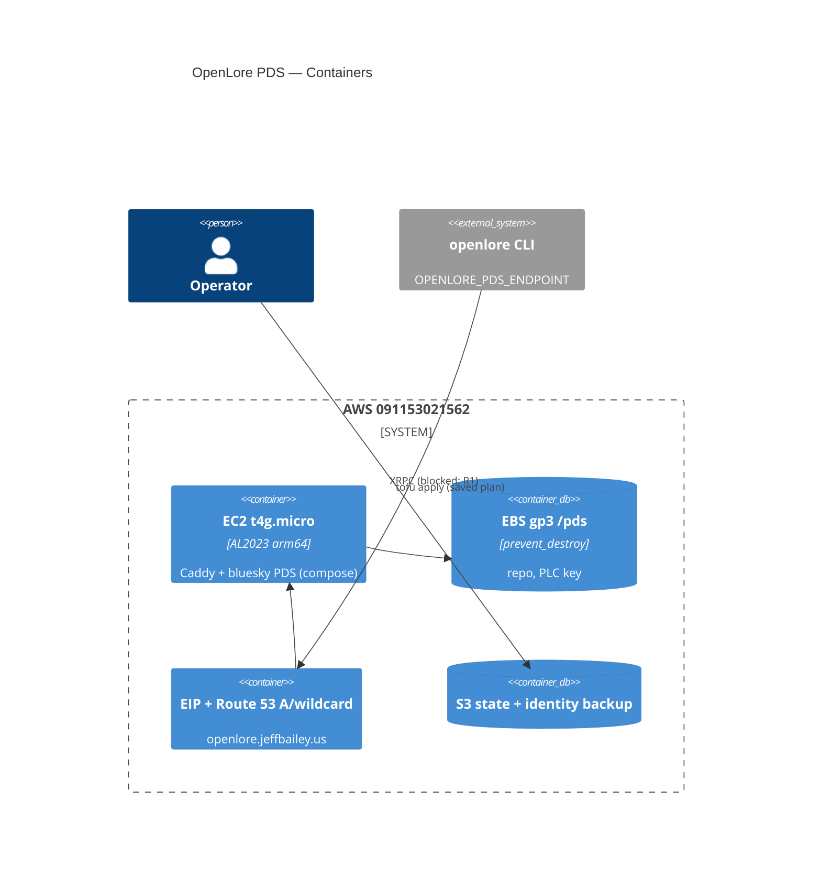

# OpenLore Architecture Brief (cross-feature SSOT)

> Bootstrapped at finalize of `openlore-foundation` (slice-01 walking skeleton)
> on 2026-05-27. This brief is the cross-feature single source of truth going
> forward; subsequent features (slice-02..05 and beyond) extend it in place.
> Per-feature detail lives under `docs/feature/{feature-id}/design/` during
> active waves and migrates to `docs/evolution/` at finalize.

## Style

- **Architectural style**: Hexagonal (Ports + Adapters), Modular Monolith,
  single-binary Rust CLI. See ADR-009.
- **Paradigm**: Functional-leaning Rust — pure core + effect shell. See ADR-007.
- **Runtime**: Tokio (async). See ADR-004.
- **Local store**: DuckDB (single embedded file). See ADR-001; revisit in
  slice-04 when graph traversal becomes the dominant workload (locked per WD-8).
- **Federation contract**: ATProto Lexicon under `org.openlore.*` namespace;
  CIDv1 dag-cbor sha2-256 addressing. See ADR-005 + ADR-006.
- **Identity**: User's existing ATProto DID with a per-application derived
  Ed25519 key in the OS keychain (macOS Keychain / Linux Secret Service /
  WSL2 fallback file). See ADR-002.
- **Retraction**: Counter-claim that references the original CID; no
  hard-delete. See ADR-008.

## Component Inventory

Workspace layout — all crates live under `/Users/jeffbailey/Projects/foss/leading/openlore/`:

| Crate                        | Kind        | Purpose                                                                 | Shipped in   |
|------------------------------|-------------|-------------------------------------------------------------------------|--------------|
| `crates/claim-domain`        | pure core   | Canonicalization, CID computation, signing, reference rules, confidence | slice-01     |
| `crates/lexicon`             | pure        | `org.openlore.*` schema + validation                                    | slice-01     |
| `crates/ports`               | pure traits | `StoragePort`, `IdentityPort`, `PdsPort`, `ClockPort`, `ProbeOutcome` ADT | slice-01     |
| `crates/adapter-duckdb`      | effect      | Implements `StoragePort` over DuckDB single-file DB                     | slice-01     |
| `crates/adapter-atproto-did` | effect      | Implements `IdentityPort` over OS keychain + DID resolution             | slice-01     |
| `crates/adapter-atproto-pds` | effect      | Implements `PdsPort` over ATProto XRPC                                  | slice-01     |
| `crates/adapter-system-clock`| effect      | Implements `ClockPort` over `std::time`                                 | slice-01     |
| `crates/cli`                 | driver      | clap-based composition root; threads adapters into pure core            | slice-01     |
| `crates/scraper-domain`      | pure core   | Derives candidate claims from harvested GitHub signals via the `jobs.yaml` signal->predicate SSOT mapping; no I/O | slice-02     |
| `crates/adapter-github`      | effect      | Implements `GithubPort` over the GitHub public REST/HTTPS API; optional PAT; public-data-only probe | slice-02     |
| `crates/scoring`             | pure core   | Transparent no-ML adherence-weight + `WeightBucket` over per-author `Contribution`s; the WD-77 formula SSOT (`ScoringConfig::DEFAULT`); aggregation in Rust, never SQL (anti-merging in aggregates) | slice-04     |
| `crates/appview-domain`      | pure core   | PURE indexer logic: `ingest_decision` (verify-before-index gate), `compose_results` (anti-merging-at-network-scale composition), `annotate_counter_relationship` (shown-not-applied), `near_match_suggestion` (edit-distance ranker); no I/O | slice-05     |
| `crates/adapter-atproto-ingest` | effect   | Implements `IngestSourcePort` over bounded public ATProto `listRecords` PULL (read-only; no write surface)               | slice-05     |
| `crates/adapter-index-store` | effect      | Implements `IndexStorePort` over a SEPARATE `index.duckdb`; non-`Option` `author_did` rows; `verified_against NOT NULL`; no merged/consensus schema | slice-05     |
| `crates/adapter-xrpc-query-server` | effect | `hyper` HTTP server of the `org.openlore.appview.searchClaims` XRPC query method (per-result `author_did` always present) | slice-05     |
| `crates/adapter-index-query` | effect      | CLI-side `IndexQueryPort` XRPC client (bounded timeouts); treats indexer-unreachable as a SOFT non-fatal outcome (graceful degradation) | slice-05     |
| `crates/openlore-indexer`    | driver (binary) | The SECOND composition root (`serve`/`ingest`/`stats`, plus `trigger` per ADR-080); self-hostable network service; signing-incapable; holds no local store. In production, `serve` owns the index and runs triggered passes (indexer-deployment). | slice-05     |
| `crates/review-domain`       | pure core   | Review/consent context: ownership verdict, suggestion lifecycle, reconcile, Publish/Retract/SharePost **plans**, budget arithmetic, maud views (ADR-072/076) | bluesky-claim-review-app |
| `crates/adapter-atproto-oauth` | effect    | `OAuthPort` + create-only `UserRepoWritePort` over `atrium-oauth` (confidential client, DPoP) (ADR-073) | bluesky-claim-review-app |
| `crates/adapter-review-store`| effect      | Owner-scoped private state + AEAD secret store over a SEPARATE `review-app.duckdb` (ADR-074) | bluesky-claim-review-app |
| `crates/openlore-review-app` | driver (binary) | The THIRD composition root: hosted review web app (`serve`/`probe`/`kpi`); no signing key, no local store (ADR-072/075) | bluesky-claim-review-app |
| `crates/test-support`        | test-only   | `FakePds`, `FakeKeychain`, `FakeClock`, `TempXdg`, `FakeGithub`, scoring fixtures, `FakeIngestSource`/`FakeIndexStore`/`FakeIndexQuery` + real-`z6Mk` DID-doc + adversarial ingest fixtures — hermetic test doubles | slice-01/02/04/05 |
| `xtask`                      | dev tooling | `check-arch` (hexagonal invariants), `check-probes` (probe contracts)   | slice-01     |

**Slice-01 ships 8 production crates + 1 test-support crate + 1 xtask binary.
Slice-02 adds 2 production crates (`scraper-domain` + `adapter-github`); slice-04
adds 1 (`scoring`); slice-05 adds 6 (1 pure `appview-domain` + 4 effect adapters +
1 binary `openlore-indexer` — the indexer subsystem / first network service);
slice-06 adds 2 (1 pure `viewer-domain` + 1 effect `adapter-http-viewer` — the
read-only localhost htmx viewer), bringing the production count to 19 + 1
test-support + 1 xtask binary (21 workspace members total; `cargo xtask check-arch`
reports 21).**

## Application Architecture (per-feature design decisions, in-place extensions)

> Application-layer (component) decisions live here as in-place extensions of the
> read-only `openlore ui` viewer. Each entry names its ADR(s); full per-feature
> detail lives in `docs/feature/{feature-id}/` and migrates to `docs/evolution/` at
> finalize. The hexagonal/modular-monolith STYLE (above) is unchanged by these.

Shipped slice extensions:

- **indexer-deployment: IMPLEMENTED (designed 2026-10-06, delivered 2026-10-07; not yet deployed). IN-PLACE EXTENSION of the
  indexer root. ZERO new crates, ZERO schema migration, ZERO lexicon change.** It deploys
  `openlore-indexer` co-located on the PDS host (ADR-075 pattern) as a public, read-only search at
  `https://index.openlore.jeffbailey.us`, with a pass every 15 minutes.
  - **ADR-080 (store ownership)**: one long-running `serve` container owns the only `index.duckdb`
    handle. The host systemd timer runs `openlore-indexer trigger` (via `docker exec`), which asks
    `serve`, over a Unix-socket control channel, to run one pass in-process and exits with the pass's
    0/2/3 (busy → 0, `serve` unreachable → 4). Single-flight. A pass holds the store for at most one
    transaction at a time. Every pass emits exactly one `pass_summary` with `exit_code` and `pass_id`.
  - **ADR-081 (DID list)**: `OPENLORE_INDEXER_REPO_DIDS_FILE` is read and validated each pass. The host
    renders the SSM Standard String into a read-only directory mount and keeps the last good copy. A
    malformed list refuses the pass (exit 2), never `serve`.
  - **ADR-082 (purge)**: opt-in `OPENLORE_INDEXER_PURGE_UNLISTED`. The pure `plan_purge` takes the set
    difference of indexed authors and a non-empty loaded list. A separate `IndexPurgePort` is held only
    by the pass runner, and DELETE lives only in `adapter-index-store/src/purge.rs`. Purge is
    resumable. Skips still never delete (ADR-078 amended).
  - **ADR-083 (public surface)**: only search and `GET /healthz` (`last_successful_pass_at`), at Caddy
    and in the binary. Body 8 KiB, value 512 B, ≤ 1000 rows, header timeout, 5 s request timeout,
    connection cap. **Per-IP rate limit in the binary** (10/s, burst 50, 429 + Retry-After; client from
    X-Forwarded-For only behind a trusted proxy): the v1 "no rate limit" was reversed in DELIVER because
    stock Caddy has no `rate_limit` module. The CLI default is unchanged; the CLI sends one request per
    search (the index returns the near-match) and degrades on 429.
  - Ports: `IndexReadPort` is split from `IndexStorePort`, and the search handler holds reads only.
    New `IndexPurgePort`.
  - Robustness: the pass runs on a dedicated thread inside `catch_unwind`, with a 25-minute pass
    deadline. An unusable store makes `serve` exit for a restart. Search returns 500 and `/healthz`
    returns 503 on store faults (never a false green).
  - Sizing: stay on t4g.micro (user decision). Indexer container 128m. DuckDB 48 MB with 1 thread in
    the indexer **and the review app** (the review app's caps were documented but never set; fixed
    here). Hard measured gate at MemAvailable > 128 MB. t4g.small only by operator decision.
  - `xtask` deltas: `index_store_delete_only_in_purge`, `index_purge_only_in_pass_runner`,
    `indexer_search_handler_read_only`.
  - Platform: signed arm64 image (only from green commits), digest deploy with auto-rollback
    (`deploy/indexer/`), 15-minute host timer, 3 CloudWatch alarms (~$1/month).
  - ADR-080..083 accepted (ADR-083 §4 reversed). See `docs/architecture/indexer-deployment/`
    (architecture-design.md, component-boundaries.md, data-models.md, technology-stack.md).
    History, open follow-ups and the go-live sequence: `docs/evolution/indexer-deployment-evolution.md`.

- **indexer-per-did-pds-fetch: IMPLEMENTED (designed and delivered 2026-10-05). IN-PLACE EXTENSION of the indexer root.
  ZERO new crates, ZERO schema change, ZERO new crates in `Cargo.lock`.** Every pass resolves
  each repo DID to its own `#atproto_pds` and lists it there, so self-attested claims from any
  author's PDS reach `openlore search`.
  - **ADR-077 (per-DID source)**: `IdentityLookupPort::resolve_pds` (a default method; the
    document-only override in `IdentityLookup`; `did:plc` + `did:web`). The pure
    `appview_domain::ingest_pass` has `ListingSource = OwnPds | Fallback`. Only `OwnPds` on
    exact match is `AuthorPds`. `OPENLORE_INDEXER_SOURCE_URL` is now an optional fallback that is
    relay origin **by type**. There is no startup network probe. A pure
    `origin_classification_probe` is added. Supersedes ADR-024 source discovery and ADR-071 §4's
    indexer bullet.
  - **ADR-078 (isolation and bounds)**: one DID = one failure unit
    (`did_unresolvable | pds_unreachable | pds_timeout | listing_failed | pds_address_refused`).
    Exit 0 when at least one DID was listed, **3 when every configured DID was skipped** (after
    `pass_summary`), and 2 for config, probe or upsert failure. `futures-util` `buffered(4)`, a
    30 s per-DID deadline (env-tunable; defaults confirmed). Events `source_skipped`,
    `source_fallback`, `pass_summary`, `config.loaded`.
  - **SSRF guard (ADR-077 §4)**: https only. Loopback, private, link-local and unique-local
    addresses are refused after DNS by a guarded `reqwest` resolver, which connects to the
    checked IP. No redirects. The TEST-ONLY `OPENLORE_INDEXER_ALLOW_LOOPBACK_HTTP` is refused in
    release builds.
  - **ADR-079 (wire provenance)**: optional `SearchResultDto.provenance`. Absent means
    app-signed. An unknown value hides the row. The CLI shows `[verified] [self-attested]`.
  - `xtask` deltas: `indexer_origin_only_via_listing_source` (token ban on `RecordOrigin::of` /
    `::AuthorPds` in the indexer root) and `indexer_guarded_clients_only` (the indexer wires
    only the `::guarded` adapter constructors).
  - ADR-077..079 accepted. See `docs/architecture/indexer-per-did-pds-fetch/`
    (architecture-design.md, component-boundaries.md, data-models.md, technology-stack.md).
    History and open follow-ups: `docs/evolution/indexer-per-did-pds-fetch-evolution.md`.

- **bluesky-claim-review-app: IMPLEMENTED (designed and delivered 2026-10-04; not yet deployed). ADDITIVE: +4 crates (25 production / 27
  members); a THIRD composition root; a second provenance mode across every reader.** This is a
  hosted web app at `https://app.openlore.jeffbailey.us`. A Bluesky user signs in with ATProto
  OAuth, proves their GitHub account with their DID in the bio (re-checked before every scrape),
  privately reviews suggestions from the REUSED scrape pipeline, and publishes approved ones as
  **self-attested** `org.openlore.claim` records into **their own PDS**. They can then share a
  profile with an opt-in post. Pending and declined suggestions stay PRIVATE app-side state.
  - **ADR-071 (self-attested provenance)**: no lexicon field is added. SelfAttested means: no
    `signature`, a bare-DID `author` equal to the repo DID, and a fetch from the author's
    DID-document PDS. CID == rkey integrity. `claim_domain::verify` is UNCHANGED. A pure
    provenance verdict is used by `peer pull`, `ingest_decision`, the viewer and search. Additive
    `provenance` columns. A relay origin fails closed until commit-proof verification exists.
  - **ADR-072 (third root)**: `openlore-review-app` (hand-rolled hyper; `axum` stays banned).
    Disjoint capabilities: no keychain identity, no `adapter-duckdb`, no app-password
    `adapter-atproto-pds`. I-3 is reworded above.
  - **ADR-073 (OAuth)**: confidential client (`private_key_jwt`, DPoP) via `atrium-oauth` (MIT,
    default features off, rustls). A create-only `UserRepoWritePort` (claim + post) makes I-BRA-8
    non-representable. Granular `repo:` scopes are the target, with `transition:generic` as the
    fallback (SPIKE-3).
  - **ADR-074 (private state)**: a separate `review-app.duckdb`, owner-scoped at the TYPE layer
    (`OwnerScope`), the STRUCTURAL layer (SQL rule) and the BEHAVIORAL layer (cross-owner probe).
    XChaCha20-Poly1305 for tokens. Aggregate-only KPI counters.
  - **ADR-075 (hosting)**: co-located container on the PDS host behind the existing Caddy, through
    a generic sites hook (tofu-aws-pds v1.7.0: `/pds/caddy/sites` mounted at `/etc/caddy/sites`,
    IMDS hop limit 1), adopted in one planned replacement (option A, decided 2026-10-04). The existing wildcard DNS covers the host,
    so there is no DNS change.
  - **ADR-076 (GitHub)**: one public-read PAT; an in-process per-DID/per-IP/global budget; an
    exact-token DID bio matcher; a `VerifiedOwnership` capability gates every scrape.
  - `xtask` deltas: the review-app capability boundary, the disjoint-roots extension, a
    create-only scan, the owner-scoped SQL scan, and the `review-domain` pure-core arm.
  - See `docs/architecture/bluesky-claim-review-app/` (architecture-design.md with C4
    L1/L2/L3, component-boundaries.md, data-models.md, technology-stack.md). History and open
    follow-ups (go-live operator steps; the single-source indexer follow-up was resolved by
    indexer-per-did-pds-fetch):
    `docs/evolution/bluesky-claim-review-app-evolution.md`.

- **review-app-repos-and-accounts: DESIGN 2026-10-19 (PROPOSED) — IN-PLACE EXTENSION of the review
  app. ZERO new crates, ZERO Lexicon or OAuth-scope change, one store migration
  (`review-app.duckdb` v1 → v2).** Up to 3 GitHub accounts per sign-in; a saved repo choice per
  account (top 5 pre-ticked until saved); any public repo importable as private, never-publishable
  suggestions; one total limit of 10 repos per scan; a fresh repo-owner + bio read at every
  preview and confirm. Releases R1 choose, R2 accounts + publish check, R3 imports; R4
  (administered repos) deferred.
  - **`crates/claim-domain` (PURE, EXTEND)**: NEW `authority` module, owner tier only (first
    delivery of ADR-086 §4): `may_sign` → `SigningPermit` (private, not serializable) |
    `SigningRefusal`. owner-only-signing extends it later.
  - **`crates/review-domain` (PURE, EXTEND)**: NEW `repo_scope` (default ticks, limit arithmetic,
    scan intent and plan, BR-RRA-5 moves, derived visibility, `outside_default`); `plans`
    constructors and `restore_plan` take `&SigningPermit`; views for accounts, choose-repos,
    imports and imported cards; new `KpiEvent`s.
  - **`crates/ports` (EXTEND)**: `GithubPort::read_repo` + `RepoFacts`; `OwnedRepo` gains
    `repo_id`, `owner_id`; split read/write ports for accounts, choices, imports; separate
    `ScopeMovePort` and `ScopeRemovalPort`; scan-plan methods; conditional
    `add_pending_from_listed_source`.
  - **`crates/adapter-github` (EXTEND)**: `GET /repos/{o}/{r}` with one same-host redirect.
  - **`crates/adapter-review-store` (EXTEND)**: v2 (`github_accounts`, `repo_choices`,
    `imported_repos`, `scan_run_repos`, source columns on `suggestions`); migration in one
    transaction after a file backup; `removal.rs` (deletes only `pending`); live probe extended.
  - **`crates/openlore-review-app` (EXTEND)**: `routes/repos.rs`, `routes/imports.rs`
    (new files), multi-account `routes/github.rs`, plan-based `scan.rs` (frozen plan, resume reads
    unread rows), `permit_for` in review and publish routes, per-DID scope lock, constant
    `SCAN_REPO_CAP = 10`.
  - **`xtask` (EXTEND)**: `review_publish_plan_needs_permit`,
    `authority_evidence_only_from_adapters`, `signing_permit_not_serializable`,
    `review_accounts_write_only_in_github_route`; amended
    `review_store_owner_scoped_sql` (new owner tables; `DELETE` also in removal, `pending` only).
  - **ADR-088** (store v2, scan plan, removal) + **ADR-089** (publish permit, BR-RRA-1), both
    Proposed. Design and C4 L1/L2/L3: `docs/feature/review-app-repos-and-accounts/design/`.
    Supersedes bluesky-claim-review-app `data-models.md` §3.1 (one link per DID).

- **contributor-philosophy-inference: DESIGN 2026-09-27 — IN-PLACE EXTENSION, ZERO new crates,
  ZERO Lexicon change.** `scrape github owner/repo` also records the repo's top-N human
  contributors (one public `/contributors` page, bots excluded) as LOCAL, UNSIGNED, append-only
  contribution links; `openlore infer people` proposes `github:<login> adheresToPhilosophy X`
  candidates from SIGNED, non-retracted repo `embodiesPhilosophy` claims (own ∪ active peers),
  labelled NEW / STRONGER (sign ⇒ new claim with `supersedes`) with SUPPORT WEAKENED flags; the
  human signs through the shipped pipeline (never auto-signed/-retracted).
  - **`crates/scraper-domain` (PURE, EXTEND)**: `people` area — contributor selection (bot rule,
    re-rank, de-dup, top-N), overlap, eligibility, integer-hundredths confidence
    `min(29, 15+5(k−1), floor(100·max))`, classification, provenance codec, scrape-hint diff.
  - **`crates/claim-domain` (PURE, EXTEND)**: ADR-060 D-RF-D3 self-retraction rule hoisted as a
    shared pure helper.
  - **`crates/ports` (EXTEND)**: `GithubPort::list_contributors` + `RawContributor` +
    `GithubError::ContributorsUnavailable`; NEW sync `ContributionLinkPort` (probe /
    record_snapshot / list_links — NO delete method).
  - **`crates/adapter-github` (EXTEND)**: one `GET /repos/{o}/{r}/contributors?per_page=100`.
  - **`crates/adapter-duckdb` (EXTEND)**: `schema_v5` `contribution_links` (case-folded PK
    (`repo_key`,`person_key`), `github_user_id`, rank, contributions, first/last observed; one-tx
    `ON CONFLICT DO UPDATE`, never delete) + `DuckDbContributionLinkAdapter` on the shared
    connection; LIVE probe (in-tx upsert-twice, rolled back).
  - **`crates/cli` (EXTEND)**: NEW `infer people` verb; `scrape github --contributors N` (0..=100),
    contributors/overlap block + hint, `scrape github <user>` person view; scraper `--sign` batch
    extracted into a shared helper; `ComposedClaim.references` (default empty — existing CIDs
    unchanged). Signed-claim inputs REUSE `query_federated_by_subject` + `query_by_contributor`.
  - **`xtask` (EXTEND)**: `contribution_links_append_only` + `adapter-github` names no storage port.
  - **ADR-063** (component architecture) + **ADR-064** (wire contract: subject `github:<login>`,
    predicate `adheresToPhilosophy`, provenance = `evidence[]` AT-URIs
    `at://<did>/org.openlore.claim/<cid>` + `https://github.com/<o>/<r>/commits?author=<login>`).
    C4 L1/L2/L3 in `docs/feature/contributor-philosophy-inference/feature-delta.md`.

- **github-did-identity-link: DESIGN 2026-10-14 (ACCEPTED by the user 2026-10-14; revised by
  owner-only-signing: a verified link is also the proof of signing authority) — IN-PLACE EXTENSION, ZERO new crates, ZERO Lexicon change, one migration
  (v7).** Realizes the OD-CPI-1 deferral: a DID owner may publish an opt-in `org.openlore.claim`
  `{subject: <own bare DID>, predicate: sameAs, object: github:<login>, evidence:
  [https://github.com/<login>, https://api.github.com/user/<id>], confidence: 10000}`, app-signed
  (CLI) or self-attested (review app). Only a provenance-verified claim with author == subject is a
  link; a link is an ASSOCIATION only after this reader's own `verified` bio check (the ADR-076
  exact-token matcher), keyed by numeric GitHub id. Unchecked/disproved links render as assertions.
  No subject merging; the scorer drops `sameAs` claims.
  - **`crates/claim-domain` (PURE, EXTEND)**: new `identity_link` module — DID-token matcher
    hoisted from `review-domain`, `check_link`, `ProvenLink` → `LinkDraft` codec,
    `project(&claim, &Provenance)`, `link_view` (Active/Retracted/Superseded ×
    Verified/Disproved/NotChecked; Contested only when ≥ 2 DIDs are Verified for one id).
  - **`crates/scoring` (PURE, EXTEND)**: `score` drops `sameAs` claims (unbounded preservation;
    covers the CLI and viewer callers).
  - **`crates/review-domain` (PURE, EXTEND)**: `prove_ownership` delegates (behavior-preserving);
    `PlanKind::IdentityLink` publish/retract plans from a fresh in-request proof.
  - **`crates/ports` (EXTEND)**: NEW sync `IdentityLinkCheckReadPort` / `WritePort` (insert only)
    / `PurgePort`; `GithubPort::read_person_by_id`.
  - **`crates/adapter-github` (EXTEND)**: `GET /user/{id}`.
  - **`crates/adapter-duckdb` (EXTEND)**: `schema_v7` `identity_link_checks` (insert-only, PK
    includes `checked_at`, latest = read query, never federated); DELETE only in the purge file;
    live probe.
  - **`crates/cli` (EXTEND)**: NEW `identity link github <login>` (plan-returning preview; writes
    on confirm), `identity verify`, `identity list`, `identity forget --did`; linked-identity line
    in `infer people` / `scrape github <user>` (offline: last local check); `scrape github <user>`
    refreshes checks for published links at zero extra requests. Unlink = `claim retract`
    (ADR-008). Narrowest port handle per verb (ADR-085 §7).
  - **`crates/openlore-review-app` (EXTEND)**: "Publish this link" / "Retract this link" through
    the create-only `UserRepoWritePort` (no new OAuth scope).
  - **`openlore-indexer`: UNCHANGED** — links index as ordinary claims; no GitHub capability.
  - **Slice 4 (DESIGN 2026-10-19, proposed) — viewer linked-identity line.** `viewer-domain`
    (PURE, EXTEND): new `linked_identity` module (`None | Lines | Unreadable` view-model, region
    render) embedded in the `/score`, `/project?subject=github:…`, claim-detail and `/search`
    results fragments; search labels link rows "authority not checked here".
    `adapter-http-viewer` (EFFECT, EXTEND): optional read-only handles (check read, candidate
    read, lineage read; never write or purge), one read per request, no GitHub call.
    `read_listed_links` moves from `cli` into `ports` (one lineage read for CLI and viewer).
    `cli` `ui` wires the handles after a read-only probe (never the check port's write probe). No new port, crate, route or migration. Detail:
    `docs/feature/github-did-identity-link/design/slice-4-viewer-linked-identity.md`.
  - **`xtask` (EXTEND)**: `identity_link_checks_insert_only`,
    `identity_link_purge_only_in_forget_verb`, `identity_link_readers_hold_no_write_handle`,
    `identity_link_compose_only_via_proven_link`.
  - **ADR-084** (wire contract) + **ADR-085** (verification reuse, reader semantics, local checks),
    both Accepted 2026-10-14. Design, C4 L1/L2, assumptions A-1..A-10 and options per decision:
    `docs/feature/github-did-identity-link/design/` (wave-decisions.md, architecture-design.md,
    upstream-changes.md).

- **owner-only-signing: DESIGN 2026-10-14 (ACCEPTED by the user 2026-10-14; depends on
  github-did-identity-link slice 1) — IN-PLACE EXTENSION,
  ZERO new crates, ZERO Lexicon change, one migration (v8).** Anyone may import (scrape/infer)
  unsigned candidates about any public `github:` subject; only a DID with **authority** may sign:
  for `github:<login>` the DID with a `verified` ADR-084 link to that account; for
  `github:<owner>/<repo>` the linked owner of a user-owned repo (`owner.id`) or a DID listed in the
  repo's `.github/openlore-authority` file (the only public route for org repos). Retractions,
  counters and identity links need no authority and are never weighted. Readers derive `owner /
  repo-listed / third-party / authority not checked` per `github:` assertion from local,
  insert-only checks; nothing on the wire changes and already-published claims are judged by the
  same rule. Establishes an accepted exception to I-9 (see the invariants table).
  - **`crates/claim-domain` (PURE, EXTEND)**: `authority` module — `requirement`, `classify`,
    `may_sign` → private-constructor `SigningPermit`. *2026-10-20 (U-OOS-3)*: the module and an
    owner-tier `may_sign` from same-request reads shipped with ADR-089; the CLI adds a second entry
    point from local checks and a `RepoListed` permit basis, minting only in this module.
  - **`crates/scoring` (PURE, EXTEND)**: `score_attested` (unbounded preservation; weights only
    assertions that are non-`github:` or attested; counters/retractions/links never weighted; the
    feed gains reference types; `--include-unattested` shown separately per author).
  - **`crates/ports` (EXTEND)**: `GithubPort::read_repo_authority`; NEW `RepoAuthorityCheckReadPort`
    / `WritePort` (insert only).
  - **`crates/adapter-github` (EXTEND)**: one same-host redirect on `/repos`; contents of
    `.github/openlore-authority` (public, WD-51 kept).
  - **`crates/adapter-duckdb` (EXTEND)**: `schema_v8` `repo_authority_checks` (insert-only); slice 5
    optional `imported_candidates`.
  - **`crates/cli` (EXTEND)**: NEW `authority verify`; NEW `sign_permitted` helper replaces the
    inline signs in `claim add`, `claim counter`, `claim retract` and the sign batch (`scrape
    github/person --sign`, `infer people --sign`); `publish_signed_claim` takes a permit (covers
    `claim publish`); labels in `graph query`, scrape/infer views, viewer, `search` ("authority
    not checked here"); offline signing from checks ≤ 7 days; `adapter-github` same-host redirect
    policy.
  - **`crates/openlore-review-app` (EXTEND)**: share draft quotes attested claims only (meaning
    proposed, U-OOS-4). The publish-time bio + repo re-check shipped with
    review-app-repos-and-accounts (ADR-089); OOS-D13 is superseded.
  - **Sign-time GitHub outage (OOS-D7 clarification, 2026-10-20)**: an online verb whose refresh
    GitHub cannot answer records nothing and gates from the latest local check exactly as offline.
  - **`openlore-indexer`: UNCHANGED** (no GitHub capability).
  - **`xtask` (EXTEND)**: `sign_only_with_permit`, `authority_evidence_only_from_adapters`,
    `repo_authority_checks_insert_only`,
    `authority_readers_hold_no_write_handle`, `scoring_callers_use_score_attested`.
  - **ADR-086** (authority model, enforcement, existing claims) + **ADR-087** (proofs), both
    Accepted 2026-10-14. GDL changes (`docs/feature/owner-only-signing/design/upstream-changes.md`
    UC-1..UC-8) applied to the GDL design and ADR-085 on 2026-10-14.

- **serverless-philosophy-federation: DESIGN 2026-07-15 — ADDITIVE. +2 Rust production crates
  (`publish-domain` pure + `adapter-publish-http` effect; workspace 21 → 23 prod / 25 members, or 24
  if `publish-domain` folds into `cli`) + a NEW non-workspace `atproto/` TypeScript/Cloudflare-Workers
  deployment target.** The self-hosted-serverless realization of ADR-023's deferred hosted mode: each
  user deploys their OWN Cloudflare Worker (they own it → sovereignty preserved; no central authority,
  D-1/D-3/D-4), pushes locally-signed claims to it, serves a public read-only card linkable from
  Bluesky, pulls it back into local DuckDB (CID-verified), and pulls from OTHER users' instances
  (J-003 transport delta). SPIKE-00 (OD-SF-1) proved the Worker MUST be an **opaque, content-addressed
  byte store** — the CID is minted ONLY by `claim-domain::compute_cid`; the Worker stores/returns
  bytes VERBATIM and computes no CID (a JS `@ipld/dag-cbor` PDS diverges on f16-representable
  confidence `0.0`/`0.5`/`1.0` because `ciborium` emits shortest-form floats — a latent ADR-006 gap
  the opaque transport sidesteps).
  - **`atproto/` Worker (TS, CREATE NEW; workerd/wrangler/Durable Object)**: `PUT/GET /records/:cid`
    (verbatim), `GET /manifest` (CID list + display projection), `GET /` (read-only, signing- AND
    write-incapable card). NO JS IPLD/CBOR/CID libs on the CID path.
  - **`crates/publish-domain` (PURE, CREATE NEW)**: `plan_push` (additive/idempotent diff) +
    `reconcile_pull` (in-sync no-op / insert / conflict-surface, never silent overwrite). Fold-into-
    `cli` documented alternative.
  - **`crates/adapter-publish-http` (EFFECT, CREATE NEW)**: implements the write-capable `PublishPort`
    + read-only `InstanceReadPort` over the workspace `reqwest` (no new HTTP crate); `probe()`
    round-trips a `0.0`/`0.5`/`1.0` canary CID (Earned-Trust startup gate).
  - **`crates/ports` (EXTEND)**: `PublishPort` (write) + `InstanceReadPort` (read-only) split + ADTs.
    **`crates/cli` (EXTEND, sole composition root)**: `openlore publish {init,push,pull,status}`;
    write `PublishPort` wired ONLY here; the J-003 peer-pull verb gains the byte-preserving
    opaque-read transport (DID→serviceEndpoint resolution REUSED unchanged). **`claim-domain` +
    `adapter-atproto-did` REUSED unchanged.**
  - **`xtask` (EXTEND)**: new `publish_write_capability_isolated` rule (write port wired only in the
    `publish` root; pull/card read-only) + `publish-domain` pure-core allowlist + an `atproto/`
    no-IPLD/CBOR dependency guard.
  - **ADR-062** (opaque content-addressed transport; Durable-Object medium; OD-SF-3 byte-preserving
    read; CID-conformance leave-it + revisit trigger; `putRecord` server-assigned-CID REJECTED per
    SPIKE-00 float divergence; the additive realization of ADR-023's deferred hosted mode).
    References ADR-006 (latent float gap, unmodified), ADR-023 (reconciled, unmodified), ADR-027
    (configurable URL, reused).
  - **DEVOPS 2026-07-15 (platform topology)**: per-user serverless — **NO central deploy pipeline**.
    Each user self-deploys their own Worker (`wrangler deploy`, atomic/recreate; rollback =
    `wrangler rollback`). The DEVOPS deliverable is a NEW `publish-contract.yml` GitHub Actions
    workflow that runs the CLI↔Worker round-trip on a LOCAL `wrangler dev` (workerd — no real deploy,
    no `CLOUDFLARE_API_TOKEN`) with a `0.0/0.5/1.0` float regression guard, operationalizing KPI-SF-1
    (the round-trip-CID North Star; KPI-SF-1..5 now in `docs/product/kpi-contracts.yaml`). `ci.yml
    --workspace` already covers the 2 new crates; `release.yml` does NOT build/deploy the Worker (it
    is user-deployed, not a release artifact). Write-auth = per-instance bearer token as a Cloudflare
    Worker secret (`wrangler secret put`); reads public. Observability owner-only (Workers analytics +
    `wrangler tail`) — NO central telemetry (sovereignty).
  - See ADR-062, `docs/feature/serverless-philosophy-federation/feature-delta.md` (DESIGN + DEVOPS
    sections), `docs/feature/serverless-philosophy-federation/design/wave-decisions.md`,
    `docs/feature/serverless-philosophy-federation/devops/wave-decisions.md`,
    `docs/feature/serverless-philosophy-federation/environments.yaml`,
    `docs/feature/serverless-philosophy-federation/spike/findings.md`.

- **homebrew-binary-distribution: DESIGN 2026-07-12 — ZERO new crates; NO Rust (workspace stays
  21). A THIRD install channel (Homebrew tap) — Ruby formula + YAML/shell CI only.** Adds an
  in-repo Homebrew tap (`Formula/openlore.rb`) so non-Rust users install the prebuilt `openlore`
  CLI with `brew install jeffabailey/openlore/openlore` (verified by brew's sha256), and stay
  current with `brew upgrade`. The `openlore` binary is a **black box** — reused as a prebuilt
  GitHub-Release tarball; no binary production, no CDN, no cross-compile added.
  - **`Formula/openlore.rb` (CREATE NEW, Ruby/Homebrew DSL)**: a single multi-platform formula
    (`on_macos`/`on_linux` × `on_arm`/`on_intel` url+sha256 → `bin.install "openlore"`); no
    `depends_on "rust"`, no service/plist (prebuilt-only + no-phone-home guardrails).
  - **Autobump (CREATE NEW: `scripts/release/bump-formula.sh` + a `bump-formula` job) EXTENDS the
    future `release.yml`**: on each `v*` release, regenerates the formula's `version` + 4 `sha256`
    from the published `.sha256` and commits to `main` (trunk-based, no PR), sequenced after
    artifact upload via `needs:` (ordering guard). A per-triple `brew install` + `openlore
    --version` **smoke test is the Earned-Trust probe** — blocks the release if any url+sha256
    fails. Formula enforcement = `brew audit`/`brew style` + a freshness assertion (`version ==
    tag`), the Ruby analog of `xtask check-arch`.
  - **BLOCKING PREREQUISITE**: `release.yml` producing the ADR-011 4-platform tarball+`.sha256`
    matrix (+ cosign + SBOM) **does not exist yet** — it is a separate DEVOPS feature. The formula
    + autobump are DESIGNED against ADR-011's locked contract but are **not executable** until
    `release.yml` + one real tagged release ship. Design now, split the build.
  - **ADR-061** (in-repo tap; prebuilt-not-source; sha256-via-brew with cosign as a complementary
    provenance layer per ADR-012; openlore-CLI-only; autobump = in-`release.yml` commit-to-main
    with a smoke-test probe; the release.yml blocking prerequisite). Promotes the "Homebrew tap:
    Reserved/deferred" line in ADR-011 + `distribution.md` §1.3 from Reserved → Accepted.
  - See ADR-061, `docs/feature/homebrew-binary-distribution/feature-delta.md` (DESIGN sections),
    `docs/feature/homebrew-binary-distribution/design/wave-decisions.md`, and
    `docs/feature/homebrew-binary-distribution/design/upstream-changes.md`.

- **retraction-aware-search-filter: DESIGN 2026-07-11 — IN-PLACE EXTENSION, ZERO new crates
  (workspace stays 21).** Adds an explicit, **opt-in, non-destructive, self-disclosing** filter
  that HIDES author-soft-retracted claims from a network-search VIEW: `openlore search …
  --hide-retracted` (slice 01, CLI) and `/search?hide_retracted=1` (slice 02, read-only viewer).
  Reconciles I-AV-9 ("counter shown, not applied"): the DEFAULT path (no flag/param) is
  byte-identical to today; the filter activates only on explicit user action, discloses the count
  it hid, hides ONLY author self-retractions (a same-DID `Retracts` referencing the CID; D-3),
  and never mutates the index / re-ranks / re-weights / re-verifies survivors. **OD-RF-1 resolved
  = Branch A: the shipped `SearchResultDto.references` (DV-5) + per-row `author_did` already
  distinguish author self-retraction from a third-party counter — ZERO ingest/schema/DTO change.**
  - **`crates/appview-domain` (PURE)**: adds `partition_retracted(rows, hide_retracted) ->
    {survivors, hidden_count}` — the SINGLE pure decision both surfaces invoke, run on the RAW
    `NetworkResultRowRaw` rows (NOT the lossy `compose_results` `counter_annotation`). A
    retraction event = the withdrawn original + its same-author marker record (both hidden);
    `hidden_count` = EVENTS. Stays on the pure-core allowlist (no I/O).
  - **`crates/cli` (DRIVER)**: `--hide-retracted` bool on the `openlore search` verb (ADR-027) +
    the honesty footer + the empty-after-filter guided line; calls `partition_retracted` before
    the existing render grouping. No index re-query.
  - **`crates/viewer-domain` (PURE)** + **`crates/adapter-http-viewer` (EFFECT)**: the
    "Hide retracted claims" checkbox → `?hide_retracted=1` GET-param on the slice-08 `/search`
    route; the results-region hidden-count notice in both htmx shapes; read-only / loopback /
    offline / no-key preserved. Runs the SAME pure predicate before `to_indexed_claim`.
  - **Invariants I-RF-1..8** (opt-in default byte-identical; non-destructive; self-disclosing;
    soft-retract-only [extends I-AV-2/I-AV-9]; pure core; read-only viewer; reversible/not-
    persisted; row anatomy preserved) — feature-scoped; all INHERIT the slice-05 I-AV-9 +
    slice-08 I-NS-* + slice-06/07 I-VIEW/I-HX. Mints KPI-RF-1 (explicit-hide adoption +
    disclosure comprehension); realizes it on both surfaces.
  - **ADR-060** (pure predicate over the existing reference graph; OD-RF-1 = Branch A; the
    I-AV-9 reconciliation; alternatives — additive DTO marker REJECTED as unnecessary, building
    on the lossy `counter_annotation` REJECTED, index-side filter REJECTED).
  - See ADR-060, `docs/feature/retraction-aware-search-filter/feature-delta.md` (DESIGN sections)
    + `docs/feature/retraction-aware-search-filter/design/wave-decisions.md`.

- **slice-20 (viewer-search-full-follow-state): SHIPPED 2026-06-11 — IN-PLACE
  EXTENSION, ZERO new crates (workspace stays 21).** COMPLETES the slice-16 `/search`
  follow-state ADT (ADR-053) to its full FOUR arms by filling the already-present-but-
  empty `You | UnsubscribedCache` render-match arms — the render is now a TOTAL `match`.
  Render-only, read-only, LOCAL/offline, additive; NO new route, NO new
  `AuthorRelationship` variant, NO new crate. slice-16 + slice-20 together COMPLETE the
  four-arm search follow-state.
  - **`crates/ports` (`StoreReadPort`)**: +2 read-only presence reads —
    `distinct_own_author_dids` (over `claims` → `You`) and
    `distinct_cached_peer_author_dids` (over `peer_claims`, NO `removed_at` filter so
    soft-removed peers' cached claims classify → `UnsubscribedCache`). No mutation
    method added (I-VIEW-1 preserved).
  - **`crates/adapter-duckdb`**: +2 single-table `SELECT DISTINCT author_did` impls
    over the SAME shared connection. Each is single-table → passes
    `no_cross_table_join_elides_author` BY CONSTRUCTION (the rule's cross-store
    precondition is structurally unreachable for a single-table literal).
  - **`crates/adapter-http-viewer` (EFFECT)**: `resolve_search_state` reads the 3 LOCAL
    sets (active REUSED + own/cached NEW) ONCE each into bare-DID `HashSet`s; the binary
    `to_indexed_claim` becomes a TOTAL four-arm precedence resolution
    (`You > SubscribedPeer > UnsubscribedCache > NetworkUnfollowed`) — a pure fn over
    the 3 sets. +2 `read_local_*` sibling helpers (degrade via `unwrap_or_default`,
    independent per read). **TWO new `#[cfg(debug_assertions)]` per-read fault-seam
    tokens** (`OPENLORE_VIEWER_FAIL_OWN_DIDS_READ` /
    `OPENLORE_VIEWER_FAIL_CACHED_PEER_DIDS_READ`) — the ADR-057 D-4 conditional
    escalation FIRED at DELIVER (the real-binary subprocess harness cannot inject a
    per-read `Err` via a fake `StoreReadPort`); each release sibling = identity (no env
    read compiled in), mirroring the slice-16 `OPENLORE_VIEWER_FAIL_ACTIVE_SET_READ`
    seam.
  - **`crates/viewer-domain` (PURE)**: fill the empty `You | UnsubscribedCache => {}`
    arm with two neutral render-only indicators (`SEARCH_SELF_INDICATOR = "Your own
    claim"` / `SEARCH_REMOVED_CACHED_INDICATOR = "A peer you removed (cached)"` SSOT
    consts + `render_self_indicator` / `render_cached_unsubscribed_indicator`, siblings
    of `render_following_indicator`) — the render becomes a TOTAL `match`. NEITHER
    renders a `peer add` affordance. The slice-16 `SubscribedPeer`/`NetworkUnfollowed`
    arms are byte-stable (no regression).
  - **`xtask`**: `VIEWER_FAIL_SEAM_TOKENS` extended **4 → 6** (the two new per-read
    fault tokens); single-table reads pass anti-merging by construction; workspace
    stays 21. Release build verified seam-free (all 6 fault tokens absent from the
    release rlib).
  - **ADR-057** (the two LOCAL presence reads + the four-arm precedence resolution +
    the two neutral indicators; alternatives: combined-read rejected, held-identity-
    surface-for-`You` rejected as keyless-viewer-breaking, N+1 rejected).
  - See ADR-057, `docs/feature/viewer-search-full-follow-state/feature-delta.md`,
    `docs/evolution/viewer-search-full-follow-state-evolution.md`.

- **slice-08 (viewer-network-search): SHIPPED 2026-06-04 — IN-PLACE EXTENSION, ZERO
  new crates (workspace stays at 21 members).** Adds a **`GET /search`
  network-discovery view** to the slice-06/07 `openlore ui` read-only viewer — the
  **browser UI for `openlore search`** (J-005). A `/search` route serves a GET form
  (dimension selector object/contributor/subject + a value input); on submit the
  viewer queries the slice-05 network indexer over HTTP (`OPENLORE_INDEXER_URL`,
  `org.openlore.appview.searchClaims`) and renders **verified + attributed** network
  results as HTML, with an htmx fragment swap (like `/scrape`). It is a **read-only
  network READ** — the viewer signs/writes/persists nothing and holds no key; the new
  outbound `IndexQueryPort` is the **only** addition. Following a discovered author
  stays a deliberate CLI `openlore peer add <did>` (the view shows it as guidance
  text, never an executable control). **Zero new crate, zero new persisted type, zero
  new write/sign route, zero new `deny.toml` rule.** REUSES the slice-05
  `IndexQueryPort` + `adapter-index-query` (public-data READ) + `appview-domain::
  compose_results` (verification + per-author anti-merging — NOT reimplemented), and
  the slice-07 `Shape` fork + page = chrome + fragment + the vendored offline htmx
  asset. Extends in place:
  - **`crates/viewer-domain` (PURE)**: a `SearchState` ADT (`Form | Results |
    NoResults | Unavailable` — `Unavailable` is a payload-free unit variant that
    structurally cannot leak transport internals, mirroring `ScrapeState::NetworkDown`)
    + `render_search_results_fragment` / `render_search_page` (page = chrome +
    fragment) PROJECTING the `appview-domain` result types into HTML; a third `/search`
    nav link. Takes a NEW pure→pure dependency on `appview-domain` (ADR-037).
  - **`crates/adapter-http-viewer` (EFFECT)**: the `GET /search` handler — parse
    dimension+value, call `IndexQueryPort`, map outcomes to `SearchState`, fork by
    `Shape::from_request`; an `Option<SharedIndexQuery>` field on `ViewerServer`.
    Persists nothing; renders no write control (ADR-038).
  - **`crates/cli` (DRIVER)**: the `ui` verb (the viewer composition root) wires the
    read-only `HttpIndexQueryAdapter` and SOFT-probes it (informational, never a
    startup refusal). Still NO signing key in the viewer surface (ADR-036).
  - **`xtask`**: 2 `check-arch` deltas — the `viewer-domain → appview-domain` pure-core
    dependency allowlist entry (pure → pure edge) + the confirmed/extended viewer
    capability rule admitting `IndexQueryPort` (read-only) while still FORBIDDING any
    signing/identity/PDS + the indexer SERVER/store/ingest crates (ADR-038).
  - **Invariants I-NS-1..9** (read-only / no key; graceful degradation; anti-merging at
    network scale; verified-by-construction; public-data framing; progressive
    enhancement; offline chrome; loopback / zero-persisted; confidence verbatim) —
    slice-08-scoped; all INHERIT the slice-05 AV-* + slice-06 I-VIEW-1..6 + slice-07
    I-HX-1..5. slice-08 mints NO new KPI — it REALIZES the inherited KPI-AV-1/2/3/4/5 +
    KPI-VIEW-2 + KPI-HX-G1/2/3 on the browser surface.
  - **ADRs ADR-036..038** (viewer index-query port + capability boundary; `SearchState`
    ADT + `viewer-domain` projection + payload-free degradation; `GET /search` route +
    GET form + nav link + slice-05 config reuse + the 2 check-arch deltas).
  - See ADR-036..ADR-038, `docs/evolution/viewer-network-search-evolution.md`, and
    `docs/feature/viewer-network-search/feature-delta.md`.

- **slice-07 (viewer-htmx-swaps): SHIPPED 2026-06-02 — IN-PLACE EXTENSION, ZERO
  new crates (workspace stays at 21 members).** Layers an **htmx
  progressive-enhancement layer** onto the slice-06 `openlore ui` read-only viewer
  (J-001 legibility): paging, scraping, opening a claim, and switching views update
  *in place* via htmx partial-swaps instead of full-page reloads — **without
  sacrificing the slice-06 read-only / offline / no-JS guarantees**. The same route
  serves a FULL slice-06 page when `HX-Request` is absent (no-JS / bookmark / curl)
  and a FRAGMENT of the same content when present. Enhances 4 interactions (`GET
  /claims` + `GET /peer-claims` pagination, `POST /scrape` results, `GET
  /claims/{cid}` detail-inline) plus the My↔Peer tab switch. **Zero new crate, zero
  new persisted type, zero new write/sign route, zero new `deny.toml` or `check-arch`
  rule.** Extends the two slice-06 viewer crates in place:
  - **`crates/viewer-domain` (PURE)**: adds a pure `render_*_fragment()` per region;
    each `render_*_page()` composes the SAME fragment (page = chrome + fragment →
    **structural parity**, I-HX-5, ADR-032). The `HX-Request` dispatch is a `Shape`
    projection consumed by the effect shell; the pure core stays header-unaware
    (ADR-033). Still `maud` + `ports` only (pure-core allowlist unchanged).
  - **`crates/adapter-http-viewer` (EFFECT)**: reads `HX-Request` ONCE per route
    (`Shape::from_request`) and forks fragment-vs-page at the render call; adds the
    cached `GET /static/htmx.min.js` route serving a vendored htmx 2.0.4 (0BSD) asset
    `include_str!`-embedded from `assets/htmx.min.js` with a pinned SHA-256 integrity
    test (`sha256 e209dda5c8235479f3166defc7750e1dbcd5a5c1808b7792fc2e6733768fb447`);
    a shared `page_head()` / `htmx_script()` helper makes every page load the local
    asset from ONE source. **No CDN — offline by construction** (ADR-031). Tabs use
    `hx-push-url` to keep real URLs (ADR-034).
  - **htmx is a TEXT asset, not a crate** — no new workspace member, no new
    production dependency (`sha2` is dev-only, for the integrity test).
  - **Invariants I-HX-1..5** (progressive enhancement; offline / no-CDN; read-only /
    no new write surface; no-regression byte-equivalence beyond the bounded chrome
    delta; structural fragment/page parity) — slice-07-scoped; all INHERIT the
    slice-06 I-VIEW-1..6.
  - **ADRs ADR-031..035** (vendored htmx asset + static route; fragment/page
    rendering split; `HX-Request` dispatch in the effect shell; `hx-push-url` tab
    history; acceptance-harness `HX-Request` seam).
  - See ADR-031..ADR-035, `docs/evolution/viewer-htmx-swaps-evolution.md`, and
    `docs/feature/viewer-htmx-swaps/design/`.

- **slice-06 (htmx-scraper-viewer): SHIPPED 2026-05-31 — TWO-CRATE ADDITIVE
  EXTENSION (the read-only localhost htmx store viewer).** Makes the node
  operator's node LEGIBLE (J-001): a new `openlore ui [--port 
]` verb (default
  8788, binds **127.0.0.1 only, no auth**) serves server-rendered HTML (htmx-ready,
  progressive enhancement) over the operator's local DuckDB store — read-only,
  zero SQL. Routes: `GET /` (read-only landing), `GET /claims` (paginated, size
  50), `GET /claims/{cid}` (detail + evidence), `GET /peer-claims` (federated,
  origin = `author_did` + `fetched_from_pds`), `GET/POST /scrape` (live ephemeral
  GitHub propose reusing the slice-02 `GithubPort` + `derive_candidates`; sign
  stays in the CLI). Adds 2 crates + extends slice-01/02/03 crates in place;
  **zero new persisted types, zero new table, zero new CID path**.
  - **NEW `crates/viewer-domain` (PURE)**: the viewer's pure core — `maud` render
    (`view-model → HTML string`, no I/O) + view-model ADTs + pure pagination
    arithmetic (offset/limit, clamp). Deps `maud` + `ports` only (`check-arch`
    pure-core allowlist, ADR-029).
  - **NEW `crates/adapter-http-viewer` (EFFECT)**: the read-only HTTP listener — a
    hand-rolled `hyper` 1.x handler (`axum`/`actix` are `deny.toml`-banned, DV-3);
    binds loopback-only; holds no signing key.
  - `crates/ports`: adds `StoreReadPort` (NO mutation method) + the `ClaimRow` /
    `ClaimDetail` / `PeerClaimRow` / `PageRequest` / `Page` / `StoreReadError`
    ADTs (ADR-030).
  - `crates/adapter-duckdb`: adds the read-only `StoreReadPort` impl over the SAME
    shared `Arc<Mutex<Connection>>` (no new table, no store swap; ADR-030 / WD-8).
  - `crates/cli`: the NEW `openlore ui` verb wired as a read-only composition root
    routed BEFORE `Wiring::production` (no signing identity in the web root).
  - `xtask`: the `maud` pure-core allowlist entry + the viewer capability rule
    (the web process may not link signing / mutation; exclusion set independently
    unit-pinned) + the pure-core arm.
  - **Invariants I-VIEW-1..6** (read-only [3-layer TYPE/STRUCTURAL/BEHAVIORAL];
    no key in the web process; human gate preserved; derived-from honesty; same-
    store / zero-new-schema; offline store views + loopback-only bind) —
    slice-06-scoped.
  - **ADRs ADR-028..030** (viewer architecture: `ui` verb + pure/effect split +
    read-only + loopback/no-auth; `maud` templating + pure-core allowlist;
    read-only DuckDB store-read port + column mapping + offset/limit pagination
    size 50).
  - See ADR-028..ADR-030, `docs/evolution/htmx-scraper-viewer-evolution.md`, and
    `docs/feature/htmx-scraper-viewer/design/`.

- **slice-05 (openlore-appview-search): SHIPPED 2026-05-29 — SIX-CRATE ADDITIVE
  EXTENSION (the indexer subsystem; the FIRST network service + the SECOND shipped
  binary).** The architecturally headline + FINAL umbrella slice (J-005 network
  discoverability). It introduces the network INDEXER (the ATProto AppView
  pattern): a self-hostable `openlore-indexer` binary that ingests PUBLIC signed
  claims from across the network, verifies each signature + recomputes each CID
  BEFORE indexing, and serves network-scale discovery — WITHOUT the AppView ever
  becoming an authority over the CLI-first, local-first source of truth. Adds 6
  crates (1 pure + 4 effect + 1 binary) + extends slice-01..04 crates in place. Per
  WD-13 (federation -> scrapers -> scoring -> appview) slice-05 is the last in the
  sequence.
  - **NEW `crates/appview-domain` (PURE)**: the indexer's pure core (the symmetric
    counterpart to `scraper-domain` + `scoring`). `ingest_decision(record,
    resolved_key) -> IngestOutcome` is the verify-before-index gate — it reuses
    `claim_domain::verify` + `compute_cid` (NO second verification path, WD-104);
    `compose_results(rows, dimension) -> NetworkSearchResult` groups per-author and
    NEVER merges (anti-merging at network scale, WD-103);
    `annotate_counter_relationship` adds a counter annotation without filtering
    (OD-AV-7); `near_match_suggestion` is the empty-result edit-distance ranker. No
    I/O (`check-arch` pure-core allowlist).
  - **NEW `crates/adapter-atproto-ingest` (EFFECT)**: implements `IngestSourcePort`
    — bounded PULL of public `org.openlore.claim` records via ATProto `listRecords`
    (ADR-024; Firehose deferred). Read-only by construction; reuses the workspace
    `reqwest` (no new transport crate).
  - **NEW `crates/adapter-index-store` (EFFECT)**: implements `IndexStorePort` over
    a SEPARATE `index.duckdb` (ADR-025) — a 2nd DuckDB store, NOT a graph-DB swap
    (re-affirming ADR-001/WD-8); non-`Option` `author_did` rows; `verified_against
    NOT NULL`; anti-merging-preserving per-author queries (no `GROUP BY author`); NO
    merged/consensus schema (the load-bearing absence).
  - **NEW `crates/adapter-xrpc-query-server` (EFFECT)**: serves
    `org.openlore.appview.searchClaims` over HTTP via a hand-rolled `hyper` handler
    (`axum` is `deny.toml`-banned, DV-3); every response row carries `author_did`
    (anti-merging across the transport).
  - **NEW `crates/adapter-index-query` (EFFECT, CLI side)**: implements
    `IndexQueryPort` as the CLI->indexer XRPC client with bounded timeouts; treats
    indexer-unreachable as a SOFT non-fatal `IndexQueryError::Unreachable` (graceful
    degradation, ADR-027 / KPI-5).
  - **NEW `crates/openlore-indexer` (DRIVER, BINARY)**: the SECOND composition root
    (ADR-023) — `serve` / `ingest` / `stats`. Wire -> probe -> use; signing-INCAPABLE
    + holds no local-store handle by construction. Disjoint from the CLI root (the
    CLI never wires the indexer's adapters; the indexer never wires the user's
    signing identity / `openlore.duckdb`).
  - `crates/ports`: adds `IndexQueryPort` (CLI) + `IngestSourcePort` /
    `IndexStorePort` / `IdentityResolvePort` (indexer) + the `IndexedClaim` /
    `RawRecord` / `SearchDimension` / `CounterRef` ADTs (non-`Option` `author_did`)
    + the `AuthorRelationship::NetworkUnfollowed` variant.
  - `crates/claim-domain`: adds the PURE `decode_ed25519_multibase` helper — the
    REAL `z6Mk...` PLC multibase decode (ADR-026, resolving the slice-03 DV-4 seam);
    `verify` / `compute_cid` UNCHANGED and reused by the indexer.
  - `crates/cli`: the NEW `openlore search` verb (`--object` / `--contributor` /
    `--subject` / `--show` / `--share` + the `openlore search <openlore://search?...>`
    link re-run resolver) + `render.rs` network renderer; the discovery->federation
    funnel reuses slice-03 `peer add` VERBATIM (render-only hint; no auto-follow).
  - `crates/lexicon`: adds the `org.openlore.appview.searchClaims` XRPC query DTOs
    (a READ query; no signed payload).
  - `crates/adapter-atproto-did`: adds the verify-only `IdentityResolvePort` impl +
    the release-gated pubkey seam (the slice-03 `OPENLORE_PEER_PUBKEY_HEX` env seam
    retained but `cfg(debug_assertions)`-gated; release-forbidden, ADR-026).
  - `xtask`: the anti-merging SQL rule extended to `adapter-index-store`; the new
    `indexer_holds_no_signing_or_local_store` + `no_pubkey_seam_in_release_build`
    rules; `appview-domain` added to the pure-core allowlist; I-3 (composition-root
    rule) broadened to BOTH binaries.
  - **Invariants I-AV-1..9** (verify-before-index; anti-merging at network scale
    [3-layer TYPE/STRUCTURAL/BEHAVIORAL]; local-first / disjoint composition roots;
    public-data-only; capability boundary [signing-incapable + no-local-store]; real
    z6Mk decode; discovery-funnel reuses `peer add` verbatim; share encodes
    query-not-snapshot; counter shown-not-applied) — slice-05-scoped (see below).
  - **ADRs ADR-023..027** (self-hostable single-binary indexer; bounded PULL with
    Firehose deferred; separate `index.duckdb` + anti-merging schema; production PLC
    z6Mk decode + release-forbidden seam; `search` verb + CLI<->indexer XRPC +
    graceful degradation).
  - See ADR-023..ADR-027, `docs/evolution/openlore-appview-search-evolution.md`,
    and `docs/feature/openlore-appview-search/design/`.

- **slice-02 (openlore-github-scraper): SHIPPED 2026-05-28 — TWO-CRATE ADDITIVE
  EXTENSION (WD-59; the first crate addition since slice-01).** Per WD-13 the
  umbrella sequence is federation -> scrapers -> scoring -> appview, so slice-02
  (scrapers) shipped AFTER slice-03 (federation) — recorded here as shipped
  alongside slice-03. Adds 2 production crates + extends slice-01 crates in place:
  - **NEW `crates/scraper-domain` (PURE)**: derives auditable candidate claims
    from harvested GitHub `Signal`s via the `jobs.yaml` J-004 signal->predicate
    SSOT mapping (embedded at build time via `include_str!` + a pure parse;
    `mapping_matches_ssot` drift gate, WD-67). Every candidate names >=1 source
    signal (I-SCR-4), carries the conservative 0.25 numeric confidence
    (never auto-inflated, WD-52/I-SCR-3), and derives deterministically.
    No I/O (`check-arch` pure-core allowlist, WD-65).
  - **NEW `crates/adapter-github` (EFFECT)**: implements `GithubPort` (a NEW
    port, WD-61/ADR-019 — GitHub shares no contract with ATProto) over the
    GitHub PUBLIC REST/HTTPS API using the workspace `reqwest`; reads the
    optional `GITHUB_TOKEN` PAT from env (WD-63); refuses private/non-existent
    targets; public-data-only `probe()` within the 250ms budget. Holds NO
    `StoragePort`/`IdentityPort`/`PdsPort` reference by construction (the
    human-gate at the architecture layer, I-SCR-1 — it CANNOT sign or publish).
  - `crates/ports`: adds the `GithubPort` trait + `TargetKind`
    (`Repo{owner,repo}` | `User{user}`) + `GithubError` + slice-02
    `ProbeRefusalReason` variants.
  - `crates/cli`: `scrape github <target> [--sign N[,N,...]]` verb +
    `CandidatePrefill` (the ONLY bridge from a candidate to a signed claim,
    reusing `VerbClaimAdd` + `VerbClaimPublish` internals — no parallel publish
    path, WD-66/I-SCR-6) + `SelectionParser`.
  - `crates/lexicon` + `crates/claim-domain`: UNCHANGED — `derived-from`
    provenance is DISPLAY-ONLY (WD-62/ADR-018), so the signed payload is
    byte-identical to a hand-authored claim and CID stability holds with zero
    new CID path (I-SCR-7).
  - `xtask`: `scraper-domain` added to the pure-core allowlist (its
    `serde_yaml_ng` dep whitelisted) + the GitHub public-only enforcement rule +
    the `impl GithubPort for <Adapter>` non-stub `probe()` rule.
  - See ADR-017..ADR-019, `docs/evolution/openlore-github-scraper-evolution.md`,
    and `docs/feature/openlore-github-scraper/design/`.

- **slice-04 (openlore-scoring-graph): SHIPPED 2026-05-28 — ONE-CRATE ADDITIVE
  EXTENSION (the pure `scoring` core) + read-side port/adapter/cli extensions.**
  Per WD-13 (federation -> scrapers -> scoring -> appview) slice-04 shipped after
  slice-02/03. It does NOT swap `adapter-duckdb` for a graph store (ADR-001 / WD-8
  re-evaluated and KEPT — DuckDB recursive CTEs serve the bounded depth-2 traversal;
  no graph DB warranted). Adds:
  - **NEW `crates/scoring` (PURE)**: `score(claims, cfg) -> WeightedView` — a
    transparent no-ML adherence weight (`subtotal = confidence x author_distinct_share
    + cross_project_triangulation`; `weight = Σsubtotals`) decomposed into per-author
    `Contribution`s; `weight_bucket` breadth guard renders thin evidence as `[SPARSE]`
    (WD-74/WD-90). Formula constants are the SSOT in `ScoringConfig::DEFAULT` (WD-77).
    Aggregation happens in Rust, NEVER SQL — the anti-merging-in-aggregates rule
    (ADR-022 / WD-73). No I/O (`check-arch` pure-core allowlist).
  - `crates/ports`: adds `graph.rs` — `GraphEdge` / `AttributedClaim` (non-`Option`
    `author_did` + `claim_cid`), `ScoringFilter`, `GraphNode`, `TraversalBound`
    (default depth 2), `TraversalResult`; extends `StoragePort` with
    `query_by_object`, `query_by_contributor`, `query_attributed_for_scoring`
    (the per-claim scoring feed), `traverse_graph`.
  - `crates/adapter-duckdb`: `graph_query.rs` — dimension/scoring-feed `UNION ALL`
    SQL (per-claim `author_did` projected, no aggregating JOIN) + a `WITH RECURSIVE`
    depth-bounded, visited-path cycle-safe traversal with `omitted_edge_count`.
  - `crates/cli`: 6 OPT-IN `graph query` explorer flags (`--object`, `--contributor`,
    `--traverse`, `--depth`, `--weighted`, `--explain`) + grouped/trail/tree/weighted/
    explain renderers; a bare `--subject` query stays byte-identical to slice-01/03
    (WD-87). Weights are DISPLAY-ONLY, recomputed at query time, never persisted (WD-72).
  - `xtask`: anti-merging rule extended to AGGREGATES (scoring-feed `UNION ALL` +
    recursive-CTE base must project `author_did`).
  - See ADR-020..ADR-022, `docs/evolution/openlore-scoring-graph-evolution.md`,
    and `docs/feature/openlore-scoring-graph/design/`.

- **slice-03 (openlore-federated-read): SHIPPED 2026-05-28 — EXTENSION ONLY,
  ZERO new crates (WD-26).** Extends the slice-01 crates in place:
  - `crates/ports`: adds `PeerStoragePort` (new port, WD-27); extends `PdsPort`
    with peer-read methods (`list_peer_records`, `get_peer_record`, WD-28),
    `IdentityPort` with `resolve_peer` (WD-29), and `StoragePort` with
    `query_federated_by_subject`; adds `FederatedRow` (non-`Option`
    `author_did`), `PeerInfo`, `PeerSubscription`, and the peer-storage outcome/
    error ADTs.
  - `crates/adapter-duckdb`: adds `DuckDbPeerStorageAdapter` implementing
    `PeerStoragePort` (sharing the slice-01 connection pool) + migration v3 with
    **4 new DuckDB tables** (`peer_subscriptions`, `peer_claims`,
    `peer_claim_references`, `peer_claim_evidence`) plus a per-peer-DID
    filesystem partition for auditable hard-purge (WD-31, ADR-014).
  - `crates/adapter-atproto-did` / `adapter-atproto-pds`: peer DID resolution +
    peer XRPC reads (ADR-016).
  - `crates/lexicon` + `crates/claim-domain`: optional top-level `reason` field
    on `org.openlore.claim` (CID-stable when absent, WD-32, ADR-015) +
    `normalize_reason` (NFC) + `validate_counter_claim` pure functions (WD-34/35).
  - `crates/cli`: `peer add | pull | remove`, `claim counter`,
    `graph query --federated` + `OrientationState` habit affordances.
  - `xtask`: `no_cross_table_join_elides_author` anti-merging SQL rule +
    `no_autoconfirm_in_release_build` guard.
  - See ADR-013..ADR-016, `docs/evolution/openlore-federated-read-evolution.md`,
    and `docs/feature/openlore-federated-read/design/`.

Future slices extend this inventory (planned / in-progress):

- The four-slice umbrella (federation -> scrapers -> scoring -> appview, WD-13) is
  COMPLETE as of slice-05. Documented additive future options (NOT yet built):
  ATProto Firehose / real-time ingest (deferred, ADR-024 revisit trigger), a
  hosted/community indexer (deferred, ADR-023 — the CLI talks to a configured URL),
  cross-user / network-scale SCORING (deferred, WD-79), and a full presentational web AppView
  (locked OUT, OD-AV-6 — the `--share` resolver is CLI re-run only).

The slice-04 "deferred to a later slice" item — real PLC DID-document multibase
pubkey decode (the slice-03 DV-4 test-only peer-pubkey seam) — is RESOLVED by
slice-05: `claim_domain::decode_ed25519_multibase` ships the real `z6Mk...` decode
(ADR-026) and the seam is release-forbidden (`no_pubkey_seam_in_release_build`).

**Crate count: slice-01 = 8 production + 1 test-support + 1 xtask. slice-02 added
the first 2 production crates since slice-01 (`scraper-domain` + `adapter-github`,
WD-59); slice-03 was EXTENSION ONLY (zero new crates, WD-26); slice-04 adds 1 pure
crate (`scoring`); slice-05 adds 6 (1 pure `appview-domain` + 4 effect adapters + 1
binary `openlore-indexer`, the indexer subsystem); slice-06 adds 2 (1 pure
`viewer-domain` + 1 effect `adapter-http-viewer`, the read-only localhost htmx
viewer); slice-07 (viewer-htmx-swaps) is an IN-PLACE EXTENSION (zero new crates —
extends the two slice-06 viewer crates + adds a vendored htmx TEXT asset, NOT a
crate); slice-08 (viewer-network-search) is an IN-PLACE EXTENSION (zero new crates —
extends `viewer-domain` + `adapter-http-viewer` + `cli` + `xtask`, REUSING the
slice-05 `IndexQueryPort` + `adapter-index-query` + `appview-domain`). Cumulative: 19
production + 1 test-support + 1 xtask = 21 workspace members.**

## For Acceptance Designer

### github-did-identity-link (DESIGN 2026-10-14, accepted 2026-10-14)

- **Driving ports (test entry points)**: CLI `openlore identity link github <login> [--yes]`,
  `openlore identity verify [--did|--github]`, `openlore identity list [--did]`,
  `openlore identity forget --did <did>`, `openlore claim retract <cid>` (unlink),
  `openlore infer people` and `openlore scrape github <user>` (linked-identity line),
  `openlore graph query --weighted` and the viewer `/score` route (scoring exclusion); review app
  GitHub step "Publish this link" / "Retract this link" (session + CSRF, existing harness).
  Slice 4: viewer GET `/score?contributor=`, `/project?subject=github:…`, `/claims/{cid}`,
  `/search` (linked-identity region; scenarios VL-1..19 in `design/slice-4-viewer-linked-identity.md`).
- **Pure seams for property tests**: `claim_domain::identity_link::{check_link, project,
  link_view}`, the `LinkDraft` codec round-trip (ADR-084 Earned Trust), and
  `scoring::score(F) == score(F \ sameAs)`.
- **Doubles**: `FakeGithub` (profile by login and by id + lie catalogue; fixtures
  `users_profile.json`, `user_by_id.json`), `FakePds`, `FakeKeychain`, `FakeClock`, `TempXdg`;
  real DuckDB for the check ports.
- **Must-cover behaviors**: link refused when the bio lacks the exact DID (missing, different,
  prefix-colliding, uppercase, no bio); `identity link` without confirmation writes nothing; link
  published app-signed (CLI) and self-attested (review app, fresh read in the request) and re-read
  with CID == rkey; `claim add --predicate sameAs` (and the other generic composers) refused;
  evidence login ≠ object login never projects; renamed login answered by a redirect resolves to
  the new login; third-party `sameAs` (author ≠ subject) and a self-attested `sameAs` from a
  non-author origin never project as links; **squatter**: an unchecked link naming a victim's id
  renders as an assertion, not an association; a squatter's Disproved link beside a Verified one
  leaves the Verified one associated; two Verified DIDs for one id → Contested, none associated;
  renamed account (old login 404, id read finds new login, bio still names the DID) → verified
  with the new login; re-registered login (different id) resolved through the id read; deleted
  account → `account_not_found`; bio proof removed → Disproved on next check, link not retracted;
  bio removed inside the ~60 s staleness window → link may publish, next check Disproved;
  rate-limited/outage → no check recorded, state unchanged; retracted link → not Active; weighted
  output identical with and without links (CLI and viewer); `infer people` with network disabled
  shows the last check; `scrape github <user>` records a check only for already-published links
  and never suggests a link from a bio DID; `identity forget` removes only that DID's checks;
  preview states public + retraction-does-not-erase and keeps I-7; publish message names the
  retract command (I-8).

### owner-only-signing (DESIGN 2026-10-14, accepted 2026-10-14; needs GDL slice 1 first)

- **Driving ports**: `openlore claim add`, `claim counter`, `claim retract`, `claim publish <cid>`,
  `scrape github <owner/repo> [--sign]`, `scrape person <user> [--sign]`, `infer people [--sign]`,
  `openlore authority verify [--subject|--mine]`, `graph query [--weighted]
  [--include-unattested]`, `search`, the viewer subject/`/score` pages, review-app publish confirm;
  `candidates list` (slice 5 only).
- **Pure seams**: `claim_domain::authority::{kind, requirement, classify, may_sign}` against the
  ADR-087 rule table (incl. spoofed kinds and observation order); `score_attested` weight
  invariant under added non-weight kinds and unattested `github:` assertions.
- **Doubles**: `FakeGithub` (repo owner user/org, rename redirect, transfer, authority file
  present/absent/invalid/symlink/oversize/non-default-branch, 403, 404) + GDL fixtures; `FakePds`,
  `FakeKeychain`, `FakeClock`, `TempXdg`; real DuckDB for check ports.
- **Must-cover behaviors**: non-owner can scrape/infer any subject and sees candidates + hand-off
  (who can sign, exact command), nothing signed; every composer refuses a non-attested `github:`
  claim (person and repo), incl. `claim publish` of a pre-feature unpublished local claim; owner of a
  user-owned repo with a verified link signs; org repo signs only for a DID in
  `.github/openlore-authority` (default branch only; exact token; prefix-colliding/uppercase DID
  refused; invalid file grants nothing); person claim signable only by the linked owner; contested
  id (bio names two DIDs) lets each verified DID sign; offline sign with a check ≤ 7 days succeeds
  (network disabled, I-9) and with an older or missing check is refused with the verify command;
  counter by a non-owner and retract by a former owner always succeed; repo transferred → former
  owner's claims read `third-party` after `authority verify`, nothing retracted; renamed repo
  resolves via redirect; rate limit/outage records nothing; weighted view counts only attested +
  exempt, names skipped claims, `--include-unattested` shows them per author, CLI and viewer agree;
  index rows read "authority not checked here"; review-app publish refused when the repo was
  transferred after the scan; pre-feature third-party claims read `third-party` (no cutoff);
  a foreign-client assertion with a spoofed `counters` reference is shown as a dispute and never
  weighted; counters/retractions never weighted (and confirm whether they are today, A-13);
  owner verifies → listed DID verifies → owner verifies again leaves the listed DID `repo-listed`;
  a cross-host redirect is refused; budget exhaustion mid-scrape lists candidates and refuses
  `--sign` for unobserved repos with the reset time; share draft quotes attested claims only;
  after a GitHub rename, claims about the old login read `third-party` (G-2); `scrape --sign`
  refreshes the signer's own link check before gating.
  Existing ATs that sign `github:` subjects migrate to seeded-check fixtures (list: ADR-086
  Consequences).

### review-app-repos-and-accounts (DESIGN 2026-10-19, proposed)

- **Driving ports**: review-app routes (session + CSRF, existing harness): GitHub step (add,
  verify, remove with confirm), `GET/POST` choose repos, `POST` import / remove import, Scan
  again / Resume scan, queue, approve, approve-selected, edit-preview, decline, confirm,
  confirm-selected, retry, profile, share preview, "Disconnect and forget me".
- **Pure seams for property tests**: `claim_domain::authority::may_sign` (rule table over
  generated repo facts and bios); `review_domain::repo_scope` (default ticks = first
  `min(5, room)` of `select_person_repos`; limit admission; scan plan ⊆ choice ∪ imports and ≤
  cap; visibility; moves keep the total).
- **Doubles**: `FakeGithub` + new `read_repo` fixtures (user-owned, org-owned, 301 rename,
  301 transfer, 404 private/missing, 403 rate limit, outage); listings with ids; profiles by id;
  `FakePds`; real DuckDB for the store, plus a real v1 file fixture for the migration.
- **Must-cover behaviors**: US-RRA-001..006, 008..010 scenarios; the @property over every
  publish request path (zero writes unless the fresh owner id is listed and its bio holds the
  DID); preview refused for imported and transferred repos; bio removed between preview and
  confirm marks the account unverified; GitHub unreachable at preview/confirm/scan hides and
  marks nothing; removal during a scan leaves no pending row of that source; a resumed scan reads
  only the paused plan's unread repos; renamed account keeps its choice; renamed repo stays
  ticked; migration of a v1 file keeps every suggestion visible as before; purge leaves zero rows
  in every new table.

## For Software Crafter

### github-did-identity-link (DESIGN 2026-10-14, accepted)

- Hoist the DID-token matcher from `crates/review-domain/src/ownership.rs` into
  `crates/claim-domain/src/identity_link.rs` verbatim; `prove_ownership` keeps its signature and
  delegates. Existing review-domain proptests must stay green unchanged.
- `ProvenLink` is constructible only from a passing `check_link` on a profile read in the same
  invocation/request (no cache); `LinkDraft` only from `ProvenLink` (private fields). `project`
  takes the claim and its ADR-071 `Provenance` and must reject: predicate ≠ `sameAs`, bare author
  ≠ subject, invalid login (`is_github_login` rules), missing/duplicate id URI, profile-URL login
  ≠ object login.
- Every non-identity composer (`claim add`, `scrape --sign`, `infer people --sign`, review-app
  suggestion publish) refuses predicate `sameAs` through
  `claim_domain::identity_link::is_reserved_predicate`, pointing to `openlore identity link`.
  `claim counter` is exempt (amended 2026-10-14, user, DISTILL D-b: a counter's author is not the
  subject DID, so it is never projected as a link).
- `adapter-github` follows at most one same-host redirect on `/users/{login}`; `login_seen` is the
  final body's `login`. Rendered lines show check age.
- Check algorithm per ADR-085 §4: login read, then `GithubPort::read_person_by_id` on 404 or id
  mismatch; record only `verified|did_missing|different_did|no_bio|account_not_found`.
- Key every projection by (subject DID, numeric id); logins are display-only and compared
  case-insensitively. Association rule per ADR-085 §5.
- Check store: three traits (read / insert-only write / purge); table insert-only with a
  `check_id` sequence PK, latest via a read query; DELETE only in `identity_link_purge.rs`;
  rate-limit and outage outcomes write nothing. Migration v7 forward-only and idempotent (v5/v6
  pattern). Inject the narrowest handle per verb (ADR-085 §7 table).
- `identity link` is plan-returning until confirmed; on confirm it writes one check and publishes.
- Reuse the shared sign batch and the single publish path; do not add a second publish path. Unlink
  is `claim retract`.
- Scoring: `scoring::score` drops every `sameAs` claim before grouping (one choke point for the CLI
  and viewer callers); property `score(F) == score(F \ sameAs)`.
- Review app: new `PlanKind::IdentityLink` built from the publish request's own fresh proof (the
  stored `github_links` row is never the proof); the existing per-DID publish budget applies; no
  new OAuth scope; log aggregate counters only (no DIDs, no bios).
- `xtask check-arch`: add `identity_link_checks_insert_only`,
  `identity_link_purge_only_in_forget_verb`, `identity_link_readers_hold_no_write_handle`,
  `identity_link_compose_only_via_proven_link`; the indexer capability boundary must still forbid
  `adapter-github` in `openlore-indexer`.
- Paradigm: functional (ADR-007) — use @nw-functional-software-crafter.

### owner-only-signing (DESIGN 2026-10-14, accepted)

- Prerequisite: GDL slice 1 (`identity_link` module, v7 checks). Authority rules: ADR-087 §1-3;
  model and exemptions: ADR-086 §1-2.
- `claim-domain::authority` is pure: `kind` (Assertion | Retraction | Counter | IdentityLink),
  `requirement`, `classify` (takes the provenance-verified claim, link view, repo observation),
  `may_sign` → `SigningPermit`; `Attested` and `SigningPermit` have private fields; observation
  values are constructed only in adapters/test-support. Window default 7 days as one named
  constant; the older of the checks used must be inside it.
- NEW `sign_permitted` replaces the inline `IdentityPort::sign` in `claim_add.rs`,
  `claim_counter.rs`, `claim_retract.rs`, `sign_batch.rs` (`philosophy_add.rs` untouched,
  allowlisted). `publish_signed_claim` and `review-domain` `PublishPlan` execution take a permit;
  counter/retract get exempt permits from the same function. `claim publish <cid>` gates claims
  with `published_at IS NULL`. No override flag.
- Online verbs refresh the observation in the same invocation before gating; offline verbs never
  call GitHub and refuse with `openlore authority verify --subject <s>`.
- `GithubPort::read_repo_authority`: `GET /repos/{o}/{r}` (`full_name`, `owner.id`, `owner.type`
  from the final body) and **always** the contents of `.github/openlore-authority` (observation is
  signer-independent); refuse non-`file` types and > 4 KiB; DIDs via the hoisted exact-token
  matcher. NEW redirect policy in `build_client()`: ≤ 1 redirect, same host only. Rate
  limit/outage → nothing recorded; budget reported through `AuthReport` / `last_rate_budget`.
- v8 `repo_authority_checks`: forward-only idempotent migration (v5/v6 pattern), insert-only,
  `check_id` sequence PK, latest via read query, live probe (insert twice, read latest, roll back).
- `scoring::score_attested` is the only scoring entry for the CLI and viewer callers; the scoring
  feed (`AttributedClaim`, `graph_query.rs`) gains reference types; weight-eligible = `kind =
  Assertion` ∧ (subject not `github:` ∨ attested); `sameAs` never weighted (GDL).
- One label spelling: `owner`, `repo-listed`, `third-party`, `authority not checked` (+ `here`
  on index rows), always with check age.
- Review app: fresh bio read + `read_repo_authority` inside the publish request (extend
  `routes/review.rs::owner_can_publish`); share draft quotes attested claims only; aggregate
  counter `claim.publish.refused.authority` only.
- `xtask check-arch`: `sign_only_with_permit`, `authority_evidence_only_from_adapters`,
  `repo_authority_checks_insert_only`,
  `authority_readers_hold_no_write_handle`, `scoring_callers_use_score_attested`; indexer still
  forbids `adapter-github`. Slice 5 adds `imported_candidates_not_in_scoring_or_inference`.
- Paradigm: functional (ADR-007) — use @nw-functional-software-crafter.

### review-app-repos-and-accounts (DESIGN 2026-10-19, proposed)

- R1 lands the whole v2 schema and migration (ADR-088) so R2/R3 need no second migration.
  Migration: backup copy, one transaction, backfill `source_kind='account'` and
  `source_account_id` from `github_links`; refuse to start on failure (`health.startup.refused`).
  Verify DuckDB `ADD COLUMN` behaviour in the migration test, do not assume it.
- `claim_domain::authority` owner tier: `SigningPermit` has private fields, no serde, minted only
  by `may_sign`. `publish_plan`, `publish_edited_plan`, `restore_plan` take `&SigningPermit`
  (subject must match). `owner_can_publish` becomes `permit_for` (one `read_repo`, then
  `read_person_by_id(owner_id)` if listed; per-request memo; no cross-request cache). Retract,
  share and link plans unchanged.
- Visibility, limit arithmetic, default ticks, scan intent/plan, moves and `outside_default`
  are pure in `review_domain::repo_scope`; routes and the scan task only read, call, and write.
- Scan: freeze intent before admission (refuse "nothing to read" and "over limit" without
  spending a scan); per account bio check → listing → plan; write plan rows before the first
  harvest; check the source is still listed before each read; conditional insert; resume reads
  the paused run's unread rows only.
- Store: split read/write ports; `ScopeRemovalPort` only in the two remove routes; `DELETE`
  only in `removal.rs` (pending only), purge and expiry. Scope changes under a per-DID lock.
- Constants: `SCAN_REPO_CAP = 10` (not configurable, D-RRA-16), `MAX_GITHUB_ACCOUNTS = 3`; every
  view takes the cap from the one constant.
- Listing follows up to 3 pages; a truncated listing never proves a chosen repo missing (one
  `read_repo` decides). Resume: failed account → its rows skipped "account unverified";
  unfinished → rows carried.
- Migration: `CHECKPOINT`, close, timestamped backup copy, one transaction; rollback loses
  private changes since deploy (runbook). Publish and scan hold only `AccountStatusWrite`.
- `xtask check-arch`: `review_publish_plan_needs_permit`, `authority_evidence_only_from_adapters`
  (allowlist shared with owner-only-signing), `signing_permit_not_serializable`,
  `review_accounts_write_only_in_github_route`; extend `REVIEW_OWNER_TABLES`; amend the
  review-store `DELETE` rule. Contract tests for `read_repo` and the paged listing are a required
  CI gate.
- Paradigm: functional (ADR-007) — use @nw-functional-software-crafter.

## CLI surface (cumulative)

| Verb | Shipped in | Spec'd by |
|---|---|---|
| `openlore init` | slice-01 | ADR-003 |
| `openlore claim add` | slice-01 | ADR-003 |
| `openlore claim publish` | slice-01 | ADR-003 |
| `openlore claim retract` | slice-01 | ADR-003 + ADR-008 |
| `openlore graph query` | slice-01 | ADR-003 |
| **`openlore scrape github <target> [--sign N[,N,...]]`** | slice-02 | **ADR-017** |
| **`openlore peer add`** | slice-03 | **ADR-013** |
| **`openlore peer pull`** | slice-03 | **ADR-013 + ADR-016** |
| **`openlore peer remove`** (`[--purge]`) | slice-03 | **ADR-013 + ADR-014** |
| **`openlore claim counter`** | slice-03 | **ADR-013 + ADR-015** |
| **`openlore graph query --federated`** (flag, not verb) | slice-03 | **ADR-013 + ADR-014** |
| **`openlore graph query --object\|--contributor\|--traverse\|--depth\|--weighted\|--explain`** (explorer flags, not verbs) | slice-04 | **ADR-020** |
| **`openlore search --object\|--contributor\|--subject\|--show <cid>\|--share`** (NEW network verb; `graph query` stays unambiguously LOCAL) | slice-05 | **ADR-027** |
| **`openlore search <openlore://search?...>`** (link re-run resolver — re-runs the shared query, current results not a snapshot) | slice-05 | **ADR-027** |
| **`openlore-indexer serve\|ingest\|stats`** (the SECOND binary; the self-hostable network service; signing-incapable) | slice-05 | **ADR-023 + ADR-024 + ADR-027** |
| **`openlore scrape github <owner/repo> --contributors N`** (flag; records top-N human contributors as local links) | contributor-philosophy-inference (DESIGN) | **ADR-063** |
| **`openlore infer people [--person github:<login>] [--min-repos N] [--sign N[,N,...]]`** (NEW verb; person→philosophy candidates from signed repo claims) | contributor-philosophy-inference (DESIGN) | **ADR-063 + ADR-064** |
| **`openlore scrape github <user>`** (renders the person view from the local store) | contributor-philosophy-inference (DESIGN) | **ADR-063** |
| **`openlore identity link github <login> [--yes]`** (NEW verb; bio proof → owner-signed `sameAs` link) | github-did-identity-link (DESIGN, accepted) | **ADR-084 + ADR-085** |
| **`openlore identity verify [--did <did> \| --github <login>]`** (NEW; re-checks links' GitHub side, records local checks) | github-did-identity-link (DESIGN, accepted) | **ADR-085** |
| **`openlore identity list [--did <did>]`** (NEW; offline linked-identity view) | github-did-identity-link (DESIGN, accepted) | **ADR-085** |
| **`openlore identity forget --did <did>`** (NEW; deletes that DID's local proof checks only) | github-did-identity-link (DESIGN, accepted) | **ADR-085** |
| **`openlore authority verify [--subject <github:…> \| --mine]`** (NEW; re-checks subject authority of local claims, records local checks, never signs) | owner-only-signing (DESIGN, accepted) | **ADR-087** |
| **`openlore graph query --include-unattested`** (flag; shows non-attested claims as a separate per-author section) | owner-only-signing (DESIGN, accepted) | **ADR-086** |
| **`openlore candidates list [--subject <s>]`** (NEW, slice 5 — A-11 accepted; offline list of imported unsigned candidates) | owner-only-signing (DESIGN, accepted) | **ADR-086** |

## C4 reference

The authoritative C4 diagrams (Level 1 System Context, Level 2 Containers,
Level 3 Components for `claim-domain`) live in the slice-01 architecture
design:

- **`docs/feature/openlore-foundation/design/architecture-design.md`**

Review app (current C4 L1/L2/L3 for the repos-and-accounts extension):
`docs/feature/review-app-repos-and-accounts/design/architecture-design.md` §2-4 (base:
`docs/architecture/bluesky-claim-review-app/architecture-design.md`).

These diagrams are versioned with the feature workspace; when slices 02-05
land, each will produce its own architecture-design.md and this brief will
point at the merged successor.

## Cross-feature invariants (enforced)

These invariants hold across every feature in this repo. Each is enforced
mechanically by a tool listed in the **Enforced by** column. Adding a feature
that violates one of these without a documented exception in an ADR is a
build-fail.

| # | Invariant                                                              | Enforced by                                    |
|---|------------------------------------------------------------------------|------------------------------------------------|
| I-1 | Pure-core crates (`claim-domain`, `lexicon`, `ports`) MUST NOT depend on adapter crates | `cargo xtask check-arch`                       |
| I-2 | Pure-core crates MUST NOT depend on `tokio`, `reqwest`, `duckdb`, `keyring`, or any other I/O crate | `cargo xtask check-arch`                       |
| I-3 | Only the declared composition roots (`cli`; `openlore-indexer` per ADR-023; `openlore-review-app` per ADR-072) may wire adapters into ports, and the roots wire DISJOINT capability sets | `cargo xtask check-arch`                       |
| I-4 | Every adapter MUST implement a `probe() -> ProbeOutcome` for startup health-check | `cargo xtask check-probes`                     |
| I-5 | Every adapter `probe()` MUST run with a 250ms timeout budget and degrade gracefully on timeout | `cargo xtask check-probes`                     |
| I-6 | The signed-claim payload MUST contain only the locked numeric `confidence` (`[0.0, 1.0]`); display buckets MUST NEVER be serialized | `tests/lexicon_conformance.rs` (DISTILL gate)  |
| I-7 | The compose preview MUST contain the literal text "not as truth"        | `tests/walking_skeleton.rs::WS-1`              |
| I-8 | The publish success message MUST mention the retract command            | `tests/walking_skeleton.rs::WS-8`              |
| I-9 | Compose and sign MUST succeed with network disabled (KPI-5). *Accepted exception (ADR-086 §5, owner-only-signing, 2026-10-14): a `github:` assertion without a local authority check ≤ 7 days old is refused offline; signing itself never uses the network. WS-1..WS-10 sign `github:rust-lang/rust`, so they are affected (U-OOS-2, 2026-10-20): the slice-01 walking skeleton needs a fixture with authority (listed DID or own repo) or a non-`github:` subject — DELIVER decides, keeping this row's test on a non-`github:` subject; offline with a fresh check: owner-only-signing PS-4 / RA-10.* | `tests/walking_skeleton.rs::WS-10`             |
| I-10 | Graph query output MUST match compose-preview field-for-field (KPI-4)   | `tests/walking_skeleton.rs::WS-12` + `tests/federation_roundtrip.rs` |
| I-11 | Workspace dependencies MUST pass cargo-deny advisories, bans, sources, and licenses | `cargo deny check` (CI gate)                   |
| I-12 | Every git commit on a roadmap step MUST carry a `Step-ID: NN-NN` trailer matching the roadmap | `des-verify-integrity` (Phase 6 gate)          |

**Slice-03 invariants (I-FED-1..7) are slice-03-scoped**, NOT promoted to the
cross-feature I-1..I-12 set (mirroring how slice-01 kept its feature-scoped
invariants in its own workspace). They cover the anti-merging guarantee
(I-FED-1, enforced at three layers per WD-30), the single-publish-path reuse
(I-FED-5), and CID stability of the optional `reason` field (I-FED-6/7). Detail
lives in `docs/feature/openlore-federated-read/design/` + ADR-014/ADR-015.

**Slice-02 invariants (I-SCR-1..7) are likewise slice-02-scoped**, NOT promoted
to I-1..I-12 (same handling as slice-03's I-FED-*). They cover the human-gate
(I-SCR-1: `adapter-github` holds no storage/identity/pds reference and
`CandidatePrefill` is the only bridge), public-data-only (I-SCR-2), confidence
0.25 never auto-inflated (I-SCR-3), candidate auditability / names-its-signal
(I-SCR-4), mapping SSOT no-drift (I-SCR-5), single-publish-path reuse (I-SCR-6),
and display-only-provenance CID stability (I-SCR-7). Detail lives in
`docs/feature/openlore-github-scraper/design/` + ADR-017/ADR-018/ADR-019.

**Slice-04 invariants (I-GRAPH-1..8) are likewise slice-04-scoped**, NOT promoted
to I-1..I-12. They cover anti-merging IN AGGREGATES (I-GRAPH-1/2: a weight is an
aggregate view that decomposes to per-author `Contribution`s — enforced at three
layers: non-`Option` `author_did`/`claim_cid` types + the `xtask check-arch`
scoring-feed/recursive-CTE SQL rule + behavioral GQE-13/27), scoring transparency
(I-GRAPH-3: `weight == formula`, reproducible via `--explain`), display-only/
never-persisted weights (I-GRAPH-4, WD-72), sparse-renders-sparse epistemic honesty
(I-GRAPH-5/6, WD-74), numeric-confidence pass-through with no bucket rounding
(Gate 6), and local-first/no-network scoring + traversal (I-GRAPH-7). Detail lives
in `docs/feature/openlore-scoring-graph/design/` + ADR-020/ADR-021/ADR-022.

**Slice-05 invariants (I-AV-1..9) are likewise slice-05-scoped**, NOT promoted to
I-1..I-12 (same handling as I-FED-*/I-SCR-*/I-GRAPH-*). They cover verified-before-
index (I-AV-1: signature-verified against the REAL PLC key + CID-recomputed via the
pure core BEFORE any record enters the index; no second verification path; every
result `[verified]`; `verified_against NOT NULL`), anti-merging AT NETWORK SCALE
(I-AV-2: non-`Option` author DID + no merged consensus schema/row anywhere; enforced
at three layers — type + the `xtask check-arch` `no_cross_table_join_elides_author`
rule extended to `adapter-index-store` SQL + behavioral
`network_result_preserves_attribution`; the direct descendant of I-FED-1 / I-GRAPH-2),
local-first preserved (I-AV-3: the CLI links no indexer code; `search` is the only
network verb + degrades gracefully; disjoint composition roots; KPI-5), public-data-
only (I-AV-4), the indexer capability boundary (I-AV-5: signing-incapable + holds no
local store, mirroring slice-02 I-SCR-1, three-layer), real production pubkey decode
(I-AV-6: the test seam release-forbidden), the discovery->federation funnel reusing
`peer add` verbatim (I-AV-7, reuses I-FED-5), share-encodes-query-not-snapshot
(I-AV-8), and counter-shown-not-applied (I-AV-9). Detail lives in
`docs/feature/openlore-appview-search/design/` + ADR-023/ADR-024/ADR-025/ADR-026/ADR-027.

If a future slice needs one of these (I-FED-*, I-SCR-*, I-GRAPH-*, or I-AV-*)
enforced cross-feature, promote it to the table above in the same commit as the ADR
that generalizes it.

## Production dependencies (notable additions)

- `unicode-normalization` (slice-03): pure dependency in `crates/claim-domain`
  for NFC normalization of the counter-claim `reason` field (WD-35, ADR-015).
  Required for CID determinism; covered by the existing `deny.toml` MIT/Apache-2.0
  allowlist. Stays within the pure-core allowlist in `xtask check-arch`.
- `serde_yaml_ng` (slice-02): pure dependency in `crates/scraper-domain` for
  parsing the embedded `jobs.yaml` signal->predicate mapping snapshot (DV-5,
  WD-67). A maintained drop-in fork of the archived `serde_yaml`; license-clean
  (MIT/Apache-2.0) under the existing `deny.toml` allowlist; whitelisted in the
  `xtask check-arch` pure-core allowlist (WD-65). `adapter-github` (slice-02)
  adds NO new transport crate — it reuses the workspace `reqwest` (rustls).
- `hyper` (slice-05): effect dependency in `crates/adapter-xrpc-query-server` for
  serving the single `org.openlore.appview.searchClaims` XRPC route. `axum` was
  considered and REJECTED (`deny.toml`-banned, DV-3); a hand-rolled `hyper` handler
  serves one route with no banned dependency. License-clean (MIT) under the existing
  allowlist. `adapter-atproto-ingest` + `adapter-index-query` (slice-05) add NO new
  transport crate — they reuse the workspace `reqwest` (rustls), like `adapter-github`.
- base58 multibase decode (slice-05): the PURE `decode_ed25519_multibase` helper in
  `crates/claim-domain` (ADR-026). base58btc is a small pure decode (a `bs58`-style
  dependency or hand-rolled inline, Q-DELIVER-AV-8); license-clean (MIT/Apache-2.0)
  and within the pure-core allowlist (no I/O), like slice-02/03's pure deps.
- `futures-util` (indexer-per-did-pds-fetch, ADR-078): a direct dependency of
  `openlore-indexer` only, for `StreamExt::buffered` bounded fan-out. It was already transitive
  in `Cargo.lock` (0.3.x, MIT OR Apache-2.0), so the tree and `deny.toml` are unchanged.

## Release pipeline (deployment topology)

OpenLore ships as bare CLI binaries (no service, no containers). Release delivery
is tag-driven and immutable, governed by ADR-011 (matrix + naming) and ADR-012
(supply-chain). Designed by feature `github-release-binaries` (DEVOPS);
`.github/workflows/release.yml` is authored in that feature's DELIVER wave.

- **Trigger**: `push: tags: ['v*']` only (trunk-based; tags from `main`, no PRs).
  Disjoint from `ci.yml` (PR/push) and `nightly.yml` (schedule) — purely additive.
- **Job DAG**: `verify` (reuse `ci.yml` commit+acceptance gates on the tagged
  ref) -> `build-release` (4-triple native matrix, ADR-011) ->
  `sign-sbom-provenance` (cosign keyless + CycloneDX SBOM + SLSA attestation,
  ADR-012, all OIDC/first-party) -> `publish` (GitHub Releases).
- **Artifacts per tag**: 4× `openlore-{version}-{triple}.tar.gz` +
  `.sha256`/`.sig`/`.cert` each + release-wide `sbom.cdx.json` + CHANGELOG excerpt.
- **Deferred**: crates.io publish (needs `CRATES_IO_TOKEN`), 8-cell substrate
  gate, full mutation-sweep release gate, real-PDS Pact — infrastructure unbuilt
  (see `docs/feature/github-release-binaries/feature-delta.md` §Changed Assumptions).
- **Unblocks**: `homebrew-binary-distribution` (formula consumes the tarball
  names + `.sha256`; a future `bump-formula` job extends `release.yml` via a
  reserved `needs: [publish]` extension point).

## Platform Architecture (PDS hosting)

Feature `shared-pds-module`: **IMPLEMENTED** (designed 2026-10-02, live 2026-10-04; module v1.6.0),
with decisions in ADR-066 through ADR-070. History: `docs/evolution/shared-pds-module-evolution.md`.
OpenLore gets its own ATProto PDS at `openlore.jeffbailey.us` in AWS account 091153021562
(profile `jeff`). The deployment is the same OpenTofu module that the-reality-base runs in its
own account. The module lives in the public repo `jeffabailey/tofu-aws-pds`
(`modules/pds`, `modules/pds-bootstrap`) and is consumed by semver git tag.

- **Topology** (ADR-067): one EC2 host per project, in that project's own account. The host is
  cattle. The EBS volume (PLC rotation key, `did:plc`) and the EIP carry `prevent_destroy`. DNS
  is an A record plus a wildcard A in the existing `jeffbailey.us` zone.
- **Size** (ADR-068): t4g.micro, 1 GiB swap, 5 GB data volume, EIP, prod only. About $10.84/month.
- **Operations** (ADR-068): a laptop apply against a saved plan, with a local delete-gate script.
  CI (`deploy-pds-check.yml`) runs credential-free checks only. No OIDC roles in v1.
- **Layout**: `deploy/environments/prod.json` (the single source of names),
  `deploy/tofu/bootstrap`, `deploy/tofu/environments/prod`. State lives in the existing
  `jeffbaileyterraformstate` bucket under `openlore/pds/`.
- **Module contract** (ADR-066): `name_prefix`, `project`, and the opt-in
  `require_namespace_matches_hostname`. OpenLore leaves it off, because `org.openlore` and
  `openlore.jeffbailey.us` do not reverse-match.
- **TRB migration** (ADR-069): a source swap that keeps every address, with a no-op plan gate,
  test then prod.
- **Publishing (R1, resolved)**: claims publish to the PDS signed by the account's own DID.
  `confidence` travels as integer basis points (ADR-070). `claim publish` logs in with an app
  password. `#org.openlore.application` is published in the PLC document by the deployment
  (`verification_methods`), and `peer pull` verifies against it.
- **Identity backup**: daily, hybrid-encrypted to a keychain-held RSA key, with an alarm after
  two days without a successful backup (module v1.4.0 to v1.6.0).
- **DNS**: `jeffbailey.us` is served by Cloudflare. The live A records are there, and the
  Route 53 records the module writes are inert.

## SSOT discipline

- This brief is **cross-feature**. Add a row to **Component Inventory** when a
  feature ships a new crate; never inline per-feature design here.
- Per-feature architecture design (C4 diagrams, ADR proposals,
  component-boundaries.md, data-models.md) belongs in
  `docs/feature/{feature-id}/design/` during active waves, then migrates to
  `docs/evolution/` at finalize.
- ADRs live flat in `docs/adrs/` (cross-feature namespace, monotonically
  numbered).
- When an invariant in the table above gets weakened, raise an ADR and update
  this brief in the same commit.

## Pointers

- ADRs: `docs/adrs/ADR-001-*.md` through `docs/adrs/ADR-035-*.md`
  (ADR-013..016 accepted with openlore-federated-read; ADR-017..019 accepted/
  shipped with openlore-github-scraper, both shipped 2026-05-28; ADR-020..022
  accepted/shipped with openlore-scoring-graph 2026-05-28; ADR-023..027 accepted/
  shipped with openlore-appview-search 2026-05-29; ADR-028..030 accepted/shipped
  with htmx-scraper-viewer 2026-05-31; ADR-031..035 accepted/shipped with
  viewer-htmx-swaps 2026-06-02)
- Slice-01 evolution: `docs/evolution/openlore-foundation-evolution.md`
- Slice-02 evolution: `docs/evolution/openlore-github-scraper-evolution.md`
- Slice-03 evolution: `docs/evolution/openlore-federated-read-evolution.md`
- Slice-04 evolution: `docs/evolution/openlore-scoring-graph-evolution.md`
- Slice-05 evolution: `docs/evolution/openlore-appview-search-evolution.md`
- Slice-06 evolution: `docs/evolution/htmx-scraper-viewer-evolution.md`
- Slice-07 evolution: `docs/evolution/viewer-htmx-swaps-evolution.md`
- Slice-08 evolution: `docs/evolution/viewer-network-search-evolution.md`
- Slice-01 architecture design: `docs/feature/openlore-foundation/design/architecture-design.md`
- Slice-02 architecture design:
  `docs/feature/openlore-github-scraper/design/architecture-design.md`
- Slice-03 architecture design:
  `docs/feature/openlore-federated-read/design/architecture-design.md`
- Slice-04 architecture design:
  `docs/feature/openlore-scoring-graph/design/architecture-design.md`
- Slice-05 architecture design:
  `docs/feature/openlore-appview-search/design/architecture-design.md`
- KPI contracts: `docs/product/kpi-contracts.yaml`
- Jobs (JTBD): `docs/product/jobs.yaml`
- CI policy: `.github/workflows/ci.yml`, `.github/workflows/nightly.yml`
- Release pipeline design (greenfield `release.yml`):
  `docs/feature/github-release-binaries/feature-delta.md`,
  `docs/feature/github-release-binaries/environments.yaml`; ADR-011, ADR-012
- Supply-chain policy: `deny.toml`
- PDS hosting (shared module): `docs/feature/shared-pds-module/feature-delta.md`; ADR-066..069
- GitHub ↔ DID identity link (DESIGN, accepted): `docs/feature/github-did-identity-link/design/`;
  ADR-084, ADR-085
- Owner-only signing (DESIGN, accepted): `docs/feature/owner-only-signing/design/`; ADR-086,
  ADR-087
